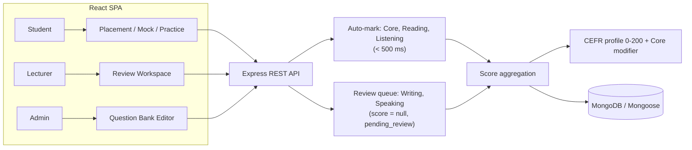
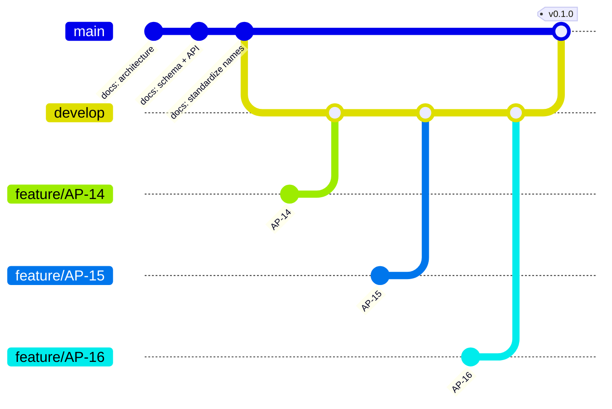

# APTIS GO

Goal-oriented Aptis ESOL preparation platform for university students working
toward the **CEFR B1/B2** certification required for trimester entry or
graduation.

APTIS GO combines instant auto-marking for receptive skills with lecturer rubric
review for productive skills, then resolves a CEFR profile using the official
Aptis 0–200 scale and the Core module as a borderline modifier.

> **Status: Sprint 2 — AG-102 persistence complete.**
> The repository now contains two decoupled applications: `client/` (React 19 +
> Vite 8 + TailwindCSS 4) and `server/` (Node.js + Express 5), gated by ESLint 10
> and Prettier 3. The API connects to MongoDB Atlas through a pooled Mongoose
> connection and ships the `User` model. Authentication routes, other models,
> and the domain UI arrive in the next tickets.

---

## Table of Contents

- [How it works](#how-it-works)
- [Official Aptis alignment](#official-aptis-alignment)
- [User roles](#user-roles)
- [Tech stack](#tech-stack)
- [Repository layout](#repository-layout)
- [Getting started](#getting-started)
- [Testing](#testing)
- [Branching model](#branching-model)
- [Documentation](#documentation)
- [Engineering rules](#engineering-rules)
- [Roadmap](#roadmap)

---

## How it works



- **Auto-marked:** Core (Grammar & Vocabulary), Reading, Listening.
- **Lecturer-marked:** Writing and Speaking; submissions start as
  `pending_review` and only receive a score after rubric evaluation.
- **Aggregation:** a final total is computed only when every skill has a
  non-null score.

## Official Aptis alignment

| Module    | Content                                          | Duration          | Scaled score               |
| --------- | ------------------------------------------------ | ----------------- | -------------------------- |
| Core      | Grammar 25 Qs + Vocabulary 25 Qs                 | 25 min            | 0–50 (borderline modifier) |
| Reading   | 4 parts                                          | 35 min            | 0–50                       |
| Listening | 4 parts                                          | 40 min            | 0–50                       |
| Writing   | 4 parts (form → noticeboard → chat → dual email) | 50 min            | 0–50                       |
| Speaking  | 4 parts (~12 min)                                | per-prompt timers | 0–50                       |

- The four skills total **0–200**. The Core score is **not** part of that total.
- **CEFR Borderline Modifier:** a Core score of **≥ 35/50** raises a skill
  sitting on a CEFR boundary (for example 36/50 at B1/B2) to the higher band.
- Question mechanics are typed: `mcq_single`, `dropdown_match`, `dropdown_cloze`,
  `sentence_order`, `short_fields`, `essay_text`, `audio_record`.
- Speaking timing is fixed per prompt (30 s / 45 s / 120 s; Part 4 adds 60 s
  preparation with the microphone disabled). Pause and backward navigation are
  not permitted.

## User roles

| Role         | Capabilities                                                                                                                    |
| ------------ | ------------------------------------------------------------------------------------------------------------------------------- |
| **Student**  | Diagnostic placement, certificate goal and deadline, daily study plan, mock exams, audio/text submissions, qualitative feedback |
| **Lecturer** | Pending review queue, audio streaming, essay review, rubric scoring, published feedback                                         |
| **Admin**    | User management, system analytics, question bank authoring with embedded question sub-documents                                 |

## Tech stack

**Implemented so far:**

- **Frontend (`client/`):** React 19.3, Vite 8.3, TailwindCSS 4.3 (CSS-first),
  ESLint 10 flat config, Prettier 3.
- **Backend (`server/`):** Node.js ≥ 20.19, Express 5.3, Helmet, CORS, dotenv,
  ESLint 10, Prettier 3.
- **Database:** MongoDB Atlas via Mongoose 9 with an explicit connection pool
  (max 10 / min 2, 5 s server selection, 30 s idle recycling), bcryptjs cost 12.
- **Tests:** Node.js built-in `node:test` — no test-framework dependency.

**Planned (see the SAD and ADS documents):**

- JWT auth routes, Multer uploads, React Query / Axios, MediaRecorder API.

## Repository layout

```text
.
├── client/                          # React SPA (ESM)
│   ├── src/App.jsx                  # Health-check landing view
│   ├── src/index.css                # TailwindCSS entry (@import + @theme)
│   ├── eslint.config.js             # Browser globals + React hooks rules
│   ├── vite.config.js               # React + Tailwind plugins, /api proxy
│   └── package.json
├── server/                          # Express API (CommonJS)
│   ├── src/app.js                   # Exported app: /api/health, 404, error handler
│   ├── src/server.js                # Connect DB, listen, graceful shutdown
│   ├── src/config/database.js       # Atlas URI + pool Contract
│   ├── src/models/User.js           # User schema, indexes, password hooks
│   ├── src/utils/password.js        # bcryptjs hash/verify (cost 12)
│   ├── eslint.config.js             # Node globals
│   └── package.json
├── contracts/
│   └── JayContract.js               # Shared Contract: enums, validators, CEFR scoring
├── design-log/
│   ├── #0001-aptis-format-alignment.md
│   ├── #0002-client-server-scaffold.md
│   └── #0003-mongodb-pool-user-schema.md
├── diagrams/                        # Exported architecture diagrams (PNG)
├── docx/                            # SRS, SAD, DDS, ADS, CSG, BRD, STP
├── prototype/
│   └── prototype.html               # Interactive clickable prototype
├── tests/
│   ├── aptis-contract.test.js       # Aptis domain Contract suite
│   ├── database.test.js             # Pool options + URI validation
│   ├── password.test.js             # bcrypt hashing Contract
│   ├── scaffold.test.js             # AG-101 structure + manifest Contract
│   ├── server-health.test.js        # /api/health and 404 Contract
│   ├── user-model.test.js           # User schema, indexes, redaction
│   └── user-repository.integration.test.js  # opt-in real MongoDB check
├── eslint.config.js                 # Root (Node) flat config
├── .prettierrc.json                 # Shared formatting
├── package.json                     # Root command delegation
└── README.md
```

## Getting started

### Prerequisites

- Node.js **20.19 or newer** (verified on v24.10.0)
- npm **10 or newer**
- Git

### Install

```bash
git clone <repository-url>
cd Final-Year-Project-AptisGo
npm run install:all
```

`install:all` installs the root tooling plus the independent `client/` and
`server/` dependency trees. Each app keeps its own lockfile.

### Configure the server environment

```bash
cp server/.env.example server/.env
```

Set `MONGODB_URI` in `server/.env` to your Atlas connection string:

```text
MONGODB_URI=mongodb+srv://<user>:<password>@<cluster>.mongodb.net/aptis-go?retryWrites=true&w=majority
```

The API **fails fast** (exit code 1) when `MONGODB_URI` is missing or does not
start with `mongodb://` / `mongodb+srv://`. Never commit `server/.env`; it is
already ignored. In Atlas, add your current IP under **Network Access**.

### Run both applications

```bash
# Terminal 1 — Express API on http://localhost:5000
npm run dev:server

# Terminal 2 — React SPA on http://localhost:5173
npm run dev:client
```

The Vite dev server proxies `/api` to `http://localhost:5000`, so the landing
page reports the live API status. The client reads `VITE_API_URL` only when you
need to bypass the proxy.

### Quality gates

```bash
npm test                        # unit, Contract, and scaffold tests
npm run lint                    # root, client, and server ESLint
npm run format:check            # Prettier verification
npm --prefix client run build   # production SPA build to client/dist
```

Expected test result (the integration test is skipped without a database):

```text
ℹ tests 31
ℹ pass 30
ℹ fail 0
ℹ skipped 1
```

Run the real-database check against Atlas or a local MongoDB:

```bash
# bash
MONGODB_TEST_URI="mongodb://127.0.0.1:27017/aptis-go-test" node --test tests/user-repository.integration.test.js

# PowerShell
$env:MONGODB_TEST_URI="mongodb://127.0.0.1:27017/aptis-go-test"; node --test tests/user-repository.integration.test.js
```

> Quote the glob. On some shells `tests/*.test.js` is expanded before Node sees
> it; passing the pattern to Node keeps the command portable.

### Open the prototype

```bash
# Windows
start prototype/prototype.html

# macOS
open prototype/prototype.html
```

There is no server build step: Express runs directly on Node. The client is
built with Vite for production.

## Testing

| Suite            | Command                                                                      | Scope                                                                                                                    |
| ---------------- | ---------------------------------------------------------------------------- | ------------------------------------------------------------------------------------------------------------------------ |
| Contract         | `node --test "tests/*.test.js"`                                              | Core scaling, CEFR borderline elevation, question validation, writing word limits, speaking timers, listening play limit |
| Scaffold         | `node --test "tests/*.test.js"`                                              | Client/server paths, manifest scripts and engines, flat ESLint configs, Prettier Contract                                |
| Server health    | `node --test "tests/*.test.js"`                                              | `GET /api/health` response Contract, 404 Contract, hidden Express fingerprint                                            |
| Database         | `node --test "tests/*.test.js"`                                              | Pool defaults and bounds, URI scheme rejection, safe disconnect                                                          |
| User schema      | `node --test "tests/*.test.js"`                                              | Required fields, email normalization, enums, indexes, password hashing, JSON redaction                                   |
| Mongo round-trip | `MONGODB_TEST_URI=... node --test tests/user-repository.integration.test.js` | Real MongoDB save, bcrypt hash, `UNTESTED` default, duplicate-email rejection                                            |

TDD is mandatory: write the failing test first, confirm the failure, implement,
then re-run. Do not weaken a test to make a suite pass.

## Branching model

Git Flow with short-lived feature branches named after the ticket
(`feature/AP-<id>`), integrated into `develop`, and released to `main` with a
version tag.



| Branch            | Purpose                                                           |
| ----------------- | ----------------------------------------------------------------- |
| `main`            | Released, tagged history only (`v0.1.0` for Sprint 1)             |
| `develop`         | Integration branch for the next release                           |
| `feature/AP-<id>` | One ticket, branched from `develop`, merged back via pull request |

## Documentation

| File                                           | Contents                                         |
| ---------------------------------------------- | ------------------------------------------------ |
| `docx/01_SRS_Project_Overview.md`              | Scope, roles, KPIs                               |
| `docx/02_SAD_System_Architecture.md`           | C4 views, containers, components                 |
| `docx/03_DDS_Database_Schema.md`               | Mongoose schemas                                 |
| `docx/04_ADS_API_Specification.md.md`          | REST endpoints                                   |
| `docx/05_CSG_Coding_Standards.md`              | Security and coding directives                   |
| `docx/06_BRD_MoSCoW_and_User_Stories.md.md`    | Requirements and user stories                    |
| `docx/07_STP_Test_Plan_and_RTM.md`             | Test plan and traceability matrix                |
| `design-log/#0001-aptis-format-alignment.md`   | Aptis format and scoring decisions               |
| `design-log/#0002-client-server-scaffold.md`   | AG-101 scaffold, lint, and format decisions      |
| `design-log/#0003-mongodb-pool-user-schema.md` | AG-102 pool, User schema, and password decisions |

## Engineering rules

1. **Design log first.** Every substantive change starts as
   `design-log/#<number>-<title>.md` with Background, Problem, Q&A, Design,
   Implementation Plan, Examples, and Trade-offs. Append **Implementation
   Results** afterwards, including deviations.
2. **TDD.** Test first, then implementation.
3. **Strict terminology.** `ViewState`, `Contract`, and `JayContract` are the
   only accepted names for those concepts.
4. **Exact specifications.** Cite the file path, type signature, and validation
   rules for every change.
5. **Examples** use ✅ for correct and ❌ for incorrect.

## Roadmap

- [x] Sprint 1 — Aptis format alignment, Contract, prototype, Contract tests (v0.1.0)
- [x] AG-101 — Decoupled client/server scaffold with ESLint and Prettier
- [x] AG-102 — MongoDB Atlas pool and `User` schema
- [ ] Sprint 2 — Express API and Mongoose models per ADS/DDS
- [ ] Sprint 3 — Student SPA: placement, goals, study plan
- [ ] Sprint 4 — Lecturer workspace and hybrid grading pipeline
- [ ] Sprint 5 — Admin question bank and analytics, UAT
