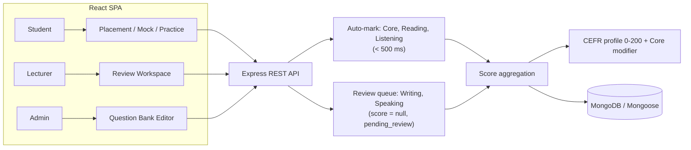
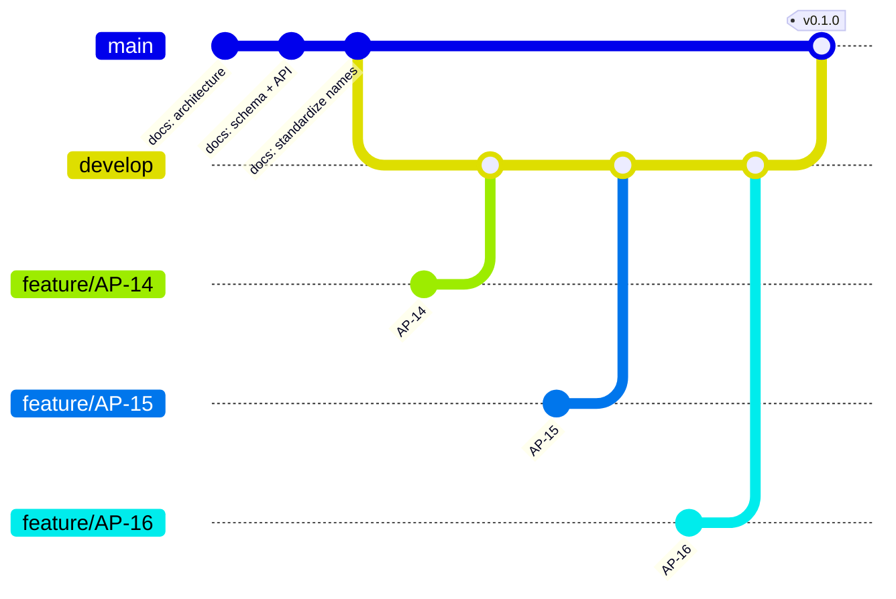

# APTIS GO

Goal-oriented Aptis ESOL preparation platform for university students working
toward the **CEFR B1/B2** certification required for trimester entry or
graduation.

APTIS GO combines instant auto-marking for receptive skills with lecturer rubric
review for productive skills, then resolves a CEFR profile using the official
Aptis 0–200 scale and the Core module as a borderline modifier.

> **Status: Sprint 2 - AG-106 authentication portal complete.**
> The repository now contains two decoupled applications: `client/` (React 19 +
> Vite 8 + TailwindCSS 4) and `server/` (Node.js + Express 5), gated by ESLint 10
> and Prettier 3. The API connects to MongoDB Atlas through a pooled Mongoose
> connection, ships the `User` model, issues stateless HS256 JWTs from
> `POST /api/auth/register` and `POST /api/auth/login`, exposes `verifyToken`
> plus role guards, sanitizes MongoDB operator keys, and centralizes error
> responses. The public authentication portal now serves `/login` and
> `/register` with role-aware sign-in, Greenwich institutional-email
> validation, and a mandatory GDPR consent gate. Protected domain routes, the
> remaining models, and the domain workspace arrive next.

---

## Table of Contents

- [How it works](#how-it-works)
- [Official Aptis alignment](#official-aptis-alignment)
- [User roles](#user-roles)
- [Authentication API](#authentication-api)
- [Tech stack](#tech-stack)
- [Repository layout](#repository-layout)
- [Getting started](#getting-started)
- [Testing](#testing)
- [Branching model](#branching-model)
- [Documentation](#documentation)
- [Engineering rules](#engineering-rules)
- [Roadmap](#roadmap)

---

## How it works



- **Auto-marked:** Core (Grammar & Vocabulary), Reading, Listening.
- **Lecturer-marked:** Writing and Speaking; submissions start as
  `pending_review` and only receive a score after rubric evaluation.
- **Aggregation:** a final total is computed only when every skill has a
  non-null score.

## Official Aptis alignment

| Module    | Content                                          | Duration          | Scaled score               |
| --------- | ------------------------------------------------ | ----------------- | -------------------------- |
| Core      | Grammar 25 Qs + Vocabulary 25 Qs                 | 25 min            | 0–50 (borderline modifier) |
| Reading   | 4 parts                                          | 35 min            | 0–50                       |
| Listening | 4 parts                                          | 40 min            | 0–50                       |
| Writing   | 4 parts (form → noticeboard → chat → dual email) | 50 min            | 0–50                       |
| Speaking  | 4 parts (~12 min)                                | per-prompt timers | 0–50                       |

- The four skills total **0–200**. The Core score is **not** part of that total.
- **CEFR Borderline Modifier:** a Core score of **≥ 35/50** raises a skill
  sitting on a CEFR boundary (for example 36/50 at B1/B2) to the higher band.
- Question mechanics are typed: `mcq_single`, `dropdown_match`, `dropdown_cloze`,
  `sentence_order`, `short_fields`, `essay_text`, `audio_record`.
- Speaking timing is fixed per prompt (30 s / 45 s / 120 s; Part 4 adds 60 s
  preparation with the microphone disabled). Pause and backward navigation are
  not permitted.

## User roles

| Role         | Capabilities                                                                                                                    |
| ------------ | ------------------------------------------------------------------------------------------------------------------------------- |
| **Student**  | Diagnostic placement, certificate goal and deadline, daily study plan, mock exams, audio/text submissions, qualitative feedback |
| **Lecturer** | Pending review queue, audio streaming, essay review, rubric scoring, published feedback                                         |
| **Admin**    | User management, system analytics, question bank authoring with embedded question sub-documents                                 |

## Authentication API

| Method | Path                 | Access | Success                          |
| ------ | -------------------- | ------ | -------------------------------- |
| `POST` | `/api/auth/register` | Public | `201 { token, tokenType, user }` |
| `POST` | `/api/auth/login`    | Public | `200 { token, tokenType, user }` |

```bash
curl -X POST http://localhost:5000/api/auth/register \
  -H "Content-Type: application/json" \
  -d '{"name":"Amina Yusuf","email":"amina@university.edu","password":"Placement2026!"}'

curl -X POST http://localhost:5000/api/auth/login \
  -H "Content-Type: application/json" \
  -d '{"email":"amina@university.edu","password":"Placement2026!"}'
```

Registration always creates `role: "student"` and `currentLevel: "UNTESTED"`;
`role` and `currentLevel` in the body are ignored. Passwords are hashed with
bcrypt cost 12 and never returned. Tokens are HS256, expire after `1h`
(`JWT_EXPIRES_IN`), and carry `sub`, `role`, `iss: aptis-go-api`,
`aud: aptis-go-client`. Future protected endpoints expect:

```http
Authorization: Bearer <token>
```

Failure Contracts: `400 Validation failed` with `details[]`, `409 Email is
already registered`, and `401 Invalid email or password` for both unknown email
and wrong password.

### Protecting routes

```javascript
const router = require('express').Router();
const { verifyToken, authorizeRoles } = require('../middleware/authMiddleware');

router.get('/profile', verifyToken, (request, response) => {
  response.json({ user: request.user });
});

router.get('/admin', verifyToken, authorizeRoles('admin'), handler);
```

`verifyToken` accepts `Authorization: Bearer <token>`, verifies signature,
issuer, audience, expiry, and claims, then attaches
`request.user = { id, role }`. It returns `401` for a missing, malformed,
invalid, or expired token.

`authorizeRoles(...)` must be mounted **after** `verifyToken`. It returns `403
Forbidden` when the token is valid but the role is not allowed, and `401` when
no identity has been attached. Role names are validated at wiring time, so a
typo crashes on startup instead of silently blocking every request.

✅ `verifyToken, authorizeRoles('lecturer', 'admin')`

❌ `authorizeRoles('admin'), verifyToken`

## Security and errors

`express-mongo-sanitize` runs after `express.json()` and before routes. It
rewrites MongoDB operator keys in bodies and query strings:

| Input key      | Sanitized key  |
| -------------- | -------------- |
| `$gt`          | `_gt`          |
| `$where`       | `_where`       |
| `profile.name` | `profile_name` |
| `filter.$gt`   | `filter_$gt`   |

The adapter in `server/src/middleware/mongoSanitize.js` makes the package work
with Express 5, where `request.query` is getter-only.

The centralized handler in `server/src/middleware/errorHandler.js` returns:

| Error               | Status | Body                                             |
| ------------------- | ------ | ------------------------------------------------ |
| Malformed JSON      | `400`  | `{ error: "Invalid JSON payload" }`              |
| Body over 1 MB      | `413`  | `{ error: "Payload too large" }`                 |
| Mongoose validation | `400`  | `{ error: "Validation failed", details: [...] }` |
| Invalid Mongoose id | `400`  | `{ error: "Invalid identifier" }`                |
| Duplicate key       | `409`  | `{ error: "Resource already exists" }`           |
| Unknown failure     | `500`  | `{ error: "Internal Server Error" }`             |

Unknown 5xx details are logged server-side and never returned to the client.

## Tech stack

**Implemented so far:**

- **Frontend (`client/`):** React 19.3, React Router 7, Vite 8.3, TailwindCSS 4.3 (CSS-first),
  ESLint 10 flat config, Prettier 3.
- **Backend (`server/`):** Node.js ≥ 20.19, Express 5.3, Helmet, CORS, dotenv,
  jsonwebtoken 9 (HS256), bcryptjs cost 12, express-mongo-sanitize 2.2, ESLint
  10, Prettier 3.
- **Database:** MongoDB Atlas via Mongoose 9 with an explicit connection pool
  (max 10 / min 2, 5 s server selection, 30 s idle recycling).
- **Tests:** Node.js built-in `node:test` for the API, plus Vitest 5, jsdom 29, and Testing Library for the React portal.

**Planned (see the SAD and ADS documents):**

- Multer uploads, React Query / Axios, MediaRecorder API, protected domain
  routes.

## Repository layout

```text
.
├── client/                          # React SPA (ESM)
│   ├── src/App.jsx                  # Router: /login, /register, session gate
│   ├── src/index.css                # TailwindCSS entry (@import + @theme)
│   ├── eslint.config.js             # Browser globals + React hooks rules
│   ├── vite.config.js               # React + Tailwind plugins, /api proxy
│   └── package.json
├── server/                          # Express API (CommonJS)
│   ├── src/app.js                   # Exported app: health, auth, 404, errors
│   ├── src/server.js                # Validate config, connect DB, listen
│   ├── src/config/auth.js           # JWT secret/issuer/audience Contract
│   ├── src/config/database.js       # Atlas URI + pool Contract
│   ├── src/controllers/authController.js  # register, login
│   ├── src/middleware/authMiddleware.js   # verifyToken, authorizeRoles
│   ├── src/middleware/errorHandler.js     # 404 + centralized error mapping
│   ├── src/middleware/mongoSanitize.js    # Express 5 adapter for sanitization
│   ├── src/models/User.js           # User schema, indexes, password hooks
│   ├── src/routes/authRoutes.js     # /api/auth router
│   ├── src/utils/jwt.js             # sign/verify HS256 access tokens
│   ├── src/utils/password.js        # bcryptjs hash/verify (cost 12)
│   ├── src/validators/authValidator.js    # pure input validation
│   ├── eslint.config.js             # Node globals
│   └── package.json
├── contracts/
│   └── JayContract.js               # Shared Contract: enums, validators, CEFR scoring
├── design-log/
│   ├── #0001-aptis-format-alignment.md
│   ├── #0002-client-server-scaffold.md
│   ├── #0003-mongodb-pool-user-schema.md
│   ├── #0004-auth-controller-jwt.md
│   ├── #0005-rbac-middleware.md
│   └── #0006-nosql-sanitization-error-handler.md
├── diagrams/                        # Exported architecture diagrams (PNG)
├── docx/                            # SRS, SAD, DDS, ADS, CSG, BRD, STP
├── prototype/
│   └── prototype.html               # Interactive clickable prototype
├── tests/
│   ├── aptis-contract.test.js       # Aptis domain Contract suite
│   ├── auth-middleware.test.js      # verifyToken + authorizeRoles Contract
│   ├── auth-routes.test.js          # /api/auth 400 Contract without a DB
│   ├── auth-validator.test.js       # register/login validation matrix
│   ├── auth.integration.test.js     # opt-in register/login round-trip
│   ├── database.test.js             # Pool options + URI validation
│   ├── error-handler.test.js        # centralized error Contract
│   ├── jwt.test.js                  # claims, expiry, tamper rejection
│   ├── mongo-sanitize.test.js       # NoSQL key sanitization + Express 5 adapter
│   ├── password.test.js             # bcrypt hashing Contract
│   ├── scaffold.test.js             # AG-101 structure + manifest Contract
│   ├── server-health.test.js        # /api/health and 404 Contract
│   ├── user-model.test.js           # User schema, indexes, redaction
│   └── user-repository.integration.test.js  # opt-in real MongoDB check
├── eslint.config.js                 # Root (Node) flat config
├── .prettierrc.json                 # Shared formatting
├── package.json                     # Root command delegation
└── README.md
```

Frontend test files:

- `tests/auth-validation.test.jsx` — validation Contract
- `tests/auth-portal.test.jsx` — route, role, API, session, and consent behaviour
- `tests/setup.js` — Testing Library cleanup and matchers
- `vitest.config.mjs` — jsdom, React dedupe, and `tests/**/*.test.jsx` discovery

Auth portal modules:

- `client/src/auth/authValidation.js` — institutional domain, password, student ID, and consent rules
- `client/src/auth/api.js` — `/api/auth` fetch wrapper and `ApiError`
- `client/src/auth/authStorage.js` — tab-scoped session persistence
- `client/src/auth/AuthLayout.jsx`, `RoleSelector.jsx`, `FormField.jsx`, `PasswordField.jsx`, `ConsentField.jsx`, `AuthAlert.jsx`
- `client/src/pages/LoginPage.jsx`, `RegisterPage.jsx`, `SessionPage.jsx`

## Getting started

### Prerequisites

- Node.js **20.19 or newer** (verified on v24.10.0)
- npm **10 or newer**
- Git

### Install

```bash
git clone <repository-url>
cd Final-Year-Project-AptisGo
npm run install:all
```

`install:all` installs the root tooling plus the independent `client/` and
`server/` dependency trees. Each app keeps its own lockfile.

### Configure the server environment

```bash
cp server/.env.example server/.env
```

Set `MONGODB_URI` in `server/.env` to your Atlas connection string:

```text
MONGODB_URI=mongodb+srv://<user>:<password>@<cluster>.mongodb.net/aptis-go?retryWrites=true&w=majority
```

The API **fails fast** (exit code 1) when `MONGODB_URI` is missing or does not
start with `mongodb://` / `mongodb+srv://`. Never commit `server/.env`; it is
already ignored. In Atlas, add your current IP under **Network Access**.

Set a JWT signing secret of at least 32 characters:

```bash
node -e "console.log(require('crypto').randomBytes(48).toString('base64url'))"
```

```text
JWT_SECRET=<paste-the-generated-value>
JWT_EXPIRES_IN=1h
```

The API also **fails fast** when `JWT_SECRET` is missing or shorter than 32
characters.

### Run both applications

```bash
# Terminal 1 — Express API on http://localhost:5000
npm run dev:server

# Terminal 2 — React SPA on http://localhost:5173
npm run dev:client
```

The Vite dev server proxies `/api` to `http://localhost:5000`. Open
`http://localhost:5173/login` or `http://localhost:5173/register` to use the
authentication portal. The client reads `VITE_API_URL` only when you need to
bypass the proxy. `VITE_INSTITUTIONAL_EMAIL_DOMAINS` controls the accepted
institutional domains and defaults to `greenwich.edu.vn`.

### Quality gates

```bash
npm test                        # API unit, Contract, and scaffold tests
npm run test:ui                 # React auth-portal tests (Vitest + jsdom)
npm run lint                    # root, client, and server ESLint
npm run format:check            # Prettier verification
npm --prefix client run build   # production SPA build to client/dist
```

Expected test result (both integration tests are skipped without a database):

```text
ℹ tests 85
ℹ pass 83
ℹ fail 0
ℹ skipped 2
```

Expected UI result:

```text
ℹ tests 26
ℹ pass 26
ℹ fail 0
```

With `MONGODB_TEST_URI` set (local MongoDB or Atlas), the same command reports
**85 passed, 0 failed, 0 skipped**. Run the real-database check against Atlas or
a local MongoDB:

```bash
# bash
MONGODB_TEST_URI="mongodb://127.0.0.1:27017/aptis-go-test" node --test tests/user-repository.integration.test.js

# PowerShell
$env:MONGODB_TEST_URI="mongodb://127.0.0.1:27017/aptis-go-test"; node --test tests/user-repository.integration.test.js
```

> Quote the glob. On some shells `tests/*.test.js` is expanded before Node sees
> it; passing the pattern to Node keeps the command portable.

### Open the prototype

```bash
# Windows
start prototype/prototype.html

# macOS
open prototype/prototype.html
```

There is no server build step: Express runs directly on Node. The client is
built with Vite for production.

## Testing

| Suite            | Command                                                                      | Scope                                                                                                                    |
| ---------------- | ---------------------------------------------------------------------------- | ------------------------------------------------------------------------------------------------------------------------ |
| Contract         | `node --test "tests/*.test.js"`                                              | Core scaling, CEFR borderline elevation, question validation, writing word limits, speaking timers, listening play limit |
| Scaffold         | `node --test "tests/*.test.js"`                                              | Client/server paths, manifest scripts and engines, flat ESLint configs, Prettier Contract                                |
| Server health    | `node --test "tests/*.test.js"`                                              | `GET /api/health` response Contract, 404 Contract, hidden Express fingerprint                                            |
| Database         | `node --test "tests/*.test.js"`                                              | Pool defaults and bounds, URI scheme rejection, safe disconnect                                                          |
| User schema      | `node --test "tests/*.test.js"`                                              | Required fields, email normalization, enums, indexes, password hashing, JSON redaction                                   |
| Auth validator   | `node --test "tests/*.test.js"`                                              | Register/login normalization, bounds, forced server fields                                                               |
| JWT              | `node --test "tests/*.test.js"`                                              | Claims, expiry, tamper/wrong-secret rejection, secret strength                                                           |
| Auth routes      | `node --test "tests/*.test.js"`                                              | 400 Contracts for register/login without a database                                                                      |
| RBAC middleware  | `node --test "tests/*.test.js"`                                              | Bearer parsing, invalid/expired tokens, role allow/deny, 401/403 Contracts, config errors                                |
| NoSQL sanitizer  | `node --test "tests/*.test.js"`                                              | Operator/dotted-key rewriting, nested body data, Express 5 compatibility, ordinary requests                              |
| Error handler    | `node --test "tests/*.test.js"`                                              | JSON parse, payload limit, validation, cast, duplicate key, generic 500, headersSent, 404 Contract                       |
| Auth validation  | `npm run test:ui`                                                            | Institutional domain, password/student-ID bounds, role and consent rules                                                 |
| Auth portal      | `npm run test:ui`                                                            | `/login`, `/register`, role mismatch, API calls, session save, redirects, sign out                                       |
| Auth round-trip  | `MONGODB_TEST_URI=... node --test tests/auth.integration.test.js`            | Register 201, role forcing, bcrypt, duplicate 409, login 200/401, token claims                                           |
| Mongo round-trip | `MONGODB_TEST_URI=... node --test tests/user-repository.integration.test.js` | Real MongoDB save, bcrypt hash, `UNTESTED` default, duplicate-email rejection                                            |

TDD is mandatory: write the failing test first, confirm the failure, implement,
then re-run. Do not weaken a test to make a suite pass.

## Branching model

Git Flow with short-lived feature branches named after the ticket
(`feature/AP-<id>`), integrated into `develop`, and released to `main` with a
version tag.



| Branch            | Purpose                                                           |
| ----------------- | ----------------------------------------------------------------- |
| `main`            | Released, tagged history only (`v0.1.0` for Sprint 1)             |
| `develop`         | Integration branch for the next release                           |
| `feature/AP-<id>` | One ticket, branched from `develop`, merged back via pull request |

## Documentation

| File                                                   | Contents                                         |
| ------------------------------------------------------ | ------------------------------------------------ |
| `docx/01_SRS_Project_Overview.md`                      | Scope, roles, KPIs                               |
| `docx/02_SAD_System_Architecture.md`                   | C4 views, containers, components                 |
| `docx/03_DDS_Database_Schema.md`                       | Mongoose schemas                                 |
| `docx/04_ADS_API_Specification.md.md`                  | REST endpoints                                   |
| `docx/05_CSG_Coding_Standards.md`                      | Security and coding directives                   |
| `docx/06_BRD_MoSCoW_and_User_Stories.md.md`            | Requirements and user stories                    |
| `docx/07_STP_Test_Plan_and_RTM.md`                     | Test plan and traceability matrix                |
| `design-log/#0001-aptis-format-alignment.md`           | Aptis format and scoring decisions               |
| `design-log/#0002-client-server-scaffold.md`           | AG-101 scaffold, lint, and format decisions      |
| `design-log/#0003-mongodb-pool-user-schema.md`         | AG-102 pool, User schema, and password decisions |
| `design-log/#0004-auth-controller-jwt.md`              | AG-103 register/login and JWT decisions          |
| `design-log/#0005-rbac-middleware.md`                  | AG-104 verifyToken and role-guard decisions      |
| `design-log/#0006-nosql-sanitization-error-handler.md` | AG-105 sanitization and error Contract           |
| `design-log/#0007-authentication-portal.md`            | AG-106 auth portal, role, email, and consent     |

## Engineering rules

1. **Design log first.** Every substantive change starts as
   `design-log/#<number>-<title>.md` with Background, Problem, Q&A, Design,
   Implementation Plan, Examples, and Trade-offs. Append **Implementation
   Results** afterwards, including deviations.
2. **TDD.** Test first, then implementation.
3. **Strict terminology.** `ViewState`, `Contract`, and `JayContract` are the
   only accepted names for those concepts.
4. **Exact specifications.** Cite the file path, type signature, and validation
   rules for every change.
5. **Examples** use ✅ for correct and ❌ for incorrect.

## Roadmap

- [x] Sprint 1 — Aptis format alignment, Contract, prototype, Contract tests (v0.1.0)
- [x] AG-101 — Decoupled client/server scaffold with ESLint and Prettier
- [x] AG-102 — MongoDB Atlas pool and `User` schema
- [x] AG-103 — Register/login with bcrypt and stateless JWT
- [x] AG-104 — JWT verification and role-based access guards
- [x] AG-105 — NoSQL sanitization and centralized error handling
- [x] AG-106 — Authentication portal (`/login`, `/register`)
- [ ] Sprint 2 — Express API and Mongoose models per ADS/DDS
- [ ] Sprint 3 — Student SPA: placement, goals, study plan
- [ ] Sprint 4 — Lecturer workspace and hybrid grading pipeline
- [ ] Sprint 5 — Admin question bank and analytics, UAT
