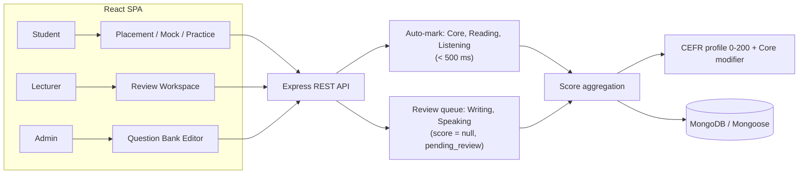
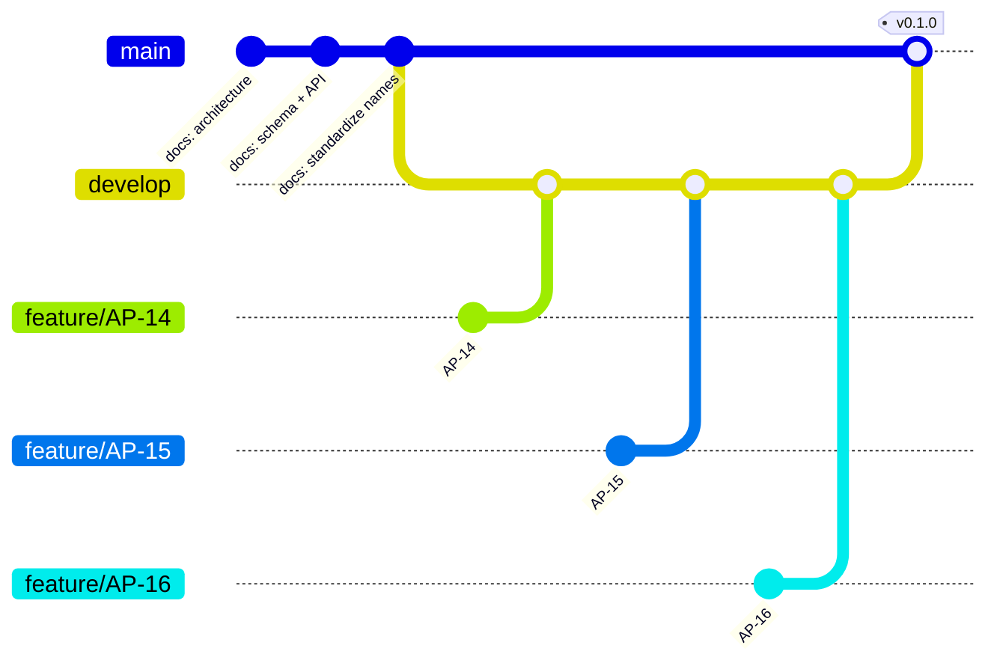

# APTIS GO

Goal-oriented Aptis ESOL preparation platform for university students working
toward the **CEFR B1/B2** certification required for trimester entry or
graduation.

APTIS GO combines instant auto-marking for receptive skills with lecturer rubric
review for productive skills, then resolves a CEFR profile using the official
Aptis 0–200 scale and the Core module as a borderline modifier.

> **Status: Sprint 3 - AG-306 listening audio player complete.**
> The repository now contains two decoupled applications: `client/` (React 19 +
> Vite 8 + TailwindCSS 4) and `server/` (Node.js + Express 5), gated by ESLint 10
> and Prettier 3. The API connects to MongoDB Atlas through a pooled Mongoose
> connection, ships the `User` model, embeds `Question` sub-documents inside the
> `Test` schema for data locality, and adds one-goal-per-student `Goal` records
> plus `StudyPlan` documents with embedded `dailyTasks`. The new
> `GET /api/tests/placement` endpoint serves the newest published diagnostic to
> students in one indexed MongoDB read, with hidden assessment answers and a
> <500 ms integration check. `GET /api/tests/:id` serves any published test by
> id through the same answer-free question projection. The new
> `POST /api/submissions` endpoint marks Core, Reading, and Listening
> deterministically against the stored answer keys, stores the per-question
> `details` and per-skill 0-50 scores, and routes Writing/Speaking attempts to
> `pending_review`. The diagnostic evaluator validates 0-50 skill
> scores, reuses the JayContract CEFR profile, and persists the resulting
> `User.currentLevel`. The new `POST /api/goals` endpoint rejects past
> deadlines, calculates remaining days, upserts the student goal, and
> regenerates one `StudyPlan` per day with a rotating skill-part task template,
> and `PATCH /api/study-plans/tasks/:id` sets an embedded task's completion flag
> and returns recalculated plan and roadmap progress. `GET /api/study-plans/today`
> resolves the current UTC day of that roadmap and returns the day's tasks with
> derived day and roadmap progress. The student SPA now serves `/placement` (a
> question-by-question diagnostic runner), `/goals` (B1/B2 target, deadline
> picker, and cadence preview), `/dashboard` (today's checklist and progress
> bars), and `/tests/:id` (a timed mock exam runner with a question palette, a
> listening player capped at two plays per track, a countdown, automatic
> submission at zero, and the server's marked summary), driven by explicit
> `PlacementViewState`, `GoalViewState`, `DashboardViewState`, and
> `ExamViewState` objects. The new `Submission` model
> stores one document
> per attempt: a `details` array of per-question evaluations, `autoScore`,
> `manualScore`, and `totalScore`, plus an
> `in_progress | pending_review | completed` status. Subjective scores stay
> `null` until lecturer review, and `totalScore` stays `null` until every score
> exists. Core is reported separately because the official 200-point aggregate
> covers only Reading, Listening, Writing, and Speaking.
> The API issues stateless HS256 JWTs from
> `POST /api/auth/register` and `POST /api/auth/login`, exposes `verifyToken` plus
> role guards, sanitizes MongoDB operator keys, and centralizes error responses.
> The public authentication portal now serves `/login` and `/register` with
> role-aware sign-in, any-email validation with an optional `@fpt.edu.vn`
> suggestion, and a mandatory GDPR consent gate. A React `AuthContext` restores
> the tab session, Axios attaches the JWT to API requests, and role-specific
> `/student`, `/lecturer`, and `/admin` workspaces are protected by
> `ProtectedRoute`. Jest controller tests and a runnable Postman collection now
> cover TC01–TC03. `questions.correctAnswer` and
> `questions.dropdownSets.correctAnswer` use `select: false`, so default reads
> omit assessment answers. Submission routes, the marking pipeline, and the
> domain workspace arrive next.

---

## Table of Contents

- [How it works](#how-it-works)
- [Official Aptis alignment](#official-aptis-alignment)
- [User roles](#user-roles)
- [Authentication API](#authentication-api)
- [Placement API](#placement-api)
- [Test detail API](#test-detail-api)
- [Submission API](#submission-api)
- [Diagnostic evaluation](#diagnostic-evaluation)
- [Goal API](#goal-api)
- [Study plan API](#study-plan-api)
- [Student screens](#student-screens)
- [Tech stack](#tech-stack)
- [Repository layout](#repository-layout)
- [Getting started](#getting-started)
- [Testing](#testing)
- [Branching model](#branching-model)
- [Documentation](#documentation)
- [Engineering rules](#engineering-rules)
- [Roadmap](#roadmap)

---

## How it works



- **Auto-marked:** Core (Grammar & Vocabulary), Reading, Listening.
- **Lecturer-marked:** Writing and Speaking; submissions start as
  `pending_review` and only receive a score after rubric evaluation.
- **Aggregation:** a final total is computed only when every skill has a
  non-null score.

## Official Aptis alignment

| Module    | Content                                          | Duration          | Scaled score               |
| --------- | ------------------------------------------------ | ----------------- | -------------------------- |
| Core      | Grammar 25 Qs + Vocabulary 25 Qs                 | 25 min            | 0–50 (borderline modifier) |
| Reading   | 4 parts                                          | 35 min            | 0–50                       |
| Listening | 4 parts                                          | 40 min            | 0–50                       |
| Writing   | 4 parts (form → noticeboard → chat → dual email) | 50 min            | 0–50                       |
| Speaking  | 4 parts (~12 min)                                | per-prompt timers | 0–50                       |

- The four skills total **0–200**. The Core score is **not** part of that total.
- **CEFR Borderline Modifier:** a Core score of **≥ 35/50** raises a skill
  sitting on a CEFR boundary (for example 36/50 at B1/B2) to the higher band.
- Question mechanics are typed: `mcq_single`, `dropdown_match`, `dropdown_cloze`,
  `sentence_order`, `short_fields`, `essay_text`, `audio_record`.
- Speaking timing is fixed per prompt (30 s / 45 s / 120 s; Part 4 adds 60 s
  preparation with the microphone disabled). Pause and backward navigation are
  not permitted.

## User roles

| Role         | Capabilities                                                                                                                    |
| ------------ | ------------------------------------------------------------------------------------------------------------------------------- |
| **Student**  | Diagnostic placement, certificate goal and deadline, daily study plan, mock exams, audio/text submissions, qualitative feedback |
| **Lecturer** | Pending review queue, audio streaming, essay review, rubric scoring, published feedback                                         |
| **Admin**    | User management, system analytics, question bank authoring with embedded question sub-documents                                 |

## Authentication API

| Method | Path                 | Access | Success                          |
| ------ | -------------------- | ------ | -------------------------------- |
| `POST` | `/api/auth/register` | Public | `201 { token, tokenType, user }` |
| `POST` | `/api/auth/login`    | Public | `200 { token, tokenType, user }` |

```bash
curl -X POST http://localhost:5000/api/auth/register \
  -H "Content-Type: application/json" \
  -d '{"name":"Amina Yusuf","email":"amina@university.edu","password":"Placement2026!"}'

curl -X POST http://localhost:5000/api/auth/login \
  -H "Content-Type: application/json" \
  -d '{"email":"amina@university.edu","password":"Placement2026!"}'
```

Registration always creates `role: "student"` and `currentLevel: "UNTESTED"`;
`role` and `currentLevel` in the body are ignored. Passwords are hashed with
bcrypt cost 12 and never returned. Tokens are HS256, expire after `1h`
(`JWT_EXPIRES_IN`), and carry `sub`, `role`, `iss: aptis-go-api`,
`aud: aptis-go-client`. Future protected endpoints expect:

```http
Authorization: Bearer <token>
```

Failure Contracts: `400 Validation failed` with `details[]`, `409 Email is
already registered`, and `401 Invalid email or password` for both unknown email
and wrong password.

### Protecting routes

```javascript
const router = require('express').Router();
const { verifyToken, authorizeRoles } = require('../middleware/authMiddleware');

router.get('/profile', verifyToken, (request, response) => {
  response.json({ user: request.user });
});

router.get('/admin', verifyToken, authorizeRoles('admin'), handler);
```

`verifyToken` accepts `Authorization: Bearer <token>`, verifies signature,
issuer, audience, expiry, and claims, then attaches
`request.user = { id, role }`. It returns `401` for a missing, malformed,
invalid, or expired token.

`authorizeRoles(...)` must be mounted **after** `verifyToken`. It returns `403
Forbidden` when the token is valid but the role is not allowed, and `401` when
no identity has been attached. Role names are validated at wiring time, so a
typo crashes on startup instead of silently blocking every request.

✅ `verifyToken, authorizeRoles('lecturer', 'admin')`

❌ `authorizeRoles('admin'), verifyToken`

### Client session and route guards

`AuthProvider` owns the in-memory session and restores it from `sessionStorage`
under `aptis-go.auth`. The Axios request interceptor reads the token through
`getAccessToken()` and sends `Authorization: Bearer <token>` on every request.
A `401` response clears the stored session, emits
`aptis-go:auth-unauthorized`, and the provider resets its state so the guard
returns the user to `/login`.

| Client route    | Guard                                        |
| --------------- | -------------------------------------------- |
| `/`             | `RoleHomeRedirect` → role workspace or login |
| `/login`        | Public; authenticated users go to `/`        |
| `/register`     | Public; authenticated users go to `/`        |
| `/student`      | `ProtectedRoute allowedRoles={['student']}`  |
| `/placement`    | `ProtectedRoute allowedRoles={['student']}`  |
| `/goals`        | `ProtectedRoute allowedRoles={['student']}`  |
| `/dashboard`    | `ProtectedRoute allowedRoles={['student']}`  |
| `/tests/:id`    | `ProtectedRoute allowedRoles={['student']}`  |
| `/lecturer`     | `ProtectedRoute allowedRoles={['lecturer']}` |
| `/admin`        | `ProtectedRoute allowedRoles={['admin']}`    |
| `/unauthorized` | Explains a role mismatch without logging out |
| `*`             | Redirects to `/login`                        |

A role mismatch is rejected before the session is saved. Client guards are a
navigation aid only; the Express API remains the authorization boundary, so
protected server routes still need `verifyToken` and `authorizeRoles`.

✅ Student token opens `/student`; `/lecturer` redirects to `/unauthorized`.

❌ Hiding `/admin` in React without `authorizeRoles('admin')` on the API route.

## Placement API

| Method | Path                   | Access      | Success                             |
| ------ | ---------------------- | ----------- | ----------------------------------- |
| `GET`  | `/api/tests/placement` | Student JWT | `200` placement test with questions |

The endpoint returns the newest published diagnostic (`type: "diagnostic"`,
`isPublished: true`) and all embedded questions. It uses one
`Test.findOne(...).sort(...).lean()` read and the compound
`{ type: 1, isPublished: 1, createdAt: -1 }` index. Lecturers and admins receive
`403`; missing or invalid tokens receive `401`.

```bash
curl http://localhost:5000/api/tests/placement \
  -H "Authorization: Bearer <student-token>"
```

```json
{
  "id": "665f...",
  "title": "Placement Diagnostic",
  "description": "Baseline CEFR placement",
  "targetCefr": "B2",
  "skillModules": ["core", "reading"],
  "durationMinutes": 25,
  "questionCount": 2,
  "questions": [
    {
      "id": "665f...",
      "skill": "core",
      "part": 1,
      "questionType": "mcq_single",
      "prompt": "Choose the correct option.",
      "options": ["am", "is", "are"]
    }
  ]
}
```

`questions[].correctAnswer` and
`questions[].dropdownSets[].correctAnswer` are never returned. The response maps
`_id` to `id` and omits `__v` and timestamps. If no diagnostic is published:
`404 { "error": "Placement test not found" }`.

The integration suite seeds 50 questions, asserts exactly one `findOne` call,
and requires the request to finish under 500 ms on local MongoDB (NFR01).

## Test detail API

| Method | Path             | Access      | Success                                 |
| ------ | ---------------- | ----------- | --------------------------------------- |
| `GET`  | `/api/tests/:id` | Student JWT | `200` one published test with questions |

Serves any published test by its 24-hex id. The lookup is a single `_id` read
filtered by `isPublished: true`, and the response is rebuilt from an allowlist,
so `correctAnswer` is absent at the question level and inside `dropdownSets`.
Lecturers and admins receive `403`; a malformed id receives
`400 { "error": "Invalid identifier" }` before any database call.

```bash
curl http://localhost:5000/api/tests/<test-id> \
  -H "Authorization: Bearer <student-token>"
```

```json
{
  "id": "665f...",
  "title": "Mock Exam 1",
  "description": "Full-length mock",
  "type": "mock",
  "targetCefr": "B2",
  "skillModules": ["core", "reading"],
  "durationMinutes": 90,
  "questionCount": 1,
  "questions": [
    {
      "id": "665f...",
      "skill": "core",
      "part": 1,
      "questionType": "mcq_single",
      "prompt": "Choose the correct option.",
      "options": ["am", "is", "are"]
    }
  ]
}
```

Unpublished and unknown ids both answer `404 { "error": "Test not found" }`, so
the route never discloses that a test exists but is hidden. `isPublished`,
`__v`, and timestamps are internal and are never returned.

`GET /api/tests/placement` is registered before `GET /api/tests/:id`, so
`"placement"` is never parsed as an id.

The integration suite seeds one published and one unpublished test, asserts a
single `Test.findOne` call, deep-scans the body for `correctAnswer`, and
requires the request to finish under 500 ms (NFR01).

## Submission API

| Method | Path               | Access      | Success                         |
| ------ | ------------------ | ----------- | ------------------------------- |
| `POST` | `/api/submissions` | Student JWT | `201` marked submission summary |

The endpoint grades Core, Reading, and Listening on the server from the stored
answer keys, persists one `Submission`, and never trusts a client-provided
score. Writing and Speaking answers are stored but left ungraded.

```bash
curl -X POST http://localhost:5000/api/submissions \
  -H "Authorization: Bearer <student-token>" \
  -H "Content-Type: application/json" \
  -d '{
    "testId": "665f...71",
    "answers": [
      { "questionId": "665f...72", "submittedAnswer": 1 },
      { "questionId": "665f...73", "submittedAnswer": { "665f...74": 0 } },
      { "questionId": "665f...75", "submittedAnswer": ["665f...76", "665f...77"] },
      { "questionId": "665f...78", "submittedAnswer": "Dear Sir, ..." },
      { "questionId": "665f...79", "submittedAnswer": null, "mediaUrl": "/audio/a.webm" }
    ]
  }'
```

Answer shapes:

| `questionType`                     | `submittedAnswer`                                            |
| ---------------------------------- | ------------------------------------------------------------ |
| `mcq_single`                       | option index or `null`                                       |
| `dropdown_match`, `dropdown_cloze` | `{ "<dropdownSetId>": optionIndex }` or `null`               |
| `sentence_order`                   | every sentence id, each once, in the chosen order, or `null` |
| `short_fields`                     | `{ "<fieldId>": "text" }` or `null`                          |
| `essay_text`                       | string up to 20,000 characters or `null`                     |
| `audio_record`                     | `null`; the recording path goes in `mediaUrl`                |

```json
{
  "id": "665f...90",
  "test": { "id": "665f...71", "title": "Mock Exam 1", "type": "mock" },
  "status": "pending_review",
  "autoScore": 100,
  "manualScore": null,
  "totalScore": null,
  "skillScores": {
    "core": 25,
    "reading": 25,
    "listening": 50,
    "writing": null,
    "speaking": null
  },
  "questionCount": 5,
  "answeredCount": 5,
  "createdAt": "2026-11-22T13:45:00.000Z"
}
```

Marking is deterministic:

- `skillScore = round(earnedMarks / totalMarks × 50)`, with unanswered questions
  still in the denominator.
- `mcq_single` is one mark; each `dropdownSets[]` entry is one mark; a
  `sentence_order` is one all-or-nothing mark.
- `autoScore = core + reading + listening` (0-150).
- `totalScore = reading + listening` for a completed objective-only attempt,
  because Core is a CEFR borderline modifier and is excluded from the official
  0-200 four-skill aggregate. It stays `null` while Writing/Speaking await
  review.
- A test containing Writing or Speaking questions produces
  `status: "pending_review"`, `manualScore: null`, and `totalScore: null`.
- `wordCount` and every score are computed server-side.

Failures:

| Status | Body                                                 | When                                                                                         |
| ------ | ---------------------------------------------------- | -------------------------------------------------------------------------------------------- |
| `400`  | `{ "error": "Validation failed", "details": [...] }` | bad body, unknown/duplicate question id, or an answer shape that does not match its question |
| `401`  | `{ "error": "Authentication required" }`             | missing token                                                                                |
| `403`  | `{ "error": "Forbidden" }`                           | lecturer or admin                                                                            |
| `404`  | `{ "error": "Test not found" }`                      | unknown or unpublished test                                                                  |

Each submission is one indexed test read plus one insert. The integration suite
seeds a mixed test, asserts exactly one `Test.findOne` call, checks the stored
details, retakes the same payload for deterministic scores, and requires the
request to finish under 500 ms (NFR01).

## Diagnostic evaluation

`server/src/services/diagnosticEvaluationService.js` maps validated raw scores
to the official CEFR profile and persists the result on `User.currentLevel`.

```javascript
const { evaluateDiagnosticForUser } = require('./server/src/services/diagnosticEvaluationService');

const { user, evaluation } = await evaluateDiagnosticForUser(studentId, {
  core: 45,
  reading: 42,
  listening: 36,
  writing: 40,
  speaking: 38,
});

// user.currentLevel === 'B2'
// evaluation.finalCefr === 'B2'
```

All five skill scores are required. Each must be a finite number from `0` to
`50`. Invalid scores throw `DiagnosticEvaluationError` with `400`; an unknown
user throws the same error type with `404`. The service reuses
`calculateCefrProfile` from `contracts/JayContract.js`, so the A1-C1 thresholds
and Core borderline modifier stay in one place. Core is excluded from the
0-200 `scaledTotal`.

There is intentionally no public HTTP route in AG-204. The future submission
endpoint must compute scores from answer keys on the server; accepting raw
scores from a browser would let a student assign themselves any CEFR level.

## Goal API

| Method | Path         | Access      | Success                             |
| ------ | ------------ | ----------- | ----------------------------------- |
| `POST` | `/api/goals` | Student JWT | `201` new goal / `200` updated goal |

```bash
curl -X POST http://localhost:5000/api/goals \
  -H "Authorization: Bearer <student-token>" \
  -H "Content-Type: application/json" \
  -d '{"targetCertificate":"B2","deadline":"2027-06-30","dailyMinutesTarget":45}'
```

```json
{
  "goal": {
    "id": "665f...",
    "targetCertificate": "B2",
    "deadline": "2027-06-30T23:59:59.999Z",
    "dailyMinutesTarget": 45,
    "remainingDays": 233
  },
  "roadmap": {
    "totalDays": 233,
    "tasksPerDay": 3,
    "totalTasks": 699,
    "firstDayNumber": 1,
    "lastDayNumber": 233
  }
}
```

`POST /api/goals` is student-only. A missing token returns `401`, and lecturers
or admins receive `403`. A date-only `deadline` (`YYYY-MM-DD`) means the end of
that UTC day; an ISO datetime is used exactly. Past deadlines return
`400 { "error": "Deadline must be a future date" }` (STP TC04), and roadmaps
longer than 1,825 days are rejected.

`remainingDays` is `max(1, ceil((deadline - now) / 24h))`. The default
`dailyMinutesTarget` is `45`; values must be integers from `15` to `240`.
`tasksPerDay` is `ceil(dailyMinutesTarget / 15)` clamped to `1-8`, so the default
produces three tasks per day. Tasks rotate through an 18-template Core,
Listening, Reading, Writing, and Speaking Part 1-4 sequence, with
`points: 10` and `isCompleted: false`.

The API persists one `Goal` per student and one `StudyPlan` document per
remaining day, with embedded `dailyTasks` and a unique
`{ student, dayNumber }` index. A repeated POST updates the goal, replaces the
old roadmap, and returns `200` with no duplicate day records.

## Study plan API

| Method  | Path                         | Access      | Success                              |
| ------- | ---------------------------- | ----------- | ------------------------------------ |
| `GET`   | `/api/study-plans/today`     | Student JWT | `200` goal + day + tasks + progress  |
| `PATCH` | `/api/study-plans/tasks/:id` | Student JWT | `200` task + plan + roadmap progress |

```bash
curl -X PATCH http://localhost:5000/api/study-plans/tasks/66f1c0a2b5d4e6f7a8b9c0d1 \
  -H "Authorization: Bearer <student-token>" \
  -H "Content-Type: application/json" \
  -d '{"isCompleted":true}'
```

```json
{
  "task": {
    "id": "66f1c0a2b5d4e6f7a8b9c0d1",
    "planId": "66f1c0a2b5d4e6f7a8b9c0e0",
    "dayNumber": 1,
    "title": "Core Part 1: Grammar practice",
    "skill": "core",
    "partNumber": 1,
    "points": 10,
    "isCompleted": true
  },
  "plan": {
    "id": "66f1c0a2b5d4e6f7a8b9c0e0",
    "dayNumber": 1,
    "completedTasks": 1,
    "totalTasks": 3,
    "percent": 33.3,
    "completedPoints": 10,
    "totalPoints": 30
  },
  "roadmap": {
    "completedTasks": 1,
    "totalTasks": 699,
    "percent": 0.1,
    "completedPoints": 10,
    "totalPoints": 6990
  }
}
```

`:id` is the `_id` of the embedded task inside `dailyTasks`, not the plan id. The
body must contain a real boolean `isCompleted`; the endpoint is idempotent, so a
retried request cannot flip the state back. Students may only change their own
tasks: an unknown id and another student's task both return
`404 { "error": "Task not found" }`, and a malformed id returns
`400 { "error": "Invalid identifier" }` before any database call.

Progress is derived from the stored `isCompleted` flags on every request, never
stored. `percent` has one decimal place and is clamped to `0-100`, so the first
completion of a 699-task roadmap reports `0.1` rather than `0`. `plan` covers the
day that owns the task; `roadmap` aggregates every day of the student.

### Today's dashboard read

`GET /api/study-plans/today` returns everything the dashboard needs in one
request:

```json
{
  "goal": {
    "id": "665f...",
    "targetCertificate": "B2",
    "deadline": "2026-12-15",
    "dailyMinutesTarget": 45
  },
  "day": {
    "id": "66f1...",
    "dayNumber": 6,
    "totalDays": 28,
    "tasks": [
      {
        "id": "66f1...",
        "title": "Core Part 1: Grammar practice",
        "skill": "core",
        "partNumber": 1,
        "points": 10,
        "isCompleted": false
      }
    ]
  },
  "progress": {
    "completedTasks": 0,
    "totalTasks": 3,
    "percent": 0,
    "completedPoints": 0,
    "totalPoints": 30
  },
  "roadmap": {
    "completedTasks": 4,
    "totalTasks": 84,
    "percent": 4.8,
    "completedPoints": 40,
    "totalPoints": 840
  }
}
```

`StudyPlan` documents carry a `dayNumber`, not a calendar date, so the API derives
"today" from the goal: day 1 is the UTC day on which the goal was created, every
following UTC day adds one, and the result is clamped to the number of stored
days. The deadline is returned date-only (`YYYY-MM-DD`) because the stored value
is the end of a UTC day.

- No goal yet returns `404 { "error": "Goal not found" }`; the dashboard maps it to
  an empty state linking to `/goals`.
- A goal with no stored day (or no plan for the computed day) returns
  `404 { "error": "Study plan not found" }`, which the dashboard treats as a
  retryable error.
- Progress blocks are derived on every read with the same one-decimal rule as the
  PATCH response. Tasks are ordered as stored and omit `planId`.

## Student screens

| Path         | Guard                           | Purpose                                                   |
| ------------ | ------------------------------- | --------------------------------------------------------- |
| `/placement` | `ProtectedRoute` (student only) | Diagnostic runner backed by `GET /api/tests/placement`    |
| `/goals`     | `ProtectedRoute` (student only) | B1/B2 target, deadline picker, and roadmap generation     |
| `/dashboard` | `ProtectedRoute` (student only) | Today's checklist and progress bars                       |
| `/tests/:id` | `ProtectedRoute` (student only) | Timed mock exam with palette, two-play audio, auto-submit |

All four screens use the shared `StudentShell` header, and the student workspace
links to the first three as Step 1, Step 2, and Step 3. `/tests/:id` has no list
endpoint yet, so it opens from a direct URL.

`/placement` renders one question at a time for `mcq_single`, `dropdown_match`,
and `dropdown_cloze` items, keeps answers in an explicit `PlacementViewState`,
and mirrors them to `sessionStorage` under `aptis-go:placement-progress` so a
reload or a visit to `/goals` keeps the work. Writing, speaking, ordering, and
short-field items render with a notice because those inputs belong to the exam
runner (FR05).

No CEFR result is shown. Answers are never posted, and the API never sends
`correctAnswer`, so the client cannot mark them. Marking is FR04
(`POST /api/submissions`, TC05) and remains a later ticket; finishing the
diagnostic records the capture and links to goal setting.

`/goals` offers the B1/B2 selector, a date-only deadline picker, and a daily
minutes target (15-240, default 45). Validation mirrors the API: `deadline is
required`, `deadline must be a valid ISO date`, `Deadline must be a future date`,
and `dailyMinutesTarget must be an integer between 15 and 240`. The cadence
preview reuses the 15-minutes-per-task, 1-8-tasks-per-day, 1,825-day rules from
the server, and a date-only deadline means the end of that UTC day. C1 remains
accepted by the API but is not offered in this form.

`POST /api/goals` is an upsert, so a second submission replaces the roadmap and
resets task completion; the form states this before the button.

`/dashboard` loads `GET /api/study-plans/today` into an explicit
`DashboardViewState`. It shows the target, the current day, the deadline, two
one-decimal progress bars (today and roadmap), and one accessible checkbox per
task. Ticking a box calls `PATCH /api/study-plans/tasks/:id`, locks every row
until the answer arrives, then applies the server's `plan` and `roadmap` blocks;
the browser never calculates percentages. A failed toggle keeps the checklist
usable and shows the API message, while a missing goal renders an empty state
with a link to `/goals`. The dashboard does not poll or cache; every visit reads
the current UTC day.

`/tests/:id` loads one published test with `GET /api/tests/:id` into an explicit
`ExamViewState` and renders the whole paper in stored order. The countdown is
derived from the server's `durationMinutes`: `expiresAt` is stored once, and
`remainingSeconds` recomputes `max(0, ceil((expiresAt - now) / 1000))` on every
render, so a backgrounded tab catches up instead of drifting. Answers and the
deadline are mirrored to `sessionStorage` under
`aptis-go:exam-progress:<testId>`; a refresh restores both, which means a used
minute stays used. At zero the screen posts automatically, exactly once, and the
guards are a `ready`-only timeout handler, a disabled button while submitting,
and an in-flight ref.

Submitting sends `POST /api/submissions` with one entry per question in stored
order, including `submittedAnswer: null` for skipped questions, so the API's
denominator and its non-empty `answers` rule both hold. The screen then shows
only the server summary: `status`, `autoScore` out of 150, the three automated
skill scores, `totalScore` when it exists, and the answered count. Writing and
Speaking read "Awaiting review" rather than `0`. Sentence-order tasks start from
a deterministic shuffle seeded by the question id with fixed sentences pinned,
so the stored answer key is never displayed and a refresh cannot reroll the
order.

A question palette sits between the countdown and the paper. It shows
`N answered · M unanswered · K flagged` plus one button per item, numbered in
stored order, with an accessible name that states the skill, part, and state
(for example `Question 3, reading part 2, unanswered, flagged`). Clicking a chip
scrolls that card into view and moves focus to it, and the last target carries
`aria-current`. Answered/unanswered comes from the same rule as the submit
payload, so an untouched sentence-order item counts as unanswered. Each card has
a `Flag question N` toggle (`aria-pressed`) for "come back to this"; flags can
coexist with answers, are stored with the attempt under `flags`, and are never
sent to the API. The palette is hidden on the result panel and disabled while a
submission is in flight.

Listening items render a custom player above their options: `Play audio` /
`Pause` / `Play again`, a `N of 2 plays used` counter, a `2 plays remaining` /
`1 play remaining` / `No plays remaining` status, and a display-only progress
bar with an `m:ss` clock. The official two-play limit is enforced twice: the
control disables at the limit, and `recordTrackPlay` refuses a third increment
even if called directly. A new play is recorded only after `HTMLMediaElement`
resolves `play()`, so blocked autoplay never costs a play; pausing and resuming
continues the same play. Counts live under `playCounts` in the same tab record,
so a refresh cannot buy a third listen. Playback is deliberately not scrubbable,
and a listening item without `mediaUrl` shows
`Audio is not available for this question.` instead of a dead control. The client
constant `LISTENING_PLAY_LIMIT` is pinned to
`JayContract.validateListeningPlaysLimit` by a test; server-side play counting is
not yet part of the ADS.

## Security and errors

`express-mongo-sanitize` runs after `express.json()` and before routes. It
rewrites MongoDB operator keys in bodies and query strings:

| Input key      | Sanitized key  |
| -------------- | -------------- |
| `$gt`          | `_gt`          |
| `$where`       | `_where`       |
| `profile.name` | `profile_name` |
| `filter.$gt`   | `filter_$gt`   |

The adapter in `server/src/middleware/mongoSanitize.js` makes the package work
with Express 5, where `request.query` is getter-only.

The centralized handler in `server/src/middleware/errorHandler.js` returns:

| Error               | Status | Body                                             |
| ------------------- | ------ | ------------------------------------------------ |
| Malformed JSON      | `400`  | `{ error: "Invalid JSON payload" }`              |
| Body over 1 MB      | `413`  | `{ error: "Payload too large" }`                 |
| Mongoose validation | `400`  | `{ error: "Validation failed", details: [...] }` |
| Invalid Mongoose id | `400`  | `{ error: "Invalid identifier" }`                |
| Duplicate key       | `409`  | `{ error: "Resource already exists" }`           |
| Unknown failure     | `500`  | `{ error: "Internal Server Error" }`             |

Unknown 5xx details are logged server-side and never returned to the client.

## Tech stack

**Implemented so far:**

- **Frontend (`client/`):** React 19.3, React Router 7, Axios 1.21, Vite 8.3,
  TailwindCSS 4.3 (CSS-first), ESLint 10 flat config, Prettier 3.
- **Backend (`server/`):** Node.js ≥ 20.19, Express 5.3, Helmet, CORS, dotenv,
  jsonwebtoken 9 (HS256), bcryptjs cost 12, express-mongo-sanitize 2.2, ESLint
  10, Prettier 3.
- **Database:** MongoDB Atlas via Mongoose 9 with an explicit connection pool
  (max 10 / min 2, 5 s server selection, 30 s idle recycling).
- **Tests:** Node.js built-in `node:test` for the API, Jest 30 for
  controller/middleware unit tests, Vitest 5 + jsdom 29 + Testing Library for
  the React portal, and Postman CLI for live auth-contract assertions.

**Planned (see the SAD and ADS documents):**

- Multer uploads, React Query, MediaRecorder API, and the domain workspace.

## Repository layout

```text
.
├── client/                          # React SPA (ESM)
│   ├── public/audio/demo-listening.wav        # local listening track for the demo seed
│   ├── src/App.jsx                  # Router: auth portal, role workspaces, student screens
│   ├── src/app/Brand.jsx            # Shared logo block
│   ├── src/app/ProgressBar.jsx      # Accessible progress bar with aria-valuenow
│   ├── src/app/StudentShell.jsx     # Student header, navigation, and sign out
│   ├── src/dashboard/DashboardPage.jsx        # /dashboard today checklist and progress
│   ├── src/dashboard/TaskChecklist.jsx        # Accessible checkboxes with pending lock
│   ├── src/dashboard/api.js                   # GET /today and PATCH task wrappers
│   ├── src/dashboard/dashboardViewState.js    # explicit DashboardViewState
│   ├── src/exam/ExamQuestionCard.jsx          # every question type, answer capture
│   ├── src/exam/ListeningAudioPlayer.jsx      # custom transport with the two-play limit
│   ├── src/exam/MockExamPage.jsx              # /tests/:id timer, auto-submit, result
│   ├── src/exam/api.js                        # GET /api/tests/:id and POST /api/submissions
│   ├── src/exam/examProgressStorage.js        # sessionStorage answers + deadline mirror
│   ├── src/exam/examViewState.js              # explicit ExamViewState, timer, payload
│   ├── src/exam/QuestionPalette.jsx           # answered/unanswered/flagged palette and jump
│   ├── src/goals/GoalsPage.jsx      # /goals target, deadline, and cadence form
│   ├── src/goals/api.js             # POST /api/goals wrapper
│   ├── src/goals/goalCadence.js     # remaining days, tasks per day, deadline rules
│   ├── src/goals/goalViewState.js   # explicit GoalViewState and validation
│   ├── src/placement/PlacementPage.jsx          # /placement diagnostic runner
│   ├── src/placement/PlacementQuestionCard.jsx  # MCQ and dropdown question inputs
│   ├── src/placement/api.js                     # GET /api/tests/placement wrapper
│   ├── src/placement/placementProgressStorage.js # sessionStorage answer mirror
│   ├── src/placement/placementViewState.js      # explicit PlacementViewState
│   ├── src/index.css                # TailwindCSS entry (@import + @theme)
│   ├── eslint.config.js             # Browser globals + React hooks rules
│   ├── vite.config.js               # React + Tailwind plugins, /api proxy
│   └── package.json
├── server/                          # Express API (CommonJS)
│   ├── src/app.js                   # Exported app: health, auth, goals, plans, submissions, tests
│   ├── src/server.js                # Validate config, connect DB, listen
│   ├── src/config/auth.js           # JWT secret/issuer/audience Contract
│   ├── src/config/database.js       # Atlas URI + pool Contract
│   ├── src/controllers/authController.js  # register, login
│   ├── src/controllers/goalController.js  # goal upsert + roadmap generation
│   ├── src/controllers/studyPlanController.js # task completion + progress
│   ├── src/controllers/submissionController.js # POST /api/submissions marking
│   ├── src/controllers/testController.js  # placement and test detail delivery
│   ├── src/middleware/authMiddleware.js   # verifyToken, authorizeRoles
│   ├── src/middleware/errorHandler.js     # 404 + centralized error mapping
│   ├── src/middleware/mongoSanitize.js    # Express 5 adapter for sanitization
│   ├── src/models/Goal.js           # Target certificate and deadline
│   ├── src/models/Question.js       # Embedded question schema and enums
│   ├── src/models/StudyPlan.js      # Daily plan with embedded tasks
│   ├── src/models/Submission.js     # Attempt details, hybrid scores, and status
│   ├── src/models/Test.js           # Test schema embedding questions
│   ├── src/models/User.js           # User schema, indexes, password hooks
│   ├── src/routes/authRoutes.js     # /api/auth router
│   ├── src/routes/goalRoutes.js     # /api/goals router
│   ├── src/routes/studyPlanRoutes.js # /api/study-plans router
│   ├── src/routes/submissionRoutes.js # /api/submissions router
│   ├── src/routes/testRoutes.js     # /api/tests placement and detail router
│   ├── src/services/autoMarkingService.js # deterministic R/L/G marking and scaling
│   ├── src/services/diagnosticEvaluationService.js # CEFR mapping + user level
│   ├── src/services/roadmapGenerator.js # remaining days + daily task rotation
│   ├── src/services/studyPlanProgress.js # derived task/plan/roadmap progress
│   ├── src/services/studyPlanSchedule.js # UTC day resolution for /today
│   ├── src/utils/jwt.js             # sign/verify HS256 access tokens
│   ├── src/utils/password.js        # bcryptjs hash/verify (cost 12)
│   ├── src/validators/authValidator.js    # pure input validation
│   ├── src/validators/goalValidator.js    # goal body and cadence validation
│   ├── src/validators/objectIdValidator.js # shared 24-hex ObjectId Contract
│   ├── src/validators/studyPlanValidator.js # task id and completion validation
│   ├── src/validators/submissionValidator.js # body and per-question answer validation
│   ├── eslint.config.js             # Node globals
│   └── package.json
├── contracts/
│   └── JayContract.js               # Shared Contract: enums, validators, CEFR scoring
├── design-log/
│   ├── #0001-aptis-format-alignment.md
│   ├── #0002-client-server-scaffold.md
│   ├── #0003-mongodb-pool-user-schema.md
│   ├── #0004-auth-controller-jwt.md
│   ├── #0005-rbac-middleware.md
│   ├── #0006-nosql-sanitization-error-handler.md
│   ├── #0007-authentication-portal.md
│   ├── #0008-auth-context-axios-protected-routes.md
│   ├── #0009-jest-postman-auth-tests.md
│   ├── #0010-accept-any-valid-email.md
│   ├── #0011-integrate-aptis-logo.md
│   ├── #0012-test-schema-embedded-questions.md
│   ├── #0013-goal-study-plan-schemas.md
│   ├── #0014-placement-diagnostic-endpoint.md
│   ├── #0015-diagnostic-cefr-evaluation.md
│   ├── #0016-goal-roadmap-generator.md
│   ├── #0017-study-plan-task-completion.md
│   ├── #0018-diagnostic-placement-and-goal-screens.md
│   ├── #0019-student-dashboard-today-roadmap.md
│   ├── #0020-submission-schema.md
│   ├── #0021-test-detail-endpoint.md
│   ├── #0022-submission-auto-marking.md
│   ├── #0023-timed-mock-exam-screen.md
│   └── #0024-exam-question-palette.md
├── diagrams/                        # Exported architecture diagrams (PNG)
├── docx/                            # SRS, SAD, DDS, ADS, CSG, BRD, STP
├── postman/
│   └── collections/
│       └── aptis-go-auth/           # TC01-TC03 v3 collection and assertions
├── prototype/
│   └── prototype.html               # Interactive clickable prototype
├── tests/
│   ├── aptis-contract.test.js       # Aptis domain Contract suite
│   ├── auth-middleware.test.js      # verifyToken + authorizeRoles Contract
│   ├── auth-routes.test.js          # /api/auth 400 Contract without a DB
│   ├── auth-validator.test.js       # register/login validation matrix
│   ├── auth.integration.test.js     # opt-in register/login round-trip
│   ├── database.test.js             # Pool options + URI validation
│   ├── diagnostic-evaluation.test.js # CEFR mapping and score validation
│   ├── diagnostic-evaluation.integration.test.js # opt-in User.currentLevel persistence
│   ├── error-handler.test.js        # centralized error Contract
│   ├── goal-model.test.js           # Goal schema, certificate enum, deadline
│   ├── goal-roadmap.integration.test.js  # opt-in goal upsert and roadmap regeneration
│   ├── goal-routes.test.js          # student-only goal route and 400 Contracts
│   ├── goal-study-plan.integration.test.js  # opt-in goal uniqueness and task state
│   ├── goal-validator.test.js       # goal body, certificate, and cadence validation
│   ├── jest/
│   │   └── auth-controller.test.js  # TC01-TC03 controller/middleware units
│   ├── jwt.test.js                  # claims, expiry, tamper rejection
│   ├── mongo-sanitize.test.js       # NoSQL key sanitization + Express 5 adapter
│   ├── password.test.js             # bcrypt hashing Contract
│   ├── placement-controller.test.js # placement 404 without a published diagnostic
│   ├── placement-routes.test.js     # student-only guard and placement index
│   ├── placement.integration.test.js # opt-in one-query <500 ms placement check
│   ├── roadmap-generator.test.js    # deadline math and task rotation
│   ├── scaffold.test.js             # AG-101 structure + manifest Contract
│   ├── server-health.test.js        # /api/health and 404 Contract
│   ├── study-plan-model.test.js     # StudyPlan schema and embedded daily tasks
│   ├── study-plan-progress.test.js  # derived percent and point totals
│   ├── study-plan-routes.test.js    # student-only task toggle and 400 Contracts
│   ├── study-plan-task-completion.integration.test.js # opt-in toggle + progress round-trip
│   ├── study-plan-validator.test.js # completion boolean and 24-hex task id
│   ├── test-model.test.js           # Test schema, embedded questions, answer hiding
│   ├── test-repository.integration.test.js  # opt-in embedded answer projection
│   ├── user-model.test.js           # User schema, indexes, redaction
│   └── user-repository.integration.test.js  # opt-in real MongoDB check
├── eslint.config.js                 # Root (Node) flat config
├── jest.config.cjs                  # Jest node environment, tests/jest only
├── .prettierrc.json                 # Shared formatting
├── package.json                     # Root command delegation
└── README.md
```

Frontend test files:

- `tests/auth-validation.test.jsx` — validation Contract
- `tests/auth-portal.test.jsx` — route, role, API, session, and consent behaviour
- `tests/auth-context.test.jsx` — session restore, login/register, logout, and 401 state
- `tests/axios-client.test.jsx` — Bearer header and error normalization
- `tests/exam-screen.test.jsx` — load, palette, flags, jump/focus, submit, auto-submit, restore
- `tests/exam-audio-player.test.jsx` — two-play limit, resume, failures, restored counts, Contract parity
- `tests/exam-view-state.test.jsx` — `ExamViewState`, timer, payload, shuffle, flags, play counts, storage
- `tests/goal-cadence.test.jsx` — deadline parsing, remaining days, and task caps
- `tests/goal-screen.test.jsx` — B1/B2 form, validation, request body, roadmap summary
- `tests/goal-view-state.test.jsx` — `GoalViewState` transitions and validation
- `tests/placement-screen.test.jsx` — runner loading, navigation, finish gate, retry
- `tests/placement-view-state.test.jsx` — `PlacementViewState` answers and completion
- `tests/protected-route.test.jsx` — unauthenticated, wrong-role, and allowed-role routes
- `tests/screen-fixtures.jsx` — shared session, diagnostic, exam, and submission fixtures
- `tests/setup.js` — Testing Library cleanup and matchers
- `vitest.config.mjs` — jsdom, React/Axios dedupe, and `tests/**/*.test.jsx` discovery

QA test files:

- `tests/jest/auth-controller.test.js` — TC01–TC03 controller and middleware units
- `jest.config.cjs` — Jest node environment and `tests/jest/**/*.test.js` discovery
- `postman/collections/aptis-go-auth/` — TC01–TC03 live API requests and assertions

Auth portal modules:

- `client/src/auth/authValidation.js` — email, password, student ID, and consent rules
- `client/src/auth/apiClient.js` — Axios instance, Bearer request interceptor, 401 handling
- `client/src/auth/api.js` — `/api/auth` request wrappers and `ApiError` re-export
- `client/src/auth/AuthProvider.jsx` — session context, login/register/logout
- `client/src/auth/ProtectedRoute.jsx` — role-based navigation guard
- `client/src/auth/authStorage.js` — tab-scoped session persistence
- `client/src/auth/AuthLayout.jsx`, `RoleSelector.jsx`, `FormField.jsx`, `PasswordField.jsx`, `ConsentField.jsx`, `AuthAlert.jsx`
- `client/src/pages/LoginPage.jsx`, `RegisterPage.jsx`, `WorkspacePage.jsx`, `AccessDeniedPage.jsx`

Student screen modules:

- `client/src/app/StudentShell.jsx` — student header, navigation, and sign out
- `client/src/app/Brand.jsx` — shared logo block used by both layouts
- `client/src/placement/placementViewState.js` — pure `PlacementViewState` helpers
- `client/src/placement/placementProgressStorage.js` — versioned sessionStorage mirror
- `client/src/placement/PlacementPage.jsx`, `PlacementQuestionCard.jsx`, `api.js`
- `client/src/goals/goalViewState.js` — pure `GoalViewState` helpers
- `client/src/goals/goalCadence.js` — deadline, remaining days, and task caps
- `client/src/goals/GoalsPage.jsx`, `api.js`

## Getting started

### Prerequisites

- Node.js **20.19 or newer** (verified on v24.10.0)
- npm **10 or newer**
- Git

### Install

```bash
git clone <repository-url>
cd Final-Year-Project-AptisGo
npm run install:all
```

`install:all` installs the root tooling plus the independent `client/` and
`server/` dependency trees. Each app keeps its own lockfile.

### Configure the server environment

```bash
cp server/.env.example server/.env
```

Set `MONGODB_URI` in `server/.env` to your Atlas connection string:

```text
MONGODB_URI=mongodb+srv://<user>:<password>@<cluster>.mongodb.net/aptis-go?retryWrites=true&w=majority
```

The API **fails fast** (exit code 1) when `MONGODB_URI` is missing or does not
start with `mongodb://` / `mongodb+srv://`. Never commit `server/.env`; it is
already ignored. In Atlas, add your current IP under **Network Access**.

Set a JWT signing secret of at least 32 characters:

```bash
node -e "console.log(require('crypto').randomBytes(48).toString('base64url'))"
```

```text
JWT_SECRET=<paste-the-generated-value>
JWT_EXPIRES_IN=1h
```

The API also **fails fast** when `JWT_SECRET` is missing or shorter than 32
characters.

### Run both applications

```bash
# Terminal 1 — Express API on http://localhost:5000
npm run dev:server

# Terminal 2 — React SPA on http://localhost:5173
npm run dev:client
```

The Vite dev server proxies `/api` to `http://localhost:5000`. Open
`http://localhost:5173/login` or `http://localhost:5173/register` to use the
authentication portal; signed-in users are redirected to `/student`,
`/lecturer`, or `/admin`. The client reads `VITE_API_URL` only when you need to
bypass the proxy. Any valid email address is accepted; the forms suggest
`name@fpt.edu.vn` but do not require that domain.

### Quality gates

```bash
npm test                        # API unit, Contract, and scaffold tests
npm run test:ui                 # React auth, Axios, and route-guard tests
npm run test:jest               # TC01-TC03 Jest controller/middleware units
npm run lint                    # root, client, and server ESLint
npm run format:check            # Prettier verification
npm --prefix client run build   # production SPA build to client/dist
```

Expected test result (database integration tests are skipped without
`MONGODB_TEST_URI`):

```text
ℹ tests 181
ℹ pass 173
ℹ fail 0
ℹ skipped 8
```

Expected UI result:

```text
ℹ tests 94
ℹ pass 94
ℹ fail 0
```

Expected Jest result:

```text
Test Suites: 1 passed, 1 total
Tests:       7 passed, 7 total
```

With `MONGODB_TEST_URI` set (local MongoDB or Atlas), `npm test` reports
**181 passed, 0 failed, 0 skipped**. Run the real-database check against Atlas or
a local MongoDB:

```bash
# bash
MONGODB_TEST_URI="mongodb://127.0.0.1:27017/aptis-go-test" node --test tests/user-repository.integration.test.js

# PowerShell
$env:MONGODB_TEST_URI="mongodb://127.0.0.1:27017/aptis-go-test"; node --test tests/user-repository.integration.test.js
```

> Quote the glob. On some shells `tests/*.test.js` is expanded before Node sees
> it; passing the pattern to Node keeps the command portable.

### Run the Postman auth collection

Start the API against a test database, then run the Git-native collection:

```bash
# Terminal 1 (PowerShell example)
$env:MONGODB_URI="mongodb://127.0.0.1:27017/aptis-go-qa"
$env:JWT_SECRET="<at-least-32-characters>"
$env:PORT="5000"
npm run dev:server

# Terminal 2
postman collection lint postman/collections/aptis-go-auth
postman collection run postman/collections/aptis-go-auth \
  --env-var baseUrl=http://127.0.0.1:5000
```

The collection runs five requests and 11 assertions. It covers TC01
registration, TC02 duplicate email, TC03 login, and the two login negatives.
The STP's lecturer-workspace `403` is covered by the Jest `authorizeRoles`
test until `/api/submissions/lecturer/pending` exists.

### Open the prototype

```bash
# Windows
start prototype/prototype.html

# macOS
open prototype/prototype.html
```

There is no server build step: Express runs directly on Node. The client is
built with Vite for production.

## Testing

| Suite                         | Command                                                                                 | Scope                                                                                                                    |
| ----------------------------- | --------------------------------------------------------------------------------------- | ------------------------------------------------------------------------------------------------------------------------ |
| Contract                      | `node --test "tests/*.test.js"`                                                         | Core scaling, CEFR borderline elevation, question validation, writing word limits, speaking timers, listening play limit |
| Scaffold                      | `node --test "tests/*.test.js"`                                                         | Client/server paths, manifest scripts and engines, flat ESLint configs, Prettier Contract                                |
| Server health                 | `node --test "tests/*.test.js"`                                                         | `GET /api/health` response Contract, 404 Contract, hidden Express fingerprint                                            |
| Database                      | `node --test "tests/*.test.js"`                                                         | Pool defaults and bounds, URI scheme rejection, safe disconnect                                                          |
| User schema                   | `node --test "tests/*.test.js"`                                                         | Required fields, email normalization, enums, indexes, password hashing, JSON redaction                                   |
| Test schema                   | `node --test "tests/*.test.js"`                                                         | Embedded question arrays, enums, defaults, nested answer hiding, `type` + placement indexes                              |
| Placement routes              | `node --test "tests/*.test.js"`                                                         | Student-only JWT guard, lecturer/admin `403`, and placement index Contract                                               |
| Placement controller          | `node --test "tests/*.test.js"`                                                         | `404 Placement test not found` when no published diagnostic exists                                                       |
| ObjectId validator            | `node --test "tests/*.test.js"`                                                         | 24-hex accept, string-only rule, rejection of instance/buffer/non-hex values                                             |
| Test detail controller        | `node --test "tests/*.test.js"`                                                         | `400` without a DB read, published-only filter, answer exclusion, `404`, `200`, allowlist serializer                     |
| Test detail routes            | `node --test "tests/*.test.js"`                                                         | Student-only guard, lecturer/admin `403`, invalid id `400`, `/placement` precedence                                      |
| Diagnostic evaluation         | `node --test "tests/*.test.js"`                                                         | 0-50 validation, A1-C1 boundaries, Core modifier, lowest-skill resolution                                                |
| Goal validator                | `node --test "tests/*.test.js"`                                                         | Deadline presence, certificate enum, cadence bounds, defaults                                                            |
| Roadmap generator             | `node --test "tests/*.test.js"`                                                         | Date-only parsing, past/too-far rejection, remaining days, task rotation, caps                                           |
| Goal routes                   | `node --test "tests/*.test.js"`                                                         | Student-only guard, lecturer/admin `403`, body and deadline `400` Contracts                                              |
| Goal schema                   | `node --test "tests/*.test.js"`                                                         | Target certificate enum, deadline cast, defaults, unique student index                                                   |
| StudyPlan schema              | `node --test "tests/*.test.js"`                                                         | Embedded daily tasks, skill enum, points/completion defaults, unique student/day index                                   |
| Study plan progress           | `node --test "tests/*.test.js"`                                                         | One-decimal percent, clamping, zero totals, point totals, non-boolean completion flags                                   |
| Study plan validator          | `node --test "tests/*.test.js"`                                                         | Boolean-only `isCompleted`, JSON-object body, 24-hex task id rule                                                        |
| Study plan routes             | `node --test "tests/*.test.js"`                                                         | Student-only guard, lecturer/admin `403`, invalid id `400`, body `400` Contracts                                         |
| Study plan schedule           | `node --test "tests/*.test.js"`                                                         | UTC day derivation, midnight rollover, clamping to stored days, invalid input                                            |
| Study plan today              | `node --test "tests/*.test.js"`                                                         | `GET /api/study-plans/today` payload, `404` paths, cross-student isolation, stale-goal clamp                             |
| Submission schema             | `node --test "tests/*.test.js"`                                                         | Required refs, status enum, score defaults/bounds, detail enums, word count, feedback cap, indexes, Contracts            |
| Submission integration        | `node --test "tests/*.test.js"`                                                         | Opt-in detail persistence, null grading scores, lecturer score/feedback update                                           |
| Auto-marking service          | `node --test "tests/*.test.js"`                                                         | Per-type marks, dropdown partial credit, 0-50 scaling, rounding, status, total score, determinism                        |
| Submission validator          | `node --test "tests/*.test.js"`                                                         | Body ids, per-type answer shapes, duplicate/unknown questions, mediaUrl exclusivity, length caps                         |
| Submission controller         | `node --test "tests/*.test.js"`                                                         | 400 before the DB, answer-key projection, published-only lookup, 404, persisted result, summary                          |
| Submission routes             | `node --test "tests/*.test.js"`                                                         | Student-only guard, lecturer/admin `403`, body `400`, unknown test `404`                                                 |
| Auth validator                | `node --test "tests/*.test.js"`                                                         | Register/login normalization, bounds, forced server fields                                                               |
| JWT                           | `node --test "tests/*.test.js"`                                                         | Claims, expiry, tamper/wrong-secret rejection, secret strength                                                           |
| Auth routes                   | `node --test "tests/*.test.js"`                                                         | 400 Contracts for register/login without a database                                                                      |
| RBAC middleware               | `node --test "tests/*.test.js"`                                                         | Bearer parsing, invalid/expired tokens, role allow/deny, 401/403 Contracts, config errors                                |
| NoSQL sanitizer               | `node --test "tests/*.test.js"`                                                         | Operator/dotted-key rewriting, nested body data, Express 5 compatibility, ordinary requests                              |
| Error handler                 | `node --test "tests/*.test.js"`                                                         | JSON parse, payload limit, validation, cast, duplicate key, generic 500, headersSent, 404 Contract                       |
| Auth validation               | `npm run test:ui`                                                                       | Any-email acceptance, password/student-ID bounds, role and consent rules                                                 |
| Auth portal                   | `npm run test:ui`                                                                       | `/login`, `/register`, role mismatch, API calls, session save, redirects, sign out                                       |
| Axios client                  | `npm run test:ui`                                                                       | Bearer request header, 401 session clearing, server/network `ApiError` normalization                                     |
| Auth context                  | `npm run test:ui`                                                                       | Session restore, login/register, logout, role mismatch, 401 state reset                                                  |
| Protected routes              | `npm run test:ui`                                                                       | Unauthenticated redirect, wrong-role denial, allowed roles, role-home redirect, access-denied recovery                   |
| Placement ViewState           | `npm run test:ui`                                                                       | Answer keys, dropdown completion, navigation clamping, finish gate, saved-progress hydration                             |
| Placement screen              | `npm run test:ui`                                                                       | Test load, question navigation, answer retention, unanswerable notice, finish summary, 404, retry                        |
| Goal cadence                  | `npm run test:ui`                                                                       | UTC end-of-day parsing, remaining days, tasks per day, preview caps, API validation messages                             |
| Goal ViewState                | `npm run test:ui`                                                                       | B1/B2 targets, deadline and minutes validation, submit/success/error transitions                                         |
| Goal screen                   | `npm run test:ui`                                                                       | B1/B2 selector, deadline picker, blocked submissions, request body, roadmap summary, server details, captured answers    |
| Dashboard ViewState           | `npm run test:ui`                                                                       | Payload validation, load/empty/error transitions, pending lock, confirmed task updates, day summary                      |
| Dashboard screen              | `npm run test:ui`                                                                       | Today checklist, progress bars, PATCH toggle, pending lock, failed toggle, empty state, retry, completion message        |
| Exam ViewState                | `npm run test:ui`                                                                       | Payload validation, deadline math, countdown formatting, seeded shuffle, flags, palette statuses, play counts, storage   |
| Exam screen                   | `npm run test:ui`                                                                       | Load + countdown, palette totals, flag toggles, jump/focus, exact POST body, auto-submit once, restore                   |
| Listening player              | `npm run test:ui`                                                                       | Two-play cap, pause/resume, post-end replay, disabled control, blocked autoplay, restored counts, JayContract parity     |
| Auth unit (TC01–TC03)         | `npm run test:jest`                                                                     | Register happy/validation/duplicate, login happy/negative, lecturer role guard                                           |
| Auth API (TC01–TC03)          | `postman collection run postman/collections/aptis-go-auth`                              | Live registration, duplicate email, login, wrong password, unknown email; 11 assertions                                  |
| Auth round-trip               | `MONGODB_TEST_URI=... node --test tests/auth.integration.test.js`                       | Register 201, role forcing, bcrypt, duplicate 409, login 200/401, token claims                                           |
| Mongo round-trip              | `MONGODB_TEST_URI=... node --test tests/user-repository.integration.test.js`            | Real MongoDB save, bcrypt hash, `UNTESTED` default, duplicate-email rejection                                            |
| Test round-trip               | `MONGODB_TEST_URI=... node --test tests/test-repository.integration.test.js`            | Default read omits embedded answers; explicit projection returns them for grading                                        |
| Goal/plan round-trip          | `MONGODB_TEST_URI=... node --test tests/goal-study-plan.integration.test.js`            | Unique goal per student; embedded task defaults and completion persistence                                               |
| Goal roadmap round-trip       | `MONGODB_TEST_URI=... node --test tests/goal-roadmap.integration.test.js`               | Goal upsert, remaining-day plans, task rotation, no duplicate days, past-deadline preservation                           |
| Placement round-trip          | `MONGODB_TEST_URI=... node --test tests/placement.integration.test.js`                  | 50-question diagnostic, hidden answers, one query, <500 ms response (NFR01)                                              |
| Test detail round-trip        | `MONGODB_TEST_URI=... node --test tests/test-detail.integration.test.js`                | Published test by id, unpublished/unknown `404`, hidden nested answers, one query, <500 ms                               |
| Submission marking round-trip | `MONGODB_TEST_URI=... node --test tests/submission-marking.integration.test.js`         | Mixed/objective attempts, stored details, deterministic retakes, one query, <500 ms (FR04/NFR01)                         |
| Diagnostic round-trip         | `MONGODB_TEST_URI=... node --test tests/diagnostic-evaluation.integration.test.js`      | `User.currentLevel` persistence, Core modifier, invalid-input non-mutation, 404 user                                     |
| Task completion round-trip    | `MONGODB_TEST_URI=... node --test tests/study-plan-task-completion.integration.test.js` | Embedded flag persistence, plan/roadmap percentages, idempotent retry, cross-student `404`                               |

TDD is mandatory: write the failing test first, confirm the failure, implement,
then re-run. Do not weaken a test to make a suite pass.

## Branching model

Git Flow with short-lived feature branches named after the ticket
(`feature/AP-<id>`), integrated into `develop`, and released to `main` with a
version tag.



| Branch            | Purpose                                                           |
| ----------------- | ----------------------------------------------------------------- |
| `main`            | Released, tagged history only (`v0.1.0` for Sprint 1)             |
| `develop`         | Integration branch for the next release                           |
| `feature/AP-<id>` | One ticket, branched from `develop`, merged back via pull request |

## Documentation

| File                                                        | Contents                                            |
| ----------------------------------------------------------- | --------------------------------------------------- |
| `docx/01_SRS_Project_Overview.md`                           | Scope, roles, KPIs                                  |
| `docx/02_SAD_System_Architecture.md`                        | C4 views, containers, components                    |
| `docx/03_DDS_Database_Schema.md`                            | Mongoose schemas                                    |
| `docx/04_ADS_API_Specification.md.md`                       | REST endpoints                                      |
| `docx/05_CSG_Coding_Standards.md`                           | Security and coding directives                      |
| `docx/06_BRD_MoSCoW_and_User_Stories.md.md`                 | Requirements and user stories                       |
| `docx/07_STP_Test_Plan_and_RTM.md`                          | Test plan and traceability matrix                   |
| `design-log/#0001-aptis-format-alignment.md`                | Aptis format and scoring decisions                  |
| `design-log/#0002-client-server-scaffold.md`                | AG-101 scaffold, lint, and format decisions         |
| `design-log/#0003-mongodb-pool-user-schema.md`              | AG-102 pool, User schema, and password decisions    |
| `design-log/#0004-auth-controller-jwt.md`                   | AG-103 register/login and JWT decisions             |
| `design-log/#0005-rbac-middleware.md`                       | AG-104 verifyToken and role-guard decisions         |
| `design-log/#0006-nosql-sanitization-error-handler.md`      | AG-105 sanitization and error Contract              |
| `design-log/#0007-authentication-portal.md`                 | AG-106 auth portal, role, email, and consent        |
| `design-log/#0008-auth-context-axios-protected-routes.md`   | AG-107 AuthContext, Axios JWT, and route guards     |
| `design-log/#0009-jest-postman-auth-tests.md`               | AG-108 Jest and Postman TC01–TC03 evidence          |
| `design-log/#0010-accept-any-valid-email.md`                | Any-email validation with optional `@fpt.edu.vn`    |
| `design-log/#0011-integrate-aptis-logo.md`                  | Aptis logo assets and transparent backgrounds       |
| `design-log/#0012-test-schema-embedded-questions.md`        | AG-201 embedded Test/Question schema and NFR02      |
| `design-log/#0013-goal-study-plan-schemas.md`               | AG-202 Goal and StudyPlan schemas                   |
| `design-log/#0014-placement-diagnostic-endpoint.md`         | AG-203 placement endpoint, NFR01, and NFR02         |
| `design-log/#0015-diagnostic-cefr-evaluation.md`            | AG-204 CEFR evaluation and `currentLevel` update    |
| `design-log/#0016-goal-roadmap-generator.md`                | AG-205 goal upsert, remaining days, and daily tasks |
| `design-log/#0017-study-plan-task-completion.md`            | AG-206 task completion and derived progress         |
| `design-log/#0018-diagnostic-placement-and-goal-screens.md` | AG-207 placement runner and goal setting screens    |
| `design-log/#0019-student-dashboard-today-roadmap.md`       | AG-208 today dashboard read and checklist           |
| `design-log/#0020-submission-schema.md`                     | AG-301 submission details, scores, and status       |
| `design-log/#0021-test-detail-endpoint.md`                  | AG-302 single-test delivery and hidden answers      |
| `design-log/#0022-submission-auto-marking.md`               | AG-303 deterministic R/L/G marking and scores       |
| `design-log/#0023-timed-mock-exam-screen.md`                | AG-304 timed mock exam, countdown, and auto-submit  |
| `design-log/#0024-exam-question-palette.md`                 | AG-305 palette states, flags, and question jumping  |
| `design-log/#0025-listening-audio-player.md`                | AG-306 two-play listening player and play counts    |

## Engineering rules

1. **Design log first.** Every substantive change starts as
   `design-log/#<number>-<title>.md` with Background, Problem, Q&A, Design,
   Implementation Plan, Examples, and Trade-offs. Append **Implementation
   Results** afterwards, including deviations.
2. **TDD.** Test first, then implementation.
3. **Strict terminology.** `ViewState`, `Contract`, and `JayContract` are the
   only accepted names for those concepts.
4. **Exact specifications.** Cite the file path, type signature, and validation
   rules for every change.
5. **Examples** use ✅ for correct and ❌ for incorrect.

## Roadmap

- [x] Sprint 1 — Aptis format alignment, Contract, prototype, Contract tests (v0.1.0)
- [x] AG-101 — Decoupled client/server scaffold with ESLint and Prettier
- [x] AG-102 — MongoDB Atlas pool and `User` schema
- [x] AG-103 — Register/login with bcrypt and stateless JWT
- [x] AG-104 — JWT verification and role-based access guards
- [x] AG-105 — NoSQL sanitization and centralized error handling
- [x] AG-106 - Authentication portal (`/login`, `/register`)
- [x] AG-107 - AuthContext, Axios JWT interceptors, and protected role routes
- [x] AG-108 - Jest unit tests and Postman assertions for TC01–TC03
- [x] AG-201 - Test schema with embedded questions and hidden correct answers
- [x] AG-202 - Goal and StudyPlan schemas with embedded daily tasks
- [x] AG-203 - Placement diagnostic endpoint (single query, <500 ms, NFR01)
- [x] AG-204 - Diagnostic CEFR evaluation and `User.currentLevel` update
- [x] AG-205 - Goal roadmap generator with remaining days and daily tasks
- [x] AG-206 - Study plan task completion with recalculated progress
- [x] AG-207 - Diagnostic placement runner and B1/B2 goal setting screens
- [x] AG-208 - Today's study roadmap dashboard with derived progress
- [x] AG-301 - Submission schema with details, hybrid scores, and status
- [x] AG-302 - Single-test delivery with answer keys hidden
- [x] AG-303 - Deterministic auto-marking for Core, Reading, and Listening
- [x] AG-304 - Timed mock exam screen with countdown and auto-submit
- [x] AG-305 - Interactive question palette with answered, unanswered, and flagged states
- [x] AG-306 - Listening audio player with the official two-play limit
- [ ] Sprint 2 - Express API and Mongoose models per ADS/DDS
- [ ] Sprint 3 — Student SPA: placement, goals, study plan
- [ ] Sprint 4 — Lecturer workspace and hybrid grading pipeline
- [ ] Sprint 5 — Admin question bank and analytics, UAT
