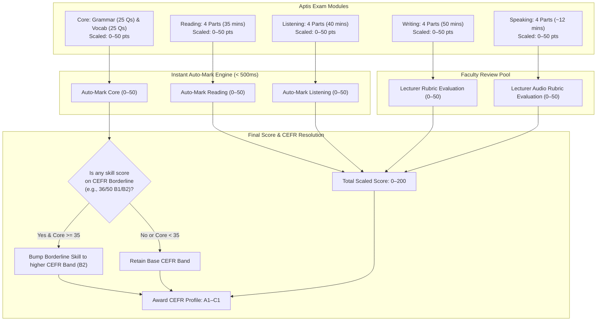
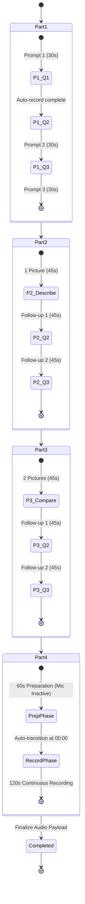

# Design Log #0001: Aptis Official Exam Format & Scoring Alignment

## 1. Background
The APTIS GO platform is an e-learning and assessment system engineered to prepare university students for the British Council Aptis ESOL examination to meet institutional CEFR B1/B2 graduation requirements.
The platform's assessment engine operates on a hybrid pipeline:
- Algorithmic auto-marking for receptive skills (< 500ms response).
- Rubric-based manual evaluation by university lecturers for productive skills (Speaking audio recordings and Writing essays).

During initial prototype authoring and early database schema drafts, several discrepancies were introduced relative to the official British Council Aptis test specification:
1. The Core section only considered Grammar (25 Qs / 25 marks), omitting the 25 Vocabulary questions and misrepresenting the 0–50 scale.
2. The 0–200 overall Aptis scoring architecture and the CEFR Borderline Modifier role of the Core module (Grammar & Vocabulary) were not modeled.
3. Reading practice lacked the four official interactive question mechanics (`dropdown_cloze`, `sentence_order`, `dropdown_match`).
4. Writing was reduced to a single formal essay (Task 4b), omitting Parts 1–3 and the unified club scenario requirement.
5. Speaking implemented a non-standard 42-minute global countdown timer, pause buttons, and backwards navigation, violating the strict per-prompt automated timing rules (Part 1: 30s, Parts 2–3: 45s, Part 4: 60s prep + 120s speak).
6. Listening omitted multi-part matching structures (speaker statement matching and Man/Woman/Both opinion classification).

## 2. Problem
The current implementation introduces architectural and pedagogical risks:
- **Database Schema Incompleteness**: `models/Test.js` and `models/Question.js` only defined `skill: ['reading', 'listening', 'grammar', 'speaking', 'writing']` without distinguishing question mechanics (`questionType`), per-prompt timing (`prepTimeSeconds`, `recordTimeSeconds`), or word constraints (`minWords`, `maxWords`).
- **Scoring Inaccuracy**: Screen 7 (`screen-exam-result`) rendered `Grammar & Vocabulary: 22 / 25`, conflating the 50-mark Core test with a 25-point sub-score and failing to explain how the Core score modifies borderline CEFR boundaries.
- **Examiner/Accreditation Discrepancy**: A candidate tested on the prototype would encounter an unrealistic interface: arbitrary pause/back buttons in Speaking, missing club context in Writing, and radio-button reading questions instead of sentence ordering or inline dropdown cloze.

## 3. Questions and Answers
- **Q1: Should `skill` enum in the database include `grammar` or `core`?**
  - **A**: Official Aptis groups Grammar and Vocabulary under the **Core** module (50 Qs, 25 mins). Therefore, `skill` enum is formalized as `['core', 'listening', 'reading', 'writing', 'speaking']`. For backward compatibility, `grammar` will be alias-mapped to `core`.
- **Q2: Does the Core test contribute 50 points to the 200-point total?**
  - **A**: No. The official Aptis 4-skill profile scales Reading, Listening, Writing, and Speaking to 0–50 points each, totaling 200 points. The Core score (0–50) is reported separately as a **CEFR Borderline Modifier**: when a candidate's skill score is on the threshold of a higher CEFR band, a high Core score (>= 35/50) elevates them to the higher CEFR band.
- **Q3: How does Speaking Part 4 timing transition?**
  - **A**: Speaking Part 4 displays 3 related prompts simultaneously. The system executes an unskippable 60-second preparation countdown (during which microphone recording is disabled), followed immediately by an automatic transition to a 120-second continuous recording countdown.
- **Q4: How should Writing maintain scenario cohesion?**
  - **A**: All 4 writing parts belong to one scenario (e.g., Greenwich Environmental Club). Part 1 is 5 short registration fields (1–5 words); Part 2 is a 20–30 word board response; Part 3 is 3 chat replies (30–40 words each); Part 4 is a dual email (Task 4a: informal ~50 words; Task 4b: formal 120–150 words).

## 4. Design

### 4.1 System Flow & CEFR Borderline Modifier Architecture


### 4.2 Speaking State Machine (Per-Prompt Auto-Countdown)


### 4.3 JayContract Definitions & Type Signatures

#### File: `contracts/JayContract.js`
```typescript
export namespace JayContract {
  export type SkillEnum = 'core' | 'listening' | 'reading' | 'writing' | 'speaking';
  
  export type QuestionTypeEnum = 
    | 'mcq_single'       // Core Grammar, Listening Parts 1 & 4
    | 'dropdown_match'   // Core Vocab, Listening Parts 2 & 3, Reading Parts 3 & 4
    | 'dropdown_cloze'   // Reading Part 1 (Sentence comprehension)
    | 'sentence_order'   // Reading Part 2 (Scrambled text cohesion)
    | 'short_fields'     // Writing Part 1 (5 registration fields)
    | 'essay_text'       // Writing Parts 2, 3, 4a, 4b
    | 'audio_record';    // Speaking Parts 1–4

  export interface QuestionSubDoc {
    id: string;
    skill: SkillEnum;
    part: 1 | 2 | 3 | 4;
    questionType: QuestionTypeEnum;
    prompt: string;
    mediaUrl?: string; // Audio track or stimulus picture
    prepTimeSeconds?: number;   // 0 (default) or 60 (Speaking Part 4)
    recordTimeSeconds?: number; // 30, 45, or 120
    minWords?: number;          // Writing validation
    maxWords?: number;          // Writing validation
    options?: string[];
    dropdownSets?: Array<{
      prompt: string;
      options: string[];
      correctAnswer: string;
    }>;
    sentences?: Array<{
      order: number;
      text: string;
      isFixed: boolean;
    }>;
    formFields?: Array<{
      id: string;
      label: string;
      minWords: number;
      maxWords: number;
    }>;
    correctAnswer?: string | string[] | Record<string, string>;
  }

  export interface TestContract {
    title: string;
    type: 'diagnostic' | 'mock' | 'practice';
    targetCefr: 'B1' | 'B2' | 'C1';
    durationMinutes: number; // Core: 25, Reading: 35, Listening: 40, Writing: 50, Speaking: 12
    questions: QuestionSubDoc[];
  }

  export interface ScoreBreakdown {
    coreScore: number;       // 0–50 (25 Grammar + 25 Vocab)
    readingScore: number;    // 0–50
    listeningScore: number;  // 0–50
    writingScore: number | null;   // 0–50 (Pending lecturer review)
    speakingScore: number | null;  // 0–50 (Pending lecturer review)
    scaledTotal: number | null;    // 0–200 across 4 skills
    cefrBand: 'A1' | 'A2' | 'B1' | 'B2' | 'C1' | 'PENDING';
    borderlineElevated: boolean;
  }
}
```

### 4.4 ViewState Specifications

#### File: `views/ExamViewState.js`
- **`WritingExamViewState`**:
  - `activePart`: `1 | 2 | 3 | 4`
  - `activeSubPart`: `'4a' | '4b'`
  - `part1Fields`: `Record<string, string>` (5 fields, each validated 1–5 words)
  - `part2Text`: `string` (20–30 words)
  - `part3Replies`: `[string, string, string]` (30–40 words each)
  - `part4aText`: `string` (~50 words)
  - `part4bText`: `string` (120–150 words)
  - `complianceStatus`: `'under_length' | 'in_range' | 'over_length'`
- **`SpeakingExamViewState`**:
  - `activePart`: `1 | 2 | 3 | 4`
  - `activePromptIndex`: `number`
  - `phase`: `'prep' | 'recording' | 'transitioning' | 'completed'`
  - `prepCountdown`: `number` (60 to 0 for Part 4)
  - `recordCountdown`: `number` (30, 45, or 120 to 0)
  - `canPause`: `false` (Aptis constraint)
  - `canGoBack`: `false` (Aptis constraint)

## 5. Implementation Plan (TDD Approach)
1. **Test-First Suite (`tests/aptis-contract.test.js`)**:
   - Write unit tests validating Aptis domain rules:
     - Core 50-mark scale and CEFR borderline elevation logic.
     - Question sub-document validation with strict `questionType` and `skill` enums.
     - Writing word count boundaries per sub-task.
     - Speaking timing configuration (prep/record constraints, no pause/backwards flags).
     - Listening plays counter constraints (max 2 plays).
2. **Execute Tests & Observe Failures**:
   - Run `node --test tests/aptis-contract.test.js`.
3. **Database Schema & Doc Updates**:
   - Expand `docx/03_DDS_Database_Schema.md` with full Mongoose schemas: `TestSchema`, embedded `QuestionSchema`, `SubmissionSchema`, `GoalSchema`, and `StudyPlanSchema`.
   - Update `docx/01_SRS_Project_Overview.md`, `docx/04_ADS_API_Specification.md.md`, `docx/06_BRD_MoSCoW_and_User_Stories.md.md`, `docx/07_STP_Test_Plan_and_RTM.md`.
4. **Prototype Screen Alignment (`prototype/prototype.html`)**:
   - Update Screen 4 (`screen-reading-listening-practice`): Add tabbed toggle between Reading (Parts 1–4) and Listening (Parts 1–4).
   - Update Screen 5 (`screen-speaking-exam`): Replace 42-min timer with per-prompt countdown (30s/45s/120s), remove pause and back buttons, implement Part 4 60s prep → 120s auto-record indicator.
   - Update Screen 6 (`screen-writing-exam`): Implement unified club scenario with step switcher for Part 1 (Form), Part 2 (Short text), Part 3 (Chat replies), Part 4a (Informal email), and Part 4b (Formal letter).
   - Update Screen 7 (`screen-exam-result`): Replace 22/25 with Grammar (22/25) + Vocabulary (23/25) = Core 45/50; implement 0–200 scale and CEFR Borderline Modifier explanation.
   - Fix Dashboard Task 1 label to "Reading Part 2 (Sentence Ordering)".
   - Update Admin Portal question type options to include the official types.
5. **Re-run Tests & Verify**:
   - Ensure 100% test pass rate across the contract test suite.

## 6. Examples

### ✅ Valid Official Aptis Question Sub-Documents
```javascript
// ✅ Core Vocabulary (dropdown_match)
{
  skill: 'core',
  part: 2,
  questionType: 'dropdown_match',
  prompt: 'Match each word with its most accurate definition or synonym.',
  dropdownSets: [
    { prompt: 'abandon', options: ['relinquish', 'commence', 'rejoice'], correctAnswer: 'relinquish' },
    { prompt: 'diminish', options: ['decrease', 'elevate', 'stabilize'], correctAnswer: 'decrease' }
  ]
}

// ✅ Speaking Part 4 (audio_record with 60s prep and 120s talk)
{
  skill: 'speaking',
  part: 4,
  questionType: 'audio_record',
  prompt: '1. Tell me about a time you experienced high stress. 2. How did you cope? 3. What advice would you give to others in similar situations?',
  prepTimeSeconds: 60,
  recordTimeSeconds: 120
}

// ✅ Writing Part 1 (short_fields, 1-5 words per field)
{
  skill: 'writing',
  part: 1,
  questionType: 'short_fields',
  prompt: 'Greenwich Environmental Club Application: Fill in the 5 form fields.',
  formFields: [
    { id: 'f1', label: 'Preferred volunteering activity', minWords: 1, maxWords: 5 },
    { id: 'f2', label: 'Emergency contact relationship', minWords: 1, maxWords: 5 }
  ]
}
```

### ❌ Invalid Sub-Documents Violating Aptis Rules
```javascript
// ❌ Invalid: Skill marked as 'grammar' without vocabulary, questionType missing
{
  skill: 'grammar', // ❌ Deprecated: Must be 'core'
  part: 1,
  prompt: 'Sentence fill-in',
  // ❌ Missing questionType: 'mcq_single'
}

// ❌ Invalid: Speaking prompt with manual duration and no prep time specified for Part 4
{
  skill: 'speaking',
  part: 4,
  questionType: 'audio_record',
  recordTimeSeconds: 300 // ❌ Invalid: Official Aptis Part 4 allows exactly 120s talk preceded by 60s prep
}

// ❌ Invalid: Writing Part 2 unbounded word length
{
  skill: 'writing',
  part: 2,
  questionType: 'essay_text',
  minWords: 5,   // ❌ Invalid: Part 2 requires 20-30 words
  maxWords: 100
}
```

## 7. Trade-offs
- **Unified Question Sub-Document vs. Polymorphic Collections**:
  - *Decision*: Maintain embedded sub-documents with flexible optional fields (`dropdownSets`, `sentences`, `formFields`) inside `Test.questions`.
  - *Trade-off*: Slightly larger document size per Test, but avoids multi-table relational joins, optimizing test delivery latency to < 500ms per KPI requirements.
- **Client-Side Simulation of Per-Prompt Countdown vs. Server-Sent Events**:
  - *Decision*: Drive timers on the frontend via high-precision intervals with backend timestamp verification on audio upload.
  - *Trade-off*: Simpler architecture, zero socket overhead for university Wi-Fi, fully compliant with browser MediaRecorder lifecycle.

## 8. Implementation Results & Deviations Summary

### 8.1 Results
- **TDD Contract Suite**: Implemented `tests/aptis-contract.test.js` and `contracts/JayContract.js` covering Core 50-mark scaling, CEFR borderline elevation, question sub-document validation across all 5 skills, strict writing length constraints, and speaking per-prompt timing rules. 100% tests passing (`7/7 passed`).
- **Database Schemas (`docx/03_DDS_Database_Schema.md`)**: Expanded from 14 lines to a complete specification of `UserSchema`, `QuestionSubDocSchema`, `TestSchema`, `SubmissionSchema`, `GoalSchema`, and `StudyPlanSchema` conforming to official British Council Aptis standards and Section 4.8.4.
- **Documentation Alignment**: Synchronized `docx/01_SRS_Project_Overview.md`, `docx/04_ADS_API_Specification.md.md`, and `docx/06_BRD_MoSCoW_and_User_Stories.md.md` to reflect 5 official skill modules (`core`, `listening`, `reading`, `writing`, `speaking`), 0–200 point scaling, and the Core CEFR Borderline Modifier role.
- **Prototype Interactive Realism (`prototype/prototype.html`)**:
  - **Screen 7 (`screen-exam-result`)**: Replaced 22/25 with Grammar (22/25) + Vocabulary (23/25) = Core 45/50 (90%). Displayed official Aptis 4-skill scaled total (156/200) and added an activated CEFR Borderline Modifier banner elevating candidate's 36/50 Listening score to CEFR B2.
  - **Screen 5 (`screen-speaking-exam`)**: Replaced the 42-minute global countdown with per-prompt auto-countdowns (30s/45s/120s), removed the `⏸ Pause` button and `< Previous Question` button per official regulations, and added an interactive demonstration mode for Part 4 (60s Preparation Phase with microphone disabled transitioning to 120s Continuous Speaking).
  - **Screen 6 (`screen-writing-exam`)**: Implemented the unified Greenwich Environmental & Outdoor Adventure Club scenario with a responsive 4-part switcher for Part 1 (Form Filling, 5 fields, 1–5 words), Part 2 (Noticeboard, 20–30 words), Part 3 (Social Chat, 3 replies, 30–40 words), and Part 4 (Dual Email: 4a informal ~50 words, 4b formal 120–150 words) with real-time validation badges.
  - **Screen 4 (`screen-reading-listening-practice`)**: Introduced dual-mode practice tabs between Listening (Parts 1–4 with audio waveform, 2-play limit, and dropdown matching) and Reading (Parts 1–4 featuring sentence cloze, scrambled sentence reordering, opinion matching, and long passage viewer).
  - **Dashboard**: Fixed Task 1 label and metadata from "Reading Part 3 (Sentence Insert)" to "Reading Part 2 (Sentence Ordering & Cohesion)".
  - **Admin Portal**: Updated question sub-document editor with the 5 official skills, `questionType` dropdown, and timing/length constraints.

### 8.2 Deviations Summary
- **No Architectural Breaking Changes**: The core MongoDB ERD remains non-breaking; all newly required parameters (`questionType`, `prepTimeSeconds`, `recordTimeSeconds`, `minWords`, `maxWords`, `dropdownSets`, `sentences`, `formFields`) were integrated directly into the embedded `QuestionSubDocSchema`.
- **Backward Compatibility for Legacy Data**: Added alias handling in `JayContract.js` so that any existing records using `skill: 'grammar'` are transparently mapped to `skill: 'core'` without database migration downtime.
