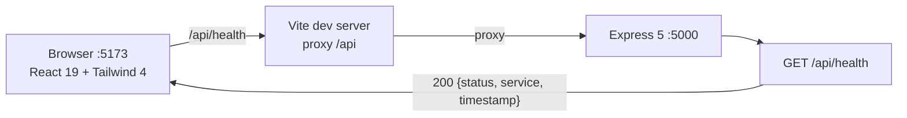

# Design Log #0002: Decoupled Client/Server Scaffold with Lint & Format Standards

**Ticket:** AP-14 (AG-101) [Setup]
**Status:** Proposed → implemented (see §8)
**Depends on:** #0001 (Aptis format alignment)

## 1. Background

Sprint 1 (`v0.1.0`) delivered the specifications (`docx/`), the shared
`contracts/JayContract.js`, the interactive prototype, and the Contract test
suite. The repository is currently documentation-only:

- No `package.json` at any level, so there is no reproducible dependency graph.
- No application directories, so the SRS architecture (React SPA + Express API)
  has no physical home.
- No linting or formatting rules, so hand-written and AI-generated code will
  drift in style and quality.
- The only executable code (`contracts/`, `tests/`) runs on Node built-ins.

AG-101 bootstraps the two deployable applications and the code-quality gates that
every later ticket (`AG-1xx`) will build on.

## 2. Problem

Without this ticket:

1. **No separation of concerns.** Frontend and backend code would either be
   mixed in one package or invented ad hoc per ticket, violating the decoupled
   client–server paradigm in `docx/02_SAD_System_Architecture.md`.
2. **No enforceable style.** Reviewers would debate formatting instead of
   behaviour, and React hook mistakes (missing dependencies, conditional hooks)
   would reach the prototype.
3. **No runnable baseline.** There is no way to confirm that a React + Tailwind
   build or an Express boot works before feature work starts.
4. **No shared formatting contract.** Two apps with different Prettier settings
   would produce noisy cross-cutting diffs.

The setup must stay small: tooling and a health endpoint only. No domain
features, no database connection, no authentication.

## 3. Questions and Answers

- **Q1: One package or two?**
  - **A:** Two independent packages, `client/` and `server/`, each with its own
    `package.json`, lockfile, and `node_modules`. Decoupling is a hard
    architectural requirement; npm workspaces would hoist dependencies and
    couple release cycles. A thin root `package.json` exists only to delegate
    commands and hold root-level Prettier.

- **Q2: JavaScript or TypeScript?**
  - **A:** JavaScript (ES2023) with JSDoc where a signature matters. The
    existing `contracts/JayContract.js` and `tests/*.test.js` are JavaScript, and
    the SAD specifies a plain Node/React stack. Adding TypeScript now would
    force a contract rewrite outside this ticket's scope.

- **Q3: Which module system per app?**
  - **A:** `client/` is ESM (`"type": "module"`) because Vite requires it.
    `server/` is CommonJS because `contracts/JayContract.js` and the Contract
    tests use `require`, and the server will consume them directly in a later
    ticket. Mixing `require` and `import` inside one app is forbidden.

- **Q4: TailwindCSS v3 or v4?**
  - **A:** TailwindCSS v4.3 with `@tailwindcss/vite`. Configuration is
    CSS-first (`@import "tailwindcss"` and `@theme`), so there is no
    `tailwind.config.js` to keep in sync. Fewer files, faster builds.

- **Q5: ESLint legacy `.eslintrc` or flat config?**
  - **A:** Flat config only (`eslint.config.js`) on ESLint 10. Legacy config is
    removed in ESLint 10. Each app owns its config because the global
    environment differs (browser vs Node).

- **Q6: Where does Prettier configuration live?**
  - **A:** One root `.prettierrc.json` so both apps and the root share identical
    formatting. Prettier resolves configuration upward, so `client/` and
    `server/` inherit it without duplicating rules. ESLint is kept out of
    formatting via `eslint-config-prettier`.

- **Q7: What is the minimum runtime?**
  - **A:** Node.js **>= 20.19.0** (Vite 8 requirement) and npm **>= 10**.
    `engines` is declared in all three manifests and `engine-strict` is not
    forced, so contributors get a warning rather than a hard failure.

- **Q8: What exactly must be proven by tests?**
  - **A:** (a) the scaffold exists and its manifests declare the required
    dependencies and scripts; (b) `GET /api/health` answers `200` with a stable
    JSON Contract. Build and lint are verified by their own exit codes, not by
    unit tests.

## 4. Design

### 4.1 Target layout

```text
Final-Year-Project-AptisGo/
├── client/                        # React 19 + Vite 8 + TailwindCSS 4 (ESM)
│   ├── index.html
│   ├── package.json
│   ├── vite.config.js
│   ├── eslint.config.js
│   ├── .env.example               # VITE_API_URL
│   └── src/
│       ├── main.jsx
│       ├── App.jsx
│       └── index.css
├── server/                        # Node.js + Express 5 (CommonJS)
│   ├── package.json
│   ├── eslint.config.js
│   ├── .env.example               # PORT, CLIENT_ORIGIN
│   └── src/
│       ├── app.js                 # exports the Express app (testable, no listen)
│       └── server.js              # loads env, listens, graceful shutdown
├── contracts/                     # unchanged
├── tests/
│   ├── aptis-contract.test.js     # unchanged
│   ├── scaffold.test.js           # NEW: structure + manifest Contract
│   └── server-health.test.js      # NEW: GET /api/health Contract
├── .prettierrc.json               # NEW: shared formatting
├── .prettierignore                # NEW
├── package.json                   # NEW: root command delegation
├── design-log/                    # this log
└── README.md                      # updated
```

`node_modules/`, `dist/`, `.env`, uploads, and coverage are already ignored by
the root `.gitignore` from the previous change.

### 4.2 Request flow



### 4.3 Contracts introduced

#### File: `server/src/app.js`
```javascript
/**
 * @typedef {Object} HealthResponse
 * @property {'ok'} status
 * @property {'aptis-go-api'} service
 * @property {string} timestamp  // ISO-8601, e.g. 2026-10-25T10:00:00.000Z
 */

/**
 * @returns {import('express').Express}
 */
module.exports = app;

// Route Contract
// GET /api/health -> 200 application/json HealthResponse
// Unknown path    -> 404 application/json { error: 'Not Found', path: string }
// Thrown error    -> 500 application/json { error: 'Internal Server Error' }
```

#### File: `client/src/App.jsx`
```javascript
/**
 * @returns {JSX.Element}
 */
export default function App();

// Consumes VITE_API_URL (default: '' so Vite's /api proxy applies).
// States: 'loading' | 'online' | 'offline'.
```

### 4.4 Script Contracts (must exist in every manifest)

| Manifest | Script | Command | Validation rule |
| --- | --- | --- | --- |
| root | `test` | `node --test "tests/*.test.js"` | exit 0, all tests pass |
| root | `lint` | `npm --prefix client run lint && npm --prefix server run lint` | exit 0 |
| root | `format:check` | `prettier --check .` | exit 0 |
| client | `dev` | `vite` | serves `http://localhost:5173` |
| client | `build` | `vite build` | emits `client/dist/` |
| client | `lint` | `eslint .` | exit 0, no warnings |
| server | `dev` | `node --watch src/server.js` | restarts on change |
| server | `start` | `node src/server.js` | listens on `PORT` (default 5000) |
| server | `lint` | `eslint .` | exit 0, no warnings |

Formatting Contract (`.prettierrc.json`):

| Option | Value | Rationale |
| --- | --- | --- |
| `singleQuote` | `true` | matches existing `JayContract.js` |
| `semi` | `true` | explicit statement boundaries |
| `printWidth` | `100` | readable in split-screen review |
| `trailingComma` | `"es5"` | valid in Node 20+ and browsers |
| `endOfLine` | `"lf"` | stable diffs across Windows/macOS/Linux |
| `tabWidth` | `2` | repository convention |

### 4.5 Lint rules that matter

- `react-hooks/rules-of-hooks: error` and `react-hooks/exhaustive-deps: warn`.
- `react-refresh/only-export-components: warn` with `allowConstantExport`.
- `no-unused-vars: error` with `argsIgnorePattern: '^_'` (Express error
  handlers need four parameters).
- `no-undef: error` with `globals.browser` for `client/src/**` and
  `globals.node` for `server/src/**` and `client/vite.config.js`.
- Prettier owns formatting: no `indent`, `quotes`, or `semi` rules in ESLint.

## 5. Implementation Plan (TDD Approach)

1. **Write failing tests first.**
   - `tests/scaffold.test.js`: assert every path in §4.1 exists; assert
     `client/package.json` and `server/package.json` declare the dependencies,
     scripts, and engines from §4.4; assert flat ESLint configs and the Prettier
     Contract from §4.4.
   - `tests/server-health.test.js`: boot `server/src/app.js` on an ephemeral port
     and assert the `GET /api/health` Contract plus the 404 Contract.
2. **Run and observe failure:** `node --test "tests/*.test.js"` — new tests must
   fail while the Aptis Contract suite still passes.
3. **Create the scaffold:** root manifest and Prettier files, then `client/`,
   then `server/`.
4. **Install dependencies:** `npm install` at root, `client/`, and `server/`.
   Lockfiles are committed.
5. **Verify gates:**
   - `node --test "tests/*.test.js"` → all pass.
   - `npm run lint` → exit 0.
   - `npm run format:check` → exit 0.
   - `npm --prefix client run build` → `client/dist/` produced.
   - `npm --prefix server start` → `GET /api/health` returns 200.
6. **Update `README.md`** with the new layout and commands, then append §8
   Implementation Results with any deviations.

## 6. Examples

### ✅ Correct manifests (independent, explicit engines)

```json
// ✅ client/package.json — ESM, React + Tailwind as real dependencies
{
  "name": "aptis-go-client",
  "private": true,
  "version": "0.1.0",
  "type": "module",
  "engines": { "node": ">=20.19.0" },
  "scripts": { "dev": "vite", "build": "vite build", "lint": "eslint ." }
}
```

```json
// ✅ server/package.json — CommonJS, no "type": "module"
{
  "name": "aptis-go-server",
  "private": true,
  "version": "0.1.0",
  "engines": { "node": ">=20.19.0" },
  "scripts": { "dev": "node --watch src/server.js", "start": "node src/server.js" }
}
```

### ❌ Incorrect manifests

```json
// ❌ No engines, no private flag, UI libraries in the server
{
  "name": "app",
  "dependencies": { "react": "^19.3.1", "express": "^5.3.0" }
}
```

```json
// ❌ Workspace hoisting couples the two deployables
{
  "workspaces": ["client", "server"]
}
```

### ✅ Correct lint composition

```javascript
// ✅ eslint.config.js (client, flat config, Prettier last)
import js from '@eslint/js';
import globals from 'globals';
import reactHooks from 'eslint-plugin-react-hooks';
import reactRefresh from 'eslint-plugin-react-refresh';
import prettier from 'eslint-config-prettier';

export default [
  { ignores: ['dist'] },
  js.configs.recommended,
  {
    files: ['**/*.{js,jsx}'],
    languageOptions: {
      globals: globals.browser,
      parserOptions: { ecmaFeatures: { jsx: true }, sourceType: 'module' },
    },
    plugins: { 'react-hooks': reactHooks, 'react-refresh': reactRefresh },
    rules: {
      'react-hooks/rules-of-hooks': 'error',
      'react-hooks/exhaustive-deps': 'warn',
    },
  },
  prettier,
];
```

### ❌ Incorrect lint setup

```javascript
// ❌ Legacy config file — removed in ESLint 10
// .eslintrc.json
{ "extends": ["eslint:recommended", "plugin:react/recommended"] }
```

```javascript
// ❌ Formatting rules in ESLint fight Prettier
{
  rules: {
    indent: ['error', 2],
    quotes: ['error', 'single'],
    semi: ['error', 'always'],
  },
}
```

### ✅ Correct server split (testable app, thin listener)

```javascript
// ✅ server/src/app.js — no side effects, exported for tests
const app = require('express')();
app.get('/api/health', (req, res) => res.status(200).json({ status: 'ok' }));
module.exports = app;
```

```javascript
// ❌ server/src/app.js — binds a port on import, tests cannot run in parallel
const app = require('express')();
app.listen(5000);
module.exports = app;
```

## 7. Trade-offs

- **Two lockfiles instead of one workspace lockfile.**
  - *Gain:* true deployment decoupling, independent upgrades, smaller installs.
  - *Cost:* dependency versions can drift between apps; a root script must
    install both. Mitigated by pinning caret ranges from the same review.
- **CommonJS server vs ESM everywhere.**
  - *Gain:* direct reuse of `contracts/JayContract.js` and the existing
    `node:test` suites without interop shims.
  - *Cost:* two module dialects in one repository. Mitigated by an explicit
    `"type"` declaration per manifest and a lint rule set per app.
- **JavaScript instead of TypeScript.**
  - *Gain:* no build step on the server, no contract rewrite, lower onboarding
    cost for the project team.
  - *Cost:* weaker compile-time guarantees; relies on JSDoc, ESLint, and the
    Contract tests. Revisit only if the API surface grows beyond the ADS.
- **Shared root Prettier config.**
  - *Gain:* one formatting truth, minimal duplication.
  - *Cost:* root config is an implicit dependency for editors; documented in the
    README and verified by `format:check`.
- **Tailwind v4 CSS-first.**
  - *Gain:* one less config file, native Vite plugin, faster HMR.
  - *Cost:* most online examples are v3 and use `tailwind.config.js`; the team
    must follow the v4 syntax in `client/src/index.css`.

## 8. Implementation Results

### 8.1 Results

- **TDD red phase:** `node --test "tests/*.test.js"` → 7 existing tests passed,
  4 failed (`Scaffold` × 3, `server-health.test.js` could not resolve
  `../server/src/app`). Failure was observed before any scaffold file existed.
- **TDD green phase:** `node --test "tests/*.test.js"` → **12/12 passed**
  (7 Aptis Contract + 3 scaffold + 2 server health/404).
- **Lint:** `npm run lint` → exit 0 for root, `client/`, and `server/`.
- **Formatting:** `npm run format:check` → `All matched files use Prettier code style!`
- **Client build:** `npm --prefix client run build` → Vite 8.3.5, 16 modules,
  `dist/assets/index-*.js` 220.67 kB (69.13 kB gzip) and
  `dist/assets/index-*.css` 8.70 kB (2.54 kB gzip).
- **Server boot:** `npm --prefix server start` →
  `{"status":"ok","service":"aptis-go-api","timestamp":"2026-10-25T10:47:09.534Z"}`
  on `http://localhost:5000/api/health`.
- **Installed toolchain:** React 19.3.1, Vite 8.3.5, TailwindCSS 4.3.3,
  Express 5.3.0, ESLint 10.13.0, Prettier 3.9.10, Node v24.10.0.
- **Files delivered:** root `package.json`, `eslint.config.js`,
  `.prettierrc.json`, `.prettierignore`; `client/` (`package.json`,
  `eslint.config.js`, `vite.config.js`, `index.html`, `.env.example`,
  `src/main.jsx`, `src/App.jsx`, `src/index.css`); `server/` (`package.json`,
  `eslint.config.js`, `.env.example`, `src/app.js`, `src/server.js`);
  `tests/scaffold.test.js`, `tests/server-health.test.js`; updated `README.md`.

### 8.2 Deviations from the Plan

- **Added a root `eslint.config.js`.** The plan only specified per-app configs.
  Root files (`tests/`, `contracts/`, config files) also need linting, so the
  root script is now `eslint . && npm --prefix client run lint && npm --prefix
  server run lint`. Root config ignores `client/**` and `server/**` to prevent
  the Node config from judging browser code.
- **Prettier was applied to existing files.** `contracts/JayContract.js` (26
  lines) and `tests/aptis-contract.test.js` (202 lines) were reformatted, not
  changed semantically, so the new `format:check` gate can pass repository-wide.
  The Aptis suite still passes 7/7 after reformatting.
- **Documentation and deliverables are excluded from Prettier.** `.prettierignore`
  lists `docx/`, `design-log/`, `diagrams/`, and `prototype/` to avoid churning
  hand-authored specs and the large prototype before a dedicated docs ticket.
- **Vite proxy target is configurable.** `client/vite.config.js` reads
  `VITE_API_PROXY` (default `http://localhost:5000`) instead of hard-coding the
  URL, matching the server's `PORT`/`CLIENT_ORIGIN` overrides.
- **Client landing view is functional, not static.** `App.jsx` calls
  `/api/health` and renders `loading | online | offline`, proving the proxy and
  CORS wiring end to end.
- **Branching and integration:** Work is committed to `feature/AP-14` and
  integrated into `develop` via Git Flow per project agreement.
