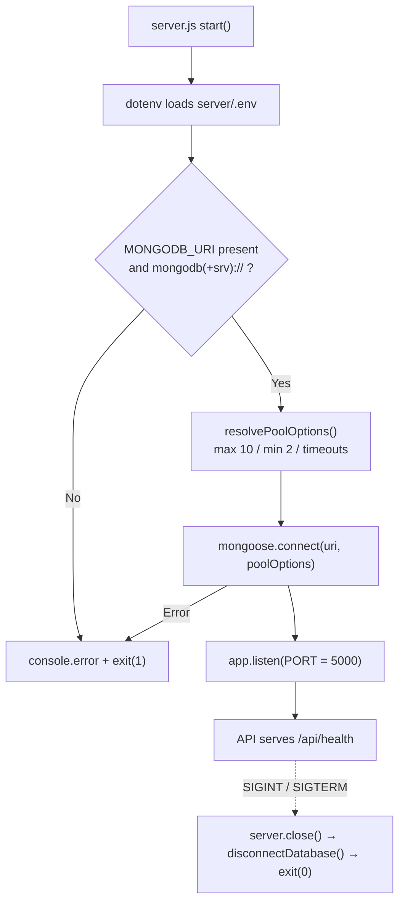
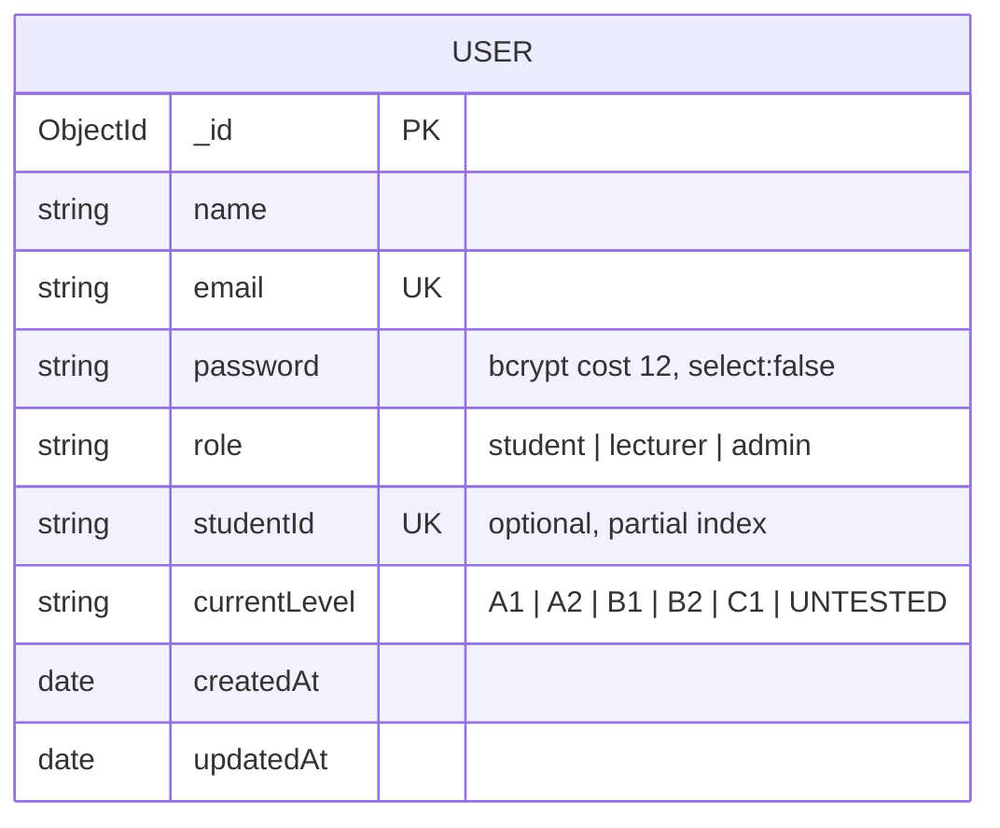

# Design Log #0003: MongoDB Atlas Connection Pool & User Schema

**Ticket:** AP-15 / AG-102 [DB]
**Status:** Proposed → implemented (see §8)
**Depends on:** #0002 (client/server scaffold)

## 1. Background

AG-101 produced a running Express API with no persistence layer. AG-102 adds the
first database capability:

- A reusable Mongoose connection with an explicitly configured pool, pointed at
  **MongoDB Atlas**.
- The `User` model that every later ticket depends on (authentication,
  placement results, lecturer review, admin analytics).

The schema is already specified in `docx/03_DDS_Database_Schema.md` §1. This
ticket turns that specification into code without changing its field names.

## 2. Problem

Without this ticket:

1. **No connection Contract.** Each controller would call `mongoose.connect`
   with its own options, producing unpredictable pool sizes and connection
   storms against the Atlas cluster.
2. **Startup is unverified.** The API currently listens even when it cannot
   reach a database, so the first request fails instead of the process.
3. **No identity model.** Registration, login, RBAC, and `currentLevel` cannot
   be implemented because there is no `User` collection.
4. **Password risk.** A naive schema would store or return plaintext passwords,
   violating `docx/05_CSG_Coding_Standards.md` §2.

Scope is deliberately narrow: connection configuration, the `User` schema, and
password hashing. No auth routes, JWT, controllers, or other models.

## 3. Questions and Answers

- **Q1: Where does the connection live?**
  - **A:** `server/src/config/database.js`. One module owns URI validation,
    pool defaults, `connectDatabase()`, and `disconnectDatabase()`. Controllers
    never call `mongoose.connect` directly.

- **Q2: What pool size fits this project?**
  - **A:** `maxPoolSize: 10`, `minPoolSize: 2`. The SAD targets < 500 ms API
    latency for a university cohort; 10 sockets per API instance is enough for
    demo/UAT traffic and stays far below Atlas shared-tier limits. Both values
    are overridable through `MONGODB_MAX_POOL_SIZE` and `MONGODB_MIN_POOL_SIZE`.

- **Q3: Which timeouts?**
  - **A:** `serverSelectionTimeoutMS: 5000` (fail fast during boot),
    `socketTimeoutMS: 45000` (long enough for faculty report queries),
    `maxIdleTimeMS: 30000` (recycle idle Atlas sockets), `retryWrites: true`
    (Atlas default, safe retries for idempotent writes).

- **Q4: Fail fast or start degraded?**
  - **A:** Fail fast. `server.js` awaits the connection before `listen()` and
    exits with code 1 on failure. A process that cannot persist users must not
    accept traffic. `/api/health` remains a liveness probe, not a readiness
    probe; a readiness endpoint is deferred to the deployment ticket.

- **Q5: Where is the password hashed?**
  - **A:** In the schema's `pre('save')` hook using `bcryptjs` with cost **12**
    (the coding standard requires ≥ 10). Hashing in the model guarantees no code
    path can persist a plaintext password, including future admin scripts.
    `setPassword()` is idempotent-safe: an existing bcrypt hash is never
    re-hashed.

- **Q6: How is the password kept out of responses?**
  - **A:** Two independent defences: `select: false` on the path (queries omit
    it by default) and a `toJSON`/`toObject` transform that deletes the field.
    Auth code must explicitly opt in with `.select('+password')`.

- **Q7: What is the default `currentLevel`?**
  - **A:** `'UNTESTED'`, exactly as in the DDS. A new student has not taken the
    placement test, so defaulting to `'B1'` would fabricate a CEFR result.
    Allowed values: `A1 | A2 | B1 | B2 | C1 | UNTESTED`.

- **Q8: Is `studentId` in scope?**
  - **A:** Yes; the DDS includes it and registration will need it. It is
    optional, trimmed, 4–20 alphanumeric characters or hyphens, and unique only
    among documents that actually set it (partial unique index). Without the
    uniqueness rule two students could claim the same university ID.

- **Q9: How is the schema tested without an Atlas cluster?**
  - **A:** Unit tests validate documents with `validateSync()`, inspect schema
    indexes and path options, and exercise the password utilities directly. The
    connection options resolver is tested with and without overrides. A real
    Atlas round-trip is a manual smoke check, documented in §8; no
    `mongodb-memory-server` binary is downloaded in CI.

- **Q10: What happens to `_id`, `__v`, and timestamps?**
  - **A:** Keep the default `_id`; keep `timestamps: true` (needed for audit and
    the DDS); keep `__v` (optimistic concurrency). Only `password` is removed
    from serialized output.

## 4. Design

### 4.1 Startup and connection lifecycle



### 4.2 Data model



### 4.3 Files and Contracts

#### File: `server/src/config/database.js`
```javascript
/**
 * @typedef {Object} PoolOptions
 * @property {number} maxPoolSize
 * @property {number} minPoolSize
 * @property {number} maxIdleTimeMS
 * @property {number} serverSelectionTimeoutMS
 * @property {number} socketTimeoutMS
 * @property {boolean} retryWrites
 */

/**
 * @param {Partial<PoolOptions>} [overrides]
 * @returns {PoolOptions}
 * @throws {TypeError}  non-integer pool value
 * @throws {RangeError} maxPoolSize outside 1–100, or minPoolSize outside 0–maxPoolSize
 */
function resolvePoolOptions(overrides = {}) {}

/**
 * @param {{ uri?: string, options?: Partial<PoolOptions> }} [config]
 * @returns {Promise<import('mongoose').Mongoose>}
 * @throws {Error} MONGODB_URI missing or not mongodb:// / mongodb+srv://
 */
async function connectDatabase(config = {}) {}

/** @returns {Promise<void>} no-op when never connected */
async function disconnectDatabase() {}

module.exports = { DEFAULT_POOL_OPTIONS, resolvePoolOptions, connectDatabase, disconnectDatabase };
```

Validation rules:

| Input | Rule | Failure |
| --- | --- | --- |
| `MONGODB_URI` | non-empty string starting `mongodb://` or `mongodb+srv://` | `Error('MONGODB_URI is not configured')` / `Error('MONGODB_URI must start with mongodb:// or mongodb+srv://')` |
| `maxPoolSize` | integer 1–100 | `TypeError` / `RangeError` |
| `minPoolSize` | integer 0–`maxPoolSize` | `TypeError` / `RangeError` |
| timeouts | integer milliseconds > 0 | `TypeError` |
| `retryWrites` | boolean | coerced with `Boolean()` |

#### File: `server/src/models/User.js`
```javascript
/**
 * @typedef {'student' | 'lecturer' | 'admin'} UserRole
 * @typedef {'A1' | 'A2' | 'B1' | 'B2' | 'C1' | 'UNTESTED'} CefrLevel
 */

/**
 * @param {string} plainPassword
 * @returns {Promise<UserDocument>}
 */
userSchema.methods.setPassword = async function setPassword(plainPassword) {};

/**
 * @param {string} plainPassword
 * @returns {Promise<boolean>} false when no bcrypt hash is stored
 */
userSchema.methods.verifyPassword = function verifyPassword(plainPassword) {};

module.exports = mongoose.model('User', userSchema);
```

Field validation rules:

| Field | Type | Required | Rules | Default |
| --- | --- | --- | --- | --- |
| `name` | String | yes | trim, 1–80 characters | — |
| `email` | String | yes | trim, lowercase, `/^[^\s@]+@[^\s@]+\.[^\s@]+$/`, unique index | — |
| `password` | String | yes | min 8 characters, bcrypt cost 12 on save, `select: false`, never serialized | — |
| `role` | String | no | enum `student \| lecturer \| admin`, indexed | `student` |
| `studentId` | String | no | trim, `/^[A-Za-z0-9-]{4,20}$/`, partial unique index | `null` |
| `currentLevel` | String | no | enum `A1 \| A2 \| B1 \| B2 \| C1 \| UNTESTED` | `UNTESTED` |
| `createdAt` / `updatedAt` | Date | auto | `timestamps: true` | now |

#### File: `server/src/utils/password.js`
```javascript
const SALT_ROUNDS = 12;
/**
 * @param {string} plainPassword
 * @param {number} [saltRounds=12]
 * @returns {Promise<string>}
 */
async function hashPassword(plainPassword, saltRounds = SALT_ROUNDS) {}
/**
 * @param {string} plainPassword
 * @param {string} passwordHash
 * @returns {Promise<boolean>}
 */
async function verifyPassword(plainPassword, passwordHash) {}
/**
 * @param {unknown} value
 * @returns {boolean}
 */
function isBcryptHash(value) {}
module.exports = { SALT_ROUNDS, hashPassword, verifyPassword, isBcryptHash };
```

### 4.4 Indexes

| Index | Definition | Purpose |
| --- | --- | --- |
| `email_1` | `{ email: 1 }`, `unique: true` | one account per email |
| `role_1` | `{ role: 1 }` | lecturer/admin queue filtering |
| `studentId_1` | `{ studentId: 1 }`, `unique: true`, `partialFilterExpression: { studentId: { $type: 'string' } }` | unique university ID without colliding on `null` |

## 5. Implementation Plan (TDD Approach)

1. **Write failing tests.**
   - `tests/database.test.js`: pool defaults, env/override coercion, range
     rejection, URI rejection, safe disconnect.
   - `tests/password.test.js`: hash format (`$2b$12$`), verify success/failure,
     empty input rejection, non-hash comparison returns `false`.
   - `tests/user-model.test.js`: defaults, required fields, email normalization
     and format, password length and `select: false`, enums, `studentId` pattern,
     unique indexes, JSON redaction, `setPassword`/`verifyPassword`, and the
     `pre('save')` hashing hook (idempotent on an already-hashed value).
2. **Run and observe failure:** `node --test "tests/*.test.js"` — new suites
   must fail; the existing 12 tests must still pass.
3. **Install runtime dependencies:** `mongoose@9`, `bcryptjs@3` in `server/`.
4. **Implement** `password.js` → `database.js` → `User.js`, then wire
   `connectDatabase()` into `server/src/server.js` before `listen()`.
5. **Verify gates:** tests, `npm run lint`, `npm run format:check`, and a real
   Atlas smoke connection using a temporary `.env` (never committed).
6. **Update** `server/.env.example`, `README.md`, and append §8.

## 6. Examples

### ✅ Correct model usage

```javascript
// ✅ Create a student; the hook hashes before persistence
const user = new User({
  name: 'Amina Yusuf',
  email: 'Amina.Yusuf@University.edu ',
  password: 'Placement2026!',
  studentId: 'GCS210884',
});
await user.save();
// stored: email 'amina.yusuf@university.edu', password '$2b$12$...', role 'student',
// currentLevel 'UNTESTED'

// ✅ Auth query explicitly requests the hash
const candidate = await User.findOne({ email }).select('+password');
await candidate.verifyPassword(submittedPassword);
```

```javascript
// ✅ Connection is configured once, with explicit pool limits
const { connectDatabase } = require('./config/database');
await connectDatabase(); // reads MONGODB_URI
```

### ❌ Incorrect usage

```javascript
// ❌ Trusts a client-supplied role during public registration
await User.create({ ...req.body }); // role: 'admin'

// ❌ Compares plaintext to a hash without bcrypt
if (user.password === submittedPassword) {
}

// ❌ Returns the document directly to the client
res.json(user); // password is select:false, but transforms are the second guard

// ❌ Opens a new connection per request with default pool settings
router.get('/', async (req, res) => {
  await mongoose.connect(process.env.MONGODB_URI);
});
```

```javascript
// ❌ Defaults a new account to a CEFR band it never earned
currentLevel: { default: 'B1' }

// ❌ Unbounded pool against a shared Atlas tier
mongoose.connect(uri, { maxPoolSize: 500 });
```

## 7. Trade-offs

- **Schema-level hashing vs. service-level hashing.**
  - *Gain:* impossible to persist plaintext through `save()`; one rule for all
    callers.
  - *Cost:* hashing is implicit, and bulk `updateOne` writes bypass hooks.
    Documented; auth services must use `setPassword()` + `save()`.
- **Fail-fast startup vs. degraded mode.**
  - *Gain:* deployment fails loudly, no half-working API.
  - *Cost:* local development needs `MONGODB_URI` before the server will start.
    The client and unit tests remain runnable without a database.
- **Unit tests without an in-memory MongoDB.**
  - *Gain:* no 100 MB binary download, fast CI, deterministic tests.
  - *Cost:* query behaviour, unique-index enforcement, and the save hook against
    a real server are only proven by the manual Atlas smoke check.
- **Adding `studentId` beyond the ticket text.**
  - *Gain:* matches the DDS and avoids a follow-up migration for registration.
  - *Cost:* one more optional field and a partial index to reason about.
- **`UNTESTED` default vs. `B1` default.**
  - *Gain:* honest placement data; the study plan cannot silently assume a band.
  - *Cost:* every UI consumer must handle `UNTESTED` explicitly.

## 8. Implementation Results

### 8.1 Results

- **TDD red phase:** `node --test "tests/*.test.js"` → 12 existing tests passed,
  3 suites failed to load (`database.test.js`, `password.test.js`,
  `user-model.test.js`) because `server/src/config/database.js`,
  `server/src/utils/password.js`, and `server/src/models/User.js` did not exist.
- **TDD green phase:** full suite → **30 passed, 1 skipped** (`tests 31`).
  - 7 Aptis Contract, 3 scaffold, 2 server health, 5 database, 3 password,
    10 User schema.
- **Real MongoDB round-trip:** with a local `MongoDB` Windows service:
  `mongodb://127.0.0.1:27017/aptis-go-test` →
  **1/1 passed**. `User.create()` stored a `$2b$12$` hash, `verifyPassword()`
  accepted the original and rejected duplicates with MongoDB error `11000`.
  `User.init()` built the unique email index; the default `currentLevel` was
  persisted as `UNTESTED`.
- **Atlas smoke:** verified against `cluster0.kxy8nfk.mongodb.net` (database
  `aptis-go`, user `aptis_app`). The integration test passed **1/1** in 3.4 s,
  the API boot logged `MongoDB connected (pool 2-10, selection timeout 5000ms)`,
  and `GET /api/health` returned 200. Atlas reports the `users` collection with
  `_id_`, `email_1` (unique), `role_1`, and `studentId_1` (partial unique)
  indexes, and zero documents after cleanup.
- **Fail-fast boot:** `node src/server.js` without `MONGODB_URI` →
  `exit=1`, `Failed to start APTIS GO API: MONGODB_URI is not configured`
  (verified after silencing dotenv's startup banner with `{ quiet: true }`).
- **Lint:** `npm run lint` → exit 0 for root, `client/`, and `server/`.
- **Formatting:** `npm run format:check` →
  `All matched files use Prettier code style!`.
- **Dependencies added:** `mongoose@9.11.4`, `bcryptjs@3.0.3` in `server/`.
- **Files delivered:** `server/src/config/database.js`,
  `server/src/models/User.js`, `server/src/utils/password.js`; updated
  `server/src/server.js` and `server/.env.example`; new tests
  `tests/database.test.js`, `tests/password.test.js`,
  `tests/user-model.test.js`, `tests/user-repository.integration.test.js`;
  updated `README.md`.

### 8.2 Deviations from the Plan

- **Integration test added beyond the plan.** §3 Q9 deferred the database
  round-trip to a manual check; a local MongoDB service was available, so an
  opt-in `tests/user-repository.integration.test.js` was added (skipped unless
  `MONGODB_TEST_URI` is set). It now guards hashing, unique email, and defaults
  in CI whenever a database is provided.
- **Mongoose 9 deprecation.** `Document.prototype.validateSync()` is deprecated,
  so the User tests use `await user.validate()` instead. No schema behaviour
  changed.
- **`studentId` was hardened.** The DDS declared `sparse: true` without an index
  or uniqueness rule. The implementation uses an explicit partial unique index
  plus a `/^[A-Za-z0-9-]{4,20}$/` pattern so duplicate university IDs are
  rejected while `null` remains allowed.
- **Model metadata exported.** `User.USER_ROLES`, `User.CEFR_LEVELS`, and
  `User.SALT_ROUNDS` are attached to the model for reuse by validation layers
  without re-declaring enums.
- **Password hashing is idempotent.** `setPassword()` hashes immediately, and
  the pre-save hook skips values that already match a bcrypt hash, preventing
  double hashing on `save()`.
- **Server startup semantics changed.** `server.js` now awaits
  `connectDatabase()` before `listen()` and closes both HTTP and MongoDB on
  `SIGINT`/`SIGTERM`. A separate readiness endpoint was not added; `/api/health`
  remains a liveness probe.
- **Pool sizing is environment-tunable.** `MONGODB_MAX_POOL_SIZE` and
  `MONGODB_MIN_POOL_SIZE` override the defaults without code changes; all other
  pool/timeout values stay in the reviewed module.
- **Atlas index creation is not forced.** Mongoose `autoIndex` is left at its
  default. Before production, run `User.syncIndexes()` (or disable autoIndex and
  create indexes in the deployment step) so the unique email and student ID
  constraints are guaranteed.
