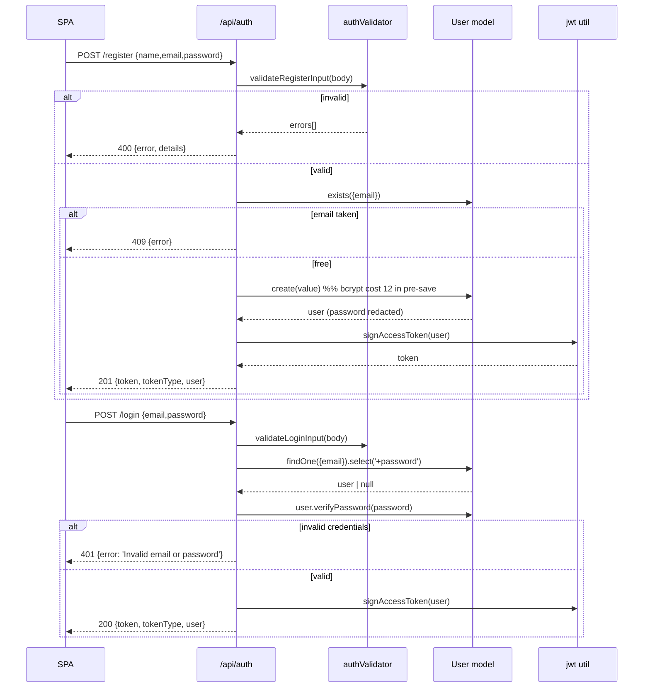

# Design Log #0004: Auth Controller — Register, Login, Stateless JWT

**Ticket:** AG-103 [BE]
**Status:** Proposed → implemented (see §8)
**Depends on:** #0003 (pool + `User` schema)
**Traceability:** FR01 (Auth & RBAC), NFR02 (security — hashing and stateless authorization)

## 1. Background

AG-102 delivered a pooled Atlas connection and the `User` model, including
bcrypt cost-12 hashing and password redaction. There is still no way for a
student, lecturer, or admin to obtain an identity:

- `POST /api/auth/register` and `POST /api/auth/login` from
  `docx/04_ADS_API_Specification.md.md` §1 do not exist.
- `docx/06_BRD_MoSCoW_and_User_Stories.md.md` FR01 requires registration/login
  with bcrypt hashing and JWT authorization for the three roles.
- Every protected endpoint in the ADS expects
  `Authorization: Bearer <JWT_TOKEN>`, but nothing issues that token.

AG-103 implements registration and login only. Protected-route middleware
(`requireAuth`, `requireRole`), `GET /api/auth/me`, logout, refresh tokens, and
password reset are explicitly out of scope.

## 2. Problem

Without this ticket:

1. **No identity issuance.** Clients cannot register or authenticate, so all
   later student/lecturer/admin flows are blocked.
2. **Role escalation risk.** A naive controller would accept `role` from the
   request body, letting a public caller create an `admin`.
3. **Credential leakage risk.** Returning the Mongoose document without
   redaction, or distinguishing "unknown email" from "wrong password", exposes
   data and enables account enumeration.
4. **Forged tokens.** A hard-coded or missing signing secret, or accepting any
   algorithm, would make JWT authorization meaningless.
5. **Server-side sessions.** Stateful sessions contradict the SAD's decoupled
   SPA architecture and the stateless JWT requirement.

## 3. Questions and Answers

- **Q1: Which JWT library and algorithm?**
  - **A:** `jsonwebtoken@9` with **HS256** only. Verification pins
    `algorithms: ['HS256']`; `none` and asymmetric confusion attacks are
    rejected. The secret is read from `JWT_SECRET` at call time.

- **Q2: What is the token Contract?**
  - **A:** `sub` = user id, `role` = `student | lecturer | admin`, `iss` =
    `aptis-go-api`, `aud` = `aptis-go-client`, `iat`, `exp`. Default lifetime is
    `1h`, configurable via `JWT_EXPIRES_IN`. Tokens are returned in the JSON
    body and sent back as `Authorization: Bearer <token>`.

- **Q3: Where is the token stored on the client?**
  - **A:** Not in scope for this backend ticket. The API remains stateless and
    sets no cookies. The SPA ticket must choose memory-first storage and
    document the XSS trade-off; an httpOnly refresh cookie can be added later
    without changing this Contract.

- **Q4: May a caller choose their role at registration?**
  - **A:** No. Public registration always creates `role: 'student'` and
    `currentLevel: 'UNTESTED'`, ignoring any `role` or `currentLevel` in the
    body. Lecturer/admin accounts are provisioned by an admin ticket.

- **Q5: What does registration return?**
  - **A:** `201` with `{ token, tokenType: 'Bearer', user }`. Auto-login avoids a
    second round-trip and matches the SPA's onboarding flow. The password field
    is removed by the model's `toJSON` transform.

- **Q6: Duplicate email handling?**
  - **A:** `409 Conflict` with `{ error: 'Email is already registered' }`. A
    pre-check gives a clean response; a `11000` catch handles the race between
    two concurrent registrations.

- **Q7: Login failure semantics?**
  - **A:** Always `401` with `{ error: 'Invalid email or password' }` for both
    unknown email and wrong password. No field-level detail is returned.
    Response timing may still differ by one bcrypt compare; a dummy-hash
    equalisation is documented as a trade-off, not implemented in this ticket.

- **Q8: Which inputs are validated?**
  - **A:** A pure validator returns `{ value, errors }` before any database
    access. Rules are listed in §4.4. Mongoose validation remains the second
    line of defence.

- **Q9: What happens when `JWT_SECRET` is missing or weak?**
  - **A:** `assertAuthConfig()` throws at startup (minimum 32 characters), so the
    API refuses to boot. Signing also re-validates, so tests and scripts cannot
    silently sign with an empty secret.

- **Q10: How is this tested without Atlas?**
  - **A:** Three layers: pure validator tests, JWT unit tests, and HTTP tests for
    `400` validation paths that never touch MongoDB. Happy-path register/login
    runs in an opt-in integration suite against `MONGODB_TEST_URI`, exactly like
    AG-102.

## 4. Design

### 4.1 Register and login flow



### 4.2 Files and Contracts

#### File: `server/src/validators/authValidator.js`
```javascript
/**
 * @param {unknown} body
 * @returns {{ value: { name: string, email: string, password: string, studentId: string | null }, errors: string[] }}
 */
function validateRegisterInput(body) {}

/**
 * @param {unknown} body
 * @returns {{ value: { email: string, password: string }, errors: string[] }}
 */
function validateLoginInput(body) {}

module.exports = { validateRegisterInput, validateLoginInput };
```

#### File: `server/src/config/auth.js`
```javascript
const JWT_ISSUER = 'aptis-go-api';
const JWT_AUDIENCE = 'aptis-go-client';
const MIN_SECRET_LENGTH = 32;

/**
 * @param {NodeJS.ProcessEnv} [env]
 * @returns {{ secret: string, expiresIn: string }}
 * @throws {Error} JWT_SECRET missing/shorter than 32, or invalid JWT_EXPIRES_IN
 */
function assertAuthConfig(env = process.env) {}

module.exports = { JWT_ISSUER, JWT_AUDIENCE, MIN_SECRET_LENGTH, assertAuthConfig };
```

#### File: `server/src/utils/jwt.js`
```javascript
/**
 * @param {{ _id?: unknown, id?: string, role: string }} user
 * @param {{ secret?: string, expiresIn?: string | number }} [overrides]
 * @returns {string}
 */
function signAccessToken(user, overrides = {}) {}

/**
 * @param {string} token
 * @param {{ secret?: string }} [overrides]
 * @returns {{ sub: string, role: string, iss: string, aud: string, iat: number, exp: number }}
 * @throws {JsonWebTokenError | TokenExpiredError}
 */
function verifyAccessToken(token, overrides = {}) {}

module.exports = { signAccessToken, verifyAccessToken };
```

#### File: `server/src/controllers/authController.js`
```javascript
/**
 * @param {import('express').Request} request
 * @param {import('express').Response} response
 * @returns {Promise<void>} 201 { token, tokenType, user } | 400 | 409
 */
async function register(request, response) {}

/**
 * @param {import('express').Request} request
 * @param {import('express').Response} response
 * @returns {Promise<void>} 200 { token, tokenType, user } | 400 | 401
 */
async function login(request, response) {}

module.exports = { register, login };
```

#### File: `server/src/routes/authRoutes.js`
```javascript
const router = require('express').Router();
router.post('/register', register);
router.post('/login', login);
module.exports = router;
```

Mounted in `server/src/app.js`:
```javascript
app.use('/api/auth', require('./routes/authRoutes'));
```

### 4.3 Response Contracts

| Case | Status | Body |
| --- | --- | --- |
| Register success | 201 | `{ token: string, tokenType: 'Bearer', user: PublicUser }` |
| Register invalid | 400 | `{ error: 'Validation failed', details: string[] }` |
| Register duplicate | 409 | `{ error: 'Email is already registered' }` |
| Login success | 200 | `{ token: string, tokenType: 'Bearer', user: PublicUser }` |
| Login invalid payload | 400 | `{ error: 'Validation failed', details: string[] }` |
| Login bad credentials | 401 | `{ error: 'Invalid email or password' }` |
| Unexpected failure | 500 | `{ error: 'Internal Server Error' }` |

`PublicUser` excludes `password`, `__v` remains, `_id`, `name`, `email`,
`studentId`, `role`, `currentLevel`, `createdAt`, `updatedAt` are present.

### 4.4 Validation Rules

| Field | Rule | Error text |
| --- | --- | --- |
| `name` | required string, trimmed, 1–80 chars | `name is required` / `name must be at most 80 characters` |
| `email` | required string, trimmed, lowercased, `/^[^\s@]+@[^\s@]+\.[^\s@]+$/`, ≤ 254 chars | `email must be a valid address` |
| `password` | required string, 8–72 chars | `password must be 8-72 characters` |
| `studentId` | optional string, trimmed, `/^[A-Za-z0-9-]{4,20}$/` | `studentId must be 4-20 letters, digits, or hyphens` |
| body | must be a plain object | `request body must be a JSON object` |
| login email | required string, trimmed, lowercased | `email is required` |
| login password | required non-empty string | `password is required` |

Server-controlled and never read from the body: `role`, `currentLevel`,
`createdAt`, `updatedAt`, `password` hash.

## 5. Implementation Plan (TDD Approach)

1. **Write failing tests.**
   - `tests/auth-validator.test.js`: register/login validation matrix,
     normalization, role-escalation fields ignored.
   - `tests/jwt.test.js`: signed/verified claims, issuer/audience, expiry,
     tamper/wrong-secret rejection, secret length enforcement.
   - `tests/auth-routes.test.js`: HTTP `400` paths and JSON Contract without a
     database.
   - `tests/auth.integration.test.js` (opt-in): register 201 + hash cost 12 +
     no password in response + forced student role, duplicate 409, login 200,
     wrong password 401, unknown email 401 with identical body, token verifies.
2. **Run and observe failure:** `node --test "tests/*.test.js"` — new suites
   fail; the 31 existing tests stay green.
3. **Install:** `jsonwebtoken@9` in `server/`.
4. **Implement** `authValidator` → `config/auth` → `utils/jwt` →
   `authController` → `authRoutes` → mount in `app.js`; validate auth config in
   `server.js` before connecting to Mongo.
5. **Configure:** add `JWT_SECRET` (≥ 32 random chars, local only) and
   `JWT_EXPIRES_IN=1h` to `server/.env`; document in `.env.example`.
6. **Verify:** all tests, Atlas integration, live `register`/`login` smoke with
   curl, `npm run lint`, `npm run format:check`.
7. **Update** `README.md` and append §8.

## 6. Examples

### ✅ Correct register response

```http
POST /api/auth/register
Content-Type: application/json

{ "name": "Amina Yusuf", "email": "Amina@University.edu", "password": "Placement2026!" }
```

```json
HTTP/1.1 201 Created
{
  "token": "eyJhbGciOiJIUzI1NiIsInR5cCI6IkpXVCJ9...",
  "tokenType": "Bearer",
  "user": {
    "_id": "6710...",
    "name": "Amina Yusuf",
    "email": "amina@university.edu",
    "role": "student",
    "currentLevel": "UNTESTED"
  }
}
```

### ❌ Incorrect implementations

```javascript
// ❌ Role escalation: trusting the client
const user = await User.create(req.body); // body.role = 'admin'

// ❌ Plaintext comparison
if (user.password === req.body.password) { /* ... */ }

// ❌ Leaking which part failed
if (!user) return res.status(404).json({ error: 'No account with that email' });

// ❌ Hard-coded / weak secret
jwt.sign(payload, 'secret');

// ❌ Accepting any algorithm
jwt.verify(token, secret); // no algorithms allowlist
```

```javascript
// ❌ Returning the document with the hash
res.status(200).json(user); // if selected with '+password'

// ❌ Emitting a token before the user exists
const token = signAccessToken({ role: 'admin' });
```

## 7. Trade-offs

- **Token in JSON body vs. httpOnly cookie.**
  - *Gain:* simplest for the decoupled SPA and mobile clients; no CSRF surface.
  - *Cost:* the client must protect the token from XSS. Mitigated by a strict
    CSP later; refresh cookies can be added without changing this Contract.
- **1-hour access token vs. long-lived token.**
  - *Gain:* limits the blast radius of a stolen token.
  - *Cost:* the SPA needs re-login after an hour until refresh tokens exist.
- **Generic 401 vs. precise errors.**
  - *Gain:* no account enumeration.
  - *Cost:* harder for students to self-diagnose typos; support must intervene.
- **Bcrypt cost 12 vs. lower cost.**
  - *Gain:* strong resistance to offline cracking (NFR02).
  - *Cost:* roughly 250–350 ms per login/registration, which consumes much of
    the < 500 ms KPI budget. Acceptable for auth, not for every request.
- **No dummy-hash timing equalisation.**
  - *Gain:* one less magic constant and a faster unknown-email path.
  - *Cost:* response timing can reveal whether an email exists. Low risk for a
    university cohort; revisit with rate limiting in the hardening ticket.

## 8. Implementation Results

### 8.1 Results

- **TDD red phase:** the new `auth-validator` and `jwt` suites failed to load
  (modules absent), the integration suite could not import the JWT util, and the
  three `auth-routes` requests returned `404` instead of `400`. The existing
  AG-101/AG-102 suites stayed green.
- **TDD green phase (no database):** `node --test "tests/*.test.js"` →
  **46 passed, 2 skipped** (`tests 48`). The skips are the opt-in Mongo
  round-trips.
- **Local MongoDB integration:** both opt-in suites passed **2/2** against
  `mongodb://127.0.0.1:27017/aptis-go-test`:
  - register `201`, forced `role: student`, `currentLevel: UNTESTED`,
    `$2b$12$` hash, no password in the response, token claims `sub`/`role`;
  - duplicate email `409`; login `200`; wrong password and unknown email both
    `401` with an identical body.
- **Live HTTP smoke (local DB):**
  - `POST /api/auth/register` → `201`, `role=student`, `level=UNTESTED`,
    `tokenType=Bearer`, token length 255;
  - decoded claims: `{"role":"student","iat":...,"exp":...,"aud":"aptis-go-client","iss":"aptis-go-api","sub":"..."}`
    with `exp - iat = 3600`;
  - `POST /api/auth/login` → `200`; wrong password → `401`.
- **Atlas re-check:** blocked, **not by the code**. The machine's public IP is
  now `171.225.184.76`, while Atlas still allow-lists yesterday's
  `1.52.161.147/32`, so both integration suites fail with
  `MongooseServerSelectionError` (IP not whitelisted). Add the current IP in
  Atlas → Network Access, then re-run. The same suites pass against local
  MongoDB and use the identical Mongoose connection.
- **Lint:** `npm run lint` → exit 0 for root, `client/`, and `server/`.
- **Formatting:** `npm run format:check` → all files conform.
- **Dependency added:** `jsonwebtoken@9.0.3`.
- **Local configuration:** `JWT_SECRET` (48 random bytes, base64url) and
  `JWT_EXPIRES_IN=1h` appended to the ignored `server/.env`; `.env.example`
  documents the keys with an empty value.
- **Files delivered:** `server/src/validators/authValidator.js`,
  `server/src/config/auth.js`, `server/src/utils/jwt.js`,
  `server/src/controllers/authController.js`,
  `server/src/routes/authRoutes.js`; updated `server/src/app.js` (mount),
  `server/src/server.js` (config gate), `server/.env.example`; new tests
  `tests/auth-validator.test.js`, `tests/jwt.test.js`,
  `tests/auth-routes.test.js`, `tests/auth.integration.test.js`; updated
  `README.md`.

### 8.2 Deviations from the Plan

- **Atlas verification is pending an IP update.** Local MongoDB and the live
  HTTP smoke fully exercised the same code; the Atlas failure is environmental
  (allowlist), not behavioural. Recorded rather than silently skipped.
- **`GET /api/auth/me` was not implemented.** The ADS lists it, but AG-103 scopes
  register/login only; it needs the `requireAuth` middleware from the next
  ticket.
- **Login email is not format-validated.** Only presence and normalization are
  checked, deliberately avoiding a second place that can reveal account
  policy/state. The model remains the source of truth for stored emails.
- **Password upper bound is 72 characters.** bcrypt only consumes 72 bytes;
  rejecting longer input avoids silent truncation and two passwords verifying
  the same hash.
- **Auth configuration is validated twice.** `assertAuthConfig()` runs at server
  start (fail fast) and the JWT helpers re-validate overrides, so tests and
  scripts cannot sign with an empty or short secret.
- **Registration auto-logs-in.** It returns a token immediately (documented in
  Q5) instead of forcing a second login request.
- **No rate limiting or refresh tokens.** Out of scope for AG-103; brute-force
  protection and token renewal are tracked for the security-hardening ticket.
