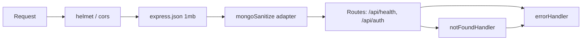

# Design Log #0006: NoSQL Sanitization and Centralized Error Handling

**Ticket:** AG-105 [BE]
**Status:** Proposed → implemented (see §8)
**Depends on:** #0003 (Mongoose models), #0004 (auth errors), #0005 (middleware)
**Traceability:** FR01 (secure auth/RBAC), NFR02 (security), CSG error handling

## 1. Background

The API currently accepts JSON bodies and query strings directly:

```javascript
app.use(express.json({ limit: '1mb' }));
app.use('/api/auth', authRoutes);
```

Two security and operability gaps remain:

1. A request body or query string can contain MongoDB operator keys such as
   `$gt`, `$ne`, `$where`, or dotted keys such as `profile.name`. If a future
   handler passes that object into a Mongoose query, it can change the query's
   meaning (NoSQL injection).
2. Errors are handled by a small anonymous middleware in `server/src/app.js`:

```javascript
app.use((error, _request, response, _next) => {
  const status = Number.isInteger(error.status) ? error.status : 500;
  response.status(status).json({
    error: status >= 500 ? 'Internal Server Error' : error.message,
  });
});
```

That handler does not distinguish malformed JSON, oversized payloads,
Mongoose validation failures, invalid identifiers, duplicate keys, or unknown
failures. It can also expose raw parser messages.

AG-105 adds a sanitization layer and one reusable error Contract. Business
controllers keep their existing response formats; this ticket does not rewrite
them.

## 2. Problem

Without this ticket:

1. **NoSQL operator injection.** `{ "email": { "$ne": null } }` or
   `?role[$ne]=student` can become a query predicate instead of a value.
2. **No centralized error Contract.** Every route must guess status codes and
   response shapes, producing inconsistent clients and duplicated `try/catch`.
3. **Information leakage.** Parser, Mongoose, and driver messages can reveal
   schema details and stack information to callers.
4. **Unknown failures look like client errors.** A generic `Error` must be
   `500`, not `400`.
5. **Express 5 incompatibility.** `express-mongo-sanitize@2.2.0` assigns
   `req.query`, but Express 5 exposes `query` as a getter-only property. Using
   the package directly throws:
   `TypeError: Cannot set property query ... which has only a getter`.

## 3. Questions and Answers

- **Q1: Which package and version?**
  - **A:** `express-mongo-sanitize@2.2.0`. It is the requested package, its
    sanitizer is actively used, and it has no runtime dependencies. It is not
    Express 5 compatible when mounted directly.

- **Q2: How is Express 5 handled?**
  - **A:** A thin adapter in `server/src/middleware/mongoSanitize.js` defines a
    writable own `query` property before invoking the package middleware:

    ```javascript
    Object.defineProperty(request, 'query', {
      configurable: true,
      enumerable: true,
      writable: true,
      value: request.query,
    });
    ```

    The package can then replace the already-parsed query object without
    throwing. The adapter is the only Express-5-specific code and is covered by
    an integration test against the real Express request object.

- **Q3: How are keys sanitized?**
  - **A:** `{ replaceWith: '_' }`. A key beginning with `$` or containing `.`
    becomes `_`-prefixed/`_`-separated:
    - `$gt` → `_gt`
    - `profile.name` → `profile_name`
    - `$where` → `_where`
    - `filter.$gt` (one literal query key) → `filter_$gt`; the dot is neutralized
      and the remaining `$` is no longer in operator position

    Normal keys are unchanged. MongoDB only treats a leading `$` as an operator,
    so the transformed object cannot smuggle operators or nested paths.

- **Q4: Which request parts are sanitized?**
  - **A:** The package sanitizes `req.body`, `req.params`, `req.headers`, and
    `req.query`. The adapter ensures all four work under Express 5. Body and
    query are the attacker-controlled injection surfaces; params are usually
    route-defined strings, and header names are not used in Mongo queries.

- **Q5: What is the sanitizer's failure mode?**
  - **A:** It does not reject a request merely for containing a suspicious key;
    it transforms the key and lets normal validation decide. This keeps
    legitimate-but-odd input from becoming a parser-level denial of service and
    ensures the error Contract stays with the validator/controller.

- **Q6: Where is the centralized handler?**
  - **A:** `server/src/middleware/errorHandler.js`, exporting
    `notFoundHandler` and `errorHandler`. `app.js` mounts the sanitizer after
    `express.json()` and before routes, then mounts the 404 handler and
    `errorHandler` last.

- **Q7: Which errors map to which responses?**

  | Error | Status | Body |
  | --- | --- | --- |
  | Malformed JSON (`entity.parse.failed`) | `400` | `{ error: 'Invalid JSON payload' }` |
  | Body over `1mb` (`entity.too.large`) | `413` | `{ error: 'Payload too large' }` |
  | Mongoose `ValidationError` | `400` | `{ error: 'Validation failed', details: [...] }` |
  | Mongoose `CastError` | `400` | `{ error: 'Invalid identifier' }` |
  | Duplicate key (`11000` / `11001`) | `409` | `{ error: 'Resource already exists' }` |
  | Known 4xx `status`/`statusCode` | that status | `{ error: error.message }` |
  | Any other error | `500` | `{ error: 'Internal Server Error' }` |

- **Q8: Are 5xx messages exposed?**
  - **A:** No. Only the generic `Internal Server Error` string is returned.
    The original error is logged server-side. This prevents stack traces, driver
    details, and secret values from reaching clients.

- **Q9: What if headers were already sent?**
  - **A:** `errorHandler` delegates to `next(error)`. Express then closes the
    connection; it must not attempt a second `response.status().json()`.

- **Q10: Does this replace validation in controllers?**
  - **A:** No. Sanitization is defense in depth; controllers still validate
    types, bounds, enums, and required fields. For example, `authValidator`
    still rejects a non-string email after the sanitizer has removed operators.

## 4. Design

### 4.1 Request pipeline



### 4.2 Files and Contracts

#### File: `server/src/middleware/mongoSanitize.js`

```javascript
/**
 * Express 5 adapter for express-mongo-sanitize@2.2.0.
 * The package assigns req.query, but Express 5 defines query as a getter.
 *
 * @param {import('express').Request} request
 * @param {import('express').Response} response
 * @param {import('express').NextFunction} next
 * @returns {void}
 */
function mongoSanitize(request, response, next) {}

module.exports = mongoSanitize;
```

#### File: `server/src/middleware/errorHandler.js`

```javascript
/**
 * @param {import('express').Request} request
 * @param {import('express').Response} response
 * @returns {void}
 */
function notFoundHandler(request, response) {}

/**
 * Centralized Express error handler.
 *
 * @param {unknown} error
 * @param {import('express').Request} request
 * @param {import('express').Response} response
 * @param {import('express').NextFunction} next
 * @returns {void}
 */
function errorHandler(error, request, response, next) {}

module.exports = { notFoundHandler, errorHandler };
```

#### File: `server/src/app.js` (changed)

```javascript
app.use(express.json({ limit: '1mb' }));
app.use(mongoSanitize);

app.get('/api/health', ...);
app.use('/api/auth', authRoutes);

app.use(notFoundHandler);
app.use(errorHandler);
```

### 4.3 Sanitization examples

✅ Input:

```json
{
  "email": "amina@university.edu",
  "profile.name": "Amina",
  "filter": { "$gt": 0 }
}
```

✅ Sanitized body:

```json
{
  "email": "amina@university.edu",
  "profile_name": "Amina",
  "filter": { "_gt": 0 }
}
```

❌ Not acceptable:

```javascript
// The raw body reaches Mongoose unchanged
await User.findOne({ email: req.body.email });
```

```javascript
// Using package middleware directly under Express 5
app.use(mongoSanitize()); // TypeError: query has only a getter
```

### 4.4 Error examples

✅ Known client error:

```json
HTTP/1.1 400 Bad Request
{ "error": "Validation failed", "details": ["email must be a valid address"] }
```

✅ Unknown server error:

```json
HTTP/1.1 500 Internal Server Error
{ "error": "Internal Server Error" }
```

❌ Leaking internals:

```json
{ "error": "MongoServerError: E11000 duplicate key ...", "stack": "..." }
```

❌ Treating a programming error as a client error:

```javascript
const status = error.status ?? 500; // then returning error.message for 500
```

## 5. Implementation Plan (TDD Approach)

1. **Write failing tests.**
   - `tests/mongo-sanitize.test.js`: real Express 5 app with JSON parsing,
     sanitizer, and echo routes; malicious body/query keys become `_` keys;
     normal values survive; no `TypeError`.
   - `tests/error-handler.test.js`: direct handler tests for malformed JSON,
     oversized payload, Mongoose validation, cast, duplicate key, known 4xx,
     unknown 500, and `headersSent`; one HTTP test through the real app.
2. **Run red:** both new suites fail because the middleware modules do not
   exist; existing 72 tests stay green.
3. **Install:** `express-mongo-sanitize@2.2.0` in `server/`.
4. **Implement** `mongoSanitize.js` and `errorHandler.js`; mount them in
   `app.js`.
5. **Run green:** focused suites, full suite, lint, formatting.
6. **Document** the sanitization/error Contract in `README.md`; append §8.

## 6. Examples

### ✅ Correct route usage

```javascript
app.use(express.json({ limit: '1mb' }));
app.use(mongoSanitize);
app.use('/api/auth', authRoutes);
app.use(notFoundHandler);
app.use(errorHandler);
```

### ✅ Correct client expectation

```http
POST /api/auth/register
Content-Type: application/json

{ "email": "amina@university.edu", "password": "Placement2026!" }
```

```http
HTTP/1.1 201 Created
```

### ❌ Incorrect order

```javascript
// ❌ Handler before sanitizer: operators reach the route
app.use('/api/auth', authRoutes);
app.use(mongoSanitize);

// ❌ Error handler before routes: it captures nothing
app.use(errorHandler);
app.use('/api/auth', authRoutes);
```

## 7. Trade-offs

- **Sanitize rather than reject.**
  - *Gain:* legitimate requests with unusual keys still reach validation; no
    parser-level failure.
  - *Cost:* a malicious key is silently transformed, so logs may not show the
    original attempt unless a separate audit layer records it.
- **Package + adapter vs. hand-written sanitizer.**
  - *Gain:* reuses the requested, tested package and keeps the Express 5
    compatibility fix small.
  - *Cost:* one extra adapter and a dependency that may eventually need a fork
    or replacement if the upstream adds Express 5 support.
- **Centralized mapping vs. per-route try/catch.**
  - *Gain:* one response Contract, fewer leaks, less duplication.
  - *Cost:* domain-specific error semantics must be encoded in the handler or
    carried by error properties; generic 4xx messages are only as safe as the
    thrower.
- **Generic 500 body.**
  - *Gain:* no internal leakage.
  - *Cost:* local debugging relies on server logs rather than the HTTP response.
- **Sanitizing headers too.**
  - *Gain:* package consistency; prevents header-key operators if a future
    handler uses them.
  - *Cost:* header names containing dots are transformed; none are currently
    used that way.

## 8. Implementation Results

### 8.1 Results

- **TDD red phase:** `node --test tests/mongo-sanitize.test.js tests/error-handler.test.js`
  → **0 passed, 2 suites failed** because both middleware modules did not exist.
- **Focused green phase:** the same command → **13 passed, 0 failed**.
  - Sanitizer: Express 5 query compatibility, `$`/dotted query keys, nested
    body operators, arrays, and ordinary requests.
  - Error handler: malformed JSON, oversized payload, Mongoose validation,
    cast error, duplicate key, known 4xx, generic 500, `headersSent`, 404, and
    the real-app malformed-JSON path.
- **Full suite with local MongoDB:**
  `MONGODB_TEST_URI=mongodb://127.0.0.1:27017/aptis-go-test node --test "tests/*.test.js"`
  → **85 passed, 0 failed, 0 skipped**.
- **Full suite without a database:** `node --test "tests/*.test.js"` →
  **83 passed, 2 skipped** (`tests 85`).
- **Lint:** `npm run lint` → exit 0 for root, `client/`, and `server/`.
- **Formatting:** `npm run format:check` → all files conform.
- **Dependency added:** `express-mongo-sanitize@2.2.0`.
- **Files delivered:**
  - `server/src/middleware/mongoSanitize.js` — Express 5 adapter around the
    package middleware;
  - `server/src/middleware/errorHandler.js` — `notFoundHandler` and
    `errorHandler`;
  - updated `server/src/app.js` — sanitizer and centralized handlers mounted;
  - `tests/mongo-sanitize.test.js` — 3 tests;
  - `tests/error-handler.test.js` — 10 tests;
  - updated `README.md` (security/error Contract, layout, test matrix, roadmap);
  - this design log.

### 8.2 Deviations from the Plan

- **The Express 5 adapter is mandatory, not optional.**
  `express-mongo-sanitize@2.2.0` throws
  `TypeError: Cannot set property query ... which has only a getter` when
  mounted directly. The delivered adapter defines a writable own `query`
  property before delegating; the integration test proves the real Express 5
  request path works.
- **A dotted query key is only partially rewritten by the package.**
  `filter.$gt` becomes `filter_$gt`, not `filter_gt`: the package replaces the
  dot but only replaces a `$` in leading position. The dot is neutralized, so
  the key is no longer a Mongo operator/nested path; the test and design table
  record the exact behaviour.
- **Sanitization happens after JSON parsing and before routes.**
  This is required for `req.body` to exist. Route params are populated later by
  Express, so the app-level sanitizer sees an empty `req.params`; params are
  route-defined strings and are not an operator-injection surface. Body and
  query are fully covered.
- **No custom `AppError` class was introduced.** The handler maps native
  parser, Mongoose, and Mongo errors plus any error carrying a valid
  `status`/`statusCode`. This keeps the change small and preserves existing
  controller responses.
- **The error handler logs unexpected 5xx errors with `console.error`.** Tests
  stub it to keep output clean. A structured logger can replace this later
  without changing the response Contract.
- **No business controller was rewritten.** Existing auth responses remain
  unchanged; the centralized handler only catches failures that reach Express.
- **Atlas remains blocked by the IP allowlist.** The database-backed full suite
  ran against local MongoDB; the new sanitizer and error suites are database
  independent.
