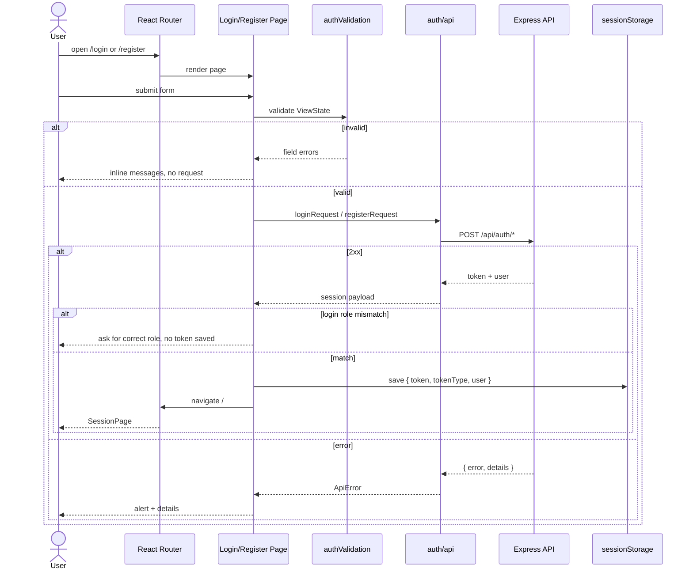

# Design Log #0007: Authentication Portal

**Ticket:** AG-106 [FE]
**Status:** Proposed → implemented (see §8)
**Depends on:** #0004 (auth API), #0005 (RBAC), #0006 (sanitization/errors)
**Traceability:** FR01 (Auth & RBAC), LSEPI legal/GDPR, NFR02 (security)

## 1. Background

The client is still the AG-101 scaffold: `client/src/App.jsx` renders a health
check card and has no routing, forms, or API calls. The backend already exposes:

- `POST /api/auth/register` → `201 { token, tokenType: "Bearer", user }`
- `POST /api/auth/login` → `200 { token, tokenType: "Bearer", user }`
- `GET /api/health` → `200 { status, service, timestamp }`

Registration accepts `name`, `email`, `password`, and optional `studentId`.
The server forces new accounts to the `student` role. Login accepts only
`email` and `password`; the returned `user.role` is the authoritative role.

AG-106 builds Screen 1: the public authentication portal at `/login` and
`/register`, with the role selector, institutional-email validation, and the
mandatory GDPR consent gate from the LSEPI legal requirements.

## 2. Problem

Without this ticket:

1. The browser has no `/login` or `/register` route; both URLs show the
   scaffold.
2. There is no form-level validation for the Greenwich institutional domain,
   password confirmation, student ID shape, or consent.
3. The prototype's role selector is not connected to the real account role, so
   a student could believe they are entering a lecturer workspace.
4. A user can submit without consent, violating the LSEPI/GDPR requirement.
5. There is no client-side session handoff for the next screens.
6. The client has no test runner, so UI behaviour cannot be verified with the
   same red/green discipline as the server.

## 3. Questions and Answers

- **Q1: Which router and route Contract?**
  - **A:** `react-router-dom@7` with `BrowserRouter`.
    - `/login` → `LoginPage`
    - `/register` → `RegisterPage`
    - `/` → `SessionPage` (temporary post-login workspace gate)
    - any other path → redirect to `/login`
  - Vite already serves `index.html` for unknown paths in development; the
    production host must provide the same SPA fallback.

- **Q2: Where is the role selector, and what does it do?**
  - **A:** The login page shows all three roles: Student, Lecturer, and
    Administrator. The selected role is a client-side intent check. After
    login, the page compares `response.user.role` with the selected role:
    - match → save the session and continue;
    - mismatch → show `This account is registered as a Student. Select Student
      to continue.` and do **not** save the token.
  - Registration is student self-service only. It shows all three roles for
    context, but Lecturer and Administrator are disabled with an
    “Invitation only” note. This matches the backend, which forces
    `role: "student"` on registration.
  - The backend remains authoritative; the selector never sends a role.

- **Q3: What is an institutional email?**
  - **A:** By default, an address whose domain is exactly
    `greenwich.edu.vn`. The allowed list is configurable with
    `VITE_INSTITUTIONAL_EMAIL_DOMAINS` (comma-separated), for example:
    `greenwich.edu.vn,student.greenwich.edu.vn`.
  - Matching is case-insensitive and exact; `@evilgreenwich.edu.vn` and
    `@greenwich.edu.vn.evil.com` are rejected.
  - Both login and registration enforce the domain. The server still validates
    only generic email syntax; server-side domain enforcement is a follow-up
    because existing seeded/admin accounts and API tests may use other domains.

- **Q4: Is consent required on login too?**
  - **A:** No. Consent is captured once at registration, where the account and
    processing purpose are created. Requiring it on every login would create a
    misleading “consent” record and add friction without adding legal value.
  - The register form requires the GDPR checkbox; the login form does not.

- **Q5: Is the consent recorded?**
  - **A:** The current auth API has no consent fields and the `User` schema has
    no consent sub-document. AG-106 enforces the legal gate in the UI and blocks
    submission without it. Persisting an auditable `acceptedAt`/`version`
    record requires a backend contract change and is intentionally not invented
    here. This limitation is called out in §7 and §8.

- **Q6: Where is the JWT stored?**
  - **A:** In `sessionStorage` under `aptis-go.auth` as
    `{ token, tokenType, user }`. Session storage is cleared when the tab
    closes and is less persistent than `localStorage`. It is still readable by
    JavaScript, so a future hardening ticket should move to an httpOnly,
    SameSite cookie if the deployment supports it.

- **Q7: What does the API client do?**
  - **A:** `client/src/auth/api.js` wraps `fetch`, always sends JSON, parses the
    server's `{ error, details }` Contract, and throws `ApiError` with
    `status` and `details`. Network failures become a friendly message. It does
    not retry automatically; retries can duplicate account creation.

- **Q8: How are validation errors presented?**
  - **A:** Client-side field errors appear under the relevant input with
    `aria-invalid` and `role="alert"`. Server errors appear in a top-level
    alert; server `details` are listed below it. Login failures use the
    server's generic `Invalid email or password` message to avoid account
    enumeration.

- **Q9: What test framework?**
  - **A:** Vitest 5 + jsdom 29 + Testing Library, configured at the repository
    root. This keeps tests in `./tests/` as required and avoids adding a second
    test runner inside `client/`. The root `test` script remains the Node
    server suite; `test:ui` runs the React suite. Both are reported separately.

- **Q10: Is the password strength meter from the prototype included?**
  - **A:** No. The ticket does not require it, and a client-side “entropy”
    estimate is easy to misrepresent. The form enforces the server's 8–72
    character Contract and shows that rule. A strength meter can be added with
    an explicit, tested scoring Contract later.

## 4. Design

### 4.1 Authentication flow



### 4.2 ViewState Contracts

```text
LoginViewState = {
  email: string,
  password: string,
  role: 'student' | 'lecturer' | 'admin'
}

RegisterViewState = {
  name: string,
  studentId: string,
  email: string,
  password: string,
  confirmPassword: string,
  gdprConsent: boolean
}
```

Field errors are `Partial<Record<keyof ViewState, string>>`. The form-level
error is a separate `string | null`; server `details` are `string[]`.

### 4.3 Files and signatures

#### File: `client/src/auth/authValidation.js`

```javascript
export const USER_ROLES = Object.freeze(['student', 'lecturer', 'admin']);
export const ROLE_OPTIONS = Object.freeze([
  { value: 'student', label: 'Student', description: 'Placement, roadmap, mocks' },
  { value: 'lecturer', label: 'Lecturer', description: 'Review queue, rubric grading' },
  { value: 'admin', label: 'Administrator', description: 'Test banks, accounts, SLA' },
]);
export const INSTITUTIONAL_EMAIL_DOMAINS = Object.freeze([...]);

export function normalizeEmail(value: string): string;
export function validateInstitutionalEmail(value: string): string | null;
export function validatePassword(value: string): string | null;
export function validateLoginForm(viewState: LoginViewState):
  Partial<Record<'email' | 'password' | 'role', string>>;
export function validateRegisterForm(viewState: RegisterViewState):
  Partial<Record<'name' | 'studentId' | 'email' | 'password' | 'confirmPassword' | 'gdprConsent', string>>;
```

Validation rules:

| Field | Rule | Failure message |
| --- | --- | --- |
| `name` | required, trimmed, ≤ 80 chars | `Full name is required` / `Full name must be 80 characters or fewer` |
| `email` | required, ≤ 254, valid shape, exact institutional domain | `Institutional email is required` / `Enter a valid email address` / `Use your Greenwich email (@greenwich.edu.vn)` |
| `password` | 8–72 chars | `Password must be 8–72 characters` |
| `confirmPassword` | equals `password` | `Passwords do not match` |
| `studentId` | optional; 4–20 letters, digits, hyphens | `Student ID must be 4–20 letters, digits, or hyphens` |
| `gdprConsent` | must be `true` | `You must consent to the privacy notice to create an account` |
| `role` | one of `USER_ROLES` | `Select a valid role` |

#### File: `client/src/auth/api.js`

```javascript
export class ApiError extends Error {
  constructor(message: string, options?: { status?: number; details?: string[] });
}

export async function postJson(path: string, body: object): Promise<object>;
export async function loginRequest(input: { email: string; password: string }): Promise<AuthSession>;
export async function registerRequest(input: {
  name: string; email: string; password: string; studentId?: string;
}): Promise<AuthSession>;
```

`AuthSession` is `{ token: string, tokenType: 'Bearer', user: { id, name, email, role, ... } }`.
Requests use `VITE_API_URL` when set; otherwise the relative `/api/...` path
goes through the Vite proxy.

#### File: `client/src/auth/authStorage.js`

```javascript
export const AUTH_STORAGE_KEY = 'aptis-go.auth';
export function saveSession(session: AuthSession): void;
export function readSession(): AuthSession | null;
export function clearSession(): void;
```

`readSession` returns `null` for malformed JSON, a missing token, a missing
user, or an unknown role.

#### Files: components and pages

| File | Responsibility |
| --- | --- |
| `client/src/auth/AuthLayout.jsx` | Responsive brand panel + form card shell |
| `client/src/auth/RoleSelector.jsx` | Accessible radio-card fieldset; supports disabled roles |
| `client/src/auth/FormField.jsx` | Label, input, hint/error, `aria-invalid` |
| `client/src/auth/PasswordField.jsx` | Password input with Show/Hide |
| `client/src/auth/ConsentField.jsx` | GDPR checkbox + privacy summary |
| `client/src/auth/AuthAlert.jsx` | Error/success alert with optional details |
| `client/src/pages/LoginPage.jsx` | LoginViewState, role check, session save |
| `client/src/pages/RegisterPage.jsx` | RegisterViewState, consent gate, session save |
| `client/src/pages/SessionPage.jsx` | Temporary authenticated landing + sign out |
| `client/src/App.jsx` | Router and route table |

### 4.4 Visual direction

- Deep navy background with teal accents, matching the existing scaffold.
- Desktop split layout: brand/benefit panel on the left, form card on the right.
- Mobile: brand compacted above a full-width card.
- Role cards use real radio inputs with a visible selected state and disabled
  invitation-only cards.
- All controls have visible focus rings, labels, and error text.

## 5. Implementation Plan (TDD Approach)

1. **Write failing tests.**
   - `tests/auth-validation.test.jsx`: domain, password, student ID, consent,
     and role rules.
   - `tests/auth-portal.test.jsx`: route rendering, client validation, role
     mismatch, login/register API calls, session save, redirects, sign out, and
     password visibility.
2. **Run red:** `npm run test:ui` fails because the client modules/pages do not
   exist yet.
3. **Implement** validation, API/storage helpers, shared auth components,
   pages, and router.
4. **Run green:** `npm run test:ui`, `npm test`, `npm run lint`,
   `npm run format:check`, and `npm --prefix client run build`.
5. **Document** the routes and consent limitation in `README.md`; append §8.

## 6. Examples

### ✅ Correct institutional registration

```text
Full name: Amina Rahman
Student ID: GCS210884
Email: amina.rahman@greenwich.edu.vn
Password: Placement2026!
Confirm: Placement2026!
Consent: checked
```

### ❌ Wrong domain

```text
Email: amina@gmail.com
```

Rejected client-side with “Use your Greenwich email
(@greenwich.edu.vn)”. It never reaches `POST /api/auth/register`.

### ✅ Correct login role handling

```text
Selected role: Student
API user.role: student
```

Session saved; navigate to `/`.

### ❌ Login role mismatch

```text
Selected role: Lecturer
API user.role: student
```

Show the mismatch error and keep `sessionStorage` empty. Do not route to a
lecturer workspace.

### ❌ Missing consent

```text
Consent: unchecked
```

Submit is blocked and the checkbox error is announced; no request is sent.

## 7. Trade-offs

- **Client-side role selector vs. server-enforced role.** The selector is
  useful UX, but only the JWT/user record is authoritative. A mismatch is
  rejected after authentication rather than trusted before it.
- **Student-only registration.** This matches the current backend and prevents
  privilege escalation. Lecturer/admin provisioning needs an invitation flow.
- **Domain validation in the client.** Fast feedback, but bypassable. Server
  enforcement is a follow-up because it changes the existing auth Contract.
- **Consent is not persisted.** The UI gate satisfies the interaction
  requirement, but an audit record requires schema/API work. This is the main
  known limitation.
- **Session storage.** Better than `localStorage` for a JWT, still
  XSS-readable. httpOnly cookies are stronger but need CORS/CSRF changes.
- **Vitest at the root.** Adds test tooling and a small amount of config, but
  keeps the required `./tests/` layout and avoids a second test runner.
- **No password strength meter.** Avoids a false sense of security; the
  server's length rule is enforced and explained.

## 8. Implementation Results

### 8.1 Results

- **TDD red phase:** `npm run test:ui` → **0 tests collected, 2 files failed**
  because `client/src/auth/authValidation.js` and
  `client/src/auth/authStorage.js` did not exist.
- **Focused green phase:** `npm run test:ui` → **26 passed, 0 failed** across
  two files:
  - `tests/auth-validation.test.jsx` — 14 tests for domain, password, student
    ID, name, role, and consent rules.
  - `tests/auth-portal.test.jsx` — 12 tests for route rendering, client
    validation, role mismatch, login/register API calls, session storage,
    redirects, sign out, and password visibility.
- **API suite:** `npm test` → **85 tests, 83 passed, 2 skipped** without a
  database (the two opt-in Mongo integration tests).
- **API suite with local MongoDB:** `MONGODB_TEST_URI=... npm test` →
  **85 passed, 0 failed, 0 skipped**.
- **Lint:** `npm run lint` → exit 0 for root, client, and server.
- **Formatting:** `npm run format:check` → all matched files conform.
- **Production build:** `npm --prefix client run build` → 35 modules, built
  successfully.
- **Files delivered:**
  - `client/src/App.jsx` — router with `/login`, `/register`, `/` session gate;
  - `client/src/auth/authValidation.js`, `api.js`, `authStorage.js`;
  - `client/src/auth/AuthLayout.jsx`, `RoleSelector.jsx`, `FormField.jsx`,
    `PasswordField.jsx`, `ConsentField.jsx`, `AuthAlert.jsx`;
  - `client/src/pages/LoginPage.jsx`, `RegisterPage.jsx`, `SessionPage.jsx`;
  - `client/src/index.css` — base theme;
  - `client/.env.example` — institutional-domain setting;
  - `tests/auth-validation.test.jsx`, `tests/auth-portal.test.jsx`,
    `tests/setup.js`, `vitest.config.mjs`;
  - `package.json` — `test:ui`, `test:all`, Vitest/jsdom tooling;
  - `client/package.json` — `react-router-dom`, Testing Library packages;
  - `README.md` — routes, domain setting, test matrix, roadmap;
  - this design log.

### 8.2 Deviations from the Plan

- **React test harness needed a single React copy.** The first green attempt
  failed with `Invalid hook call` because the root Testing Library renderer and
  the client's `react-router-dom` resolved different React installations.
  Resolution: Vitest stays at the root, while React, ReactDOM, and Testing
  Library live in `client/node_modules`; `vitest.config.mjs` aliases their bare
  imports to those client paths. This keeps the tests in `./tests/` and makes
  the rendered tree use one React instance.
- **The registration role selector shows all roles but only Student is
  enabled.** This follows the backend's forced `role: "student"` rather than
  pretending Lecturer/Administrator self-registration works.
- **Consent is a UI gate only.** The checkbox is required and the form cannot
  submit without it, but the API has no consent fields and no consent record is
  written. This is the known LSEPI follow-up: add an auditable
  `acceptedAt`/`version` sub-document and accept it in `POST /api/auth/register`.
- **Institutional-domain enforcement is client-side.** The server still accepts
  any syntactically valid email. A server-side domain rule is a follow-up
  because it would change existing API tests and seeded-account assumptions.
- **The password strength meter from the prototype was not included.** The
  ticket did not require it and the server's 8–72 character Contract is shown
  instead.
- **The health-check landing view was replaced.** `/` is now the authenticated
  session gate; API health is still available at `GET /api/health` but is not
  shown on the auth screen.
- **Atlas was not required for this ticket.** The API suite ran without a
  database; the React suite is database-independent.

