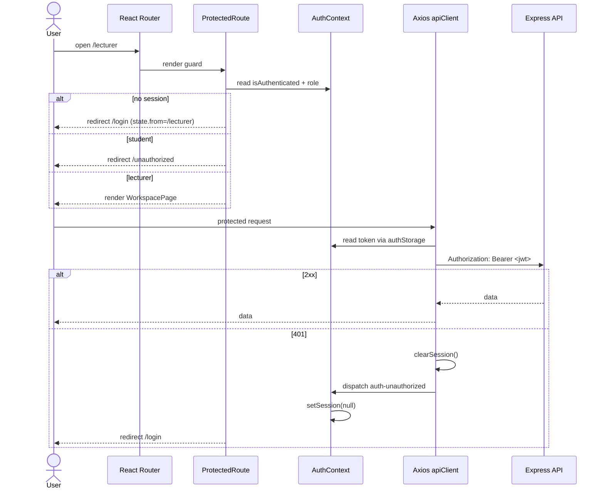

# Design Log #0008: Auth Context, Axios Interceptors, and Protected Routes

**Ticket:** AG-107 [FE]
**Status:** Proposed → implemented (see §8)
**Depends on:** #0004 (auth API), #0005 (RBAC), #0007 (auth portal)
**Traceability:** FR01 (Auth & RBAC), NFR02 (security), LSEPI access control

## 1. Background

AG-106 delivered `/login`, `/register`, and a temporary authenticated
`SessionPage`. Authentication state is currently handled in two places:

- `LoginPage` and `RegisterPage` call the fetch-based `auth/api.js` helpers and
  write the session directly to `sessionStorage`.
- `SessionPage` reads `sessionStorage` again and signs out by clearing it.

The API contract is unchanged: the backend issues a stateless HS256 JWT from
`POST /api/auth/register` and `POST /api/auth/login`, and role-protected server
routes expect `Authorization: Bearer <token>`.

AG-107 centralizes browser authentication, attaches the JWT to every Axios
request, and adds route-level role guards so a student cannot open a lecturer or
administrator screen by typing its URL.

## 2. Problem

Without this ticket:

1. There is no single source of truth for the signed-in user. Pages read
   `sessionStorage` independently and can drift out of sync after login,
   logout, or a `401`.
2. API requests do not send the JWT automatically, so the next protected
   domain screens would each have to add the header manually.
3. A `401` from the API does not clear the client session or return the user to
   the login screen.
4. `/student`, `/lecturer`, and `/admin` do not exist, and there is no reusable
   guard to enforce `allowedRoles`.
5. An authenticated user visiting `/login` or `/register` is not redirected to
   their workspace.
6. The current `fetch` wrapper duplicates error normalization that Axios can
   centralize.

## 3. Questions and Answers

- **Q1: Where does authentication state live?**
  - **A:** `AuthProvider` owns the in-memory `AuthSession` for the React tree.
    `sessionStorage` remains the persistence layer for a tab-scoped session, so
    a refresh restores the user. `AuthProvider` initializes from
    `readSession()` and exposes `{ session, user, token, role,
    isAuthenticated, login, register, logout }` through `AuthContext`.
  - `sessionStorage` is still readable by JavaScript. Moving to an httpOnly
    cookie remains a future hardening step.

- **Q2: Why Axios instead of the existing fetch wrapper?**
  - **A:** Axios gives one request pipeline for the JWT header and one response
    pipeline for API errors and `401` handling. The existing fetch wrapper has
    to repeat that logic in every caller. Axios is added as a client runtime
    dependency; no backend change is needed.

- **Q3: How does the request interceptor get the token?**
  - **A:** It reads the current token through `getAccessToken()` from
    `authStorage.js`. This avoids importing React into the Axios module and
    keeps the interceptor usable outside a component. The session is still the
    single source of truth; the token is only read, not duplicated.

- **Q4: What happens on a `401`?**
  - **A:** The response interceptor clears `sessionStorage` and dispatches
    `aptis-go:auth-unauthorized`. `AuthProvider` listens for that event and sets
    its session to `null`. `ProtectedRoute` then redirects to `/login` on the
    next render. The interceptor does not call `navigate()` directly because it
    is outside the React Router tree.
  - A `401` from a login attempt is harmless: there is no session to clear, and
    the page still displays the server's `Invalid email or password` message.

- **Q5: What is the `ProtectedRoute` Contract?**
  - **A:** `ProtectedRoute({ allowedRoles = [], children })`.
    - No authenticated session → `/login`, with `state.from` set to the
      attempted path so login can return there.
    - Authenticated but role not in `allowedRoles` → `/unauthorized`, with the
      attempted path and required roles in location state.
    - Authorized → render `children`.
    - An empty `allowedRoles` means “any authenticated role”.

- **Q6: Which routes are protected?**
  - **A:**
    - `/student` → `allowedRoles={['student']}`
    - `/lecturer` → `allowedRoles={['lecturer']}`
    - `/admin` → `allowedRoles={['admin']}`
    - `/` → `RoleHomeRedirect`, which sends the user to their role route or to
      `/login`
    - `/unauthorized` → `AccessDeniedPage`
    - `/login` and `/register` remain public, but redirect an already
      authenticated user to `/`
  - The three role pages share `WorkspacePage`; only the guard differs. The
    placeholder content is intentionally role-specific so the guard result is
    visible.

- **Q7: Is the role guard a security boundary?**
  - **A:** No. It prevents accidental client-side navigation and gives clear
    UX, but the Express API remains the authorization boundary. Every protected
    server route must still use `verifyToken` and `authorizeRoles`. The client
    guard cannot protect data that the API exposes without checking the JWT.

- **Q8: Where is the role mismatch check?**
  - **A:** It stays in `AuthProvider.login()`, because the session must not be
    saved before the selected role is compared with `response.user.role`.
    `login()` throws `AuthError` with code `ROLE_MISMATCH`; `LoginPage` displays
    its message. This keeps the AG-106 role-selector behaviour and prevents a
    mismatched token from entering the context.

- **Q9: What happens to API errors?**
  - **A:** `apiClient` normalizes Axios failures into the existing `ApiError`
    Contract `{ message, status, details }`. Network failures use status `0`;
    server `{ error, details }` payloads are preserved. `ApiError` moves to
    `apiError.js` so the Axios module and the request wrappers can share it
    without a circular import.

- **Q10: How is the Axios pipeline tested without a live API?**
  - **A:** Tests install a small custom Axios adapter on `apiClient`. The adapter
    records request configs, returns `{ status, data }`, and rejects non-2xx
    responses with `AxiosError`. This exercises the real interceptors without a
    network or a second mocking library.

## 4. Design

### 4.1 Request and guard flow



### 4.2 AuthSession and context Contract

```text
AuthSession = {
  token: string,
  tokenType: 'Bearer',
  user: {
    id: string,
    name: string,
    email: string,
    role: 'student' | 'lecturer' | 'admin'
  }
}

AuthContextValue = {
  session: AuthSession | null,
  user: AuthSession['user'] | null,
  token: string | null,
  role: UserRole | null,
  isAuthenticated: boolean,
  login: (input: { email: string, password: string, role: UserRole }) => Promise<AuthSession>,
  register: (input: { name: string, email: string, password: string, studentId?: string }) => Promise<AuthSession>,
  logout: () => void
}
```

`login()` validates the returned role before writing to storage. `register()`
accepts only the existing registration fields; it never sends a client-selected
role or consent flag.

### 4.3 Files and signatures

| File | Responsibility |
| --- | --- |
| `client/src/auth/authContext.js` | `AuthContext = createContext(null)` |
| `client/src/auth/AuthProvider.jsx` | Session state, login/register/logout, 401 event listener |
| `client/src/auth/useAuth.js` | `useAuth(): AuthContextValue`, throws outside the provider |
| `client/src/auth/authError.js` | `AuthError` for client-side auth failures such as role mismatch |
| `client/src/auth/apiError.js` | Shared `ApiError` Contract |
| `client/src/auth/apiClient.js` | Axios instance, Bearer request interceptor, 401/error response interceptor |
| `client/src/auth/api.js` | `loginRequest`, `registerRequest`; re-exports `ApiError` |
| `client/src/auth/authStorage.js` | Existing session storage plus `getAccessToken()` |
| `client/src/auth/ProtectedRoute.jsx` | Role-aware navigation guard |
| `client/src/pages/WorkspacePage.jsx` | Authenticated role-specific placeholder and sign out |
| `client/src/pages/AccessDeniedPage.jsx` | 403-style explanation and safe navigation |
| `client/src/App.jsx` | `AuthProvider`, route table, role home redirect |

Key signatures:

```javascript
export function getAccessToken(): string | null;
export class AuthError extends Error {
  constructor(message: string, code?: string);
}
export class ApiError extends Error {
  constructor(message: string, options?: { status?: number; details?: string[] });
}
export const apiClient: AxiosInstance;
export function ProtectedRoute({ allowedRoles?: UserRole[], children }): ReactNode;
```

### 4.4 Route table

```text
/              RoleHomeRedirect
/login         LoginPage
/register      RegisterPage
/student       ProtectedRoute(['student'])  -> WorkspacePage
/lecturer      ProtectedRoute(['lecturer']) -> WorkspacePage
/admin         ProtectedRoute(['admin'])    -> WorkspacePage
/unauthorized  AccessDeniedPage
*              -> /login
```

## 5. Implementation Plan (TDD Approach)

1. **Write failing tests.**
   - `tests/auth-portal.test.jsx`: migrate existing AG-106 coverage from
     `fetch` mocks to the Axios adapter; verify login/register still save the
     session and reach the student workspace.
   - `tests/auth-context.test.jsx`: initial restore, login role mismatch,
     register, logout, and `401` event handling.
   - `tests/axios-client.test.jsx`: Bearer header, no header without a session,
     `401` clears storage and emits the event, and `ApiError` normalization.
   - `tests/protected-route.test.jsx`: unauthenticated redirect, wrong-role
     denial, correct-role access, role-home redirect, and access-denied
     recovery.
2. **Run red:** `npm run test:ui` fails on missing `apiClient`, `AuthProvider`,
   `ProtectedRoute`, and the new route modules.
3. **Implement** Axios/error modules, AuthContext, guards, pages, and routes.
4. **Run green:** `npm run test:ui`, `npm test`, `npm run lint`,
   `npm run format:check`, and `npm --prefix client run build`.
5. **Document** the new architecture and route table in `README.md`; append §8.

## 6. Examples

### ✅ Correct protected access

```text
Session role: lecturer
URL: /lecturer
allowedRoles: ['lecturer']
```

`ProtectedRoute` renders `WorkspacePage`; the Axios request interceptor sends
`Authorization: Bearer <token>`.

### ❌ Wrong-role URL

```text
Session role: student
URL: /lecturer
allowedRoles: ['lecturer']
```

Redirect to `/unauthorized`; the session is **not** cleared. The student can
return to `/student` or sign out.

### ✅ Correct 401 handling

```text
Session exists -> protected request -> 401
```

The interceptor clears `sessionStorage`, emits `aptis-go:auth-unauthorized`,
the provider sets `session` to `null`, and the guard redirects to `/login`.

### ❌ Trusting the client guard

```text
Client hides /admin from students
Server /api/admin route has no verifyToken/authorizeRoles
```

The API is still exposed. Client guards are UX only; server authorization is
mandatory.

### ❌ Saving before role verification

```text
Selected role: lecturer
API user.role: student
saveSession() called before comparison
```

This would put a student token into a lecturer-looking session. `AuthProvider`
compares first and throws `AuthError` without saving.

## 7. Trade-offs

- **Axios dependency.** Adds a runtime dependency but removes repeated fetch
  header/error handling and gives a testable interceptor pipeline.
- **Session storage.** Keeps the existing tab-scoped behaviour; still
  XSS-readable. httpOnly cookies remain the stronger future option.
- **Client-side role guards.** Fast UX, not a security boundary. Server RBAC
  remains mandatory.
- **Custom event for 401.** Avoids coupling Axios to React Router and avoids
  importing a router outside the component tree. The cost is one global event
  name and a listener in `AuthProvider`.
- **Role-specific placeholder pages.** They are not the final dashboards, but
  they make the guard outcome visible and give the next tickets a stable route
  target.
- **No token refresh.** The current backend has no refresh-token endpoint; a
  `401` logs the user out instead of retrying.

## 8. Implementation Results

**Status:** Complete on 2026-10-28.

### Implemented

- `client/src/auth/authContext.js`, `useAuth.js`, and `AuthProvider.jsx` provide
  the session context, restore `sessionStorage`, and expose
  `login`/`register`/`logout`.
- `client/src/auth/apiClient.js` creates the Axios instance, attaches the JWT
  Bearer header, normalizes failures to `ApiError`, and handles `401` by
  clearing the session and emitting `aptis-go:auth-unauthorized`.
- `client/src/auth/api.js` now uses Axios and re-exports `ApiError`.
- `client/src/auth/ProtectedRoute.jsx` implements the `allowedRoles` guard.
- `client/src/pages/WorkspacePage.jsx` replaces the AG-106 `SessionPage` with
  role-specific authenticated content and sign out.
- `client/src/pages/AccessDeniedPage.jsx` provides the wrong-role recovery
  screen.
- `client/src/App.jsx` adds `AuthProvider`, `/student`, `/lecturer`, `/admin`,
  `/unauthorized`, and the role-home redirect.
- `client/src/auth/AuthLayout.jsx` accepts an optional `asideLabel` so the
  workspace and denial screens can label the side panel correctly.
- `axios@1.21.0` was added to `client/package.json` and the client lockfile.

### TDD evidence

The tests were written before the implementation. The first `npm run test:ui`
run failed because `client/src/auth/apiClient.js`, `AuthProvider.jsx`,
`useAuth.js`, and the new pages did not exist. After implementation:

```text
Test Files  5 passed (5)
Tests       44 passed (44)
```

The added protected-route test covers returning to the originally requested
route after login through `location.state.from`.

### Verification

| Command | Result |
| --- | --- |
| `npm run test:ui` | 44/44 passed |
| `npm test` | 85 tests, 83 passed, 2 skipped without `MONGODB_TEST_URI` |
| `MONGODB_TEST_URI=mongodb://127.0.0.1:27017/aptis-go-test npm test` | 85/85 passed |
| `npm run lint` | clean |
| `npm run format:check` | clean |
| `npm --prefix client run build` | successful, 102 modules transformed |

### Deviations from the plan

- `AuthProvider`, `AuthContext`, and `useAuth` were split into three modules
  instead of one component module to keep the React Fast Refresh export rule
  clean and avoid a component file exporting a hook.
- `AuthProvider` clears storage again when it receives the unauthorized event.
  The Axios interceptor already clears it; the duplicate is defensive so the
  event always leaves the browser in a signed-out state.
- `SessionPage.jsx` was deleted rather than kept as a compatibility alias. No
  route or test referenced it after the workspace replacement.
- `vitest.config.mjs` now aliases `axios` to `client/node_modules`, matching the
  existing React/testing-library aliases for the root test runner.
- No backend or API Contract changed. Client guards remain UX only; server
  `verifyToken` and `authorizeRoles` are still the authorization boundary.
- The full 85/85 API run used local MongoDB because the Atlas allowlist did not
  include the current public IP. This does not affect the frontend-only
  AG-107 verification.
