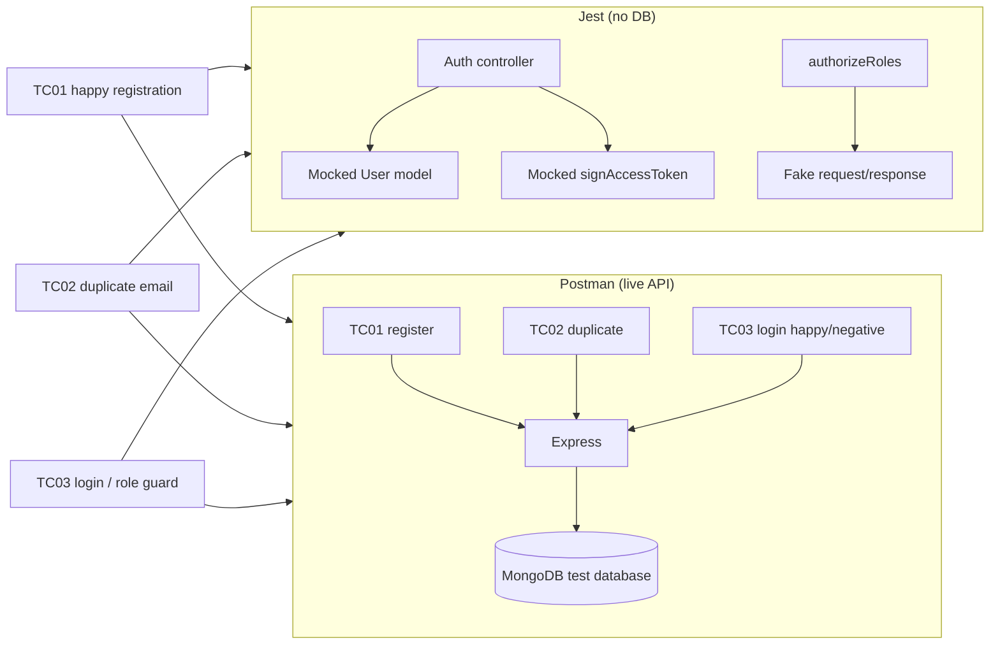

# Design Log #0009: Jest and Postman Authentication Tests (TC01–TC03)

**Ticket:** AG-108 [QA]
**Status:** Proposed → implemented (see §8)
**Depends on:** #0004 (auth API), #0005 (RBAC), #0007 (auth portal), #0008 (client auth context)
**Traceability:** FR01, TC01–TC03 in `docx/07_STP_Test_Plan_and_RTM.md`

## 1. Background

The authentication flow is implemented and covered by two existing suites:

- Node's built-in `node:test` for the Express API, including the opt-in
  MongoDB integration test.
- Vitest + jsdom for the React auth portal and route guards.

The STP asks for TC01–TC03 and explicitly names Jest for unit tests and
Postman for API-contract assertions. Neither artifact exists in the repository
yet, so the QA evidence is currently scattered across implementation tests and
is not reusable by a tester or CI job.

The relevant API Contract is:

| Method | Path | Success | Failure |
| --- | --- | --- | --- |
| `POST` | `/api/auth/register` | `201 { token, tokenType, user }` | `400` validation, `409` duplicate |
| `POST` | `/api/auth/login` | `200 { token, tokenType, user }` | `400` validation, `401` invalid credentials |

## 2. Problem

Without AG-108:

1. There is no Jest suite, despite the STP naming Jest for unit-level evidence.
2. There is no checked-in Postman collection that a tester can run against the
   live API to prove the registration and login paths.
3. TC01–TC03 are not traceable to executable artifacts in one place.
4. The STP and the implementation disagree in two places:
   - TC02 expects `400 Email already in use`; the API returns
     `409 Email is already registered`.
   - TC03 expects `403 Access forbidden: Requires lecturer role` from
     `/api/submissions/lecturer/pending`; that domain route is not implemented
     yet, and the middleware currently returns `403 { "error": "Forbidden" }`.
5. A test that asserts the document rather than the implemented Contract would
   fail for the wrong reason and hide the real mismatch.

## 3. Questions and Answers

- **Q1: Should Jest replace `node:test` or Vitest?**
  - **A:** No. The ticket explicitly requests Jest unit tests, so Jest is added
    as a narrowly scoped runner for controller/middleware unit tests under
    `tests/jest/`. Existing `node:test` and Vitest suites remain authoritative
    for their existing coverage. This avoids a risky framework migration in a
    QA ticket.

- **Q2: What is a “unit test” here?**
  - **A:** The controller and middleware are exercised directly with mocked
    persistence and JWT signing. No MongoDB connection, HTTP listener, or
    browser is required. The tests assert:
    - TC01: registration returns `201`, a Bearer JWT, and a student user.
    - TC02: duplicate email returns `409` and does not call `User.create`.
    - TC03 login: valid credentials return `200`; wrong password and unknown
      email return the same `401 Invalid email or password`.
    - TC03 security: a student token is rejected by
      `authorizeRoles('lecturer')` with `403`.

- **Q3: How should TC03 be interpreted?**
  - **A:** The STP defines TC03 as unauthorized access to the lecturer
    workspace. That endpoint is not implemented yet, so a Postman request would
    only prove `404`, not the required `403`. The Jest middleware test keeps the
    role-guard guarantee executable now. The Postman collection covers the
    login happy/negative paths named in this ticket under `TC03`; the deferred
    Postman role-guard request will be added when
    `/api/submissions/lecturer/pending` exists.
  - This is an explicit, documented deviation from the STP row, not a claim
    that the missing endpoint was tested.

- **Q4: Should Postman assert the STP's `400` or the implemented `409`?**
  - **A:** Assert the implemented `409 Email is already registered` because
    that is the current API Contract and the existing integration test already
    proves it. The STP text is stale; changing the API to `400` would be a
    breaking contract change outside AG-108. The design log records the
    mismatch so the STP can be corrected separately.

- **Q5: Where does the Postman collection live?**
  - **A:** `postman/collections/aptis-go-auth/`, in the Git-native v3 format.
    Each request is a separate `*.request.yaml`, so assertions are reviewable
    beside the API code. Collection-level variables hold `baseUrl`,
    `qaEmail`, `qaPassword`, and `studentToken`; no real secret is committed.

- **Q6: How is a unique registration email produced?**
  - **A:** A collection-level `http:beforeRequest` script creates
    `qa.<timestamp>.<random>@greenwich.edu.vn` only when `qaEmail` is empty.
    TC01 registers it, TC02 reuses it to prove duplicate handling, and TC03
    logs in with it. A second run starts from the empty file value and gets a
    new address, so local data does not collide.

- **Q7: What does a Postman run actually prove?**
  - **A:** It proves the live Express API, connected to the configured MongoDB,
    returns the asserted status and JSON shape. It does not prove bcrypt hashing
    by itself; the existing `auth.integration.test.js` verifies the stored hash
    and JWT claims. Passing against a mock would not prove the real service, so
    the documented run targets the real local API.

- **Q8: How should the collection be run?**
  - **A:**
    ```bash
    # Terminal 1: API with a test database
    MONGODB_URI=mongodb://127.0.0.1:27017/aptis-go-qa \
      JWT_SECRET=<at-least-32-characters> \
      npm run dev:server

    # Terminal 2
    postman collection lint postman/collections/aptis-go-auth
    postman collection run postman/collections/aptis-go-auth \
      --env-var baseUrl=http://127.0.0.1:5000
    ```
  - The secret is supplied at runtime and never written to the collection.

- **Q9: Why not use the Postman cloud workspace?**
  - **A:** A local v3 collection is reviewable in Git, works without a Postman
    login, and is the format the repository’s API-testing skill recommends for
    reusable assertions. A cloud copy can be pushed later from the same files.

## 4. Design

### 4.1 Artifact flow



### 4.2 Jest layout

```text
jest.config.cjs                  # node environment, tests/jest/**/*.test.js only
tests/jest/auth-controller.test.js
```

The root `package.json` gains:

```json
{
  "scripts": {
    "test:jest": "jest --runInBand"
  }
}
```

The controller test imports the real controller and middleware, but mocks only
the persistence/JWT boundary:

```javascript
jest.mock('../../server/src/utils/jwt', () => ({
  signAccessToken: jest.fn(),
  verifyAccessToken: jest.fn(),
}));

const User = require('../../server/src/models/User');
const { register, login } = require('../../server/src/controllers/authController');
const { authorizeRoles } = require('../../server/src/middleware/authMiddleware');
```

`User.exists`, `User.create`, and `User.findOne` are replaced with Jest spies;
`authorizeRoles` is exercised with a plain `{ user: { role: 'student' } }`
request. No database is touched.

### 4.3 Postman collection layout

```text
postman/collections/aptis-go-auth/
├── .resources/
│   └── definition.yaml
├── TC01 Register student.request.yaml
├── TC02 Register duplicate email.request.yaml
├── TC03 Login student.request.yaml
├── TC03b Login wrong password.request.yaml
└── TC03c Login unknown email.request.yaml
```

Collection variables:

| Variable | Default | Purpose |
| --- | --- | --- |
| `baseUrl` | `http://localhost:5000` | API origin; overridable at run time |
| `qaEmail` | empty | Unique address generated once per run |
| `qaPassword` | `Placement2026!` | Test-only password; not a production secret |
| `studentToken` | empty | JWT captured by TC01/TC03 for later requests |

Assertion summary:

| Request | Status | Key assertions |
| --- | --- | --- |
| TC01 Register student | `201` | Bearer token, 3-part JWT, student role, `UNTESTED`, no password |
| TC02 Register duplicate email | `409` | `Email is already registered`, no token |
| TC03 Login student | `200` | Bearer token, same email, student role |
| TC03b Login wrong password | `401` | `Invalid email or password`, no token |
| TC03c Login unknown email | `401` | same body as wrong password (no account enumeration) |

### 4.4 Validation and failure behavior

- Jest tests fail if a mocked controller returns the wrong status, shape, or
  calls persistence when it should not.
- Postman tests fail on status or body mismatch even when the HTTP request
  itself succeeds.
- A collection-level pre-request script must not overwrite `qaEmail` between
  TC01 and TC02; the guard is `if (!pm.collectionVariables.get('qaEmail'))`.
- The collection must not contain `JWT_SECRET`, a MongoDB URI, or a real
  account password.

## 5. Implementation Plan (TDD Approach)

1. **Write the failing Jest suite first** in
   `tests/jest/auth-controller.test.js`, plus `jest.config.cjs` and the
   `test:jest` script.
2. **Run red:** `npm run test:jest` fails because Jest is not installed (or
   the new tests are not yet discoverable).
3. **Install and configure Jest**, then run the suite green. No production
   server code changes are expected.
4. **Create the Postman v3 collection** with the requests and assertions from
   §4.3.
5. **Lint the collection** with `postman collection lint`.
6. **Run the collection against the real local API** with a local MongoDB test
   database and verify the exit code and assertion count.
7. **Update `README.md`** with the new commands and traceability.
8. **Run the full quality gates** and append §8.

## 6. Examples

### ✅ Correct duplicate-email assertion

```javascript
pm.test('TC02 duplicate email is rejected', () => {
  pm.response.to.have.status(409);
  pm.expect(pm.response.json().error).to.eql('Email is already registered');
});
```

This matches the implemented API and the existing integration test.

### ❌ Asserting the stale STP text

```javascript
pm.response.to.have.status(400);
pm.expect(pm.response.json().error).to.eql('Email already in use');
```

The API returns `409 Email is already registered`; this would fail while the
real behavior is correct.

### ✅ Correct TC03 security unit test

```javascript
const guard = authorizeRoles('lecturer');
guard({ user: { role: 'student' } }, response, next);
expect(response.statusCode).toBe(403);
```

This proves the middleware boundary without pretending the unimplemented
submissions endpoint exists.

### ❌ Claiming the missing endpoint passed

```text
POST /api/submissions/lecturer/pending -> 404
```

A `404` means the route is absent; it does not prove role authorization.

### ✅ Unique Postman email

```javascript
if (!pm.collectionVariables.get('qaEmail')) {
  pm.collectionVariables.set('qaEmail', `qa.${Date.now()}@greenwich.edu.vn`);
}
```

TC02 can reuse the address without overwriting it.

### ❌ Committing a real secret

```yaml
variables:
  - key: jwtSecret
    value: 'production-secret'
```

Secrets belong in the runtime environment, never in the collection file.

## 7. Trade-offs

- **Second test runner.** Jest adds dependencies and a second unit-test command,
  but the ticket explicitly names Jest and the suite is isolated to
  `tests/jest/`. Migrating the existing Node/Vitest suites would be riskier.
- **Controller mocks.** Unit tests do not prove bcrypt or database behavior.
  The existing MongoDB integration test covers those; Postman covers the live
  HTTP Contract.
- **TC03 deviation.** The lecturer-workspace endpoint is not available, so the
  Postman collection cannot assert its `403` yet. The Jest middleware test
  preserves the role-guard evidence and the gap is explicit.
- **Stale STP.** Asserting the implemented `409` keeps the test honest, but the
  STP row remains inconsistent until corrected.
- **Dynamic email.** A generated address keeps repeat runs independent; the
  trade-off is that the collection depends on a pre-request script and a
  database that accepts writes.
- **Local collection vs cloud.** Git-native files are reviewable and
  credential-free; sharing in Postman requires a later publish step.

## 8. Implementation Results

**Status:** Complete on 2026-10-28.

### Implemented

- Added Jest 30.5.2 as a root dev dependency and `jest.config.cjs` scoped to
  `tests/jest/**/*.test.js`.
- Added `tests/jest/auth-controller.test.js` with seven tests covering TC01
  registration, validation, TC02 duplicate email, TC03 login happy/wrong
  password/unknown email, and the lecturer role guard.
- Added `postman/collections/aptis-go-auth/` as a v3 Git-native collection:
  - `TC01 Register student (happy)`
  - `TC02 Register duplicate email (negative)`
  - `TC03 Login student (happy)`
  - `TC03b Login wrong password (negative)`
  - `TC03c Login unknown email (negative)`
- Added collection-level variables and a guarded pre-request script that
  generates one unique `qaEmail` per run.
- Added `test:jest` and included it in `test:all`.
- Added Jest globals to the root ESLint config and updated `README.md`.

### TDD evidence

The Jest suite was written before Jest was installed. The first run failed:

```text
'jest' is not recognized as an internal or external command
```

After installing Jest and adding the config:

```text
Test Suites: 1 passed, 1 total
Tests:       7 passed, 7 total
```

### Verification

| Command | Result |
| --- | --- |
| `npm run test:jest` | 7/7 passed |
| `npm run test:ui` | 44/44 passed |
| `npm test` | 85 tests, 83 passed, 2 skipped without `MONGODB_TEST_URI` |
| `MONGODB_TEST_URI=mongodb://127.0.0.1:27017/aptis-go-test npm test` | 85/85 passed |
| `postman collection lint postman/collections/aptis-go-auth` | 5 entities, 0 errors, 0 warnings |
| `postman collection run postman/collections/aptis-go-auth --env-var baseUrl=http://127.0.0.1:5108` | 5 requests, 11 assertions, 0 failed, exit code 0 |
| `npm run lint` | clean |
| `npm run format:check` | clean |
| `npm --prefix client run build` | successful, 102 modules transformed |

The Postman run targeted a real Express instance connected to local MongoDB.
The CLI printed a "No authorization data found" notice because no Postman cloud
login is required for a local collection; it did not affect the run.

### Deviations from the plan

- TC03 in the STP is the lecturer-workspace `403`, but that endpoint is not
  implemented. The Jest suite covers the `authorizeRoles('lecturer')` guard
  directly; the Postman collection uses TC03 for the login paths named in this
  ticket. A live Postman role-guard request remains deferred.
- TC02 asserts the implemented `409 Email is already registered`, not the STP's
  `400 Email already in use`. The API was not changed; the stale STP row should
  be corrected separately.
- The Postman collection uses five requests rather than three because TC03 is
  split into login happy, wrong password, and unknown email.
- The Postman CLI reports `prerequest-scripts: 0`; the collection-level script
  still ran, as shown by the successful unique-email registration. The counter
  appears to exclude collection-level scripts.
- No production server code was changed.
