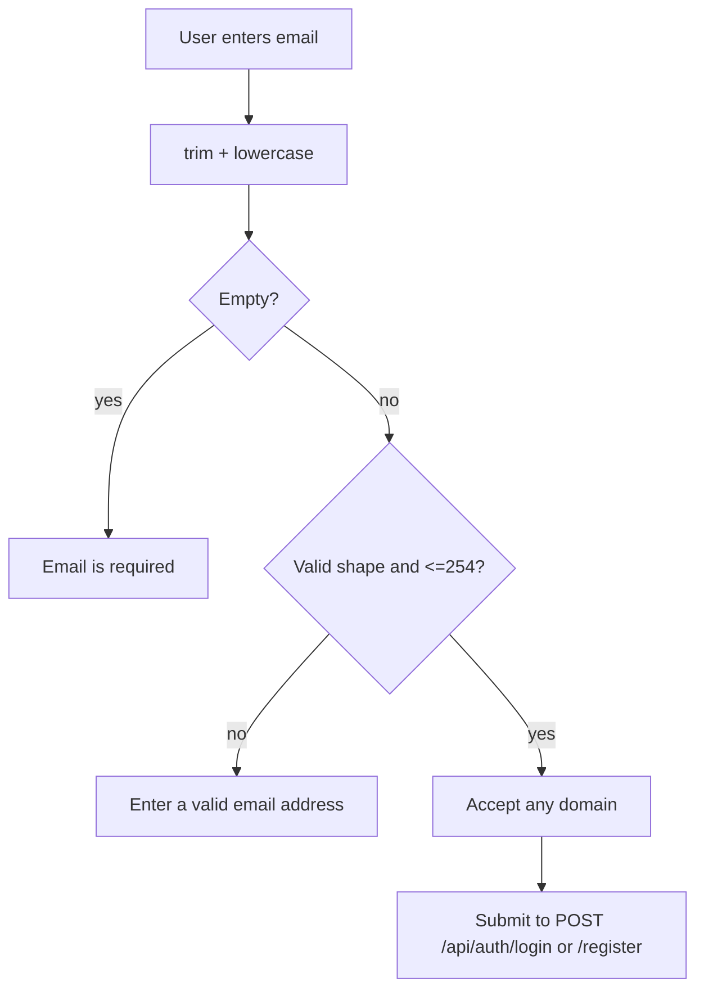

# Design Log #0010: Accept Any Valid Email Address

**Status:** Proposed → implemented (see §8)
**Related:** #0007 authentication portal, #0009 auth QA suites
**Traceability:** FR01 authentication

## 1. Background

The client currently enforces a Greenwich institutional-domain allowlist:

```text
VITE_INSTITUTIONAL_EMAIL_DOMAINS=greenwich.edu.vn
```

`validateInstitutionalEmail()` rejects any address whose domain is not in that
list. The server validator only checks email shape, so the restriction exists
only in the browser.

The product now needs to accept any valid email address. A university address
should remain a helpful suggestion, not a gate. The requested suggestion is
`@fpt.edu.vn`.

## 2. Problem

Users with valid but non-Greenwich addresses cannot register or sign in from the
UI, even though the API would accept them. The current labels and error copy
also imply that only Greenwich addresses are allowed.

The change must not:

- weaken the required/format checks,
- alter the server Contract,
- invalidate existing accounts, or
- leave a dead `VITE_INSTITUTIONAL_EMAIL_DOMAINS` setting that implies
  enforcement still exists.

## 3. Questions and Answers

- **Q1: Should the server change too?**
  - **A:** No. `server/src/validators/authValidator.js` already accepts any
    syntactically valid email. The client is the only enforcement point.

- **Q2: What validation remains?**
  - **A:** Required, maximum 254 characters, and a single `@`-shaped address
    with a dot in the domain. Values are trimmed and lowercased before
    submission. No domain comparison remains.

- **Q3: Is `@fpt.edu.vn` enforced?**
  - **A:** No. It appears only as a placeholder and hint:
    `name@fpt.edu.vn`. `amina@gmail.com`, `student@university.edu`, and
    `amina@greenwich.edu.vn` are all accepted.

- **Q4: What happens to `VITE_INSTITUTIONAL_EMAIL_DOMAINS`?**
  - **A:** It is removed from `client/.env.example` and the README because it
    no longer controls anything. Existing local `.env` files may still contain
    it; it is ignored.

- **Q5: Should the function keep its old name?**
  - **A:** No. `validateInstitutionalEmail` and
    `INSTITUTIONAL_EMAIL_DOMAINS` are replaced by `validateEmail`. Keeping the
    old names would preserve misleading terminology.

- **Q6: Do existing users need migration?**
  - **A:** No. The change only relaxes client-side input validation. Stored
    users and JWT claims are unchanged.

## 4. Design

### 4.1 Validation Contract

File: `client/src/auth/authValidation.js`

```javascript
export function normalizeEmail(value: unknown): string;

export function validateEmail(value: unknown): string | null;
```

Validation order:

1. Trim and lowercase the input.
2. Empty → `Email is required`.
3. Longer than 254 characters or no valid shape → `Enter a valid email address`.
4. Otherwise → `null`.

`validateLoginForm()` and `validateRegisterForm()` call `validateEmail()`.
`INSTITUTIONAL_EMAIL_DOMAINS`, `DEFAULT_INSTITUTIONAL_DOMAINS`, and
`validateInstitutionalEmail()` are removed.

### 4.2 UI Copy

| Location | New copy |
| --- | --- |
| Login label | `Email address` |
| Login placeholder | `name@fpt.edu.vn` |
| Login hint | `Any valid email is accepted, e.g. name@fpt.edu.vn.` |
| Register label | `Email address` |
| Register placeholder | `name@fpt.edu.vn` |
| Register hint | `Any valid email is accepted, e.g. name@fpt.edu.vn.` |
| Consent text | `email address` instead of `institutional email` |

The login subtitle no longer says “Greenwich institutional account”; it refers
to the account email and the role check.

### 4.3 Flow



### 4.4 Failure behavior

- Missing email still blocks submission with `Email is required`.
- Malformed email still blocks submission with `Enter a valid email address`.
- A valid email at any domain reaches the API.
- API errors such as duplicate email or invalid credentials are unchanged.

## 5. Implementation Plan (TDD)

1. Write/update failing tests:
   - `tests/auth-validation.test.jsx` asserts `validateEmail()` accepts
     `gmail.com`, `fpt.edu.vn`, and `greenwich.edu.vn`.
   - `tests/auth-portal.test.jsx` uses the new `Email address` label and proves
     a Gmail address can reach registration/login.
   - `tests/protected-route.test.jsx` uses the new label.
2. Run `npm run test:ui` and confirm the expected failures.
3. Implement `validateEmail()` and remove the domain allowlist.
4. Update `LoginPage.jsx`, `RegisterPage.jsx`, and `ConsentField.jsx`.
5. Remove the unused env setting from `client/.env.example` and README.
6. Run `npm run test:ui`, `npm run test:all`, lint, format, and build.
7. Append §8 with results and any deviations.

## 6. Examples

### ✅ Correct: accept a personal email

```javascript
validateEmail('amina@gmail.com'); // null
```

The rule is “any valid email address”.

### ✅ Correct: keep a suggestion without enforcing it

```jsx
<FormField
  label="Email address"
  placeholder="name@fpt.edu.vn"
  hint="Any valid email is accepted, e.g. name@fpt.edu.vn."
/>
```

The hint helps users without blocking other domains.

### ❌ Incorrect: reject a valid non-university domain

```javascript
if (domain !== 'greenwich.edu.vn') {
  return 'Use your Greenwich email';
}
```

This is the behavior being removed.

### ❌ Incorrect: accept malformed input because the domain check was removed

```javascript
validateEmail('not-an-email'); // must not return null
```

Removing the domain rule must not remove the shape check.

### ❌ Incorrect: leave a misleading setting

```text
VITE_INSTITUTIONAL_EMAIL_DOMAINS=greenwich.edu.vn
```

Keeping this after removing enforcement suggests the app still restricts
domains.

## 7. Trade-offs

- **Less institutional certainty.** Any email can register; the server remains
  the authorization boundary and role checks still apply.
- **Typo risk.** Users can mistype a domain. The suggestion and standard email
  shape check reduce, but do not eliminate, this risk.
- **No migration.** Existing accounts continue to work.
- **Simpler configuration.** One fewer environment variable and one fewer
  failure mode.
- **Suggestion is cosmetic.** `@fpt.edu.vn` is intentionally not a validation
  rule, so changing the suggestion later requires no data migration.

## 8. Implementation Results

**Status:** Complete on 2026-10-28.

### Implemented

- Replaced `validateInstitutionalEmail()` with `validateEmail()` in
  `client/src/auth/authValidation.js`.
- Removed `INSTITUTIONAL_EMAIL_DOMAINS`, `DEFAULT_INSTITUTIONAL_DOMAINS`, and
  the `VITE_INSTITUTIONAL_EMAIL_DOMAINS` setting.
- Kept required, 254-character, and email-shape validation.
- Updated login and registration labels to `Email address`.
- Added `name@fpt.edu.vn` as a placeholder and optional hint on both forms.
- Updated consent copy from “institutional email” to “email address”.
- Updated `client/.env.example`, README, and tests.

### TDD evidence

The updated tests were written first. The initial run failed as expected:

```text
Test Files  3 failed | 2 passed (5)
Tests       13 failed | 29 passed (42)
```

After implementing `validateEmail()` and the UI copy changes:

```text
Test Files  5 passed (5)
Tests       42 passed (42)
```

### Verification

| Command | Result |
| --- | --- |
| `npm run test:ui` | 42/42 passed |
| `npm run test:all` | 85 Node tests (83 passed, 2 skipped), 42 UI tests, 7 Jest tests |
| `MONGODB_TEST_URI=mongodb://127.0.0.1:27017/aptis-go-test npm test` | 85/85 passed |
| `npm run lint` | clean |
| `npm run format:check` | clean |
| `npm --prefix client run build` | successful, 102 modules transformed |
| Live API smoke test with `@gmail.com` | register `201`, login `200`, student role, 3-part JWT |

### Deviations from the plan

- The Postman collection still uses `@greenwich.edu.vn` as a valid test address.
  That is intentional: the collection verifies the API contract, not the client
  suggestion, and Greenwich addresses remain valid.
- Existing `server/.env` files may still contain
  `VITE_INSTITUTIONAL_EMAIL_DOMAINS`; it is ignored because the client no longer
  reads it.
- No server code changed.
