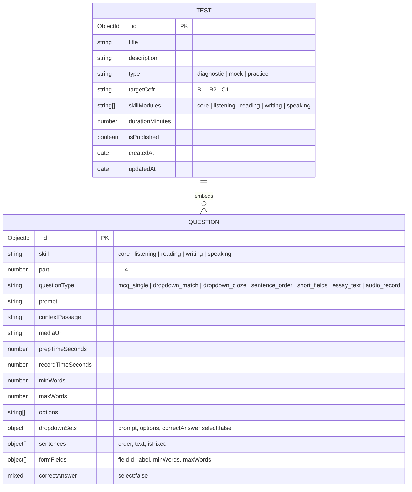

# Design Log #0012: Test Schema with Embedded Questions

**Ticket:** AG-201 [DB]
**Status:** Proposed → implemented (see §8)
**Depends on:** #0003 (MongoDB pool and User schema)
**Related:** NFR02 (answer confidentiality), DDS §2–§3

## 1. Background

The DDS defines a `Test` document that owns its question set as embedded
sub-documents. This is the data-locality decision that keeps a full exam
payload in one MongoDB read instead of joining a separate `questions`
collection.

The same question sub-document also contains assessment answers. Those answers
must be available to the auto-marker and to authorised admin content editors,
but must not be delivered to students during an examination. NFR02 makes that
confidentiality requirement explicit.

The repository currently has only the `User` model. AG-201 adds:

- `server/src/models/Question.js` — the embedded question schema and its enums.
- `server/src/models/Test.js` — the `Test` document schema, indexes, and
  embedded `questions` array.

No routes, controllers, or grading logic are in scope.

## 2. Problem

Without AG-201:

1. **No exam persistence model.** Later placement, mock, and practice flows
   cannot store a test with its questions.
2. **Read amplification if questions are referenced.** A relational-style
   `questions` collection would require a second query or `$lookup` for every
   exam delivery, working against the < 500 ms NFR.
3. **Answer leakage.** A schema that returns every question field by default
   would expose `correctAnswer` to student clients.
4. **Schema drift.** The question types, skill modules, and CEFR targets are
   enums in the DDS; re-declaring them in controllers or clients would allow
   invalid values.

## 3. Questions and Answers

- **Q1: Should questions be a separate model or embedded?**
  - **A:** Embedded. `questions` is a Mongoose `DocumentArray` of
    `QuestionSubDocSchema`. The whole test is read in one document. This is the
    Data Locality requirement and matches DDS §3.

- **Q2: Why not `ref: 'Question'`?**
  - **A:** A reference would require a second query or `$lookup` for every exam
    delivery. It also makes atomic test authoring harder. The cost is that a
    question cannot be reused across tests without copying it; that is accepted
    for this project.

- **Q3: Where must `select: false` be applied?**
  - **A:** On both answer-bearing paths:
    - `questions.correctAnswer` for single-key questions.
    - `questions.dropdownSets.correctAnswer` for dropdown set gaps.
    The first is a `Mixed` value because the answer shape depends on
    `questionType`; the second is a `String` for one gap.

- **Q4: How does the auto-marker read the answers?**
  - **A:** It must explicitly opt in, for example:
    ```javascript
    Test.findById(id).select(
      '+questions.correctAnswer +questions.dropdownSets.correctAnswer'
    );
    ```
    Student-facing reads use the default projection and omit both paths.

- **Q5: What are the Test defaults?**
  - **A:** `targetCefr: 'B2'`, `isPublished: true`, `skillModules: []`,
    `questions: []`, and automatic `createdAt` / `updatedAt`. These are the DDS
    defaults; no CEFR band is invented for a test that does not declare one.

- **Q6: What are the question defaults?**
  - **A:** `contextPassage: null`, `mediaUrl: null`, `prepTimeSeconds: 0`,
    `recordTimeSeconds: 45`, `minWords: null`, `maxWords: null`, and empty
    arrays for `options`, `dropdownSets`, `sentences`, and `formFields`.
    Writing and reading prompts override the timing/word fields.

- **Q7: Which fields are required?**
  - **A:** Test: `title`, `type`, `durationMinutes`.
    Question: `skill`, `part`, `questionType`, `prompt`.
    Dropdown set: `prompt`, `options`, `correctAnswer`.
    Sentence: `order`, `text`.
    Form field: `fieldId`, `label`.
    These match DDS §2–§3.

- **Q8: Which indexes are needed?**
  - **A:** `{ type: 1 }` for filtering diagnostic/mock/practice tests. No index
    is added on `questions`; it is always read with its parent. No unique index
    is needed because tests and embedded questions do not have external keys.

- **Q9: How is `select: false` proven?**
  - **A:** Unit tests inspect the schema options. An opt-in MongoDB
    integration test creates a test, reads it without an explicit select, and
    asserts both answer paths are absent. It then reads with the explicit
    `+questions...` projection and asserts they are present. Schema options
    alone do not prove the query projection works.

- **Q10: Should there be a `toJSON` transform that deletes answers?**
  - **A:** Not on the model. Test documents may legitimately be serialized by
    admin authoring endpoints that include answers. Delivery endpoints must use
    a default query or an explicit safe projection. `select: false` is the
    DDS-prescribed boundary. If a future endpoint returns an in-memory
    `Test.create()` result to students, that endpoint must strip answers
    explicitly.

## 4. Design

### 4.1 Data model



### 4.2 Files and Contracts

#### File: `server/src/models/Question.js`

```javascript
const QUESTION_SKILLS = Object.freeze([
  'core',
  'listening',
  'reading',
  'writing',
  'speaking',
]);

const QUESTION_TYPES = Object.freeze([
  'mcq_single',
  'dropdown_match',
  'dropdown_cloze',
  'sentence_order',
  'short_fields',
  'essay_text',
  'audio_record',
]);

const QuestionSubDocSchema = new mongoose.Schema(
  {
    skill: { type: String, required: true, enum: QUESTION_SKILLS },
    part: { type: Number, required: true, enum: [1, 2, 3, 4] },
    questionType: { type: String, required: true, enum: QUESTION_TYPES },
    prompt: { type: String, required: true, trim: true },
    contextPassage: { type: String, default: null },
    mediaUrl: { type: String, default: null },
    prepTimeSeconds: { type: Number, default: 0 },
    recordTimeSeconds: { type: Number, default: 45 },
    minWords: { type: Number, default: null },
    maxWords: { type: Number, default: null },
    options: [{ type: String }],
    dropdownSets: [
      {
        prompt: { type: String, required: true, trim: true },
        options: [{ type: String, required: true }],
        correctAnswer: { type: String, required: true, select: false },
      },
    ],
    sentences: [
      {
        order: { type: Number, required: true },
        text: { type: String, required: true, trim: true },
        isFixed: { type: Boolean, default: false },
      },
    ],
    formFields: [
      {
        fieldId: { type: String, required: true, trim: true },
        label: { type: String, required: true, trim: true },
        minWords: { type: Number, default: 1 },
        maxWords: { type: Number, default: 5 },
      },
    ],
    correctAnswer: { type: mongoose.Schema.Types.Mixed, select: false },
  },
  { _id: true }
);

module.exports = QuestionSubDocSchema;
module.exports.QUESTION_SKILLS = QUESTION_SKILLS;
module.exports.QUESTION_TYPES = QUESTION_TYPES;
```

#### File: `server/src/models/Test.js`

```javascript
const TEST_TYPES = Object.freeze(['diagnostic', 'mock', 'practice']);
const TARGET_CEFR_LEVELS = Object.freeze(['B1', 'B2', 'C1']);

const testSchema = new mongoose.Schema(
  {
    title: { type: String, required: true, trim: true },
    description: { type: String, trim: true },
    type: {
      type: String,
      enum: TEST_TYPES,
      required: true,
      index: true,
    },
    targetCefr: {
      type: String,
      enum: TARGET_CEFR_LEVELS,
      default: 'B2',
    },
    skillModules: {
      type: [{ type: String, enum: QUESTION_SKILLS }],
      default: [],
    },
    durationMinutes: { type: Number, required: true },
    isPublished: { type: Boolean, default: true },
    questions: { type: [QuestionSubDocSchema], default: [] },
  },
  { timestamps: true }
);

module.exports = mongoose.model('Test', testSchema);
module.exports.TEST_TYPES = TEST_TYPES;
module.exports.TARGET_CEFR_LEVELS = TARGET_CEFR_LEVELS;
module.exports.QUESTION_SKILLS = QUESTION_SKILLS;
module.exports.QUESTION_TYPES = QUESTION_TYPES;
```

### 4.3 Validation rules

| Field | Rule | Failure |
| --- | --- | --- |
| `title` | non-empty string, trimmed | `title is required` |
| `type` | one of `diagnostic`, `mock`, `practice` | Mongoose enum error |
| `targetCefr` | one of `B1`, `B2`, `C1` | Mongoose enum error |
| `skillModules[]` | each one of the five skills | Mongoose enum error |
| `durationMinutes` | present number | `durationMinutes is required` |
| `isPublished` | boolean, default `true` | cast error for invalid values |
| `questions[].skill` | one of the five skills | enum error |
| `questions[].part` | one of `1`, `2`, `3`, `4` | enum error |
| `questions[].questionType` | one of the seven types | enum error |
| `questions[].prompt` | non-empty trimmed string | required error |
| `questions[].dropdownSets[].prompt` | non-empty trimmed string | required error |
| `questions[].dropdownSets[].options[]` | each non-empty string | required error |
| `questions[].dropdownSets[].correctAnswer` | string, `select: false` | required error; omitted by default |
| `questions[].sentences[].order` | number | required error |
| `questions[].sentences[].text` | non-empty trimmed string | required error |
| `questions[].formFields[].fieldId` | non-empty trimmed string | required error |
| `questions[].formFields[].label` | non-empty trimmed string | required error |
| `questions[].correctAnswer` | `Mixed`, `select: false` | omitted by default |

### 4.4 Indexes

| Index | Definition | Purpose |
| --- | --- | --- |
| `type_1` | `{ type: 1 }` | diagnostic/mock/practice listing |

No index is created on `questions`; embedded questions are fetched with the
parent. No unique index exists for tests because there is no natural key.

## 5. Implementation Plan (TDD)

1. Create the failing unit suite `tests/test-model.test.js`:
   - embedded `DocumentArray` shape,
   - required fields and enum validation,
   - defaults,
   - nested `select: false` options,
   - `type` index.
2. Create the failing opt-in integration suite
   `tests/test-repository.integration.test.js`:
   - default query omits both answer paths,
   - explicit `+questions...` projection returns them.
3. Run `node --test "tests/*.test.js"` and confirm the new suites fail
   because `Question.js` and `Test.js` do not exist.
4. Implement `Question.js`, then `Test.js`.
5. Run unit tests, then the opt-in integration test against local MongoDB.
6. Run the full suite, `npm run lint`, `npm run format:check`, and the client
   build.
7. Update `README.md` and append §8 with results and deviations.

## 6. Examples

### ✅ Embedded test with an answer-bearing question

```javascript
const test = await Test.create({
  title: 'Reading Mock A',
  type: 'mock',
  targetCefr: 'B2',
  skillModules: ['reading'],
  durationMinutes: 35,
  questions: [
    {
      skill: 'reading',
      part: 1,
      questionType: 'dropdown_cloze',
      prompt: 'Complete the notice.',
      contextPassage: 'The library closes at 6 p.m.',
      correctAnswer: 'closes',
    },
  ],
});
```

The answer is stored inside the same document.

### ✅ Student read omits answer fields

```javascript
const studentView = await Test.findById(id);
// studentView.questions[0].correctAnswer === undefined
```

### ✅ Auto-marker explicitly opts in

```javascript
const gradingView = await Test.findById(id).select(
  '+questions.correctAnswer +questions.dropdownSets.correctAnswer'
);
```

### ❌ Referencing a separate question collection

```javascript
questions: [{ type: mongoose.Schema.Types.ObjectId, ref: 'Question' }];
```

This requires a second read or `$lookup` and defeats Data Locality.

### ❌ Leaking answers by default

```javascript
correctAnswer: { type: String };
```

Without `select: false`, a student-facing `Test.findById()` returns the answer.

### ❌ Student endpoint opting into answers

```javascript
Test.findById(id).select('+questions.correctAnswer');
```

Only the auto-marker and admin authoring paths may request answer fields.

## 7. Trade-offs

- **Data locality vs. question reuse.** Embedding makes exam delivery one read,
  but the same question reused in multiple tests must be copied. The DDS
  accepts this for the exam-time latency target.
- **Document growth.** A large test with many questions and passages counts
  toward MongoDB's 16 MB document limit. Aptis-sized tests are far below it, and
  the embedded shape is the intended design.
- **Answer security depends on query discipline.** `select: false` protects the
  default query path, but a deliberate `.select('+questions.correctAnswer')`
  bypasses it. The integration test documents both sides.
- **No cross-document atomic question updates.** Editing a question updates
  its parent Test document. This is acceptable for admin authoring, but it means
  a question cannot be updated independently of the test that owns it.
- **No denormalised question count.** Counting questions requires reading the
  array. That is cheap at Aptis scale and avoids a field that can drift from
  the actual embedded array.

## 8. Implementation Results

Implemented on `feature/AG-201`.

### Files delivered

- `server/src/models/Question.js` — embedded question sub-document schema,
  skill/type/part enums, nested dropdown/sentence/form schemas, and
  `correctAnswer` with `select: false`.
- `server/src/models/Test.js` — `Test` schema, defaults, timestamps, `type`
  index, and `questions: [QuestionSubDocSchema]`.
- `tests/test-model.test.js` — 10 schema/validation tests.
- `tests/test-repository.integration.test.js` — opt-in MongoDB projection test.
- `README.md` — model, test, design-log, and roadmap entries.

### TDD evidence

1. Wrote `tests/test-model.test.js` and
   `tests/test-repository.integration.test.js` before the models existed.
2. Ran `node --test tests/test-model.test.js tests/test-repository.integration.test.js`:
   both suites failed with `MODULE_NOT_FOUND` for `server/src/models/Test.js`.
3. Implemented `Question.js` and `Test.js`.
4. Ran the unit suite: **10/10 passed**.
5. Ran the opt-in integration suite against local MongoDB:
   **1/1 passed**.

### Verification

- `node --test tests/test-model.test.js` — **10/10 passed**
- `MONGODB_TEST_URI="mongodb://127.0.0.1:27017/aptis-go-test" node --test tests/test-repository.integration.test.js` — **1/1 passed**
- `MONGODB_TEST_URI="mongodb://127.0.0.1:27017/aptis-go-test"; npm test` — **98/98 passed**
- `npm run test:ui` — **43/43 passed**
- `npm run test:jest` — **7/7 passed**
- `npm run lint` — clean
- `npm run format:check` — clean
- `npm --prefix client run build` — successful

The integration test proves the actual query projection, not just the schema
flags:

- default `Test.findById()` returns `undefined` for both
  `questions[0].correctAnswer` and
  `questions[0].dropdownSets[0].correctAnswer`;
- the explicit grading projection
  `+questions.correctAnswer +questions.dropdownSets.correctAnswer` returns both
  answers.

### Deviations from the plan

- No separate `Question` model was created. `Question.js` exports only the
  sub-document schema, matching the Data Locality decision.
- `QUESTION_PARTS` is exported alongside the skill and question-type enums so
  future validators do not redeclare the 1–4 part range.
- The model uses custom Mongoose validation messages for required and enum
  fields, but no extra constraints beyond the DDS (for example, no minimum on
  `durationMinutes`).
- No `toJSON` transform strips answers. The DDS boundary is `select: false`;
  admin authoring responses may legitimately contain answers, while delivery
  endpoints must use default projections.
- The opt-in integration test was added beyond the original unit-test plan to
  prove the nested projection behaves as intended against a real MongoDB
  server.
