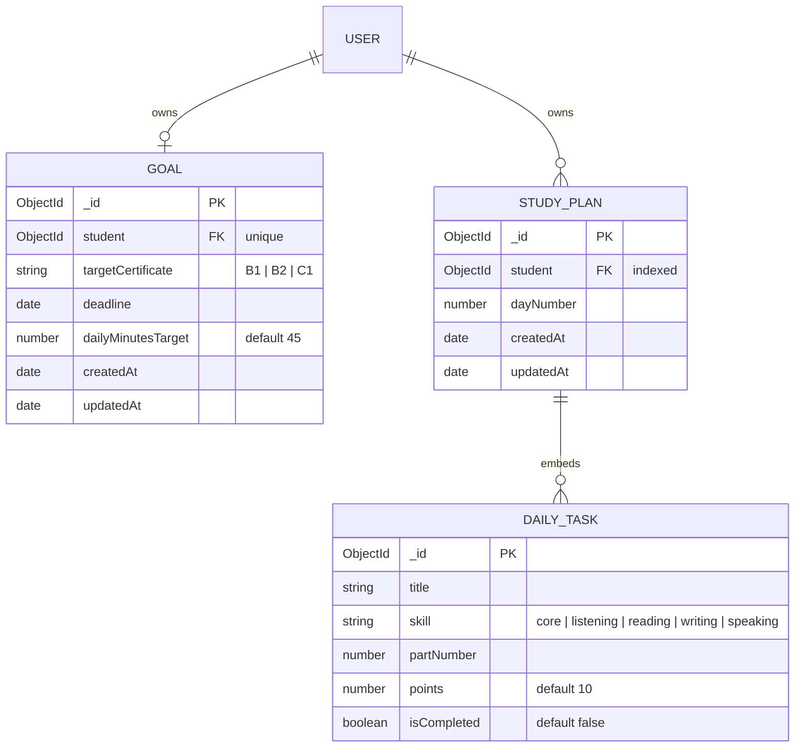

# Design Log #0013: Goal and StudyPlan Schemas

**Ticket:** AG-202 [DB]
**Status:** Proposed → implemented (see §8)
**Depends on:** #0003 (User schema), #0012 (Test/Question schema)
**Related:** FR03 goal tracking, STP TC04 past-deadline validation

## 1. Background

The student journey needs two linked records:

- A `Goal` that records the certificate the student is working toward and the
  completion deadline.
- A `StudyPlan` that groups daily tasks for that student. Each task records its
  skill, part number, points, and whether the student completed it.

The DDS places both models in `server/src/models/`. The ticket names the Goal
field `targetCertificate` and the StudyPlan array `dailyTasks`; the DDS uses
`targetCefr` and `tasks`. This implementation follows the ticket’s explicit
field names and records the difference in §8.

No routes or controllers are in scope. Future goal endpoints will enforce
STP TC04’s “deadline must be a future date” rule at the API boundary.

## 2. Problem

Without AG-202:

1. **No goal record.** The student cannot declare a target certificate or see
   time remaining before the deadline.
2. **No daily plan.** The study plan cannot persist tasks or completion state.
3. **No one-goal guarantee.** A student could create multiple active goals
   unless the schema enforces one goal per student.
4. **No task-level state.** Completion is needed per task, not per day, so the
   UI can tick individual tasks.
5. **No data locality for daily tasks.** Reading a day would need a second query
   if tasks were a separate collection.

## 3. Questions and Answers

- **Q1: Is `Goal` one per student?**
  - **A:** Yes. `student` is required and unique. Changing a goal is an update
    to that document, not a second row.

- **Q2: Why is `student` a reference rather than an embedded student object?**
  - **A:** Goals and plans belong to an existing `User`. Copying user data would
    duplicate identity and drift. The reference is indexed; population is
    opt-in.

- **Q3: What certificate values are allowed?**
  - **A:** `B1`, `B2`, and `C1`, matching the project’s CEFR targets and the
    `Test.targetCefr` enum. The default is `B2`; invalid values fail validation.

- **Q4: Should the schema reject past deadlines?**
  - **A:** No. That is a request-time rule from STP TC04 (“Deadline must be a
    future date”) and belongs in the Goal controller/validator. A schema
    validator would also make an existing goal unsavable after its deadline
    passes. The schema stores any valid `Date`; the API will reject past dates
    on create/update.

- **Q5: What is `dailyMinutesTarget`?**
  - **A:** A per-goal planning preference, defaulting to 45 minutes. It is not
    a score or a completion counter.

- **Q6: Why embed `dailyTasks` inside `StudyPlan`?**
  - **A:** A day’s tasks are read together with the day. Embedding keeps that to
    one document read and lets completion be updated on the task sub-document.

- **Q7: Does a task need an `_id`?**
  - **A:** Yes. The ADS exposes
    `PATCH /api/study-plans/tasks/:id`, so each embedded task needs its own
    stable `_id`.

- **Q8: What are the task defaults?**
  - **A:** `points: 10` and `isCompleted: false`. A new task is incomplete until
    the student marks it done.

- **Q9: Which indexes are required?**
  - **A:** `Goal.student` unique; `StudyPlan.student` indexed for “my plans”
    queries. No index is added to `dailyTasks`; tasks are always read with their
    parent plan.

- **Q10: Should `(student, dayNumber)` be unique?**
  - **A:** Not in this ticket. The DDS does not require it, and a future plan
    regeneration flow may replace a day. The API can enforce one current plan
    per day if needed.

## 4. Design

### 4.1 Data model



### 4.2 Files and Contracts

#### File: `server/src/models/Goal.js`

```javascript
const GOAL_CERTIFICATES = Object.freeze(['B1', 'B2', 'C1']);

/**
 * @typedef {'B1' | 'B2' | 'C1'} TargetCertificate
 */

const goalSchema = new mongoose.Schema(
  {
    student: {
      type: mongoose.Schema.Types.ObjectId,
      ref: 'User',
      required: [true, 'student is required'],
      unique: true,
    },
    targetCertificate: {
      type: String,
      enum: {
        values: GOAL_CERTIFICATES,
        message: 'targetCertificate must be one of: B1, B2, C1',
      },
      default: 'B2',
      required: [true, 'targetCertificate is required'],
    },
    deadline: {
      type: Date,
      required: [true, 'deadline is required'],
    },
    dailyMinutesTarget: {
      type: Number,
      default: 45,
    },
  },
  { timestamps: true }
);

module.exports = mongoose.model('Goal', goalSchema);
module.exports.GOAL_CERTIFICATES = GOAL_CERTIFICATES;
```

#### File: `server/src/models/StudyPlan.js`

```javascript
const TASK_SKILLS = Object.freeze([
  'core',
  'listening',
  'reading',
  'writing',
  'speaking',
]);

const studyPlanTaskSchema = new mongoose.Schema(
  {
    title: {
      type: String,
      required: [true, 'task title is required'],
      trim: true,
    },
    skill: {
      type: String,
      enum: {
        values: TASK_SKILLS,
        message: 'skill must be one of: core, listening, reading, writing, speaking',
      },
      required: [true, 'skill is required'],
    },
    partNumber: {
      type: Number,
      required: [true, 'partNumber is required'],
    },
    points: {
      type: Number,
      default: 10,
    },
    isCompleted: {
      type: Boolean,
      default: false,
    },
  },
  { _id: true }
);

const studyPlanSchema = new mongoose.Schema(
  {
    student: {
      type: mongoose.Schema.Types.ObjectId,
      ref: 'User',
      required: [true, 'student is required'],
      index: true,
    },
    dayNumber: {
      type: Number,
      required: [true, 'dayNumber is required'],
    },
    dailyTasks: {
      type: [studyPlanTaskSchema],
      default: [],
    },
  },
  { timestamps: true }
);

module.exports = mongoose.model('StudyPlan', studyPlanSchema);
module.exports.TASK_SKILLS = TASK_SKILLS;
```

### 4.3 Validation rules

| Model | Field | Rule | Failure |
| --- | --- | --- | --- |
| Goal | `student` | ObjectId referencing `User`, required, unique | required error; duplicate key `11000` |
| Goal | `targetCertificate` | one of `B1`, `B2`, `C1`; default `B2` | enum error |
| Goal | `deadline` | valid `Date`, required | required/cast error |
| Goal | `dailyMinutesTarget` | number, default `45` | cast error for non-numeric input |
| StudyPlan | `student` | ObjectId referencing `User`, required, indexed | required error |
| StudyPlan | `dayNumber` | number, required | required/cast error |
| StudyPlan | `dailyTasks` | embedded document array, default `[]` | — |
| DailyTask | `title` | non-empty trimmed string | required error |
| DailyTask | `skill` | one of the five skill enums | enum error |
| DailyTask | `partNumber` | number, required | required/cast error |
| DailyTask | `points` | number, default `10` | cast error |
| DailyTask | `isCompleted` | boolean, default `false` | cast error for invalid values |

### 4.4 Indexes

| Index | Definition | Purpose |
| --- | --- | --- |
| `student_1` on Goal | `{ student: 1 }`, `unique: true` | exactly one goal per student |
| `student_1` on StudyPlan | `{ student: 1 }` | list a student’s daily plans |

## 5. Implementation Plan (TDD)

1. Write failing unit tests:
   - `tests/goal-model.test.js` — required fields, certificate enum/default,
     deadline cast, `dailyMinutesTarget` default, student reference and unique
     index, timestamps.
   - `tests/study-plan-model.test.js` — required fields, embedded `dailyTasks`
     schema, task defaults, skill enum, `_id`, student index, timestamps.
2. Write the opt-in integration test
   `tests/goal-study-plan.integration.test.js`:
   - one goal per student enforced by MongoDB,
   - daily tasks persist `isCompleted: false` and `points: 10`.
3. Run the new tests and confirm they fail because the models do not exist.
4. Implement `Goal.js` and `StudyPlan.js`.
5. Run unit tests, then the integration test against local MongoDB.
6. Run the full suite, lint, format check, and client build.
7. Update `README.md` and append §8 with results and deviations.

## 6. Examples

### ✅ Create one goal for a student

```javascript
const goal = await Goal.create({
  student: studentId,
  targetCertificate: 'B2',
  deadline: new Date('2027-06-30'),
  dailyMinutesTarget: 60,
});
```

The unique `student` index rejects a second goal for the same student.

### ✅ Create a study day with embedded tasks

```javascript
const plan = await StudyPlan.create({
  student: studentId,
  dayNumber: 1,
  dailyTasks: [
    {
      title: 'Reading Part 1 practice',
      skill: 'reading',
      partNumber: 1,
      points: 10,
    },
  ],
});

// plan.dailyTasks[0].isCompleted === false
```

### ✅ Mark one task complete

```javascript
plan.dailyTasks[0].isCompleted = true;
await plan.save();
```

### ❌ Past deadline expected to fail at the schema

```javascript
await Goal.create({
  student: studentId,
  targetCertificate: 'B2',
  deadline: new Date('2020-01-01'),
});
```

This succeeds at the schema layer. The API must reject it per STP TC04; the
schema does not make historical goal documents unsavable.

### ❌ Separate task collection for daily tasks

```javascript
dailyTasks: [{ type: mongoose.Schema.Types.ObjectId, ref: 'StudyTask' }];
```

A day read would need a second query or `$lookup`, losing the intended data
locality.

### ❌ Duplicate active goals

```javascript
await Goal.create({ student, targetCertificate: 'B1', deadline });
await Goal.create({ student, targetCertificate: 'B2', deadline });
```

The second insert is rejected by the unique `student` index.

## 7. Trade-offs

- **One Goal per student vs. goal history.** Unique `student` keeps “current
  goal” simple. Historical goals would need a separate archive model or a
  status field; not in this ticket.
- **Embedded daily tasks vs. standalone tasks.** Embedding gives one-read day
  loading and simple completion updates, but a task cannot exist without its
  plan and the plan document grows with the day.
- **Schema accepts any date vs. API future-date rule.** The schema remains
  stable for old records; TC04 is enforced at request time where the message
  and HTTP 400 contract belong.
- **Ticket names vs. DDS names.** `targetCertificate` and `dailyTasks` follow
  the ticket. The DDS uses `targetCefr` and `tasks`; no duplicate alias fields
  are persisted, so there is one canonical representation.
- **No unique `(student, dayNumber)`.** The DDS does not require it, and plan
  regeneration may need to replace a day. The API can enforce current-plan
  uniqueness later.

## 8. Implementation Results

Implemented on `feature/AG-202`.

### Files delivered

- `server/src/models/Goal.js` — target certificate, deadline, daily minutes,
  unique student reference, and timestamps.
- `server/src/models/StudyPlan.js` — day number, student reference, embedded
  `dailyTasks`, and task defaults.
- `tests/goal-model.test.js` — 5 Goal schema tests.
- `tests/study-plan-model.test.js` — 7 StudyPlan schema tests.
- `tests/goal-study-plan.integration.test.js` — opt-in MongoDB test for unique
  goals and embedded task state.
- `README.md` — model, test, design-log, and roadmap entries.

### TDD evidence

1. Wrote the Goal, StudyPlan, and integration tests first.
2. Ran `node --test tests/goal-model.test.js tests/study-plan-model.test.js tests/goal-study-plan.integration.test.js`:
   all three suites failed with `MODULE_NOT_FOUND` for `Goal.js` and
   `StudyPlan.js`.
3. Implemented both models.
4. Ran the unit suites: **12/12 passed**.
5. Ran the integration suite against local MongoDB: **1/1 passed**.

### Verification

- `node --test tests/goal-model.test.js tests/study-plan-model.test.js` —
  **12/12 passed**
- `MONGODB_TEST_URI="mongodb://127.0.0.1:27017/aptis-go-test" node --test tests/goal-study-plan.integration.test.js` — **1/1 passed**
- `MONGODB_TEST_URI="mongodb://127.0.0.1:27017/aptis-go-test"; npm test` —
  **111/111 passed**
- `npm run test:ui` — **43/43 passed**
- `npm run test:jest` — **7/7 passed**
- `npm run lint` — clean
- `npm run format:check` — clean
- `npm --prefix client run build` — successful

The integration test proves:

- a second Goal for the same student is rejected by MongoDB with `11000`;
- the default target certificate is `B2` and the default daily target is 45
  minutes;
- embedded tasks persist `points: 10` and `isCompleted: false`;
- changing a task to `isCompleted: true` and saving persists the new state.

### Deviations from the plan

- **Field names follow the ticket, not the DDS.** Goal uses
  `targetCertificate` (DDS: `targetCefr`) and StudyPlan uses `dailyTasks`
  (DDS: `tasks`). No duplicate alias fields were added.
- **No future-deadline schema validator.** The schema accepts any valid Date;
  STP TC04’s past-deadline rejection belongs in the Goal API validator so
  historical goal documents remain saveable.
- **StudyPlanTaskSchema is exported** as metadata on the StudyPlan model for
  future validators and tests, while remaining an embedded sub-document rather
  than a standalone model.
- **No unique `(student, dayNumber)` index.** This matches the DDS and keeps
  plan regeneration flexible; the API can enforce one active day if needed.
