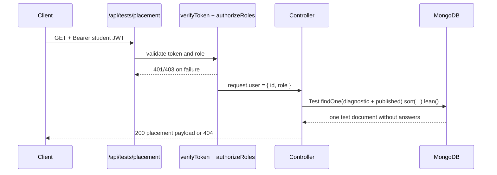

# Design Log #0014: Placement Diagnostic Endpoint

**Ticket:** AG-203 [BE]
**Status:** Proposed → implemented (see §8)
**Depends on:** #0012 (Test/Question schema), #0005 (RBAC middleware)
**Related:** FR02 placement diagnostic, NFR01 <500 ms, NFR02 answer confidentiality

## 1. Background

Students need one endpoint that returns the published diagnostic placement test
and its embedded questions. The Test schema already stores questions inside the
test document, so the endpoint can satisfy the request with one MongoDB read.

The endpoint is not in the current ADS route list. `GET /api/tests` lists tests
and `GET /api/tests/:id` fetches one, but the placement flow needs a stable
`GET /api/tests/placement` path that does not require the client to know a test
id.

## 2. Problem

Without AG-203:

1. **The client cannot start placement.** It has no way to fetch the
   diagnostic test and its questions.
2. **The client would need multiple requests.** Listing tests and then fetching
   one by id adds latency and can race with publication changes.
3. **Answers could leak.** Returning a raw Test document would expose
   `correctAnswer` unless the query projection is correct.
4. **The NFR01 budget is unproven.** The endpoint must be a single query and
   stay below 500 ms for an Aptis-sized diagnostic.

## 3. Questions and Answers

- **Q1: Who may call the endpoint?**
  - **A:** Authenticated students only. Placement is a student action; lecturer
    and admin tokens receive `403`. This uses the existing `verifyToken` and
    `authorizeRoles('student')` middleware.

- **Q2: Which diagnostic does it return?**
  - **A:** The newest published diagnostic:
    `{ type: 'diagnostic', isPublished: true }`, sorted by
    `{ createdAt: -1, _id: -1 }`. Publishing a newer diagnostic becomes the
    active placement test without a code change. The `_id` tie-breaker keeps the
    result deterministic.

- **Q3: How is “single query” guaranteed?**
  - **A:** The controller calls `Test.findOne(...).sort(...).lean()` once. It
    never populates users, questions, or answers. A compound index
    `{ type: 1, isPublished: 1, createdAt: -1 }` supports the filter and sort.

- **Q4: What is the success response?**
  - **A:** A direct test object:
    ```json
    {
      "id": "665f...",
      "title": "Placement Diagnostic",
      "description": "Baseline CEFR placement",
      "targetCefr": "B2",
      "skillModules": ["core", "reading", "listening"],
      "durationMinutes": 25,
      "questionCount": 2,
      "questions": []
    }
    ```
    It is not wrapped in a `data` envelope, matching the existing auth
    responses.

- **Q5: What does a question look like?**
  - **A:** Only delivery-safe fields:
    `id`, `skill`, `part`, `questionType`, `prompt`, `contextPassage`,
    `mediaUrl`, `prepTimeSeconds`, `recordTimeSeconds`, `minWords`, `maxWords`,
    `options`, `dropdownSets`, `sentences`, and `formFields`.
    `dropdownSets` contains `id`, `prompt`, and `options`; it never contains
    `correctAnswer`.

- **Q6: Why map the document instead of returning it directly?**
  - **A:** Mapping gives a stable public Contract, converts `_id` to `id`, and
    removes `__v`, timestamps, and internal fields. It also gives a second
    explicit guard against answer leakage.

- **Q7: What happens when no diagnostic is published?**
  - **A:** `404 { "error": "Placement test not found" }`. This is a content
    state, not a server failure.

- **Q8: What about an invalid or missing token?**
  - **A:** The existing auth middleware returns `401` with
    `Authentication required` or `Invalid or expired token`. A valid non-student
    token returns `403 { "error": "Forbidden" }`.

- **Q9: How is NFR01 verified?**
  - **A:** The integration test seeds a diagnostic with 50 questions, calls the
    real HTTP endpoint with a student JWT, and asserts:
    - the response is `200`,
    - only one `Test.findOne` call is made,
    - the elapsed request time is under 500 ms on local MongoDB.
    The test is opt-in through `MONGODB_TEST_URI`, like the other database
    integration suites.

- **Q10: Does the endpoint paginate or filter by skill?**
  - **A:** No. Placement is one deliberate diagnostic payload. Filtering and
    pagination belong to the future test catalogue endpoint.

## 4. Design

### 4.1 Request flow



### 4.2 Files and Contracts

#### File: `server/src/routes/testRoutes.js`

```javascript
const router = require('express').Router();
const { verifyToken, authorizeRoles } = require('../middleware/authMiddleware');
const { getPlacementTest } = require('../controllers/testController');

router.get('/placement', verifyToken, authorizeRoles('student'), getPlacementTest);

module.exports = router;
```

Mounted in `server/src/app.js`:

```javascript
const testRoutes = require('./routes/testRoutes');

app.use('/api/tests', testRoutes);
```

#### File: `server/src/controllers/testController.js`

```javascript
/**
 * @param {import('express').Request} request
 * @param {import('express').Response} response
 * @returns {Promise<void>}
 */
async function getPlacementTest(_request, response) {}

/**
 * @param {object} question
 * @returns {object}
 */
function serializeQuestion(question) {}

/**
 * @param {object} test
 * @returns {object}
 */
function serializePlacementTest(test) {}
```

The controller query:

```javascript
const test = await Test.findOne({
  type: 'diagnostic',
  isPublished: true,
})
  .sort({ createdAt: -1, _id: -1 })
  .lean();
```

### 4.3 Response Contract

`200 OK`

| Field | Type | Notes |
| --- | --- | --- |
| `id` | string | Test ObjectId as a string |
| `title` | string | Test title |
| `description` | string \| null | Normalized from undefined to null |
| `targetCefr` | `B1 \| B2 \| C1` | Test target |
| `skillModules` | string[] | Covered skills |
| `durationMinutes` | number | Official duration |
| `questionCount` | number | `questions.length` |
| `questions` | Question[] | Delivery-safe question objects |

Question fields:

| Field | Type | Hidden? |
| --- | --- | --- |
| `id` | string | no |
| `skill` | string enum | no |
| `part` | 1–4 | no |
| `questionType` | string enum | no |
| `prompt` | string | no |
| `contextPassage` | string \| null | no |
| `mediaUrl` | string \| null | no |
| `prepTimeSeconds` | number | no |
| `recordTimeSeconds` | number | no |
| `minWords` | number \| null | no |
| `maxWords` | number \| null | no |
| `options` | string[] | no |
| `dropdownSets` | `{ id, prompt, options }[]` | `correctAnswer` hidden |
| `sentences` | `{ id, order, text, isFixed }[]` | no |
| `formFields` | `{ id, fieldId, label, minWords, maxWords }[]` | no |
| `correctAnswer` | — | never returned |

`404 Not Found`

```json
{ "error": "Placement test not found" }
```

`401 Unauthorized`

```json
{ "error": "Authentication required" }
```

`403 Forbidden`

```json
{ "error": "Forbidden" }
```

### 4.4 Index

Added to `server/src/models/Test.js`:

```javascript
testSchema.index({ type: 1, isPublished: 1, createdAt: -1 });
```

This supports the placement filter and newest-first sort. The existing
`type_1` index remains available for other test-type queries.

## 5. Implementation Plan (TDD)

1. Write failing route tests:
   - `tests/placement-routes.test.js`: unauthenticated `401`, lecturer `403`,
     and placement index presence.
2. Write the failing integration test:
   - `tests/placement.integration.test.js`: seed 50 questions, call the real
     endpoint, assert the payload, no answers, one query, and <500 ms.
3. Run the new tests and confirm they fail because the route/controller do not
   exist.
4. Implement `testController.js`, `testRoutes.js`, mount the router, and add the
   compound index.
5. Run the new tests, then the full suite, lint, format check, and client build.
6. Update `README.md` and append §8 with results and deviations.

## 6. Examples

### ✅ Student request

```http
GET /api/tests/placement
Authorization: Bearer <student-token>
```

```json
{
  "id": "665f1a...",
  "title": "Placement Diagnostic",
  "description": "Baseline CEFR placement",
  "targetCefr": "B2",
  "skillModules": ["core", "reading", "listening"],
  "durationMinutes": 25,
  "questionCount": 50,
  "questions": [
    {
      "id": "665f1b...",
      "skill": "core",
      "part": 1,
      "questionType": "mcq_single",
      "prompt": "Choose the correct option.",
      "options": ["am", "is", "are"]
    }
  ]
}
```

### ✅ Newest published diagnostic wins

If two diagnostics exist, the one with the latest `createdAt` is returned. The
`_id` tie-breaker makes the choice deterministic.

### ❌ Fetching the test by id first

```http
GET /api/tests
GET /api/tests/:id
```

Two round-trips increase latency and can select a different document if
publication changes between calls.

### ❌ Returning the raw Mongoose document

```javascript
response.json(test);
```

This can expose `_id`, `__v`, timestamps, and answer-bearing internal fields.
The explicit serializer keeps the public Contract small and safe.

### ❌ Querying answers for the student

```javascript
Test.findOne(...).select('+questions.correctAnswer');
```

Placement delivery must never opt into answer paths.

## 7. Trade-offs

- **Newest diagnostic vs. fixed canonical test.** Newest published makes
  content updates immediate, but publishing an unfinished diagnostic changes
  placement for everyone. Admin publishing discipline is required.
- **Student-only vs. public.** Student-only protects placement data and lets
  `request.user` support future attempt tracking. It requires login before
  placement.
- **Lean + mapping vs. returning the document.** Lean reduces overhead and
  mapping produces a stable Contract, at the cost of a small serialization
  function to maintain.
- **Compound index.** It improves the filter/sort path but adds one index to
  the Test collection. The index is small because there are few tests compared
  with questions.
- **No caching.** A single indexed read is already below the target at this
  scale. Caching would add invalidation complexity when admins publish tests.

## 8. Implementation Results

Implemented on `feature/AG-203` from `develop` at `81294ba`.

### Files added or changed

- `server/src/controllers/testController.js` - placement lookup and safe serializer.
- `server/src/routes/testRoutes.js` - student-only `GET /placement` router.
- `server/src/app.js` - mounted `/api/tests`.
- `server/src/models/Test.js` - added
  `{ type: 1, isPublished: 1, createdAt: -1 }`.
- `tests/placement-routes.test.js` - `401`, lecturer/admin `403`, and index
  Contract.
- `tests/placement-controller.test.js` - `404` when no published diagnostic
  exists.
- `tests/placement.integration.test.js` - 50-question seeded round-trip,
  answer hiding, one-query count, and NFR01 timing.
- `README.md` - status, placement API, test counts, layout, documentation, and
  roadmap.

### TDD evidence

Red run after writing the tests and before implementation:

```text
node --test tests/placement-routes.test.js tests/placement-controller.test.js
```

The route tests failed with `404` instead of `401`/`403`, the index test failed,
and the controller test failed because `testController` did not exist. The
integration test was not run against a database until the controller existed.

Green runs:

```text
node --test tests/placement-routes.test.js tests/placement-controller.test.js
# tests 4, pass 4, fail 0

$env:MONGODB_TEST_URI="mongodb://127.0.0.1:27017/aptis-go-test";
node --test tests/placement.integration.test.js
# tests 1, pass 1, fail 0
# placement response 11.7ms with 1 Test.findOne call(s)
```

Full suite:

```text
npm test
# tests 116, pass 111, fail 0, skipped 5 (no MONGODB_TEST_URI)

$env:MONGODB_TEST_URI="mongodb://127.0.0.1:27017/aptis-go-test"; npm test
# tests 116, pass 116, fail 0, skipped 0

npm run test:ui
# 43/43 passed

npm run test:jest
# 7/7 passed

npm run lint
# clean

npm run format:check
# clean

npm --prefix client run build
# Vite production build succeeded
```

### NFR01 and NFR02 evidence

- NFR01: the measured placement HTTP request completed in **11.7 ms** against
  local MongoDB with 50 embedded questions. The test also asserts exactly
  **one** `Test.findOne` call.
- NFR02: the integration test asserts `questions[0].correctAnswer` and
  `questions[49].dropdownSets[0].correctAnswer` are `undefined` in the response.

### Deviations from the plan

- Added a controller-level `404` test that was not listed in the original plan.
  It covers the no-published-diagnostic branch without touching shared test
  database state.
- Added a `t.diagnostic()` timing line to the integration test so the NFR01
  measurement is visible in test output.
- No Postman collection was added. The existing collection is the auth
  TC01-TC03 suite; a live placement request would require a pre-seeded
  diagnostic. The integration test seeds and verifies that state directly.
- The README test counts were updated from the stale `85`/`42` values to the
  current `116`/`43` totals.
