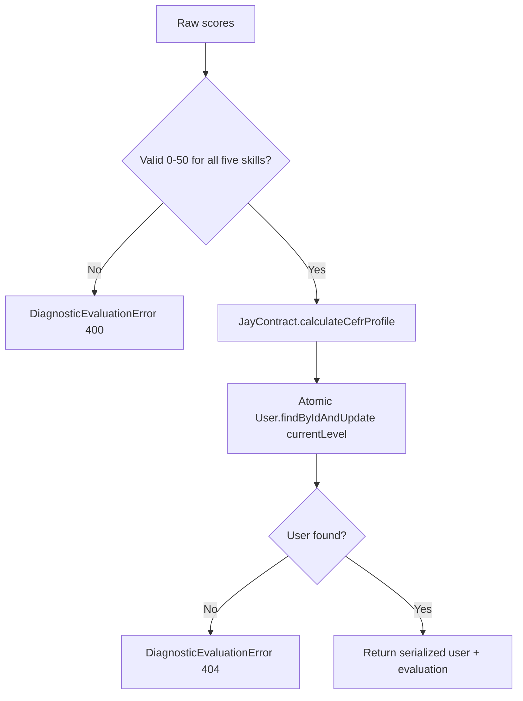

# Design Log #0015: Diagnostic CEFR Evaluation and Level Persistence

**Ticket:** AG-204 [BE]
**Status:** Proposed → implemented (see §8)
**Depends on:** #0012 (Test/Question schema), #0014 (placement payload), JayContract CEFR profile
**Related:** FR02 placement diagnostic, FR04 auto-marking, NFR01 < 500 ms

## 1. Background

AG-203 serves the placement diagnostic and its embedded questions. The next step
is to turn a completed diagnostic into a CEFR baseline and store that baseline on
the student record.

The domain already has the official CEFR profile calculation in
`contracts/JayContract.js`:

```javascript
calculateCefrProfile({ core, reading, listening, writing, speaking });
```

The `User` model already has:

```javascript
currentLevel: {
  type: String,
  enum: ['A1', 'A2', 'B1', 'B2', 'C1', 'UNTESTED'],
  default: 'UNTESTED',
}
```

AG-204 must connect those two pieces without duplicating the British Council
threshold rules.

## 2. Problem

Without a shared evaluation service:

1. **Scoring logic would drift.** A controller, seed script, and future
   submission handler could each implement their own CEFR thresholds.
2. **Invalid scores could become levels.** `calculateCefrProfile` assumes
   validated 0–50 inputs; a negative or `NaN` score would produce a misleading
   result.
3. **`User.currentLevel` would not be updated.** The placement flow would return
   a test but never persist the student baseline.
4. **Client-supplied levels would be tempting.** A public
   `PATCH /api/auth/me` or `POST /api/tests/placement/evaluate` endpoint that
   accepts raw scores would let a student set their own CEFR level.

## 3. Questions and Answers

- **Q1: What are the raw scores?**
  - **A:** Five skill scores, each on the official 0–50 scale:
    `core`, `reading`, `listening`, `writing`, and `speaking`.
    Core is the borderline modifier and is not part of the 0–200 scaled total.

- **Q2: Are all five scores required?**
  - **A:** Yes for this ticket. `calculateCefrProfile` resolves the overall level
    from all four productive/receptive skills, with Core as the modifier.
    Missing writing or speaking must not silently become `0`, because that would
    force an A1 result. A future ticket can add an explicit partial-diagnostic
    mode if placement omits subjective skills.

- **Q3: Should the thresholds be copied into the service?**
  - **A:** No. The service imports `calculateCefrProfile` from
    `contracts/JayContract.js`. That module remains the single source of truth
    for the A1–C1 mapping and the Core borderline rule.

- **Q4: How is `User.currentLevel` updated?**
  - **A:** With one atomic write:
    ```javascript
    User.findByIdAndUpdate(
      userId,
      { $set: { currentLevel: evaluation.finalCefr } },
      { returnDocument: 'after', runValidators: true }
    );
    ```
    This avoids a read-modify-write race and runs the schema enum validation.

- **Q5: Is there an HTTP endpoint in this ticket?**
  - **A:** No. AG-204 exposes a server-side service, not a public route.
    The future submission endpoint must compute raw scores from submitted answers
    on the server before calling this service. Exposing a client-supplied score
    endpoint would let a student assign themselves any CEFR level.
    This is an intentional security boundary.

- **Q6: What happens when the user does not exist?**
  - **A:** The service throws `DiagnosticEvaluationError` with `statusCode: 404`
    and message `User not found`. A future controller can pass it to the existing
    centralized error handler.

- **Q7: What happens with invalid scores?**
  - **A:** The service rejects them before calling the shared algorithm:
    - `scores` must be a plain object, not `null` or an array.
    - Each of the five skills must be present.
    - Each value must be a finite number.
    - Each value must be between `0` and `50` inclusive.
    No clamping is performed. The error is
    `DiagnosticEvaluationError` with `statusCode: 400`.

- **Q8: What does the service return?**
  - **A:**
    ```javascript
    {
      user: { id, name, email, role, currentLevel, ... },
      evaluation: {
        scaledTotal,
        coreScore,
        skillScores,
        skillCefr,
        borderlineElevated,
        finalCefr,
      },
    }
    ```
    `user` is the serialized public User form, so the password is omitted.

- **Q9: What if the same scores are evaluated twice?**
  - **A:** The result is deterministic and idempotent. The second write sets the
    same `currentLevel`. Last write wins for concurrent requests, which is
    acceptable for a one-time placement baseline.

- **Q10: Does this create a Submission record?**
  - **A:** No. The Submission model and its `finalCefr`,
    `scaledTotalScore`, and `cefrBorderlineApplied` fields belong to the
    submission/auto-marking ticket. AG-204 updates only the User baseline.

## 4. Design

### 4.1 Evaluation flow



### 4.2 Files and Contracts

#### File: `server/src/services/diagnosticEvaluationService.js`

```javascript
/**
 * @typedef {{
 *   core: number,
 *   reading: number,
 *   listening: number,
 *   writing: number,
 *   speaking: number
 * }} DiagnosticScores
 */

/**
 * @param {unknown} scores
 * @returns {DiagnosticScores}
 * @throws {DiagnosticEvaluationError}
 */
function validateDiagnosticScores(scores) {}

/**
 * @param {DiagnosticScores} scores
 * @returns {{
 *   scaledTotal: number,
 *   coreScore: number,
 *   skillScores: { reading: number, listening: number, writing: number, speaking: number },
 *   skillCefr: { reading: string, listening: string, writing: string, speaking: string },
 *   borderlineElevated: boolean,
 *   finalCefr: 'A1' | 'A2' | 'B1' | 'B2' | 'C1'
 * }}
 */
function evaluateDiagnosticScores(scores) {}

/**
 * @param {string | import('mongoose').Types.ObjectId} userId
 * @param {DiagnosticScores} scores
 * @returns {Promise<{ user: object, evaluation: object }>}
 * @throws {DiagnosticEvaluationError}
 */
async function evaluateDiagnosticForUser(userId, scores) {}

class DiagnosticEvaluationError extends Error {
  /**
   * @param {string} message
   * @param {number} [statusCode]
   */
  constructor(message, statusCode = 400) {}
}

module.exports = {
  DIAGNOSTIC_SKILLS,
  MIN_SCORE,
  MAX_SCORE,
  DiagnosticEvaluationError,
  validateDiagnosticScores,
  evaluateDiagnosticScores,
  evaluateDiagnosticForUser,
};
```

#### Reused Contract: `contracts/JayContract.js`

`calculateCefrProfile` is imported unchanged. Its skill thresholds remain:

| Skill score | Skill CEFR | Borderline? |
| ----------- | ---------- | ----------- |
| 0–19        | A1         | No          |
| 20–34       | A2         | No          |
| 35–37       | B1         | Yes         |
| 38–47       | B2         | No          |
| 48–50       | C1         | No          |

Core (0–50) is the modifier:

- `core >= 35` elevates any borderline skill from B1 to B2.
- `core < 35` leaves the borderline skill at B1.
- Core is excluded from `scaledTotal` (0–200).
- Overall `finalCefr` is the lowest resolved skill CEFR.

#### Validation rules

| Input | Rule | Failure |
| --- | --- | --- |
| `scores` | Plain object | `scores must be an object` |
| `scores.core` | Finite number 0–50 | `scores.core must be a finite number` / `... between 0 and 50` |
| `scores.reading` | Finite number 0–50 | Same pattern |
| `scores.listening` | Finite number 0–50 | Same pattern |
| `scores.writing` | Finite number 0–50 | Same pattern |
| `scores.speaking` | Finite number 0–50 | Same pattern |
| `userId` | Existing User | `User not found` with `404` |

All validation errors are `DiagnosticEvaluationError` with `statusCode: 400`.

### 4.3 Persistence behavior

Only `currentLevel` is written:

```javascript
{
  $set: {
    currentLevel: evaluation.finalCefr,
  }
}
```

The write runs `runValidators: true`, so the `User` enum rejects any value
outside `A1 | A2 | B1 | B2 | C1`. `UNTESTED` remains the registration default
until a diagnostic is evaluated.

## 5. Implementation Plan (TDD)

1. Write failing unit tests in `tests/diagnostic-evaluation.test.js`:
   - A1, A2, B1, B2, C1 threshold boundaries.
   - Core modifier elevation and non-elevation.
   - Lowest-skill overall resolution.
   - Validation failures for missing, non-finite, negative, and over-50 scores.
2. Write the failing database test in
   `tests/diagnostic-evaluation.integration.test.js`:
   - Create a user with `currentLevel: 'UNTESTED'`.
   - Evaluate B2 scores and assert both the returned user and the persisted
     `User.currentLevel`.
   - Evaluate a B1 boundary case and assert the Core modifier behavior.
   - Assert unknown users produce a 404 error and invalid scores do not mutate
     the user.
3. Run the new tests and confirm they fail because the service does not exist.
4. Implement `server/src/services/diagnosticEvaluationService.js` and reuse
   `calculateCefrProfile`.
5. Re-run the new tests, then the full suite, lint, format check, and client
   build.
6. Update `README.md` and append §8 with results and deviations.

## 6. Examples

### ✅ B2 placement with Core modifier

```javascript
await evaluateDiagnosticForUser(studentId, {
  core: 45,
  reading: 42,
  listening: 36,
  writing: 40,
  speaking: 38,
});
```

Result:

```json
{
  "evaluation": {
    "scaledTotal": 156,
    "coreScore": 45,
    "skillScores": {
      "reading": 42,
      "listening": 36,
      "writing": 40,
      "speaking": 38
    },
    "skillCefr": {
      "reading": "B2",
      "listening": "B2",
      "writing": "B2",
      "speaking": "B2"
    },
    "borderlineElevated": true,
    "finalCefr": "B2"
  }
}
```

The listening score of 36 is borderline B1, but Core 45 elevates it to B2.

### ✅ A2 baseline

```javascript
await evaluateDiagnosticForUser(studentId, {
  core: 28,
  reading: 30,
  listening: 32,
  writing: 25,
  speaking: 24,
});
```

`finalCefr` is `A2`, and `User.currentLevel` becomes `A2`.

### ❌ Sending scores from the browser

```javascript
POST /api/tests/placement/evaluate
{ "core": 50, "reading": 50, "listening": 50, "writing": 50, "speaking": 50 }
```

This would let a student claim C1. The service is server-side only; the future
submission route must compute scores from answer keys.

### ❌ Missing a skill

```javascript
evaluateDiagnosticScores({ core: 40, reading: 40, listening: 40, writing: 40 });
```

`speaking` is missing. The service rejects the input instead of treating
`speaking` as 0, which would incorrectly force A1.

### ❌ Clamping an invalid score

```javascript
evaluateDiagnosticScores({ core: 75, reading: 40, listening: 40, writing: 40, speaking: 40 });
```

The service rejects `core` because it is outside 0–50. It does not silently
clamp to 50, which would hide a scoring bug upstream.

## 7. Trade-offs

- **Service-only vs. public endpoint.** Service-only prevents client-side CEFR
  manipulation, at the cost of not being directly callable by the SPA yet. The
  submission endpoint will expose the user-facing flow.
- **All five scores required vs. partial diagnostic.** Requiring all five avoids
  accidental A1 results, but a placement test that omits writing or speaking
  cannot use this service until a partial mode is designed.
- **Reuse JayContract vs. a local copy.** Reuse keeps one threshold table and
  one borderline rule. A local copy would be easier to change independently but
  would drift from the contract tests.
- **Atomic update vs. read-modify-write.** `findByIdAndUpdate` avoids a race and
  is one write. It bypasses custom save hooks, but only `currentLevel` changes
  and no hook depends on it.
- **No Submission persistence.** This keeps AG-204 small and leaves the
  submission lifecycle, status, and lecturer workflow to the next ticket.

## 8. Implementation Results

Implemented on `feature/AG-204` from `develop` at `ea2ec0c`.

### Files added or changed

- `server/src/services/diagnosticEvaluationService.js` - score validation,
  JayContract evaluation, and atomic `User.currentLevel` update.
- `tests/diagnostic-evaluation.test.js` - pure CEFR and validation unit suite.
- `tests/diagnostic-evaluation.integration.test.js` - real MongoDB persistence,
  invalid-input non-mutation, and unknown-user behavior.
- `README.md` - status, evaluation service contract, test counts, layout,
  documentation, and roadmap.

### TDD evidence

Red run after writing the tests and before implementation:

```text
node --test tests/diagnostic-evaluation.test.js tests/diagnostic-evaluation.integration.test.js
# Cannot find module '../server/src/services/diagnosticEvaluationService'
# tests 2, pass 0, fail 2
```

Green runs:

```text
node --test tests/diagnostic-evaluation.test.js
# tests 10, pass 10, fail 0

$env:MONGODB_TEST_URI="mongodb://127.0.0.1:27017/aptis-go-test";
node --test tests/diagnostic-evaluation.integration.test.js
# tests 1, pass 1, fail 0
```

Full suite:

```text
npm test
# tests 127, pass 121, fail 0, skipped 6 (no MONGODB_TEST_URI)

$env:MONGODB_TEST_URI="mongodb://127.0.0.1:27017/aptis-go-test"; npm test
# tests 127, pass 127, fail 0, skipped 0

npm run test:ui
# 43/43 passed

npm run test:jest
# 7/7 passed

npm run lint
# clean

npm run format:check
# clean

npm --prefix client run build
# Vite production build succeeded
```

### Verified behavior

- A1 boundary: `0` and `19`.
- A2 boundary: `20` and `34`.
- B1 boundary: `35` and `37` without a Core bump.
- B2 boundary: `38` and `47`, plus `35-37` with `core >= 35`.
- C1 boundary: `48` and `50`.
- `scaledTotal` excludes Core.
- The overall level is the lowest resolved skill.
- `User.currentLevel` is persisted after evaluation.
- Invalid scores return `DiagnosticEvaluationError` with `400` and do not mutate
  the stored level.
- A missing user returns `DiagnosticEvaluationError` with `404`.
- The serialized returned user omits the password.

### Deviations from the plan

- Used Mongoose's `returnDocument: 'after'` instead of the deprecated `new: true`
  option in `findByIdAndUpdate`. This avoids a runtime deprecation warning while
  preserving the same return value.
- No HTTP route was added, as planned. The service is the reusable boundary for
  the future submission endpoint.
- No Submission record is created. That remains part of the submission and
  auto-marking ticket.
- All five skill scores remain required. A partial diagnostic mode is explicitly
  deferred.
