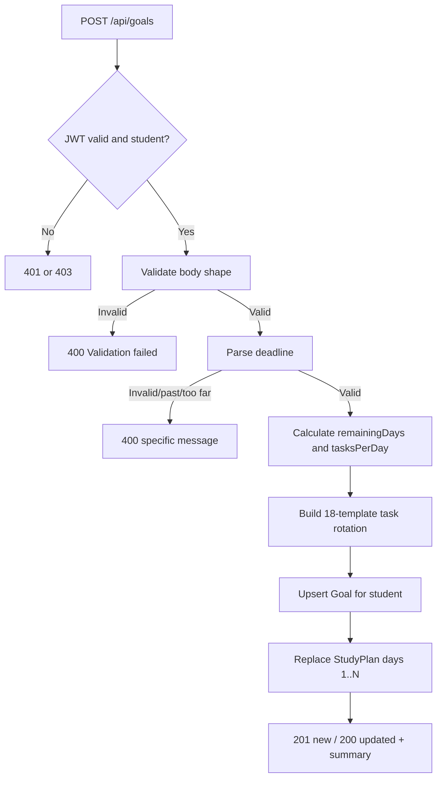

# Design Log #0016: Goal Roadmap Generator

**Ticket:** AG-205 [BE]
**Status:** Proposed → implemented (see §8)
**Depends on:** #0013 (Goal/StudyPlan schemas), #0003 (User/JWT)
**Related:** FR03 goal tracking, STP TC04 past-deadline rejection, FR07 daily task completion

## 1. Background

A student sets a CEFR target and a deadline. The backend must:

1. Persist one `Goal` per student.
2. Calculate the remaining days from now until the deadline.
3. Generate a `StudyPlan` document for each remaining day.
4. Embed the day's `dailyTasks` inside that plan.
5. Return enough summary data for the client to confirm the roadmap.

The models already exist from AG-202. AG-205 adds the HTTP boundary and the
roadmap-generation service.

## 2. Problem

Without AG-205:

1. **No goal endpoint.** The ADS exposes `POST /api/goals`, but no route or
   controller exists.
2. **No remaining-day calculation.** The client would have to duplicate date
   math and could disagree with the backend.
3. **No daily task generation.** `StudyPlan` documents exist but are never
   populated.
4. **No past-deadline rejection.** STP TC04 requires
   `400 Deadline must be a future date`.
5. **Repeated submissions could duplicate plans.** A second `POST /api/goals`
   must update the goal and regenerate the roadmap rather than create parallel
   day records.

## 3. Questions and Answers

- **Q1: What is a “remaining day”?**
  - **A:** The number of 24-hour periods between the request time and the
    deadline, rounded up, with a minimum of one:
    ```text
    remainingDays = max(1, ceil((deadline - now) / 86_400_000))
    ```
    This counts a partially remaining day as one plan day.

- **Q2: How are date-only deadlines interpreted?**
  - **A:** A `YYYY-MM-DD` value is interpreted as the end of that UTC day,
    `23:59:59.999Z`. This lets a student set “today” as the deadline while the
    day is still running. An ISO datetime is used as the exact instant.
    Invalid calendar dates such as `2026-02-31` are rejected.

- **Q3: What is the exact past-deadline response?**
  - **A:** `400 { "error": "Deadline must be a future date" }`, matching STP
    TC04. The check is `deadline <= now` after parsing.

- **Q4: How many tasks are generated per day?**
  - **A:** Based on the Goal's `dailyMinutesTarget`:
    ```text
    tasksPerDay = clamp(ceil(dailyMinutesTarget / 15), 1, 8)
    ```
    Fifteen minutes is the task granularity. The default `45` minutes produces
    three tasks per day, matching the prototype dashboard. The cap prevents an
    oversized single day.

- **Q5: Which tasks are generated?**
  - **A:** A fixed 18-template rotation covering Core (Grammar/Vocabulary),
    Listening, Reading, Writing, and Speaking Parts 1–4. Each day starts at a
    different offset, so a student sees varied skills across the roadmap.
    Every task is `points: 10`, `isCompleted: false`.

- **Q6: How many StudyPlan documents are created?**
  - **A:** One document per remaining day, with `dayNumber` running from `1` to
    `remainingDays`. Tasks are embedded in `dailyTasks`.

- **Q7: What happens on a second POST for the same student?**
  - **A:** The existing `Goal` is updated, and the StudyPlan is replaced so the
    roadmap matches the new target, deadline, and daily minutes. The response
    is `200` for an update and `201` for a new goal. No duplicate day records
    remain.

- **Q8: Are goal update and plan regeneration transactional?**
  - **A:** No. The local MongoDB test instance is standalone and does not
    support multi-document transactions. The controller validates everything
    before writing, upserts the Goal, then replaces the plan. If the plan write
    fails after the Goal write, the student can retry the same request. This
    trade-off is recorded in §7.

- **Q9: Should `remainingDays` be stored in MongoDB?**
  - **A:** No. It is derived from `deadline - now` and would become stale every
    day. It is returned in the response only.

- **Q10: Is `GET /api/goals/current` in scope?**
  - **A:** No. AG-205 is the `POST /api/goals` roadmap generator. The POST
    response exposes the goal and roadmap summary; the current-goal and
    study-plan read endpoints remain later tickets.

- **Q11: Why cap the roadmap at 1825 days?**
  - **A:** A five-year horizon is far beyond a university graduation target and
    prevents a malicious or accidental far-future deadline from generating
    millions of embedded tasks. A deadline beyond the cap returns
    `400 Deadline must be within 1825 days`.

- **Q12: Does `targetCertificate` change the task templates?**
  - **A:** No. It is stored on the Goal. Study intensity is controlled by
    `dailyMinutesTarget`; the certificate does not silently change the number
    of tasks.

- **Q13: Which roles may call the endpoint?**
  - **A:** Students only. Missing or invalid JWTs return `401`; lecturers and
    admins return `403`.

## 4. Design

### 4.1 Request flow



### 4.2 Files and Contracts

#### File: `server/src/validators/goalValidator.js`

```javascript
const MIN_DAILY_MINUTES = 15;
const MAX_DAILY_MINUTES = 240;
const DEFAULT_DAILY_MINUTES = 45;

/**
 * @param {unknown} body
 * @returns {{
 *   value: { targetCertificate: 'B1'|'B2'|'C1', deadline: string, dailyMinutesTarget: number },
 *   errors: string[]
 * }}
 */
function validateGoalInput(body) {}
```

Validation rules:

| Field | Rule | Failure message |
| --- | --- | --- |
| body | JSON object | `request body must be a JSON object` |
| `deadline` | Required non-empty string, parseable later | `deadline is required` / `deadline must be a valid ISO date` |
| `targetCertificate` | Optional; one of `B1`, `B2`, `C1`; default `B2` | `targetCertificate must be one of: B1, B2, C1` |
| `dailyMinutesTarget` | Optional; integer `15`–`240`; default `45` | `dailyMinutesTarget must be an integer between 15 and 240` |

The validator does not compare against `now`; that belongs to the roadmap
service so the check can be unit-tested with a fixed clock.

#### File: `server/src/services/roadmapGenerator.js`

```javascript
const MINUTES_PER_TASK = 15;
const MIN_TASKS_PER_DAY = 1;
const MAX_TASKS_PER_DAY = 8;
const MAX_ROADMAP_DAYS = 1825;

class RoadmapError extends Error {
  /**
   * @param {string} message
   * @param {number} [statusCode]
   */
  constructor(message, statusCode = 400) {}
}

/**
 * @param {string | Date} value
 * @param {Date} [now]
 * @returns {Date}
 * @throws {RoadmapError}
 */
function parseDeadline(value, now = new Date()) {}

/**
 * @param {Date} deadline
 * @param {Date} [now]
 * @returns {number}
 */
function calculateRemainingDays(deadline, now = new Date()) {}

/**
 * @param {number} dailyMinutesTarget
 * @returns {number}
 */
function calculateTasksPerDay(dailyMinutesTarget) {}

/**
 * @param {number} dayNumber
 * @param {number} tasksPerDay
 * @returns {Array<{
 *   title: string,
 *   skill: 'core'|'listening'|'reading'|'writing'|'speaking',
 *   partNumber: number,
 *   points: number,
 *   isCompleted: boolean
 * }>}
 */
function buildDailyTasks(dayNumber, tasksPerDay) {}

/**
 * @param {{
 *   targetCertificate: 'B1'|'B2'|'C1',
 *   deadline: string | Date,
 *   dailyMinutesTarget: number,
 *   now?: Date
 * }} input
 * @returns {{
 *   deadline: Date,
 *   remainingDays: number,
 *   tasksPerDay: number,
 *   days: Array<{ dayNumber: number, dailyTasks: Array<object> }>
 * }}
 * @throws {RoadmapError}
 */
function buildRoadmap(input) {}
```

#### File: `server/src/controllers/goalController.js`

```javascript
/**
 * @param {import('express').Request} request
 * @param {import('express').Response} response
 * @returns {Promise<void>}
 */
async function createGoal(request, response) {}
```

Behavior:

1. Validate `request.body`.
2. Call `buildRoadmap` with a fresh `now`.
3. `Goal.exists({ student })` to choose `201` versus `200`.
4. Upsert the Goal with `findOneAndUpdate`.
5. Replace the student's StudyPlan with one document per day.
6. Return the summary below.

#### File: `server/src/routes/goalRoutes.js`

```javascript
router.post('/', verifyToken, authorizeRoles('student'), createGoal);
```

Mount in `server/src/app.js`:

```javascript
app.use('/api/goals', goalRoutes);
```

#### StudyPlan index

Add a compound unique index:

```javascript
studyPlanSchema.index({ student: 1, dayNumber: 1 }, { unique: true });
```

This prevents concurrent POSTs from creating duplicate day records.

### 4.3 Task template rotation

The generator uses 18 templates in this order:

| # | Skill | Part | Title |
| --- | --- | --- | --- |
| 1 | core | 1 | Core Part 1: Grammar practice |
| 2 | listening | 1 | Listening Part 1: Information matching |
| 3 | reading | 1 | Reading Part 1: Sentence completion |
| 4 | writing | 1 | Writing Part 1: Form completion |
| 5 | speaking | 1 | Speaking Part 1: Personal information |
| 6 | core | 2 | Core Part 2: Vocabulary practice |
| 7 | listening | 2 | Listening Part 2: Opinion matching |
| 8 | reading | 2 | Reading Part 2: Sentence ordering |
| 9 | writing | 2 | Writing Part 2: Short text |
| 10 | speaking | 2 | Speaking Part 2: Picture description |
| 11 | listening | 3 | Listening Part 3: Monologue completion |
| 12 | reading | 3 | Reading Part 3: Opinion matching |
| 13 | writing | 3 | Writing Part 3: Chat replies |
| 14 | speaking | 3 | Speaking Part 3: Picture comparison |
| 15 | listening | 4 | Listening Part 4: Long conversation |
| 16 | reading | 4 | Reading Part 4: Heading matching |
| 17 | writing | 4 | Writing Part 4: Formal email |
| 18 | speaking | 4 | Speaking Part 4: Abstract discussion |

For day `d`, the first template index is:

```text
((d - 1) * tasksPerDay) % 18
```

The next `tasksPerDay` templates wrap around the list.

### 4.4 Response contract

`201 Created` for a new goal, `200 OK` for an updated goal:

```json
{
  "goal": {
    "id": "66f...",
    "targetCertificate": "B2",
    "deadline": "2027-06-30T23:59:59.999Z",
    "dailyMinutesTarget": 45,
    "remainingDays": 233
  },
  "roadmap": {
    "totalDays": 233,
    "tasksPerDay": 3,
    "totalTasks": 699,
    "firstDayNumber": 1,
    "lastDayNumber": 233
  }
}
```

The response deliberately does not include every day. `GET /api/study-plans`
will read the persisted breakdown without sending a multi-year payload.

### 4.5 Error contracts

| Status | Body | When |
| --- | --- | --- |
| `401` | `{ "error": "Authentication required" }` | Missing bearer token |
| `401` | `{ "error": "Invalid or expired token" }` | Bad JWT |
| `403` | `{ "error": "Forbidden" }` | Lecturer/admin |
| `400` | `{ "error": "Validation failed", "details": [...] }` | Bad body shape |
| `400` | `{ "error": "Deadline must be a valid ISO date" }` | Unparseable/invalid date |
| `400` | `{ "error": "Deadline must be a future date" }` | Past deadline |
| `400` | `{ "error": "Deadline must be within 1825 days" }` | Too far ahead |

## 5. Implementation Plan (TDD)

1. Write failing validator tests in `tests/goal-validator.test.js`.
2. Write failing roadmap tests in `tests/roadmap-generator.test.js` covering
   deadline parsing, past/too-far rejection, remaining-day math, task counts,
   template rotation, and bounds.
3. Write failing route tests in `tests/goal-routes.test.js` for `401`, `403`,
   body validation, past-deadline `400`, and generated route behavior.
4. Write the failing MongoDB integration test
   `tests/goal-roadmap.integration.test.js`:
   - Create a student and JWT.
   - POST a goal and assert `201`, remaining days, task counts, and persisted
     `StudyPlan` days.
   - POST again with a shorter deadline and different daily minutes; assert
     `200`, one Goal, no duplicate days, and regenerated tasks.
   - Assert a past deadline returns the exact STP TC04 message.
5. Update `tests/study-plan-model.test.js` to assert the compound unique index.
6. Run the new tests and confirm they fail for the missing modules.
7. Implement the validator, service, controller, route, app mount, and index.
8. Re-run targeted tests, the full suite, lint, format check, UI tests, Jest,
   and the client build.
9. Update `README.md` and append §8 with results and deviations.

## 6. Examples

### ✅ Date-only deadline

```json
{ "targetCertificate": "B2", "deadline": "2027-06-30" }
```

With `now = 2026-11-09T12:00:00Z`, the deadline becomes
`2027-06-30T23:59:59.999Z`, remaining days are calculated from that instant, and
the default `dailyMinutesTarget: 45` produces three tasks per day.

### ✅ Higher daily target

```json
{
  "targetCertificate": "C1",
  "deadline": "2026-12-31",
  "dailyMinutesTarget": 120
}
```

`ceil(120 / 15) = 8` tasks per day, capped at eight.

### ✅ Repeated POST

First request: `201 Created`, 10 plan days.
Second request with a 5-day deadline: `200 OK`, exactly 5 plan days, one Goal
document, and no leftover days 6–10.

### ❌ Past deadline

```json
{ "deadline": "2020-01-01" }
```

Returns `400 { "error": "Deadline must be a future date" }`. The controller must
not create a Goal or StudyPlan.

### ❌ Invalid calendar date

```json
{ "deadline": "2026-02-31" }
```

Returns `400 { "error": "Deadline must be a valid ISO date" }`. JavaScript would
otherwise normalize this to March 3 and silently accept a different date.

### ❌ Duplicate day records

```text
StudyPlan.find({ student }) -> dayNumber 1, 1, 2, 2, ...
```

This is prevented by the `{ student: 1, dayNumber: 1 }` unique index and by
replacing the plan on every POST.

## 7. Trade-offs

- **Derived remaining days vs. stored counter.** Deriving avoids stale data. The
  cost is one calculation per request.
- **One plan document per day vs. one document with all days.** Per-day
  documents keep the future `PATCH /api/study-plans/tasks/:id` update small and
  let `GET /api/study-plans` page by day. The cost is more documents.
- **Replace plan vs. preserve completion state.** A goal change regenerates the
  roadmap and resets completion, which is correct when the target or cadence
  changes. It would be wrong for a simple profile edit, but no such edit exists
  yet.
- **No transaction.** Standalone MongoDB cannot run multi-document
  transactions. The controller validates before writing and replaces the plan
  after the Goal upsert; a retry repairs a partial write.
- **Five-year cap.** The cap protects memory and database writes. It also
  rejects an unrealistic long-range goal that the product does not need.
- **Summary response vs. full roadmap.** The summary keeps the POST response
  small. The read endpoint remains responsible for the full day/task payload.

## 8. Implementation Results

Implemented on `feature/AG-205` from `develop` at `df7cc50`.

### Files added or changed

- `server/src/validators/goalValidator.js` - goal body, certificate, and
  cadence validation.
- `server/src/services/roadmapGenerator.js` - deadline parsing, remaining-day
  calculation, 18-template task rotation, and the five-year cap.
- `server/src/controllers/goalController.js` - goal upsert, roadmap
  regeneration, and response serialization.
- `server/src/routes/goalRoutes.js` - student-only `POST /api/goals`.
- `server/src/app.js` - mounts `/api/goals`.
- `server/src/models/StudyPlan.js` - adds the unique `{ student, dayNumber }`
  index.
- `tests/goal-validator.test.js` - request validation matrix.
- `tests/roadmap-generator.test.js` - deadline, remaining-day, cadence, and
  rotation tests.
- `tests/goal-routes.test.js` - `401`, `403`, body, invalid-date, past-date, and
  cap Contracts.
- `tests/goal-roadmap.integration.test.js` - real MongoDB goal upsert and
  roadmap regeneration.
- `tests/study-plan-model.test.js` - asserts the compound unique index.
- `README.md` - status, Goal API contract, test counts, layout, documentation,
  and roadmap.

### TDD evidence

Red run after writing the tests and before implementation:

```text
node --test tests/goal-validator.test.js tests/roadmap-generator.test.js \
  tests/goal-routes.test.js tests/study-plan-model.test.js \
  tests/goal-roadmap.integration.test.js
# missing goalValidator and roadmapGenerator modules
# POST /api/goals returned 404 because the route was not mounted
# StudyPlan unique student/day index assertion failed
```

Green runs:

```text
node --test tests/goal-validator.test.js tests/roadmap-generator.test.js \
  tests/goal-routes.test.js tests/study-plan-model.test.js
# tests 36, pass 36, fail 0

$env:MONGODB_TEST_URI="mongodb://127.0.0.1:27017/aptis-go-test";
node --test tests/goal-roadmap.integration.test.js
# tests 1, pass 1, fail 0
```

Full suite:

```text
npm test
# tests 157, pass 150, fail 0, skipped 7 (no MONGODB_TEST_URI)

$env:MONGODB_TEST_URI="mongodb://127.0.0.1:27017/aptis-go-test"; npm test
# tests 157, pass 157, fail 0, skipped 0

npm run test:ui
# 43/43 passed

npm run test:jest
# 7/7 passed

npm run lint
# clean

npm run format:check
# clean

npm --prefix client run build
# Vite production build succeeded
```

### Verified behavior

- A new goal returns `201`; an existing goal returns `200`.
- Date-only deadlines are stored as `23:59:59.999Z` on that UTC day.
- Invalid calendar dates return `400 Deadline must be a valid ISO date`.
- Past deadlines return `400 Deadline must be a future date`.
- Roadmaps longer than 1,825 days return
  `400 Deadline must be within 1825 days`.
- The default cadence of 45 minutes creates three tasks per day.
- A 30-minute cadence creates two tasks per day.
- The 18-template rotation starts with Core Part 1, Listening Part 1, and
  Reading Part 1 on day one, then Writing Part 1, Speaking Part 1, and Core
  Part 2 on day two.
- Every task has `points: 10`, `isCompleted: false`, and its own `_id`.
- One Goal and one StudyPlan per remaining day are persisted.
- A repeated POST with a shorter deadline removes the extra old days and
  leaves no duplicate `dayNumber` records.
- A rejected past-deadline request leaves the previous Goal and StudyPlan
  unchanged.
- The response contains only the roadmap summary, not every day.

### Deviations from the plan

- The generated plans are validated before the existing StudyPlan is deleted,
  so a schema error cannot destroy the old roadmap before the replacement is
  known to be valid.
- The five-year cap route test uses `2099-01-01` so it remains beyond the cap as
  the real clock advances.
- No `GET /api/goals/current` or `GET /api/study-plans` endpoint was added.
  Those remain separate read-side tickets.
- No Postman collection was added for the goal endpoint; the integration test
  exercises the HTTP contract against MongoDB.
