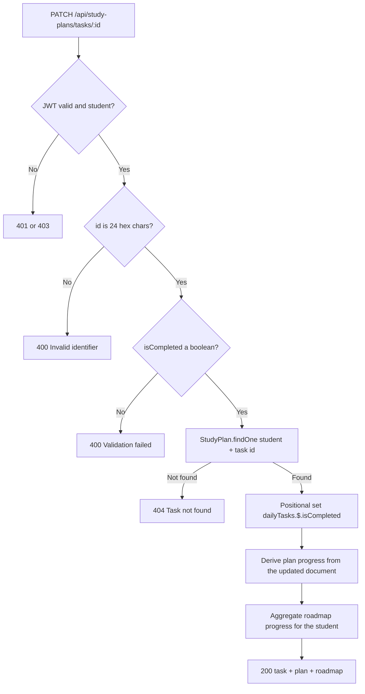

# Design Log #0017: Study Plan Task Completion and Progress

**Ticket:** AG-206 [BE]
**Status:** Proposed -> implemented (see section 8)
**Depends on:** #0013 (Goal/StudyPlan schemas), #0016 (goal roadmap generator)
**Related:** FR07 daily task completion, FR03 goal tracking, test plan TC04/TC05

## 1. Background

AG-202 embedded `dailyTasks` inside each `StudyPlan` document and gave every task
an `_id`, `points`, and `isCompleted: false`. AG-205 generates one `StudyPlan`
per remaining day, each holding `tasksPerDay` embedded tasks.

Nothing can change `isCompleted` yet. There is no write path for a task, and no
definition of what "progress" means once tasks start changing state. The client
therefore cannot satisfy FR07 without inventing its own progress math.

## 2. Problem

Without AG-206:

1. **FR07 is unreachable.** A student can be given a roadmap but cannot mark a
   day's task as done.
2. **Progress has no owner.** If the React client counts completed tasks, two
   clients can disagree, and a student can display 100% while the database says
   otherwise.
3. **Embedded tasks need a targeted write.** Tasks live inside
   `StudyPlan.dailyTasks`, so the update must be a positional `$set`, not a
   document rewrite that could clobber a concurrent change.
4. **Ownership is not expressed.** A task id is globally unique, but it belongs
   to exactly one student. Another student must not be able to complete it, and
   must not learn that it exists.
5. **Progress is needed at two levels.** A student sees "today" (the day plan)
   and the whole roadmap (the goal). Both must be recalculated from persisted
   state after every change.
6. **Repeated or retried requests must be safe.** A double tap, a browser retry,
   or a proxy replay must not flip a task back and forth.

## 3. Questions and Answers

- **Q1: Does the request send the new state, or ask for a toggle?**
  - **A:** It sends the new state: `{ "isCompleted": true }`, which must be a
    boolean. An implicit toggle (no body, flip the stored value) is rejected
    because any retry, double click, or replayed request silently reverses the
    student's intent. Explicit state makes the endpoint idempotent.

- **Q2: What exactly is `:id`?**
  - **A:** The `_id` of the embedded task inside `dailyTasks`, a 24-character hex
    ObjectId string. It is not the StudyPlan id and not the day number. Using the
    task id lets the client update one task without knowing which day document
    holds it.

- **Q3: How is the task found?**
  - **A:** With a single query scoped to the caller:
    ```javascript
    StudyPlan.findOne({ student, 'dailyTasks._id': taskId })
    ```
    The positional operator then updates exactly that element:
    ```javascript
    { $set: { 'dailyTasks.$.isCompleted': isCompleted } }
    ```
    A `PATCH` by another student matches no document and returns `404`.

- **Q4: Is progress stored on the document?**
  - **A:** No. Progress is derived from `dailyTasks` on every request, for the
    same reason AG-205 derives `remainingDays`: a stored counter goes stale
    whenever a task changes, and the two can disagree. The single source of
    truth stays the `isCompleted` flags.

- **Q5: Which progress numbers are returned?**
  - **A:** Two levels plus points:

    | Level | Fields |
    | --- | --- |
    | `plan` (the day that owns the task) | `completedTasks`, `totalTasks`, `percent`, `completedPoints`, `totalPoints` |
    | `roadmap` (all days for the student) | `completedTasks`, `totalTasks`, `percent`, `completedPoints`, `totalPoints` |

    Points exist on every task (`points: 10` from the roadmap generator) and
    would otherwise be dead data, so they are aggregated rather than ignored.

- **Q6: How is `percent` calculated and rounded?**
  - **A:** `round(completedTasks / totalTasks * 100, 1)` - one decimal place,
    `0` when there are no tasks, `100` when all are complete. One decimal is
    deliberate: with 699 roadmap tasks the first completion is `0.1`, not `0`,
    so early effort is still visible. An integer would show `0` for the first
    three completions.

- **Q7: What does a repeated identical PATCH return?**
  - **A:** `200` with the same state. The write is idempotent: setting
    `isCompleted: true` on an already completed task changes nothing and still
    returns the current plan and roadmap progress, so a retry cannot corrupt
    progress.

- **Q8: What status is returned for a task that belongs to another student?**
  - **A:** `404 { "error": "Task not found" }`, identical to an unknown id.
    `403` would confirm that the id exists and belongs to someone, which leaks
    information between students.

- **Q9: What about a malformed id such as `1`?**
  - **A:** `400 { "error": "Invalid identifier" }` before any database call. The
    check is a strict `/^[0-9a-fA-F]{24}$/` test, not Mongoose
    `isValidObjectId`, which also accepts arbitrary 12-character strings.

- **Q10: Which roles may call the endpoint?**
  - **A:** Students only. A missing or invalid JWT returns `401`; lecturers and
    admins return `403`. This matches `POST /api/goals` and the placement
    endpoint.

- **Q11: Is the write transactional with the progress read?**
  - **A:** No transaction is needed for the write itself: a positional `$set`
    updates one document atomically. The two progress reads happen after it. If
    a second PATCH touches a different day between the write and the roadmap
    aggregation, the returned `roadmap` total can lag by that one change; the
    next request corrects it. The owning `plan` figure is always consistent
    because it is read from the same `findOne` document that was updated.

- **Q12: Does completion survive a goal change?**
  - **A:** No. `POST /api/goals` (AG-205) replaces the whole roadmap, so
    completion resets. That is intentional: a new certificate, deadline, or
    cadence produces a different set of tasks, and carrying `isCompleted` onto
    differently-numbered tasks would be meaningless. This is recorded in
    section 7.

- **Q13: Is `GET /api/study-plans` or a bulk "complete all" included?**
  - **A:** No. AG-206 is one task toggle plus progress. Reading the roadmap,
    bulk completion, streaks, and calendars remain later tickets.

- **Q14: Why require a body at all instead of deriving the new value?**
  - **A:** A derived value (`!isCompleted`) is a read-modify-write across two
    round trips with no lock, so two simultaneous taps both read `false` and both
    write `true`. Explicit state removes the read entirely.

## 4. Design

### 4.1 Request flow



### 4.2 Files and Contracts

#### File: `server/src/validators/studyPlanValidator.js`

```javascript
const OBJECT_ID_PATTERN = /^[0-9a-fA-F]{24}$/;

/**
 * @param {unknown} body
 * @returns {{ value: { isCompleted: boolean | null }, errors: string[] }}
 */
function validateTaskCompletionInput(body) {}

/**
 * @param {unknown} value
 * @returns {boolean}
 */
function isTaskId(value) {}

module.exports = { OBJECT_ID_PATTERN, validateTaskCompletionInput, isTaskId };
```

Validation rules:

| Field | Rule | Failure message |
| --- | --- | --- |
| body | JSON object | `request body must be a JSON object` |
| `isCompleted` | Required boolean (`true`/`false`, not `"true"`, not `1`) | `isCompleted must be a boolean` |
| `:id` | 24 hexadecimal characters | `Invalid identifier` (responded by the controller) |

Unknown extra body fields are ignored, matching `validateGoalInput`.

#### File: `server/src/services/studyPlanProgress.js`

```javascript
/**
 * @param {number} completedTasks
 * @param {number} totalTasks
 * @returns {number} percentage with one decimal place, 0-100
 */
function calculatePercent(completedTasks, totalTasks) {}

/**
 * @param {Array<{ isCompleted?: boolean, points?: number }>} dailyTasks
 * @returns {{
 *   completedTasks: number,
 *   totalTasks: number,
 *   percent: number,
 *   completedPoints: number,
 *   totalPoints: number
 * }}
 */
function calculateTaskProgress(dailyTasks = []) {}

module.exports = { calculatePercent, calculateTaskProgress };
```

Rules:

- Non-finite or negative inputs are treated as `0`; the result never leaves
  `0-100`.
- `totalTasks === 0` returns `0`, never `NaN`.
- A completed task contributes its `points` (default `0` if the stored value is
  missing) to `completedPoints`; every task contributes to `totalPoints`.
- The same function serves the day plan (its `dailyTasks`) and the roadmap
  (aggregated sums from MongoDB), so both levels round identically.

#### File: `server/src/controllers/studyPlanController.js`

```javascript
/**
 * @param {import('express').Request} request
 * @param {import('express').Response} response
 * @returns {Promise<void>}
 */
async function updateTaskCompletion(request, response) {}

module.exports = { updateTaskCompletion, serializeTask };
```

Behavior:

1. Reject a malformed `:id` with `400 Invalid identifier`.
2. Validate the body with `validateTaskCompletionInput`.
3. `findOne` and update in one call:
   ```javascript
   StudyPlan.findOneAndUpdate(
     { student: request.user.id, 'dailyTasks._id': request.params.id },
     { $set: { 'dailyTasks.$.isCompleted': value.isCompleted } },
     { new: true, runValidators: true }
   ).lean()
   ```
4. `404 Task not found` when nothing matched.
5. Derive `plan` progress from the returned document.
6. Aggregate `roadmap` progress over every `StudyPlan` of the student.
7. Respond `200` with the contract in 4.4.

The roadmap aggregation:

```javascript
StudyPlan.aggregate([
  { $match: { student: new mongoose.Types.ObjectId(student) } },
  { $unwind: '$dailyTasks' },
  {
    $group: {
      _id: null,
      totalTasks: { $sum: 1 },
      completedTasks: { $sum: { $cond: ['$dailyTasks.isCompleted', 1, 0] } },
      totalPoints: { $sum: '$dailyTasks.points' },
      completedPoints: {
        $sum: { $cond: ['$dailyTasks.isCompleted', '$dailyTasks.points', 0] },
      },
    },
  },
]);
```

The student id is only cast after the task lookup has already matched, so a
malformed token subject cannot reach this aggregation. A student with no plans
(empty aggregation result) returns all zeros.

#### File: `server/src/routes/studyPlanRoutes.js`

```javascript
router.patch('/tasks/:id', verifyToken, authorizeRoles('student'), updateTaskCompletion);
```

Mount in `server/src/app.js`:

```javascript
app.use('/api/study-plans', studyPlanRoutes);
```

### 4.3 Why one document and a positional update

`dailyTasks` is embedded (AG-202), so the task has no collection of its own.
The positional `$set` writes one element of one document atomically, which:

- avoids a read-modify-write of the whole plan (no lost updates between taps on
  different tasks in the same day),
- keeps the write proportional to one task, not to the roadmap,
- allows the response to reuse the same returned document for the day's
  progress.

### 4.4 Response contract

`200 OK`:

```json
{
  "task": {
    "id": "66f1c0a2b5d4e6f7a8b9c0d1",
    "planId": "66f1c0a2b5d4e6f7a8b9c0e0",
    "dayNumber": 1,
    "title": "Core Part 1: Grammar practice",
    "skill": "core",
    "partNumber": 1,
    "points": 10,
    "isCompleted": true
  },
  "plan": {
    "id": "66f1c0a2b5d4e6f7a8b9c0e0",
    "dayNumber": 1,
    "completedTasks": 1,
    "totalTasks": 3,
    "percent": 33.3,
    "completedPoints": 10,
    "totalPoints": 30
  },
  "roadmap": {
    "completedTasks": 1,
    "totalTasks": 699,
    "percent": 0.1,
    "completedPoints": 10,
    "totalPoints": 6990
  }
}
```

`plan` and `roadmap` use identical field names so the client can render both
with one component.

### 4.5 Error contracts

| Status | Body | When |
| --- | --- | --- |
| `401` | `{ "error": "Authentication required" }` | Missing bearer token |
| `401` | `{ "error": "Invalid or expired token" }` | Bad JWT |
| `403` | `{ "error": "Forbidden" }` | Lecturer or admin |
| `400` | `{ "error": "Invalid identifier" }` | `:id` is not 24 hex characters |
| `400` | `{ "error": "Validation failed", "details": ["..."] }` | Body is not an object, or `isCompleted` is not a boolean |
| `404` | `{ "error": "Task not found" }` | Unknown id, or a task owned by another student |

## 5. Implementation Plan (TDD)

1. Write the failing progress tests in `tests/study-plan-progress.test.js`:
   zero tasks, no completions, partial, complete, one-decimal rounding, points,
   missing `points`, invalid inputs, and the 1-of-699 case that must not round to
   `0`.
2. Write the failing validator tests in `tests/study-plan-validator.test.js`:
   boolean acceptance, string/number/null rejection, non-object bodies, and the
   24-hex id rule (including the 12-character string `isValidObjectId` accepts).
3. Write the failing route tests in `tests/study-plan-routes.test.js`:
   `401` without a token, `403` for lecturer and admin, `400` for a malformed id,
   and `400` for a non-boolean body - all without touching MongoDB.
4. Write the failing MongoDB integration test
   `tests/study-plan-task-completion.integration.test.js`: seed two students and
   a two-day plan, complete one task, assert `200`, the persisted flag, the day
   percentage, and the roadmap totals; then set it back to `false`; then assert an
   unknown id and another student's task both return `404` and leave data
   unchanged.
5. Run the new tests and confirm they fail for the missing modules and the
   unmounted route.
6. Implement the validator, the progress service, the controller, the route, and
   the app mount.
7. Re-run the targeted tests, then the full Node suite (with and without
   `MONGODB_TEST_URI`), lint, format check, UI tests, Jest, and the client build.
8. Update `README.md` and append section 8 with results and deviations.

## 6. Examples

### ✅ Explicit completion

```http
PATCH /api/study-plans/tasks/66f1c0a2b5d4e6f7a8b9c0d1
Authorization: Bearer <student-token>
Content-Type: application/json

{ "isCompleted": true }
```

Returns `200`, `task.isCompleted: true`, `plan.percent: 33.3`, and the updated
`roadmap` totals. Satisfies the rule "state is explicit, so a retry is safe".

### ✅ Retry of the same request

Sending the same body again returns `200` with `isCompleted: true` and the same
percentages. Satisfies idempotency: a replay cannot undo the completion.

### ✅ Marking a task incomplete again

```json
{ "isCompleted": false }
```

Returns `200`, `isCompleted: false`, and the plan percentage drops back (for
example `33.3` -> `0`). Satisfies FR07 in both directions.

### ❌ Toggle without a body

```http
PATCH /api/study-plans/tasks/66f1c0a2b5d4e6f7a8b9c0d1
```

Returns `400 { "error": "Validation failed", "details": ["isCompleted must be a boolean"] }`.
Wrong because an implicit flip makes a double tap or an HTTP retry reverse the
student's action.

### ❌ String boolean

```json
{ "isCompleted": "true" }
```

Returns the same `400`. Wrong because `"false"` is a truthy string; coercing it
would complete a task the student meant to leave open.

### ❌ Another student's task id

```http
PATCH /api/study-plans/tasks/<another-student-task-id>
```

Returns `404 { "error": "Task not found" }` and changes nothing. Wrong response
would be `403`, which confirms the id exists and leaks activity between students.

### ❌ Malformed id

```http
PATCH /api/study-plans/tasks/1
```

Returns `400 { "error": "Invalid identifier" }` without a database call. Wrong
because `CastError` bubbling to the error handler would turn a client mistake
into a `500` in any future refactor that stops catching it.

### ❌ Client-computed progress

```javascript
const percent = Math.round((completed / total) * 100); // ❌ client-side
```

Correct is to render `plan.percent` and `roadmap.percent` from the response:

```javascript
const percent = response.data.plan.percent; // ✅ server-derived
```

Wrong because two clients (or a cleared cache) can disagree with the database,
and the student can display a percentage the backend never confirmed.

## 7. Trade-offs

- **Derived progress vs. stored counters.** Deriving cannot go stale and needs no
  migration, at the cost of one aggregation per PATCH. The roadmap is capped at
  1,825 days (14,600 tasks worst case), so the aggregation stays small.
- **Explicit state vs. toggle.** Explicit is idempotent and retry-safe but
  requires the client to read the current value before rendering a checkbox.
  Toggle is a shorter request but unsafe under retries.
- **`404` vs. `403` for foreign tasks.** `404` protects student privacy but makes
  cross-account debugging slightly harder, because the log line and an unknown id
  look identical to the caller.
- **One extra read per PATCH.** The roadmap aggregate is a second query. It buys
  a response the client can render without another round trip; `GET /api/study-plans`
  will later provide the full breakdown.
- **No optimistic concurrency token.** Two simultaneous PATCHes on the same task
  are last-write-wins. This is acceptable for a personal study checklist; adding
  version checks would complicate the client for no product benefit.
- **Completion resets on goal change.** Regenerating the roadmap discards
  completion because tasks are renumbered. Preserving completion would require a
  task identity that survives regeneration, which the current schema does not
  have.
- **No transaction.** The single-document positional write is atomic, but the
  progress aggregation is a separate read. A concurrent change on another day can
  make the returned roadmap figure briefly stale; the next request corrects it.

## 8. Implementation Results

Implemented on `feature/AG-206` from `develop` at `ee3373b`.

### Files added or changed

- `server/src/validators/studyPlanValidator.js` - boolean-only body validation
  and the 24-hex task id rule.
- `server/src/services/studyPlanProgress.js` - one-decimal percentage and task
  and point progress derivation.
- `server/src/controllers/studyPlanController.js` - positional task update,
  ownership scoping, and the plan plus roadmap response.
- `server/src/routes/studyPlanRoutes.js` - student-only
  `PATCH /api/study-plans/tasks/:id`.
- `server/src/app.js` - mounts `/api/study-plans`.
- `tests/study-plan-progress.test.js` - percentage rounding, clamping, zero
  totals, point totals, and non-boolean flags.
- `tests/study-plan-validator.test.js` - body and task id matrix.
- `tests/study-plan-routes.test.js` - `401`, guard ordering, `403`, invalid id
  `400`, and body `400` Contracts without a database.
- `tests/study-plan-task-completion.integration.test.js` - flag persistence,
  plan and roadmap percentages, idempotent retry, revert, and cross-student
  `404` in both directions.
- `README.md` - status, Study plan API contract, test counts, layout,
  documentation, and roadmap.
- `design-log/#0017-study-plan-task-completion.md` - this log.

### TDD evidence

Red run after writing the tests and before implementation:

```text
node --test tests/study-plan-progress.test.js \
  tests/study-plan-validator.test.js \
  tests/study-plan-routes.test.js
# Cannot find module '../server/src/services/studyPlanProgress'
# Cannot find module '../server/src/validators/studyPlanValidator'
# PATCH /api/study-plans/tasks/:id returned 404 (route not mounted)
# AssertionError: 404 !== 400 on the body Contract
```

The red run also caught one real bug in the first implementation: the validator
returned the raw invalid value (`'true'`) instead of `null`, so the type
signature in 4.2 was violated. The validator now normalizes to `null`.

Green runs:

```text
node --test tests/study-plan-progress.test.js \
  tests/study-plan-validator.test.js \
  tests/study-plan-routes.test.js
# tests 23, pass 23, fail 0

$env:MONGODB_TEST_URI="mongodb://127.0.0.1:27017/aptis-go-test";
node --test tests/study-plan-task-completion.integration.test.js
# tests 1, pass 1, fail 0
```

Full suite:

```text
npm test
# tests 181, pass 173, fail 0, skipped 8 (no MONGODB_TEST_URI)

$env:MONGODB_TEST_URI="mongodb://127.0.0.1:27017/aptis-go-test"; npm test
# tests 181, pass 181, fail 0, skipped 0

npm run test:ui       # 43/43 passed
npm run test:jest     # 7/7 passed
npm run lint          # clean
npm run format:check  # clean
npm --prefix client run build   # Vite production build succeeded
```

### Verified behavior

- Completing a day-1 task returns `200` with the task, the day plan progress
  (`1/2`, `50`, `10` of `20` points), and the roadmap progress (`1/4`, `25`,
  `10` of `40` points).
- Repeating the same `PATCH` returns `200` with `completedTasks` unchanged.
- Completing a task on day 2 raises the roadmap to `2/4`, `50`, `20` points.
- Setting the day-1 task back to `false` lowers the plan to `0` and the roadmap
  to `1/4`, `25`, and persists `false` in MongoDB.
- Another student's token cannot change the task (`404 Task not found`), and the
  first student cannot change the other student's task (`404`).
- An unknown but well-formed task id returns `404 Task not found`.
- Malformed ids (`1`, 12 characters, non-hex) return `400 Invalid identifier`
  without a database call.
- `isCompleted: "true"` and a missing field return
  `400 Validation failed` with `details: ["isCompleted must be a boolean"]`.
- Lecturers and admins receive `403`; a missing token returns `401` even when
  the id is malformed.

### Deviations from the plan

- `findOneAndUpdate` uses `returnDocument: 'after'` instead of the deprecated
  `new: true`, which removes a Mongoose 9 deprecation warning.
- The integration test also covers the reverse cross-student direction (the
  first student targeting the second student's task), beyond the single
  direction named in the plan.
- The invalid-input validator returns `isCompleted: null` as documented in 4.2;
  the first implementation returned the raw value and the red test caught it.
- `npm run format:check` initially failed on 12 pre-existing files because the
  checkout used CRLF while Prettier stores LF. `git diff -w` confirmed the changes
  were line endings only, so they were normalized and are reported separately
  from the AG-206 code.
- No Postman collection was added for the new endpoint; the integration test
  exercises the HTTP contract against MongoDB.
- No `GET /api/study-plans` endpoint was added. Reading the roadmap remains a
  later ticket, so the client currently learns progress only from a PATCH
  response.
