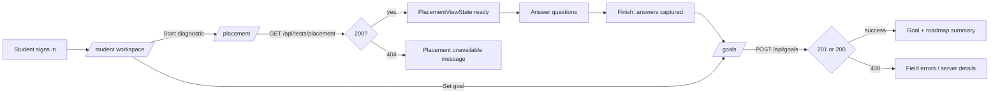

# 0018 - Diagnostic Placement and Goal Setting screens

- Ticket: AG-207 [FE] Build Screen 2: Diagnostic Placement & Goal Setting
  (`/placement`, `/goals`) with B1/B2 selector and deadline picker
- Branch: `feature/AG-207`
- Base: `develop` at `357cd73` (AG-206 merged)

## 1. Background

Sprint 2 delivered the placement diagnostic read endpoint (AG-203), the CEFR
evaluation service (AG-204), the goal roadmap generator (AG-205), and task
completion (AG-206). None of them has a user interface. The only student screen
is `WorkspacePage`, a role-guarded placeholder that says "Screen 2 will add the
adaptive placement runner and the personalised study plan."

The prototype (`prototype/prototype.html`, screens
`#screen-placement-test` and `#screen-student-goal`) defines the intended
experience: a one-question-at-a-time diagnostic runner with progress telemetry,
followed by a goal form with a CEFR target selector, a deadline picker, and a
cadence preview before generating the roadmap.

## 2. Problem

Students cannot reach either feature through the React SPA. Concretely:

1. `GET /api/tests/placement` is unreachable from the UI, so the diagnostic
   exists but cannot be taken.
2. `POST /api/goals` is unreachable from the UI, so no student can create a
   roadmap or reach `/api/study-plans` data created by AG-205/AG-206.
3. There is no screen-level state model for a multi-question runner, so answers,
   navigation, and progress have no explicit, serialisable representation.

The screens must be built against the endpoints that exist today. Placement
**marking** is FR04 (`POST /api/submissions`, TC05) and is not implemented, so
the runner must not display or invent a CEFR result.

## 3. Questions and Answers

**Q1. Do we submit placement answers to the API?**

No. The submission contract in `docx/04_ADS_API_Specification.md.md` is
`POST /api/submissions` (FR04/TC05) and no such route exists. The runner captures
answers in a `PlacementViewState`, shows an explicit "answers captured - marking
arrives with the submissions ticket" summary, and links to `/goals`. Inventing a
client-side score is impossible anyway: `questions.correctAnswer` and
`dropdownSets.correctAnswer` are `select: false`, so the client never receives
the answer key.

**Q2. Which question types can the runner render?**

`mcq_single` with `options`, and `dropdown_match` / `dropdown_cloze` with
`dropdownSets`. These are the types whose answers are a finite selection.
`sentence_order`, `short_fields`, `essay_text`, and `audio_record` need the exam
runner (FR05) and are rendered as a read-only notice, not as fake inputs.

**Q3. Is the goal form gated on finishing the diagnostic?**

No. The student may set a goal first; the screen shows the captured diagnostic
progress as context, not as a prerequisite. Blocking would strand students whose
placement bank is empty (the API returns `404 Placement test not found`).

**Q4. Which target certificates does the UI offer?**

B1 and B2, per the ticket. The API and schema also accept C1, and callers outside
this screen may still use it. The UI restriction is a product decision, not a
contract change.

**Q5. Where do the answers live?**

In `PlacementViewState` in memory, mirrored to `sessionStorage` so a reload does
not lose work and `/goals` can report captured progress. They are never sent to
the server, never written to `localStorage`, and are discarded when the tab
closes or the student signs out and clears the session.

**Q6. What happens when a student already has a roadmap and submits a goal
again?**

`POST /api/goals` is an upsert: it replaces every `StudyPlan` and returns `200`
instead of `201`. AG-205 regenerates tasks from scratch, so task completion is
lost. The form states this before submission rather than hiding it.

**Q7. Is the cadence preview authoritative?**

No. The server recalculates the deadline and roadmap. The preview exists so the
student can see the commitment before submitting. The client constants mirror
`server/src/services/roadmapGenerator.js` and are covered by tests that pin the
same numbers (15 minutes per task, 1-8 tasks per day, 1,825-day cap).

**Q8. What date does a date-only deadline mean?**

The same as on the server: the end of that UTC day. `2026-12-15` becomes
`2026-12-15T23:59:59.999Z`, so picking today is still a future deadline until
the UTC day ends.

## 4. Design

### 4.1 Routes

| Path         | Guard                             | Screen           |
| ------------ | --------------------------------- | ---------------- |
| `/placement` | `ProtectedRoute allowedRoles={['student']}` | `PlacementPage` |
| `/goals`     | `ProtectedRoute allowedRoles={['student']}` | `GoalsPage`     |

`/student` keeps its current behaviour and gains next-step links for both
screens. Lecturers and admins continue to receive `/unauthorized`.



### 4.2 `client/src/placement/placementViewState.js`

```js
export const PLACEMENT_VIEW_STATE_VERSION = 1;

/**
 * @typedef {'loading'|'ready'|'error'|'finished'} PlacementStatus
 *
 * @typedef {object} PlacementAnswer
 * @property {'option'} kind
 * @property {number} optionIndex
 *
 * @typedef {object} PlacementDropdownAnswer
 * @property {'dropdowns'} kind
 * @property {Record<string, number>} selections
 *
 * @typedef {object} PlacementViewState
 * @property {1} version
 * @property {PlacementStatus} status
 * @property {object|null} test
 * @property {Record<string, PlacementAnswer|PlacementDropdownAnswer>} answers
 * @property {number} currentIndex
 * @property {{ message: string, details: string[] }|null} error
 * @property {string|null} completedAt
 */

export function createPlacementViewState(): PlacementViewState;
export function withPlacementTest(viewState, test): PlacementViewState;
export function withPlacementError(viewState, { message, details }): PlacementViewState;
export function withOptionAnswer(viewState, questionId, optionIndex): PlacementViewState;
export function withDropdownAnswer(viewState, questionId, setId, optionIndex): PlacementViewState;
export function goToQuestion(viewState, index): PlacementViewState;
export function nextQuestion(viewState): PlacementViewState;
export function previousQuestion(viewState): PlacementViewState;
export function getCurrentQuestion(viewState): object|null;
export function isQuestionAnswerable(question): boolean;
export function isQuestionAnswered(question, answer): boolean;
export function countAnswerableQuestions(test): number;
export function countAnsweredQuestions(viewState): number;
export function canFinishPlacement(viewState): boolean;
export function finishPlacement(viewState, now?: Date): PlacementViewState;
export function hydratePlacementViewState(saved, test): PlacementViewState;
```

Rules:

- `goToQuestion` clamps to `[0, questions.length - 1]`; an empty test keeps `0`.
- `isQuestionAnswerable` is true when `questionType === 'mcq_single'` and
  `options.length > 0`, or when `questionType` starts with `dropdown_` and
  `dropdownSets.length > 0`.
- `isQuestionAnswered` requires an option index inside `options.length`, or a
  selection for every dropdown set.
- `canFinishPlacement` is true only when `status === 'ready'`, at least one
  question is answerable, and every answerable question is answered.
- `finishPlacement` sets `status: 'finished'` and `completedAt` to
  `now.toISOString()`; it is a no-op when `canFinishPlacement` is false.

### 4.3 `client/src/placement/placementProgressStorage.js`

```js
export const PLACEMENT_PROGRESS_KEY = 'aptis-go:placement-progress';

/**
 * @typedef {object} StoredPlacementProgress
 * @property {1} version
 * @property {{ id: string, title: string, answerableCount: number }} test
 * @property {Record<string, object>} answers
 * @property {number} currentIndex
 * @property {string|null} completedAt
 * @property {string} updatedAt
 */

export function savePlacementProgress(viewState, now?: Date): void;
export function readPlacementProgress(): StoredPlacementProgress|null;
export function clearPlacementProgress(): void;
```

`savePlacementProgress` is a no-op unless `status` is `ready` or `finished` and a
test is loaded. `readPlacementProgress` returns `null` and removes the entry when
the JSON is malformed, `version !== 1`, or the shape is invalid.

### 4.4 `client/src/goals/goalCadence.js`

```js
export const MIN_DAILY_MINUTES = 15;
export const MAX_DAILY_MINUTES = 240;
export const MINUTES_PER_TASK = 15;
export const MIN_TASKS_PER_DAY = 1;
export const MAX_TASKS_PER_DAY = 8;
export const MAX_ROADMAP_DAYS = 1825;
export const DAY_MS = 86_400_000;

export function parseDeadlineEnd(deadline: unknown): Date|null;
export function calculateRemainingDays(deadline: unknown, now?: Date): number;
export function calculateTasksPerDay(dailyMinutesTarget: unknown): number;
export function calculateRoadmapPreview(goal, now?: Date): {
  remainingDays: number,
  tasksPerDay: number,
  totalTasks: number
}|null;
export function todayIsoDate(now?: Date): string;
export function validateDeadline(deadline: unknown, now?: Date): string|null;
```

Rules:

- `parseDeadlineEnd` accepts `YYYY-MM-DD` and maps it to the end of that UTC day.
  It rejects malformed strings and impossible dates such as `2026-02-31`.
- `validateDeadline` returns `'deadline is required'`, `'deadline must be a
  valid ISO date'`, or `'Deadline must be a future date'` - the same strings the
  API uses.
- `calculateRemainingDays` is `max(1, ceil((deadlineEnd - now) / DAY_MS))`, and
  `0` when the deadline is invalid or already past.
- `calculateTasksPerDay` is `clamp(ceil(minutes / 15), 1, 8)`.
- `calculateRoadmapPreview` returns `null` when the deadline is invalid, past, or
  further than 1,825 days away.

### 4.5 `client/src/goals/goalViewState.js`

```js
export const GOAL_TARGETS = Object.freeze(['B1', 'B2']);
export const DEFAULT_DAILY_MINUTES = 45;

/**
 * @typedef {object} GoalViewState
 * @property {'idle'|'submitting'|'success'|'error'} status
 * @property {'B1'|'B2'} targetCertificate
 * @property {string} deadline            // YYYY-MM-DD or ''
 * @property {number} dailyMinutesTarget
 * @property {{ targetCertificate?: string, deadline?: string, dailyMinutesTarget?: string }} fieldErrors
 * @property {{ message: string, details: string[] }|null} error
 * @property {{ goal: object, roadmap: object }|null} result
 */

export function createGoalViewState(user?): GoalViewState;
export function withTarget(viewState, targetCertificate): GoalViewState;
export function withDeadline(viewState, deadline): GoalViewState;
export function withDailyMinutes(viewState, dailyMinutesTarget): GoalViewState;
export function withGoalSubmitting(viewState): GoalViewState;
export function withGoalSuccess(viewState, result): GoalViewState;
export function withGoalError(viewState, error): GoalViewState;
export function validateGoalViewState(viewState, now?: Date): {
  errors: Record<string, string>,
  value: { targetCertificate: 'B1'|'B2', deadline: string, dailyMinutesTarget: number }|null
};
export function isGoalSubmitDisabled(viewState): boolean;
```

Validation rules (all mirrored from `server/src/validators/goalValidator.js` and
`roadmapGenerator.js`):

| Field                 | Rule                                                              | Message                                                     |
| --------------------- | ----------------------------------------------------------------- | ----------------------------------------------------------- |
| `targetCertificate`   | one of `B1`, `B2`                                                 | `targetCertificate must be one of: B1, B2`                  |
| `deadline`            | required, `YYYY-MM-DD`, future end of UTC day, <= 1,825 days ahead | `deadline is required` / `deadline must be a valid ISO date` / `Deadline must be a future date` |
| `dailyMinutesTarget`  | integer, 15-240                                                   | `dailyMinutesTarget must be an integer between 15 and 240`  |

`isGoalSubmitDisabled` is true while `status === 'submitting'`.

### 4.6 API wrappers

```js
// client/src/placement/api.js
export async function fetchPlacementTest(): Promise<object>; // GET /api/tests/placement

// client/src/goals/api.js
export async function createGoalRequest({ targetCertificate, deadline, dailyMinutesTarget }): Promise<{
  goal: { id: string, targetCertificate: 'B1'|'B2'|'C1', deadline: string, dailyMinutesTarget: number, remainingDays: number },
  roadmap: { totalDays: number, tasksPerDay: number, totalTasks: number, firstDayNumber: number, lastDayNumber: number }
}>; // POST /api/goals
```

Both use the shared `apiClient`, so the JWT header, `ApiError` normalisation,
and the 401 session clear are inherited.

### 4.7 Components

- `client/src/app/Brand.jsx` - extracts the logo block currently inlined in
  `AuthLayout`, so both layouts show the same brand.
- `client/src/app/StudentShell.jsx` - app-style header (brand, student chip,
  workspace/placement/goals links, sign out) plus a centred content column.
- `client/src/placement/PlacementPage.jsx` - loading, error, ready, and finished
  views.
- `client/src/placement/PlacementQuestionCard.jsx` - prompt, passage, and the
  input for the supported question types.
- `client/src/goals/GoalsPage.jsx` - goal form, cadence preview, success panel.

Both pages render `<Navigate to="/login" replace />` if the session user is
missing, matching `WorkspacePage`.

## 5. Implementation Plan

1. Write `tests/placement-view-state.test.jsx`, `tests/goal-cadence.test.jsx`,
   `tests/goal-view-state.test.jsx`, `tests/placement-screen.test.jsx`, and
   `tests/goal-screen.test.jsx`.
2. Run `npm run test:ui` and confirm every new test fails for a missing module
   or missing route.
3. Implement the pure modules (`placementViewState.js`, `goalCadence.js`,
   `goalViewState.js`, storage, API wrappers).
4. Implement `Brand`, `StudentShell`, `PlacementPage`, `GoalsPage`, `App.jsx`
   routes, and the workspace links.
5. Re-run `npm run test:ui`, then `npm test`, `npm run test:jest`,
   `npm run lint`, `npm run format:check`, and `npm --prefix client run build`.
6. Update `README.md` (status, Screen 2 API usage, test inventory, layout) and
   append section 8 to this log.
7. Commit on `feature/AG-207`, merge into `develop`, push.

## 6. Examples

**Answer keys use question ids, not indices.**

✅ `answers[question.id] = { kind: 'option', optionIndex: 2 }` survives
navigation, reloads, and a reordered question list.

❌ `answers[viewState.currentIndex] = 2` breaks the moment the student pages
backwards or the API reorders questions.

**Navigation is clamped, not free.**

✅ `goToQuestion(viewState, 999)` returns `currentIndex: questions.length - 1`.

❌ Setting `currentIndex` directly in the component lets the UI point past the
last question and render an empty card.

**The completion gate is explicit.**

✅ `canFinishPlacement` requires every answerable question to be answered.

❌ Enabling "Finish" whenever the last question is visible lets a student skip
items and then see a misleading "6 of 6 captured" summary.

**Answers are never scored on the client.**

✅ Show "Answers captured - server-side marking arrives with FR04."

❌ Show "Your CEFR: B1" computed from `answers.length`, because the client has no
answer key and the number would be meaningless.

**Deadlines are future end-of-UTC-day values.**

✅ `2026-12-15` → `2026-12-15T23:59:59.999Z`, which is still valid when chosen
on 2026-12-15 at 08:00 UTC.

❌ `new Date('2026-12-15')` (midnight UTC), which rejects a goal the server
would accept and makes the preview disagree with the stored goal.

**The goal preview mirrors the server.**

✅ `calculateTasksPerDay(45) === 3`, matching `ceil(45 / 15)`.

❌ `Math.round(45 / 15) + 1 === 4`, which would promise 4 tasks a day and
generate 3.

**Resubmitting a goal is described honestly.**

✅ "Saving a new goal replaces your roadmap and resets completed tasks."

❌ "Your progress will be kept", which contradicts AG-205/AG-206 behaviour.

**The UI restricts targets without changing the contract.**

✅ The form offers `B1` and `B2` radio cards; the API still accepts `C1`.

❌ Adding `C1` to the form because the API allows it, contradicting the ticket.

## 7. Trade-offs

- **No placement score.** The screen cannot show a CEFR baseline until FR04
  ships. The summary is explicitly a capture confirmation, not a result.
- **Client-side cadence duplication.** `MINUTES_PER_TASK`, the task bounds, and
  the 1,825-day cap now exist in `goalCadence.js` as well as
  `roadmapGenerator.js`. Tests pin the values, but a future change must update
  both; a shared module would require a build step the client does not have.
- **Session-scoped answers.** A closed tab loses the diagnostic answers. That is
  acceptable while nothing is submitted; server-side drafts would need a new
  endpoint.
- **No timer enforcement.** `durationMinutes` is displayed but not enforced,
  because the server does not record attempt start times yet.
- **Only two answerable question types.** Writing, speaking, ordering, and
  short-field questions are acknowledged but not answered in this runner. The
  exam runner (FR05) owns them.

## 8. Implementation Results

Implemented on `feature/AG-207` from `develop` at `357cd73`.

### Files added or changed

- `client/src/placement/placementViewState.js` - `PlacementViewState`, answer
  helpers, answerability rules, clamping navigation, finish gate, hydration.
- `client/src/placement/placementProgressStorage.js` - versioned
  `sessionStorage` mirror keyed on the diagnostic id.
- `client/src/placement/PlacementPage.jsx` - loading, error, runner, and capture
  summary views.
- `client/src/placement/PlacementQuestionCard.jsx` - MCQ radios, dropdown
  selects, and the unanswerable-type notice.
- `client/src/placement/api.js` - `GET /api/tests/placement` wrapper.
- `client/src/goals/goalCadence.js` - UTC end-of-day parsing, remaining days,
  tasks per day, preview caps, and API-compatible messages.
- `client/src/goals/goalViewState.js` - `GoalViewState`, transitions, and
  validation.
- `client/src/goals/GoalsPage.jsx` - baseline, captured diagnostic, B1/B2
  selector, deadline picker, minutes select, cadence preview, and result.
- `client/src/goals/api.js` - `POST /api/goals` wrapper.
- `client/src/app/Brand.jsx`, `client/src/app/StudentShell.jsx` - shared brand
  and the student app shell.
- `client/src/App.jsx` - `/placement` and `/goals` routes behind
  `ProtectedRoute allowedRoles={['student']}`.
- `client/src/pages/WorkspacePage.jsx` - Step 1 and Step 2 links for students.
- `client/src/auth/AuthLayout.jsx` - reuses `Brand` instead of a local copy.
- `tests/placement-view-state.test.jsx`, `tests/goal-cadence.test.jsx`,
  `tests/goal-view-state.test.jsx`, `tests/placement-screen.test.jsx`,
  `tests/goal-screen.test.jsx`, `tests/screen-fixtures.jsx`.
- `README.md` - status, Student screens contract, test inventory, layout, and
  roadmap.
- `design-log/#0018-diagnostic-placement-and-goal-screens.md` - this log.

### TDD evidence

Red run after writing the tests and before implementation:

```text
npx vitest run tests/placement-view-state.test.jsx tests/goal-cadence.test.jsx \
  tests/goal-view-state.test.jsx tests/placement-screen.test.jsx \
  tests/goal-screen.test.jsx
# Test Files  5 failed (5)
# Tests  no tests
# Error: Failed to resolve import "../client/src/placement/placementViewState.js"
# Error: Failed to resolve import "../client/src/goals/goalCadence.js"
# Error: Failed to resolve import "../client/src/goals/goalViewState.js"
# Error: Failed to resolve import "../client/src/placement/placementProgressStorage.js"
```

Green run after implementation:

```text
npx vitest run tests/placement-view-state.test.jsx tests/goal-cadence.test.jsx \
  tests/goal-view-state.test.jsx tests/placement-screen.test.jsx \
  tests/goal-screen.test.jsx
# Test Files  5 passed (5)
# Tests  51 passed (51)
```

The first green attempt exposed one real gap in the tests' timing: three screen
tests interacted before the diagnostic fetch resolved. The helper now awaits
`Question 1 of 3` before clicking, which is the actual user-visible readiness
signal.

Full gates:

```text
npm run test:ui       # 10 files, 94 tests, 94 passed
npm test              # 181 tests: 173 passed, 8 skipped (no MONGODB_TEST_URI)
npm run test:jest     # 7/7 passed
npm run lint          # root, client, server clean
npm --prefix client run build   # Vite production build succeeded
```

### Verified behavior

- `/placement` loads the published diagnostic, shows the title, duration,
  question count, and skill chips, and renders `Question 1 of 3`.
- Selecting an option, moving forward, and moving back keeps the answer checked
  and restores the earlier question.
- Dropdown questions require every set; the capture chip counts a question only
  when all of its sets are filled.
- Speaking, writing, ordering, and short-field questions show the FR05 notice
  and do not block completion.
- `Finish diagnostic` stays disabled until every answerable question is
  answered, then returns a summary with `2 of 2 answers captured`, the FR04
  explanation, and a link to `/goals`.
- A published-test `404` shows `Placement test not found` with a link to goal
  setting; a `500` shows the message and a working `Try again`.
- Saved progress for the same diagnostic restores answers and position on
  reload; progress for a different diagnostic is ignored.
- `/goals` shows the session baseline (`B1` in the fixture), B2 selected by
  default, B1/B2 cards only, the deadline picker, and the minutes selector.
- Submitting without a deadline shows `deadline is required` and sends no
  request; a past date shows `Deadline must be a future date` and sends no
  request.
- A valid submission posts `{ targetCertificate, deadline, dailyMinutesTarget }`
  with the Bearer token and renders the returned roadmap (`42 days`,
  `5 tasks per day`, `210 tasks`) in an accessible result region.
- Server `400` details appear under `Validation failed`, and the page states
  that saving replaces the roadmap.
- Captured diagnostic progress is reported as `2 of 2 answers captured` with
  the FR04 note.

### Deviations from the plan

- `Brand` was extracted to `client/src/app/Brand.jsx` and is now imported by
  `AuthLayout` as well, instead of duplicating the markup in `StudentShell`.
- Dropdown `option` values use the option text, and the change handler maps the
  text back to its index before storing it in `PlacementViewState`. Native
  selects need unique values, and the API option strings are unique within a
  set; the ViewState still stores indices as designed.
- `Review answers` clears `completedAt`, so a reviewed diagnostic can be
  finished again instead of staying permanently complete.
- The cadence preview is hidden when the deadline is invalid or past
  (`calculateRoadmapPreview` returns `null`), rather than rendering an empty
  card.
- The baseline card reads the session `user.currentLevel`; no `GET /api/auth/me`
  request is made because that route is not implemented.
- `parseDeadlineEnd` accepts only `YYYY-MM-DD`, because the date input never
  emits an ISO datetime. API callers may still send datetimes; the UI does not
  preview them.
- No Postman collection or backend change was made: this is a client ticket and
  the existing API contract is unchanged.
- The Node suite is unchanged at 181 tests (173 passing, 8 skipped without a
  database) because the ticket adds only UI tests.
