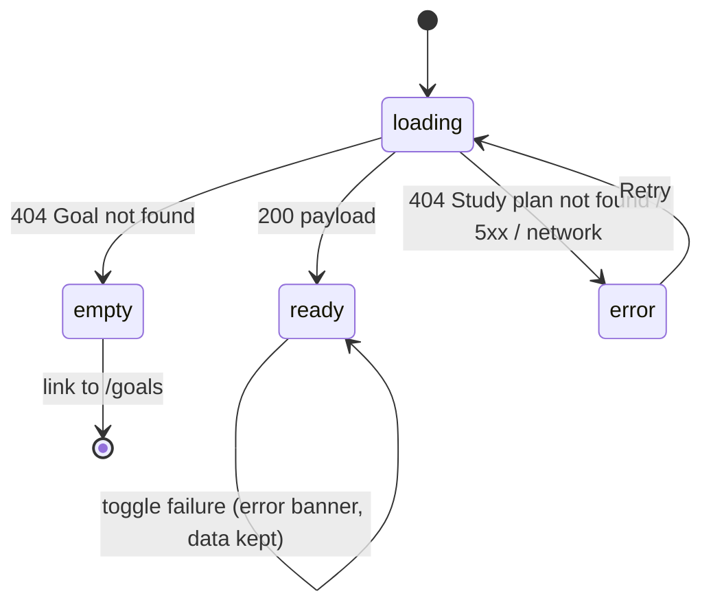

# #0019 — Student dashboard: today's study roadmap checklist and progress bar (AG-208)

- Ticket: `AG-208 [FE] Build Screen 3: Student Dashboard (/dashboard) with Today's Study Roadmap checklist and progress bar (US07)`
- Branch: `feature/AG-208`
- Date: 2026-11-15

## 1. Background

The student already has three screens:

| Screen | Route | Ticket | State |
| --- | --- | --- | --- |
| Authentication portal | `/login`, `/register` | AG-201 | Done |
| Diagnostic / placement | `/placement` | AG-207 | Done |
| Goal setting | `/goals` | AG-207 | Done |

`POST /api/goals` stores one `Goal` per student and generates `StudyPlan` documents with
`dayNumber: 1..N` and embedded `dailyTasks`. `PATCH /api/study-plans/tasks/:id` (AG-206) flips one
task's `isCompleted` and returns recalculated plan and roadmap progress.

US07 requires the student to open a dashboard after setting the goal, see **today's** tasks as a
checklist, tick them off, and watch a progress bar move.

## 2. Problem

Three things are missing:

1. **No read endpoint.** AG-206 deliberately shipped only the write path: "Reading the roadmap
   remains a later ticket". The browser therefore has no contract that returns today's tasks,
   their completion flags, or progress.
2. **No calendar field on `StudyPlan`.** Plans are numbered `dayNumber: 1..N`, not dated, so
   "today" has to be derived. There is no `scheduledDate` to query.
3. **No dashboard screen.** There is no `/dashboard` route, no nav entry, and no view state for a
   checklist whose rows change independently.

## 3. Questions and Answers

**Q1. The ticket is marked `[FE]`, but the screen cannot work without a read endpoint. What is the
scope?**

A: AG-208 adds exactly one backend route, `GET /api/study-plans/today`, because the screen is
otherwise unimplementable without duplicating `roadmapGenerator` in the browser (which would also
miss stored completion flags). The route reuses the existing progress service and is documented as
a blocking dependency resolved inside this ticket. The planned ADS `GET /api/study-plans`
(all-days listing) remains a later ticket; a full listing is unnecessary payload for a dashboard.

**Q2. How is "today" defined when plans have no dates?**

A: Day 1 is the UTC calendar day on which the goal was created. Today's day number is

```text
dayNumber = clamp( floor((utcStartOfDay(now) - utcStartOfDay(goal.createdAt)) / 86_400_000) + 1,
                   1,
                   totalDays )
```

`totalDays` is the number of stored `StudyPlan` documents for that student, so the result always
points at an existing day. A goal created before midnight UTC rolls to the next day at 00:00 UTC.

**Q3. What does the endpoint return?**

A: One self-contained payload: the goal summary, today's day, its tasks, today's derived progress,
and roadmap-wide derived progress. The client needs nothing else to paint Screen 3.

**Q4. Should progress be stored on the plan?**

A: No. AG-206 already derives progress per request. AG-208 keeps that rule: `calculateTaskProgress`
for the day and `calculateRoadmapProgress` for the whole roadmap, both fresh on every read.

**Q5. How does ticking a checkbox persist?**

A: Reuse `PATCH /api/study-plans/tasks/:id` with an explicit `{ "isCompleted": true | false }`.
The response already carries the recalculated `plan` and `roadmap` blocks, so the dashboard updates
in place without a second GET.

**Q6. Optimistic or confirmed updates?**

A: Confirmed only. The checkbox stays disabled (all rows lock) until the API answers, then the task
flips and the bars animate to the returned percentages. This avoids showing a completion the server
rejected.

**Q7. What happens when the student has no goal yet?**

A: `GET /api/study-plans/today` answers `404 { "error": "Goal not found" }`. The dashboard maps that
exact 404 to an **empty** state with a link to `/goals`. A missing plan for an existing goal
(`404 { "error": "Study plan not found" }`) is an **error** state with retry, because it means the
generator data is inconsistent.

**Q8. Does the API need `deadline` as a datetime?**

A: No. It returns the date-only form (`YYYY-MM-DD`) because the stored deadline is the end of a UTC
day and the dashboard only formats it. This also matches `parseDeadlineEnd` / `calculateRemainingDays`
in `client/src/goals/goalCadence.js`.

## 4. Design

### 4.1 Contract — `GET /api/study-plans/today`

- Auth: `Authorization: Bearer <student JWT>`; role `student` only (`lecturer`, `admin` → `403 Forbidden`).
- No path or query parameters.

Success `200`:

```json
{
  "goal": {
    "id": "66f0c2f5a1b2c3d4e5f60718",
    "targetCertificate": "B2",
    "deadline": "2026-12-15",
    "dailyMinutesTarget": 45
  },
  "day": {
    "id": "66f0c3a1a1b2c3d4e5f60720",
    "dayNumber": 3,
    "totalDays": 31,
    "tasks": [
      {
        "id": "66f0c3a1a1b2c3d4e5f60721",
        "title": "Core Part 1: Grammar practice",
        "skill": "core",
        "partNumber": 1,
        "points": 10,
        "isCompleted": true
      }
    ]
  },
  "progress": {
    "completedTasks": 1,
    "totalTasks": 3,
    "percent": 33.3,
    "completedPoints": 10,
    "totalPoints": 30
  },
  "roadmap": {
    "completedTasks": 4,
    "totalTasks": 93,
    "percent": 4.3,
    "completedPoints": 40,
    "totalPoints": 930
  }
}
```

Failures:

| Status | Body | When |
| --- | --- | --- |
| `401` | `{ "error": "Authentication required" }` + `WWW-Authenticate: Bearer` | missing/invalid token |
| `403` | `{ "error": "Forbidden" }` | authenticated non-student |
| `404` | `{ "error": "Goal not found" }` | student has no `Goal` |
| `404` | `{ "error": "Study plan not found" }` | goal exists, zero plans, or the computed day has no plan |

Validation rules:

- `dayNumber` is an integer in `[1, totalDays]`.
- `percent` has one decimal, `0 ≤ percent ≤ 100`.
- `tasks` preserves stored order; `points` is the stored number (default `10`).
- `deadline` matches `^\d{4}-\d{2}-\d{2}$`.

### 4.2 Server modules

`server/src/services/studyPlanSchedule.js`

```js
/**
 * @param {{ createdAt: Date|string|null, totalDays: number, now?: Date }} input
 * @returns {number} 1-based UTC day number, clamped to [1, max(1, totalDays)]
 */
function calculateCurrentDayNumber({ createdAt, totalDays, now = new Date() });
```

`server/src/controllers/studyPlanController.js`

```js
/**
 * GET /api/study-plans/today
 * @param {import('express').Request} request
 * @param {import('express').Response} response
 * @returns {Promise<void>}
 */
async function getTodayPlan(request, response);
```

`server/src/routes/studyPlanRoutes.js`

```js
router.get('/today', verifyToken, authorizeRoles('student'), getTodayPlan);
```

### 4.3 `DashboardViewState`

`client/src/dashboard/dashboardViewState.js` — explicit, serializable, no React.

```js
/**
 * @typedef {object} DashboardViewState
 * @property {'loading'|'ready'|'empty'|'error'} status
 * @property {TodayPlan|null} data
 * @property {string|null} pendingTaskId
 * @property {{ message: string, details: string[] }|null} error
 * @property {string|null} lastUpdatedAt
 */

/**
 * @param {Date} [now]
 * @returns {DashboardViewState}
 */
function createDashboardViewState(now = new Date());

/** @returns {DashboardViewState} */ function withDashboardLoading(viewState);
/** @returns {DashboardViewState} */ function withTodayPlan(viewState, data, now = new Date());
/** @returns {DashboardViewState} */ function withDashboardEmpty(viewState, message);
/** @returns {DashboardViewState} */ function withDashboardError(viewState, error);
/** @returns {DashboardViewState} */ function withTaskPending(viewState, taskId);
/** @returns {DashboardViewState} */ function withTaskUpdated(viewState, { taskId, isCompleted, plan, roadmap }, now = new Date());
/** @returns {DashboardViewState} */ function withTaskError(viewState, error);

/** @returns {object|null} */ function findTask(data, taskId);
/** @returns {boolean} */ function isTaskToggleDisabled(viewState, taskId);
/** @returns {{ totalTasks: number, completedTasks: number, allComplete: boolean }} */ function summarizeToday(data);
```

Rules:

- `withTodayPlan` validates the payload shape; a malformed payload becomes `status: 'error'` with
  `message: 'The study plan response was incomplete.'`.
- `withTaskPending` / `withTaskUpdated` are no-ops when the task id is unknown or the state is not
  `ready` — a late response for a replaced screen cannot corrupt the data.
- `withTaskError` clears `pendingTaskId` but keeps `status: 'ready'` and `data`, so the checklist is
  still usable after a failed toggle.
- `withTaskUpdated` writes the server-provided `plan` into `data.progress` and `roadmap` into
  `data.roadmap`; it never computes percentages in the browser.

### 4.4 Screen modules

| File | Responsibility |
| --- | --- |
| `client/src/dashboard/api.js` | `fetchTodayPlan(): Promise<TodayPlan>`, `updateTaskCompletion(taskId, isCompleted): Promise<TaskUpdateResponse>` |
| `client/src/dashboard/DashboardPage.jsx` | load on mount, empty/error/ready branches, toggle handler, layout |
| `client/src/dashboard/TaskChecklist.jsx` | accessible checkbox list, disabled while any toggle is pending |
| `client/src/app/ProgressBar.jsx` | reusable `role="progressbar"` bar with `aria-valuenow` |
| `client/src/app/StudentShell.jsx` | add `Dashboard` nav item |
| `client/src/App.jsx` | add student-only `/dashboard` route |
| `client/src/pages/WorkspacePage.jsx` | add Step 3 card linking to `/dashboard` |

`ProgressBar` signature:

```jsx
/**
 * @param {{ label: string, percent: number, valueText: string }} props
 */
export default function ProgressBar({ label, percent, valueText });
```

Accessibility contract:

- The bar is a `div role="progressbar"` with `aria-label`, `aria-valuemin={0}`, `aria-valuemax={100}`,
  and `aria-valuenow` clamped to `[0, 100]`.
- The visible percentage is `valueText` (e.g. `33.3%`), not hidden from assistive technology.
- Each checkbox is labelled by its task title, so `getByRole('checkbox', { name: /grammar practice/i })`
  works. Every checkbox is disabled while `pendingTaskId !== null`.

### 4.5 Screen states



## 5. Implementation Plan

1. Branch `feature/AG-208` from `develop`.
2. Write failing tests first:
   - `tests/study-plan-schedule.test.js` — UTC day derivation and clamping.
   - `tests/study-plan-routes.test.js` — extend with `GET /today` `401` and `403` (DB-free).
   - `tests/study-plan-today.integration.test.js` — `404` paths and full payload against `MONGODB_TEST_URI`.
   - `tests/dashboard-view-state.test.jsx` — every transition and guard.
   - `tests/dashboard-screen.test.jsx` — render, toggle, pending lock, failed toggle, empty, retry, complete.
3. Confirm red with `npm test` and `npm run test:ui`.
4. Implement the server schedule service, controller handler, and route; then the client API,
   view state, `ProgressBar`, `TaskChecklist`, `DashboardPage`, route, nav, and workspace card.
5. Confirm green, then run the full gates: Node tests with `MONGODB_TEST_URI`, UI tests, Jest,
   lint, `format:check`, client build.
6. Update `README.md` and append `## 8. Implementation Results`.

## 6. Examples

**Day numbering**

✅ Goal created `2026-11-15T23:30:00Z`, now `2026-11-16T00:10:00Z` → `dayNumber = 2`. The UTC day
changed even though only 40 minutes elapsed; this is what the spec says.
❌ Returning `1` for that pair because "less than 24 hours passed" — contradicts UTC day boundaries
and would keep students on day 1 until the following midnight.

**Clamping**

✅ 40 elapsed days with `totalDays = 31` → `dayNumber = 31`. The roadmap ends at its last stored day.
❌ `41` — would target a plan that does not exist and turn every visit into `404 Study plan not found`.

**Progress**

✅ `percent: 33.3` because 1 of 3 tasks is done, one decimal.
❌ `percent: 33` — loses one-decimal precision shared with AG-206 and makes a 1-of-699 roadmap read `0`.

**Checklist state**

✅ Keep all checkboxes disabled while a PATCH is in flight, then apply the server's `plan`/`roadmap`.
❌ Toggle optimistically and recompute `completedTasks + 1` locally — two quick clicks can interleave
and show a percentage the server never stored.

**Unknown task response**

✅ A PATCH resolving after the view state was replaced (unknown task id) is ignored.
❌ Throwing or writing `undefined` into `data.day.tasks` — breaks the whole checklist.

**Missing goal**

✅ `404 { "error": "Goal not found" }` → empty state with a link to `/goals`.
❌ Generic red error — a new student sees a failure where the correct next step is to set a goal.

**Deadline**

✅ Serialize `deadline: "2026-12-15"` so `calculateRemainingDays` accepts it.
❌ Serialize `"2026-12-15T23:59:59.999Z"` — `parseDeadlineEnd` expects date-only and returns `null`,
so the dashboard would show "0 days remaining" for a valid deadline.

## 7. Trade-offs

- **Backend work inside an FE ticket.** Accepted: the alternative is a dashboard backed by a fake or
  absent contract. The new route is additive and reuses AG-206 services.
- **UTC day boundaries.** Consistent with deadline parsing already shipped, but a student in UTC+7
  sees the day roll over at 07:00 local. A future ticket can add `scheduledDate` to `StudyPlan` and
  remove the derivation.
- **No `GET /api/study-plans` listing.** The dashboard only needs one day; a 233-day payload is waste.
  The ADS listing stays open.
- **Confirmed instead of optimistic updates.** Slightly slower feedback, but no false completions and
  no client-side progress math.
- **All rows lock during a toggle.** Prevents concurrent PATCH interleaving and simplifies
  `DashboardViewState`; costs a few hundred milliseconds of interactivity.
- **No streak, calendar, or weekly view.** Out of scope for US07; the roadmap bar covers momentum.

## 8. Implementation Results

Implemented on `feature/AG-208` exactly as planned, with the backend dependency
resolved inside the ticket.

### Test-first evidence

- Red: `npm test` failed with `404 !== 401` on `GET /api/study-plans/today` and a
  missing `studyPlanSchedule` module; `npm run test:ui` failed 8 dashboard screen
  tests because `/dashboard` fell through to the login redirect.
- Green (no database): `npm test` → **182 pass / 9 skipped / 0 fail** (191 tests).
- Green (local MongoDB): `$env:MONGODB_TEST_URI="mongodb://127.0.0.1:27017/aptis-go-test"; npm test`
  → **191/191 pass**, including the new today integration test.
- Green (UI): `npm run test:ui` → **116/116 pass across 12 files** (94 before AG-208;
  22 new tests across `dashboard-view-state` and `dashboard-screen`).
- Green (Jest): `npm run test:jest` → **7/7 pass**.
- Green (static): `npm run lint` clean; `npm run format:check` clean;
  `npm --prefix client run build` → 118 modules, built in ~1.7 s.

### Files

Server:

- `server/src/services/studyPlanSchedule.js` — `calculateCurrentDayNumber`.
- `server/src/controllers/studyPlanController.js` — `getTodayPlan`, `serializeTodayTask`.
- `server/src/routes/studyPlanRoutes.js` — `GET /today`.
- `tests/study-plan-schedule.test.js`, `tests/study-plan-routes.test.js` (extended),
  `tests/study-plan-today.integration.test.js`.

Client:

- `client/src/dashboard/dashboardViewState.js`, `api.js`, `TaskChecklist.jsx`,
  `DashboardPage.jsx`.
- `client/src/app/ProgressBar.jsx`; `StudentShell.jsx` nav; `App.jsx` route;
  `WorkspacePage.jsx` Step 3 card.
- `tests/dashboard-view-state.test.jsx`, `tests/dashboard-screen.test.jsx`.

### End-to-end check against the demo database

A temporary API instance was started on port 5055 against
`mongodb://127.0.0.1:27017/aptis-go-demo` (never the Atlas URI) and driven with the
demo student:

```text
GET  /api/study-plans/today        → day 6 of 28, 3 tasks, today 0%, roadmap 0%
PATCH /api/study-plans/tasks/:id   → today 33.3%, roadmap 1.2%
PATCH again (isCompleted: false)   → today 0%, roadmap 0%
```

The temporary server was stopped afterwards. The long-running API on port 5000
was started before this change and must be restarted to serve `/api/study-plans/today`.

### Deviations from the plan

1. **Backend work inside an `[FE]` ticket.** Planned and documented in Q1: without
   `GET /api/study-plans/today` the screen could not exist. The route is additive
   and reuses the AG-206 progress service.
2. **All rows lock during a toggle.** The plan said "the checkbox stays disabled";
   in practice every row is disabled until the PATCH resolves, which prevents
   concurrent writes from interleaving. The screen test asserts the lock.
3. **Task metadata uses `·` separators** (`Listening · Part 1 · 10 points`) rather
   than the initially sketched `Listening Part 1` label, so the section test was
   tightened to match the rendered text.
4. **Empty-state copy uses a typographic apostrophe** (`today’s`); state logic and
   tests are unaffected.
5. **No new schema fields.** Day derivation stays UTC-based as designed; a future
   ticket can add `scheduledDate` to `StudyPlan` if local-midnight behaviour is
   required.
6. **README uses the AG-208 status and inventory.** The Sprint 3 roadmap line stays
   unchecked because the sprint is not finished.
