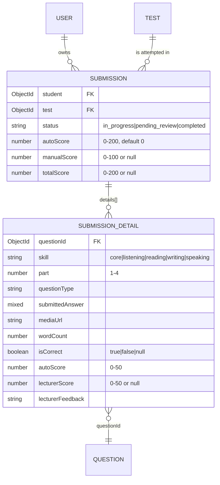

# #0020 — Submission schema: details, autoScore, manualScore, totalScore, status (AG-301)

- Ticket: `AG-301 [DB] Implement Submission schema storing details array, autoScore, manualScore, totalScore, and status`
- Branch: `feature/AG-301`
- Date: 2026-11-22

## 1. Background

Any student attempt at a test produces a **Submission**: the answers, the automatic marks for
receptive skills, the lecturer marks for productive skills, and the lifecycle status. The marking
pipeline (FR04) and the lecturer review queue (FR06) both read and write this collection, so its
shape is a blocker for `POST /api/submissions`, `GET /api/submissions/student/history`,
`GET /api/submissions/lecturer/pending`, and `PATCH /api/submissions/:id/grade`.

The implementation already ships `User`, `Test` (with embedded `Question`), `Goal`, and `StudyPlan`
models. There is no `Submission` model yet.

## 2. Problem

`docx/03_DDS_Database_Schema.md` section 4 sketches a large `Submission` model
(`skillScores`, `scaledTotalScore`, `cefrBorderlineApplied`, `finalCefr`, `answers`,
`assignedLecturer`, ...). The AG-301 ticket asks for a narrower contract:

- a `details` array,
- `autoScore`, `manualScore`, `totalScore`,
- and `status`.

Building the full DDS shape now would front-run the marking and CEFR tickets and lock in fields
nobody writes yet. Building only the five ticket fields without owner and test references would
produce documents no controller can query. The schema also has to encode the marking guardrails in
`docx/05_CSG_Coding_Standards.md`: subjective scores stay `null` until a lecturer grades, and
`totalScore` only exists once every score is known.

## 3. Questions and Answers

**Q1. Do we implement the DDS schema or the ticket fields?**

A: The ticket. AG-301 creates `server/src/models/Submission.js` with `student`, `test`, `details`,
`autoScore`, `manualScore`, `totalScore`, and `status`. DDS-only fields (`skillScores`,
`scaledTotalScore`, `cefrBorderlineApplied`, `finalCefr`, `assignedLecturer`, `lecturerComment`,
`evaluatedAt`) are deferred to the marking and CEFR tickets; adding them now would create
write-never fields. Mapping for later tickets:

| DDS name | AG-301 name | Note |
| --- | --- | --- |
| `answers` | `details` | ticket wording wins |
| `skillScores.writing/speaking` sums | `manualScore` | one top-level manual total |
| per-item `lecturerScore` | `details[].lecturerScore` | kept per question |
| `scaledTotalScore` | `totalScore` | same 0–200 scale |

**Q2. Why are `student` and `test` included when the ticket does not name them?**

A: A submission without an owner or a test cannot satisfy FR04, student history, or the lecturer
queue. Both are required `ObjectId` references, matching DDS and every other collection in the
project.

**Q3. What status values exist, and what is the default?**

A: `SUBMISSION_STATUSES = ['in_progress', 'pending_review', 'completed']` (DDS). The default is
`completed`, per DDS, because an objective-only submission is finished the moment it is marked.
The schema **does not infer** `pending_review` from the details: FR04's controller must set it when
Writing or Speaking details are present, as required by the CSG. Encoding that inference in a
Mongoose hook would silently rewrite lecturer-driven transitions.

**Q4. What are the score units and bounds?**

A: Aptis uses a 0–50 scale per skill and a 0–200 four-skill total.

| Field | Min | Max | Default | Null? |
| --- | --- | --- | --- | --- |
| `details[].autoScore` | 0 | 50 | 0 | no |
| `autoScore` | 0 | 200 | 0 | no |
| `manualScore` | 0 | 100 | `null` | yes, until graded |
| `totalScore` | 0 | 200 | `null` | yes, until complete |

`manualScore` covers Writing + Speaking (each 0–50), so 100 is its ceiling. `autoScore` covers the
auto-marked modules and is never null: zero is a legitimate result.

**Q5. Why are `manualScore` and `totalScore` nullable?**

A: The CSG requires subjective scores to remain `null` on initial submission and `totalScore` to be
written only after every skill has a valid non-null score. A default of `0` would make an ungraded
essay look like a zero score and would make "is this submission graded?" undecidable.

**Q6. What does each `details` entry store?**

A: One per answered question: which question, which skill/part/type, what the student submitted,
the auto outcome, and the lecturer outcome.

| Field | Type | Rules |
| --- | --- | --- |
| `questionId` | ObjectId | required |
| `skill` | String | `core`, `listening`, `reading`, `writing`, `speaking` |
| `part` | Number | `1`–`4` |
| `questionType` | String | one of the seven `QUESTION_TYPES` |
| `submittedAnswer` | Mixed | `null` or any JSON value (string, array, object) |
| `mediaUrl` | String | trimmed, default `null` |
| `wordCount` | Number | non-negative integer, default `0` |
| `isCorrect` | Boolean | `true`/`false`, or `null` when not auto-judged |
| `autoScore` | Number | 0–50, default `0` |
| `lecturerScore` | Number | 0–50 or `null` until graded |
| `lecturerFeedback` | String | trimmed, max 2,000 chars, default `null` |

`isCorrect: null` is the third state: an essay or recording is neither right nor wrong, it is
unmarked. `details` itself defaults to `[]` so an `in_progress` draft can be saved before the
first answer.

**Q7. Are detail sub-documents given their own `_id`?**

A: No (`{ _id: false }`, matching DDS). A detail is owned by its submission and is never addressed
individually; the question id is its identity.

**Q8. Which indexes are needed?**

A:

- `{ student: 1, createdAt: -1 }` — student history, newest first.
- `{ status: 1, createdAt: 1 }` — lecturer queue, oldest pending first (FIFO fairness).
- `{ test: 1 }` — per-test reporting.

**Q9. Does this ticket add routes, controllers, or marking logic?**

A: No. AG-301 is `[DB]` only: the model, its validation rules, and model tests. `POST
/api/submissions` remains FR04.

## 4. Design

`server/src/models/Submission.js`

```js
const SUBMISSION_STATUSES = Object.freeze(['in_progress', 'pending_review', 'completed']);

const SUBMISSION_SCORE_LIMITS = Object.freeze({
  itemAutoScore: Object.freeze({ min: 0, max: 50 }),
  autoScore: Object.freeze({ min: 0, max: 200 }),
  manualScore: Object.freeze({ min: 0, max: 100 }),
  totalScore: Object.freeze({ min: 0, max: 200 }),
});

/** @typedef {object} SubmissionDetail */
// questionId, skill, part, questionType, submittedAnswer, mediaUrl, wordCount,
// isCorrect, autoScore, lecturerScore, lecturerFeedback

/** @typedef {object} Submission */
// student, test, status, details, autoScore, manualScore, totalScore,
// createdAt, updatedAt

module.exports = mongoose.model('Submission', submissionSchema);
module.exports.SUBMISSION_STATUSES = SUBMISSION_STATUSES;
module.exports.SUBMISSION_SCORE_LIMITS = SUBMISSION_SCORE_LIMITS;
module.exports.SubmissionDetailSchema = submissionDetailSchema;
```

Enums are imported from the existing question Contract, never re-typed:

```js
const QuestionSubDocSchema = require('./Question');
const { QUESTION_SKILLS, QUESTION_TYPES, QUESTION_PARTS } = QuestionSubDocSchema;
```

Document shape:



Validation contract:

- `student`, `test`: required ObjectId references to `User` and `Test`.
- `status`: strict enum, default `completed`.
- `autoScore`: Number, `0–200`, default `0`; non-numbers fail the Mongoose cast.
- `manualScore`: Number, `0–100` or `null`, default `null`.
- `totalScore`: Number, `0–200` or `null`, default `null`.
- `details`: document array with `_id: false`, default `[]`.
- `details[].wordCount`: integer `>= 0`.
- `details[].lecturerFeedback`: max 2,000 characters.
- `timestamps: true`.

## 5. Implementation Plan

1. Branch `feature/AG-301` from `develop`.
2. Write `tests/submission-model.test.js` first and confirm it fails because the model does not exist.
3. Implement `server/src/models/Submission.js` with the fields, enums, bounds, defaults, and indexes above.
4. Re-run the model test, then the full suite, lint, format check, and the client build.
5. Update `README.md` (status, repository layout, test inventory, roadmap, docs table) and append
   `## 8. Implementation Results` to this log.
6. Commit, merge into `develop`, and push.

## 6. Examples

**Subjective submission before grading**

✅

```js
{ status: 'pending_review', autoScore: 38, manualScore: null, totalScore: null }
```

The CSG requires the lecturer scores to stay `null` until review; `totalScore` is unknown.

❌

```js
{ status: 'pending_review', autoScore: 38, manualScore: 0, totalScore: 38 }
```

Wrong: `manualScore: 0` claims an ungraded essay scored zero, and `totalScore` is written before
every skill has a score.

**Objective-only submission**

✅

```js
{ status: 'completed', autoScore: 0, manualScore: null, totalScore: 0 }
```

Wrong answers are a real zero; the submission is complete because nothing needs review.

❌

```js
{ status: 'completed', autoScore: null, manualScore: null, totalScore: null }
```

Wrong: `autoScore` is never null, so a zero-scoring attempt is distinguishable from an unmarked one.

**Per-item grading state**

✅

```js
{ questionType: 'essay_text', isCorrect: null, autoScore: 0, lecturerScore: null }
```

❌

```js
{ questionType: 'essay_text', isCorrect: false, autoScore: 0 }
```

Wrong: `false` means "marked incorrect", but the essay has not been marked at all. `null` carries
that meaning.

**Status**

✅ `status: 'in_progress'` for a draft the student has not submitted.
❌ `status: 'graded'` — not in the enum; `completed` is the terminal state.

**Detail identity**

✅ `details` uses `{ _id: false }` and identifies entries by `questionId`.
❌ Adding a second generated id per detail creates two identities for the same answer and bloats
every submission.

**Score bounds**

✅ `manualScore: 100` for two perfect productive skills.
❌ `manualScore: 120` — Writing + Speaking cannot exceed 100 on the 0–50-per-skill scale.

## 7. Trade-offs

- **Narrower than the DDS.** Deferred fields must be added by later tickets; in exchange AG-301
  ships a model everything can already write to, without dead columns.
- **No automatic `pending_review` derivation.** Keeping the schema dumb preserves lecturer-driven
  transitions, but every future controller must apply the CSG rule explicitly; the design log and
  tests pin that expectation to FR04.
- **Nullable scores.** Consumers must handle `null` (ungraded) separately from `0` (graded zero).
  This is deliberate and matches the CSG.
- **`details` allows an empty array.** Drafts can exist; a future submission validator should reject
  empty details at submit time, not at storage time.
- **`submittedAnswer` is `Mixed`.** Maximum flexibility for seven question types, at the cost of
  schema-level shape checking; per-type validation belongs to the marking service.
- **Max 2,000 characters of feedback per item.** Keeps documents bounded; a longer rubric comment
  must be split or the limit revised in a later ticket.

## 8. Implementation Results

Implemented on `feature/AG-301` as a model-only change.

### Test-first evidence

- Red: `node --test tests/submission-model.test.js` failed at import because
  `server/src/models/Submission.js` did not exist.
- Green (unit): the same command → **12/12 pass**.
- Green (persistence): `MONGODB_TEST_URI=... node --test tests/submission-model.integration.test.js`
  → **1/1 pass** against local MongoDB, including the lecturer update path.

### Full gates

- `npm test` without a database → **194 pass / 10 skipped / 0 fail** (204 tests).
- `$env:MONGODB_TEST_URI="mongodb://127.0.0.1:27017/aptis-go-test"; npm test`
  → **204/204 pass** (13 new tests: 12 model unit, 1 model integration).
- `npm run test:ui` → **116/116 pass** (unchanged; no client code touched).
- `npm run test:jest` → **7/7 pass**.
- `npm run lint` clean; `npm run format:check` clean;
  `npm --prefix client run build` → built in ~0.4 s.

### Files

- `server/src/models/Submission.js` — `Submission` model, `SubmissionDetailSchema`,
  `SUBMISSION_STATUSES`, `SUBMISSION_SCORE_LIMITS`, `MAX_FEEDBACK_LENGTH`.
- `tests/submission-model.test.js` — required refs, defaults, status enum, score
  bounds, detail schema, enums, word count, feedback cap, indexes, exported Contracts.
- `tests/submission-model.integration.test.js` — opt-in persistence and grading update.
- `README.md` — status, model tree, test inventory, docs table, roadmap.
- `design-log/#0020-submission-schema.md` — this log.

### Deviations from the plan

1. **One extra integration test.** The plan listed only model unit tests; a `[DB]`
   ticket is stronger with a real Mongo round-trip, so an opt-in integration test
   was added. It is skipped when `MONGODB_TEST_URI` is absent, like every other
   integration suite.
2. **Boolean cast test value.** `isCorrect: 'yes'` is a valid Mongoose boolean cast
   (`yes`/`no`/`on`/`off`/`1`/`0`), so the negative test uses `'maybe'`, which is a
   genuine cast failure. This narrows the test to the intended rule: non-boolean
   strings are rejected.
3. **DDS fields remain deferred.** `skillScores`, `scaledTotalScore`,
   `cefrBorderlineApplied`, `finalCefr`, `assignedLecturer`, `lecturerComment`, and
   `evaluatedAt` are not in AG-301. They belong to the marking and CEFR tickets.
4. **No automatic `pending_review` transition.** The schema defaults `status` to
   `completed` (DDS). FR04's controller must set `pending_review` when Writing or
   Speaking details are present; the CSG rule is documented in Q3/Q5 and pinned in
   this log rather than encoded as a hook.
5. **Detail-level auto score is capped at 50.** The DDS leaves it unbounded; the
   project's module scale is 0–50, so the schema now rejects values above it.
6. **No routes or controllers.** `POST /api/submissions` and the grading endpoints
   remain future tickets, as scoped.
