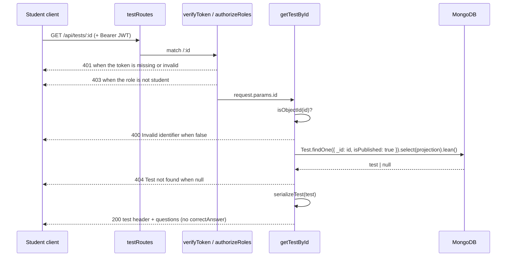

# #0021 — Test detail endpoint: `GET /api/tests/:id` without answer keys (AG-302)

- Ticket: `AG-302 [BE] Build GET /api/tests/:id controller projecting nested questions without correctAnswer`
- Branch: `feature/AG-302`
- Date: 2026-11-22

## 1. Background

`Test` documents embed their `Question` sub-documents, and both `Question.correctAnswer` and
`Question.dropdownSets[].correctAnswer` are declared with `select: false`
(`server/src/models/Question.js`). The only test read route shipped so far is
`GET /api/tests/placement` (AG-203), which returns the newest published **diagnostic** and maps
the stored sub-documents to a client contract through `serializeQuestion`
(`server/src/controllers/testController.js`).

The ADS requires a second read path:

> `GET /api/tests/:id` — Fetch single test with embedded questions (omitting `correctAnswer` for
> students).

Practice and mock flows, the lecturer preview, and the eventual test-taking screen all need to
fetch **one specific** published test by its id. Placement lookup cannot serve them: it always
returns the newest diagnostic, ignores ids, and answers `404 Placement test not found`.

## 2. Problem

Three gaps block the next frontend ticket:

1. **No id-addressed read.** There is no way to render a specific mock or practice test.
2. **No pinned projection Contract.** Answer hiding currently depends on `select: false` plus the
   placement serializer. A new controller that returns a raw document would leak
   `correctAnswer`, `dropdownSets[].correctAnswer`, `__v`, and timestamps.
3. **No identifier rule for this route.** `:id` can be anything. Without validation a malformed id
   becomes a Mongoose `CastError` (`500` through `errorHandler`) instead of the project's existing
   `400 Invalid identifier` Contract.

The endpoint must also not disclose unpublished tests, and it must keep the NFR01 latency budget
(< 500 ms) with a single indexed read.

## 3. Questions and Answers

**Q1. Is `GET /api/tests/:id` redundant with `GET /api/tests/placement`?**

A: No. They answer different questions:

| Route | Selects | Purpose |
| --- | --- | --- |
| `GET /api/tests/placement` | newest `diagnostic` + `isPublished` | first-run placement |
| `GET /api/tests/:id` | one `_id` + `isPublished`, any `type` | mock / practice / diagnostic by id |

`/placement` stays untouched. It keeps working because it is registered **before** `/:id`; Express
matches routes in registration order, so the literal path wins and `"placement"` is never treated
as an id.

**Q2. Which roles may call it?**

A: `student` only, guarded by `verifyToken` + `authorizeRoles('student')`, matching
`/api/tests/placement`. The consumer is the test-taking screen, and only students take tests.
`lecturer` and `admin` receive `403 { "error": "Forbidden" }`.

Staff need answers to author or mark questions, and this route must **never** return them. A future
FR08 authoring endpoint (`PUT /api/tests/:id`, TC10) will need a separate staff-only read that
includes answer keys. Widening this route would create a role-dependent projection that is easy to
regress.

**Q3. What exactly does "projecting nested questions without `correctAnswer`" mean here?**

A: Three independent layers, so one mistake does not leak answers:

1. **Schema** — `correctAnswer` at the question level and inside `dropdownSets` is `select: false`,
   so every default read excludes them.
2. **Query** — the controller adds an explicit exclusion projection
   (`-questions.correctAnswer -questions.dropdownSets.correctAnswer`) so the intent is visible even
   if the schema changes.
3. **Serializer** — `serializeTest` rebuilds the payload from a field allowlist and reuses the
   existing `serializeQuestion`. Unknown fields can never ride along.

The integration test deep-scans the serialized body for the literal key, so all three layers are
covered by behaviour rather than by trusting one of them.

**Q4. What is the response contract?**

A: One test header plus the same question projection placement already ships, plus `type`:

```json
{
  "id": "665f0c2f5a1b2c3d4e5f6071",
  "title": "Mock Exam 1",
  "description": "Full-length mock",
  "type": "mock",
  "targetCefr": "B2",
  "skillModules": ["core", "reading"],
  "durationMinutes": 90,
  "questionCount": 2,
  "questions": [
    {
      "id": "665f0c2f5a1b2c3d4e5f6072",
      "skill": "core",
      "part": 1,
      "questionType": "mcq_single",
      "prompt": "Choose the correct option.",
      "contextPassage": null,
      "mediaUrl": null,
      "prepTimeSeconds": 0,
      "recordTimeSeconds": 45,
      "minWords": null,
      "maxWords": null,
      "options": ["am", "is", "are"],
      "dropdownSets": [],
      "sentences": [],
      "formFields": []
    }
  ]
}
```

`type` is added because the client routes on it (`diagnostic` may not be graded like `mock` /
`practice`). `isPublished`, `__v`, `createdAt`, and `updatedAt` are internal and are not returned.

**Q5. What happens for unpublished tests?**

A: `404 { "error": "Test not found" }`. The filter is `{ _id, isPublished: true }`, so unpublished
and nonexistent ids are indistinguishable. Returning `200` with `isPublished: false` would let a
student open an exam that is still being authored; returning `403` would disclose that the id
exists.

**Q6. How is `:id` validated, and why not `mongoose.isValidObjectId`?**

A: With the shared 24-hex rule already used by AG-206:

```js
const OBJECT_ID_PATTERN = /^[0-9a-fA-F]{24}$/;
```

A URL path segment is always a string, and the Contract accepts exactly one form of id. The
Mongoose helper is broader and version-dependent: Mongoose 9 accepts `ObjectId` instances, 12-byte
`Buffer`s, and `Uint8Array`s as "valid", and its string leniency has changed between majors
(Mongoose 8 accepted arbitrary 12-character strings). Pinning the regex keeps the rule independent
of the driver and makes `400` deterministic.

The rule lives in one new module, `server/src/validators/objectIdValidator.js`, and
`studyPlanValidator.isTaskId` delegates to it so the project keeps a single identifier Contract.

Failure: `400 { "error": "Invalid identifier" }` **before** any database call.

**Q7. Should the endpoint validate that the id exists and is published in one query?**

A: Yes. `Test.findOne({ _id: id, isPublished: true })` is a single indexed `_id` lookup. No new
index is needed (`_id` is always indexed), and the existing
`{ type: 1, isPublished: 1, createdAt: -1 }` index is not used by this filter but is not harmed.

**Q8. What about errors from the database?**

A: Express 5 forwards rejected promises from `async` handlers to the central `errorHandler`, which
already maps `CastError` to `400 Invalid identifier` and unexpected failures to
`500 Internal Server Error`. Because the id is validated first, a `CastError` should never occur
here; the central handler remains the backstop.

**Q9. Is `GET /api/tests` (list) part of this ticket?**

A: No. The ADS lists it, but AG-302 is the id-addressed read only. `GET /api/tests` keeps returning
the generic `404 Not Found` from `notFoundHandler` until its own ticket.

## 4. Design

### 4.1 Contract — `GET /api/tests/:id`

- Auth: `Authorization: Bearer <student JWT>`.
- Path parameter: `id` — exactly 24 hexadecimal characters.

Success `200` — see Q4.

Failures:

| Status | Body | When |
| --- | --- | --- |
| `400` | `{ "error": "Invalid identifier" }` | `id` is not 24 hex characters |
| `401` | `{ "error": "Authentication required" }` + `WWW-Authenticate: Bearer` | missing token |
| `401` | `{ "error": "Invalid or expired token" }` + `WWW-Authenticate: Bearer` | bad/expired token |
| `403` | `{ "error": "Forbidden" }` | authenticated lecturer or admin |
| `404` | `{ "error": "Test not found" }` | unknown id, or the test is unpublished |

Response validation rules:

- `id` and `questions[].id` are 24-hex strings (never `_id`, never `__v`).
- `type ∈ { diagnostic, mock, practice }`, `targetCefr ∈ { B1, B2, C1 }`.
- `skillModules ⊂ { core, listening, reading, writing, speaking }`.
- `questionCount === questions.length`.
- `description` is `string | null`.
- No `correctAnswer` key at any depth, including `dropdownSets[].correctAnswer`.

### 4.2 Modules

`server/src/validators/objectIdValidator.js` — new shared identifier rule.

```js
const OBJECT_ID_PATTERN = /^[0-9a-fA-F]{24}$/;

/**
 * Accept only the 24-character hexadecimal text form of an ObjectId.
 * `mongoose.isValidObjectId` also accepts instances, buffers, and (in some
 * majors) 12-character strings, so the route pins its own rule.
 *
 * @param {unknown} value
 * @returns {boolean}
 */
function isObjectId(value) {
  return typeof value === 'string' && OBJECT_ID_PATTERN.test(value);
}

module.exports = { OBJECT_ID_PATTERN, isObjectId };
```

`server/src/validators/studyPlanValidator.js` — delegate, keep the existing export surface.

```js
const { OBJECT_ID_PATTERN, isObjectId } = require('./objectIdValidator');

/** @param {unknown} value @returns {boolean} */
function isTaskId(value) {
  return isObjectId(value);
}

module.exports = { OBJECT_ID_PATTERN, isTaskId, validateTaskCompletionInput };
```

`server/src/controllers/testController.js` — add `serializeTest` and `getTestById`.

```js
const TEST_NOT_FOUND = 'Test not found';
const INVALID_IDENTIFIER = 'Invalid identifier';
const TEST_DETAIL_PROJECTION =
  '-questions.correctAnswer -questions.dropdownSets.correctAnswer';

/**
 * @param {object} test
 * @returns {object}
 */
function serializeTest(test);

/**
 * GET /api/tests/:id
 *
 * @param {import('express').Request} request
 * @param {import('express').Response} response
 * @returns {Promise<void>}
 */
async function getTestById(request, response);

module.exports = { getPlacementTest, getTestById, serializePlacementTest, serializeQuestion, serializeTest };
```

`serializeTest` field order and defaults:

| Field | Source | Default |
| --- | --- | --- |
| `id` | `String(test._id)` | — |
| `title` | `test.title` | — |
| `description` | `test.description` | `null` |
| `type` | `test.type` | — |
| `targetCefr` | `test.targetCefr` | — |
| `skillModules` | `test.skillModules` | `[]` |
| `durationMinutes` | `test.durationMinutes` | — |
| `questionCount` | `questions.length` | — |
| `questions` | `test.questions.map(serializeQuestion)` | `[]` |

`server/src/routes/testRoutes.js` — literal path first, then the parameterised path.

```js
router.get('/placement', verifyToken, authorizeRoles('student'), getPlacementTest);
router.get('/:id', verifyToken, authorizeRoles('student'), getTestById);
```

### 4.3 Request flow



### 4.4 Test plan

| File | Kind | Covers |
| --- | --- | --- |
| `tests/object-id-validator.test.js` | unit | 24-hex accept, 12-char / short / long / non-string reject |
| `tests/test-detail-controller.test.js` | unit | 400 without DB, published-only filter, projection, 404, 200, serializer allowlist, deep answer scan |
| `tests/test-detail-routes.test.js` | route | 401, 403 for lecturer/admin, 400 invalid id, `/placement` precedence |
| `tests/test-detail.integration.test.js` | integration (opt-in) | seeded published + unpublished tests, one `findOne`, hidden answers, NFR01 latency |

## 5. Implementation Plan

1. Branch `feature/AG-302` from `develop`.
2. Write the four test files first and confirm red.
3. Add `server/src/validators/objectIdValidator.js`; delegate `isTaskId` to it.
4. Add `serializeTest` and `getTestById` to `server/src/controllers/testController.js`.
5. Register `GET /:id` after `/placement` in `server/src/routes/testRoutes.js`.
6. Confirm green, then run every gate: Node with `MONGODB_TEST_URI`, Node without, UI, Jest,
   lint, `format:check`, client build.
7. Update `README.md` (status, Tests API section, repository layout, test inventory, docs table,
   roadmap) and append `## 8. Implementation Results` here.
8. Commit, merge into `develop`, push.

## 6. Examples

**Answer projection**

✅

```js
serializeTest(storedTest); // questions[].dropdownSets[0] = { id, prompt, options }
```

The allowlist serializer copies only client-safe fields, so a new internal field cannot leak by
accident.

❌

```js
response.status(200).json(test); // lean() document straight to the wire
```

Wrong: it ships `__v`, timestamps, `isPublished`, and every future top-level field — and it only
hides answers by luck of `select: false`.

**Nested answer keys**

✅ `GET /api/tests/:id` → `dropdownSets: [{ "id": "...", "prompt": "...", "options": [...] }]`

The nested key is excluded in the query and rebuilt by the serializer.

❌ `dropdownSets: [{ "prompt": "...", "options": [...], "correctAnswer": "closes" }]`

Wrong: a student can read the key from the network tab and score 100% without knowing English.

**Unpublished tests**

✅ `404 { "error": "Test not found" }`

The same answer for "does not exist" and "not published" discloses nothing.

❌ `200` with a test whose `isPublished` is `false`

Wrong: students can open an exam the admin is still editing.

**Identifier**

✅ `GET /api/tests/507f1f77bcf86cd799439011` → lookup.

`500` is avoided because the id is validated before the query.

❌ `GET /api/tests/507f1f77bcf86cd79943901z` → lookup, then a `CastError`.

`400 Invalid identifier` is the documented answer; relying on the driver to fail turns a bad URL into
a `500` through `errorHandler` unless it happens to be a `CastError`.

**Authorization**

✅ Student token → `200`; lecturer token → `403 { "error": "Forbidden" }`.

❌ Returning answers to a lecturer "because staff" — that turns a student read route into an
answer-key API with no authoring Contract.

**Route order**

✅ `/placement` registered before `/:id` → `GET /api/tests/placement` runs `getPlacementTest`.

❌ `/:id` registered first → `400 Invalid identifier` for the placement screen.

## 7. Trade-offs

- **Student-only.** Staff preview is deferred to the FR08 authoring route, which must include
  answers. Costs a second route later; keeps this one answer-free for every caller.
- **Unpublished → `404`.** Slightly opaque for admins debugging an unpublished test, but correct for
  students and consistent with "do not disclose existence".
- **Explicit exclusion projection plus a serializer.** Two places express the same rule; that is
  deliberate defence in depth for a security-relevant field.
- **Duplicated test header fields.** `serializePlacementTest` and `serializeTest` share
  `serializeQuestion` but not the header. A shared builder would have changed the already-shipped
  placement payload; keeping them separate avoids an unrelated contract change.
- **New shared `objectIdValidator`.** Touches AG-206's module, but removes a second copy of the
  identifier regex and keeps one Contract.
- **No caching or ETag.** Tests change rarely, but a stale cache in a timed exam is worse than one
  extra indexed read.
- **No `GET /api/tests` listing.** Still a separate ticket; this route needs an id.

## 8. Implementation Results

Implemented on `feature/AG-302` as a read-only backend change.

### Test-first evidence

- Red (unit + route): `node --test tests/object-id-validator.test.js tests/test-detail-controller.test.js tests/test-detail-routes.test.js`
  failed on the missing `objectIdValidator` module and on
  `404 { "error": "Not Found", "path": "/api/tests/..." }` for the new route.
- Red (integration): `MONGODB_TEST_URI=... node --test tests/test-detail.integration.test.js`
  failed with `404 !== 200`.
- Green (targeted): the same unit/route command → **12/12 new tests pass** (plus
  the 8 existing `study-plan-validator` tests, 20/20 in the run).
- Green (persistence): the integration command → **1/1 pass**, response in
  **10.3 ms** with exactly **1** `Test.findOne` call.

### Full gates

- `$env:MONGODB_TEST_URI="mongodb://127.0.0.1:27017/aptis-go-test"; npm test`
  → **217/217 pass** (13 new tests: 2 validator, 5 controller, 5 routes, 1 integration).
- `npm test` without a database → **206 pass / 11 skipped / 0 fail**.
- `npm run test:ui` → **116/116 pass** (12 files; no client code touched).
- `npm run test:jest` → **7/7 pass**.
- `npm run lint` clean; `npm run format:check` clean;
  `npm --prefix client run build` → built in ~0.5 s.

### Files

- `server/src/validators/objectIdValidator.js` — `OBJECT_ID_PATTERN`, `isObjectId`.
- `server/src/validators/studyPlanValidator.js` — `isTaskId` now delegates to the shared rule.
- `server/src/controllers/testController.js` — `serializeTest`, `getTestById`,
  `TEST_DETAIL_PROJECTION`.
- `server/src/routes/testRoutes.js` — `GET /:id`, registered after `/placement`.
- `tests/object-id-validator.test.js`, `tests/test-detail-controller.test.js`,
  `tests/test-detail-routes.test.js`, `tests/test-detail.integration.test.js`.
- `README.md` — status, Test detail API section, layout, test inventory, docs table, roadmap.
- `design-log/#0021-test-detail-endpoint.md` — this log.

### End-to-end check against the demo database

A temporary API instance ran on port 5056 against
`mongodb://127.0.0.1:27017/aptis-go-demo` (never the Atlas URI) and was driven
with the seeded demo accounts:

```text
GET /api/tests/6af2ba7e…  (student)      -> 200 | 6 questions | answerKeyPresent=False | _id absent
GET /api/tests/<unpublished temp id>     -> 404 Test not found
GET /api/tests/000000000000000000000000  -> 404 Test not found
GET /api/tests/not-an-id                 -> 400 Invalid identifier
GET /api/tests/6af2ba7e…  (lecturer)     -> 403 Forbidden
```

The temporary unpublished test row was deleted afterwards
(`testsRemaining=1`) and the port-5056 server was stopped.

### Deviations from the plan

1. **Identifier rationale corrected.** The plan claimed Mongoose
   `isValidObjectId` accepts arbitrary 12-character strings. Mongoose 9.11.4 no
   longer does; it does accept `ObjectId` instances, 12-byte `Buffer`s, and
   `Uint8Array`s. The 24-hex string rule is unchanged, the justification and
   test now describe the real gap, and the rule is pinned independently of the
   driver version.
2. **`serializeTest` gained a defaulted-description test.** The plan listed the
   allowlist scan; a second serializer test pins `description: null` for tests
   without a description.
3. **`/placement` precedence is a dedicated route test.** Express registration
   order is the only thing protecting `"placement"` from the `:id` parser, so it
   is asserted rather than left implicit.
4. **Shared identifier module extracted.** `studyPlanValidator.isTaskId` now
   delegates to `objectIdValidator.isObjectId`; its export surface and tests are
   unchanged.
5. **No Postman request added.** The collection remains scoped to auth TC01–TC03;
   the new endpoint is covered by the Node suites and the demo check above.
