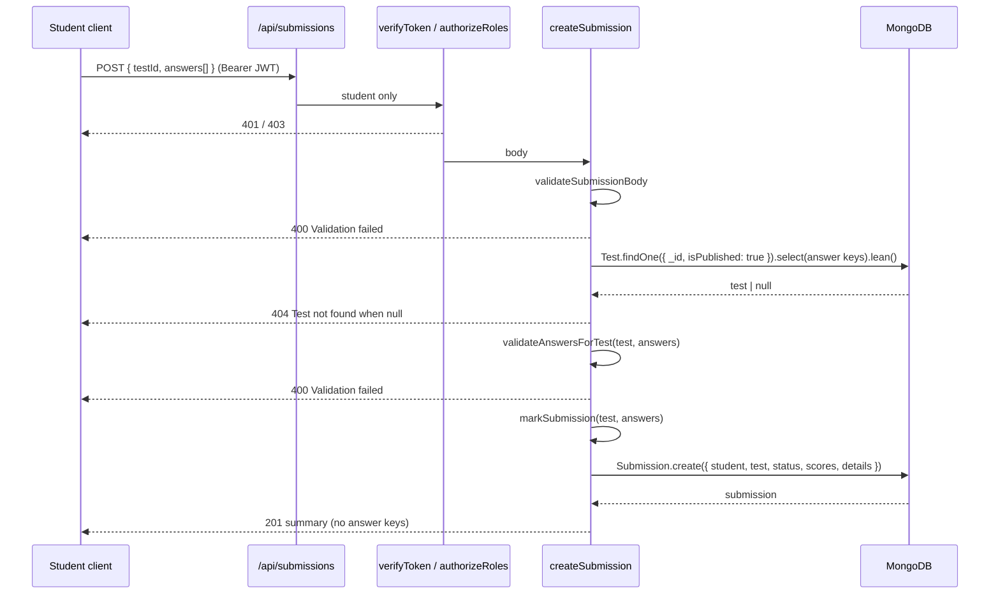

# #0022 — Deterministic auto-marking engine for Core, Reading, and Listening (AG-303)

- Ticket: `AG-303 [BE] Implement deterministic Auto-Marking Engine in submissionController for R/L/G (<500ms, FR04, NFR01)`
- Branch: `feature/AG-303`
- Date: 2026-11-22

## 1. Background

`Submission` (AG-301) stores one document per attempt: `details[]`, `autoScore`, `manualScore`,
`totalScore`, and `status`. `Question` (AG-201) stores the answer keys as `correctAnswer` and
`dropdownSets[].correctAnswer`, both `select: false`. `GET /api/tests/:id` (AG-302) deliberately
never returns those keys.

Nothing writes submissions yet. FR04 requires instant scoring for **Core (Grammar & Vocabulary,
0–50)**, **Reading (0–50)**, and **Listening (0–50)** when a student submits a test, and NFR01 caps
submission processing at **< 500 ms**. The SRS defines the scoring architecture as a **0–200 scaled
aggregate across the four skills**, with Core serving as the CEFR borderline modifier but not part
of that 200-point total.

## 2. Problem

Four gaps block FR04:

1. **No server-side marking.** Answer keys exist but no code compares a student's answers to them.
   The client must never grade itself.
2. **No submission endpoint.** `POST /api/submissions` appears in the ADS but does not exist, so
   there is nowhere to send answers.
3. **No per-skill scores.** `Submission` has totals but nowhere to store the 0–50 Core, Reading, and
   Listening scores the CEFR modifier and analytics need.
4. **No deterministic Contract.** "Deterministic" must be enforced: the same answers and test must
   always produce the same score, independent of answer order, client-supplied fields, or claimed
   scores.

Latency also matters: grading must run in one test read plus one insert, not a per-question query
loop.

## 3. Questions and Answers

**Q1. What is the scope of AG-303?**

A: The marking engine, the request/response Contract, persistence, and the route:

- `server/src/services/autoMarkingService.js` — pure, deterministic marking.
- `server/src/validators/submissionValidator.js` — request and per-question answer validation.
- `server/src/controllers/submissionController.js` — `POST /api/submissions`.
- `server/src/routes/submissionRoutes.js` + `app.js` mount.
- `Submission.skillScores` — the DDS per-skill scores this ticket produces.

Writing and Speaking are **not** graded here. They are stored as ungraded answers and push the
submission into `pending_review`; FR06 grades them in a later ticket. CEFR evaluation is also
deferred: `evaluateDiagnosticForUser` requires all five 0–50 scores, and Writing/Speaking are still
`null`.

**Q2. Why add `skillScores` to `Submission` now?**

A: AG-301 deferred it because nothing wrote it. AG-303 is the writer, and FR04 is defined per skill.
Without it, the Core borderline modifier and the analytics dashboard (FR09) have nowhere to read
0–50 scores from. The shape follows the DDS:

| Path | Type | Bounds | Default |
| --- | --- | --- | --- |
| `skillScores.core` | Number | 0–50 | `0` |
| `skillScores.reading` | Number | 0–50 | `0` |
| `skillScores.listening` | Number | 0–50 | `0` |
| `skillScores.writing` | Number \| null | 0–50 | `null` |
| `skillScores.speaking` | Number \| null | 0–50 | `null` |

**Q3. What is one "mark" for each question type?**

A: A mark is the smallest independently checkable unit, so a five-gap dropdown item is five marks,
not one:

| `questionType` | Marks | Correct when |
| --- | --- | --- |
| `mcq_single` | 1 | submitted index equals the key's option index |
| `dropdown_match` | one per `dropdownSets[]` entry | every selected index matches that set's key (partial credit per set) |
| `dropdown_cloze` | one per `dropdownSets[]` entry | same rule |
| `sentence_order` | 1 | the submitted id order equals `sentences[]` sorted by `order` |
| `short_fields` | 0 (manual) | lecturer grades |
| `essay_text` | 0 (manual) | lecturer grades |
| `audio_record` | 0 (manual) | lecturer grades |

`details[].autoScore` stores the **earned marks** for that question (0–50 by the model cap).
`details[].isCorrect` is `true` only when every mark for the question was earned, `false` when some
were missed, and `null` for manual or unmarkable questions.

**Q4. How do raw marks become a 0–50 skill score?**

A: Deterministic normalization per skill:

```text
skillScore = round(earnedMarks / totalMarks × 50)
```

- `totalMarks` counts every mark in that skill **including unanswered questions**, so skipping a
  question cannot inflate a percentage.
- A skill with no questions (for example, a Core-only diagnostic) scores `0`, matching the DDS
  default.
- `Math.round` is half-up for non-negative values; scores are integers.
- The result is capped at 50 by construction; the model still enforces the bound.

This reproduces the official counts without hard-coding them: 50 Core questions → 1 mark each, 25
Listening questions → 2 points each, and any practice test scales to the same 0–50 axis.

**Q5. What are `autoScore` and `totalScore`, exactly?**

A: They answer different questions:

| Field | Definition | Range |
| --- | --- | --- |
| `skillScores` | per-module 0–50 scores | each 0–50 |
| `autoScore` | `core + reading + listening` — every auto-marked module (FR04) | 0–150 |
| `manualScore` | Writing + Speaking, once graded; `null` here | `null` in AG-303 |
| `totalScore` | official four-skill aggregate (`reading + listening + writing + speaking`); Core is excluded because it is a borderline modifier | 0–200 |

Consequences:

- A **completed** objective-only submission has every score it can have, so
  `totalScore = reading + listening` (0–100). It deliberately does **not** include Core.
- A **pending_review** submission has an unknown Writing/Speaking score, so `totalScore` stays
  `null` and `manualScore` stays `null`, per AG-301 and the CSG.
- A Core-only diagnostic therefore has `autoScore` carrying the Core marks while `totalScore` is
  `0`. That is the official aggregate, not a bug; `skillScores.core` is the number that matters for
  the borderline modifier.

**Q6. When is a submission `pending_review`?**

A: When the **test** contains at least one Writing or Speaking question (by `skill`, or by a manual
`questionType`). It is not derived from which questions were answered: a student who skips the
essay still created work that cannot be auto-marked, and TC07 expects `pending_review`. Otherwise
the submission is `completed` immediately.

**Q7. What does the client send?**

A:

```json
{
  "testId": "665f0c2f5a1b2c3d4e5f6071",
  "answers": [
    { "questionId": "665f...72", "submittedAnswer": 1 },
    { "questionId": "665f...73", "submittedAnswer": { "665f...74": 0, "665f...75": 2 } },
    { "questionId": "665f...76", "submittedAnswer": ["665f...77", "665f...78"] },
    { "questionId": "665f...79", "submittedAnswer": "Dear Sir, ..." },
    { "questionId": "665f...80", "submittedAnswer": null, "mediaUrl": "/audio/attempt.webm" }
  ]
}
```

Per type:

| Type | `submittedAnswer` |
| --- | --- |
| `mcq_single` | option index (integer) or `null` |
| `dropdown_*` | `{ "<dropdownSetId>": optionIndex }` (partial maps allowed) or `null` |
| `sentence_order` | array of every sentence id, each once, in the chosen order, or `null` |
| `short_fields` | `{ "<fieldId>": "text" }` (≤ 500 chars per value) or `null` |
| `essay_text` | string ≤ 20,000 chars or `null` |
| `audio_record` | `null`; the recording path goes in `mediaUrl` |

Indices rather than option text are the Contract because the client already stores
`optionIndex` (`PlacementViewState`), and duplicate option strings would otherwise be ambiguous.

Answers are an **array**, not a map, because the client iterates questions and because duplicate
question ids must be detectable.

**Q8. Which fields are server-owned?**

A: Everything except `testId`, `answers[].questionId`, `answers[].submittedAnswer`, and
`answers[].mediaUrl`. `status`, `autoScore`, `manualScore`, `totalScore`, `skillScores`, `isCorrect`,
`autoScore` per detail, `wordCount`, and the `student` reference are computed server-side. Unknown
body fields are ignored, never spread into the document.

`wordCount` is computed from the submitted text (`short_fields` sums its field values), so a client
cannot claim a length.

**Q9. What is rejected, and with which response?**

A: Two validation stages:

1. **Body** — `testId` must be 24 hex, `answers` a non-empty array of JSON objects with 24-hex
   `questionId`s; `mediaUrl`, when present, must be a string ≤ 2,048 chars.
2. **Against the loaded test** — every `questionId` must belong to the test exactly once; the answer
   shape must match its `questionType` (index in range, known dropdown-set ids, known/unique
   sentence ids, known form fields, text length caps); `mediaUrl` is only valid on `audio_record`.

Both return `400 { "error": "Validation failed", "details": [...] }`, matching the goal and task
endpoints. Unknown question ids are errors because accepting them would let a caller write
unscored junk into the history.

Unanswered questions are **not** errors: they are graded as wrong (auto types) or ungraded (manual
types) and stay in the denominator.

**Q10. What happens for unknown or unpublished tests?**

A: `404 { "error": "Test not found" }`, the same rule as AG-302: unpublished and nonexistent are
indistinguishable, so students cannot submit against a test the admin is still writing.

**Q11. How is determinism verified?**

A: The engine is pure: it reads the stored test, the submitted answers, and nothing else. Tests
assert:

- the same payload produces an identical result;
- shuffling the `answers` array changes nothing;
- client-supplied `isCorrect`/`autoScore` fields are ignored;
- an answer key read with the grading projection drives the score, and no key appears in the
  response.

**Q12. Is the endpoint idempotent?**

A: No, and that is intentional: every submission is an attempt. A retake creates a second document.
An idempotency header was not requested and would complicate the attempt history (FR09).

**Q13. Does the response include per-question results?**

A: No. It returns the summary only: `id`, `test`, `status`, `autoScore`, `manualScore`,
`totalScore`, `skillScores`, `questionCount`, `answeredCount`, and `createdAt`. Per-item outcomes are
persisted in `details` for the lecturer queue and analytics, but returning them here would let a
student map a retake of the same test. A dedicated review screen can expose them later.

## 4. Design

### 4.1 Contract — `POST /api/submissions`

- Auth: `Authorization: Bearer <student JWT>`; role `student` only.
- Body: `{ testId, answers[] }` as in Q7.

Success `201`:

```json
{
  "id": "665f0c2f5a1b2c3d4e5f6090",
  "test": { "id": "665f0c2f5a1b2c3d4e5f6071", "title": "Mock Exam 1", "type": "mock" },
  "status": "pending_review",
  "autoScore": 100,
  "manualScore": null,
  "totalScore": null,
  "skillScores": {
    "core": 25,
    "reading": 25,
    "listening": 50,
    "writing": null,
    "speaking": null
  },
  "questionCount": 5,
  "answeredCount": 5,
  "createdAt": "2026-11-22T13:45:00.000Z"
}
```

Failures:

| Status | Body | When |
| --- | --- | --- |
| `400` | `{ "error": "Validation failed", "details": [...] }` | body or answer shape invalid |
| `401` | `{ "error": "Authentication required" }` + `WWW-Authenticate: Bearer` | no token |
| `401` | `{ "error": "Invalid or expired token" }` + `WWW-Authenticate: Bearer` | bad token |
| `403` | `{ "error": "Forbidden" }` | lecturer or admin |
| `404` | `{ "error": "Test not found" }` | unknown or unpublished test |

Latency: one indexed `Test.findOne` (with `+questions.correctAnswer
+questions.dropdownSets.correctAnswer`) and one `Submission.create`. No per-question reads.

### 4.2 Marking service

`server/src/services/autoMarkingService.js`

```js
const AUTO_MARKED_SKILLS = Object.freeze(['core', 'reading', 'listening']);
const MANUAL_SKILLS = Object.freeze(['writing', 'speaking']);
const MANUAL_QUESTION_TYPES = Object.freeze(['short_fields', 'essay_text', 'audio_record']);
const SKILL_SCORE_MAX = 50;

/**
 * @param {object} question
 * @returns {number} independently checkable marks (0 for manual types)
 */
function countMarkableUnits(question);

/**
 * @param {object} question
 * @param {unknown} submittedAnswer
 * @returns {{ isCorrect: boolean | null, earnedUnits: number, totalUnits: number }}
 */
function markQuestion(question, submittedAnswer);

/**
 * @param {object} test
 * @param {Map<string, { submittedAnswer: unknown, mediaUrl: string | null }>} answersByQuestionId
 * @returns {{
 *   details: Array<object>,
 *   skillScores: { core: number, reading: number, listening: number, writing: null, speaking: null },
 *   autoScore: number,
 *   manualScore: null,
 *   totalScore: number | null,
 *   status: 'completed' | 'pending_review'
 * }}
 */
function markSubmission(test, answersByQuestionId);
```

Rules:

- `details` has one entry per stored question, in stored order, including unanswered ones.
- Every detail carries `questionId`, `skill`, `part`, `questionType`, `submittedAnswer`, `mediaUrl`,
  `wordCount`, `isCorrect`, `autoScore` (earned marks), `lecturerScore: null`,
  `lecturerFeedback: null`.
- `wordCount` is computed from text (`short_fields` sums its fields).
- `skillScores` uses `round(earned / total × 50)`, with `0` for a skill that has no marks.
- `status` is `pending_review` when the test contains a manual question, otherwise `completed`.
- `totalScore` is `reading + listening` when `completed`, otherwise `null`.

### 4.3 Validator

`server/src/validators/submissionValidator.js`

```js
/**
 * @param {unknown} body
 * @returns {{ value: { testId: string, answers: Array<object> }, errors: string[] }}
 */
function validateSubmissionBody(body);

/**
 * @param {object} test
 * @param {Array<object>} answers
 * @returns {{
 *   value: Map<string, { submittedAnswer: unknown, mediaUrl: string | null }>,
 *   errors: string[]
 * }}
 */
function validateAnswersForTest(test, answers);
```

`validateAnswersForTest` returns a `Map` keyed by the question id string, so the service does not
depend on answer order and duplicate ids are detectable.

### 4.4 Controller and route

`server/src/controllers/submissionController.js`

```js
const ANSWER_KEY_PROJECTION = '+questions.correctAnswer +questions.dropdownSets.correctAnswer';

/**
 * @param {import('express').Request} request
 * @param {import('express').Response} response
 * @returns {Promise<void>}
 */
async function createSubmission(request, response);

/**
 * @param {import('mongoose').Document} submission
 * @param {object} test
 * @returns {object}
 */
function serializeSubmission(submission, test);
```

`server/src/routes/submissionRoutes.js`

```js
router.post('/', verifyToken, authorizeRoles('student'), createSubmission);
```

`server/src/app.js`

```js
app.use('/api/submissions', submissionRoutes);
```

### 4.5 Flow



### 4.6 Data flow

```mermaid
flowchart LR
    A[answers[]] --> B[Map by questionId]
    T[Test with answer keys] --> M[markQuestion per question]
    B --> M
    M --> D[details + earned/total marks]
    D --> S[skillScores = round earned/total x 50]
    S --> O[autoScore = core + reading + listening]
    D --> P{manual question in test?}
    P -->|yes| Q[pending_review, totalScore null]
    P -->|no| R[completed, totalScore = reading + listening]
```

## 5. Implementation Plan

1. Branch `feature/AG-303` from `develop`.
2. Write the failing tests first:
   - `tests/submission-model.test.js` — `skillScores` defaults and bounds.
   - `tests/auto-marking.test.js` — every question type, scaling, rounding, status, determinism.
   - `tests/submission-validator.test.js` — body and per-test answer rules.
   - `tests/submission-controller.test.js` — `400`, `404`, `201`, key projection, persistence payload.
   - `tests/submission-routes.test.js` — `401`, `403`, `400`, `404`.
   - `tests/submission-marking.integration.test.js` — mixed and objective tests against MongoDB,
     stored details, determinism, one query, `<500 ms`.
3. Confirm red with `npm test`.
4. Add `skillScores` to `server/src/models/Submission.js`, then the service, validator, controller,
   route, and `app.js` mount.
5. Confirm green, then run every gate: Node with `MONGODB_TEST_URI`, Node without, UI, Jest, lint,
   `format:check`, client build.
6. Update `README.md` (status, Submission API section, layout, test inventory, docs table, roadmap)
   and append `## 8. Implementation Results`.
7. Commit, merge into `develop`, push.

## 6. Examples

**Marking an MCQ**

✅ `{ options: ["go","goes","going"], correctAnswer: "goes" }` with `submittedAnswer: 1` → 1 mark.
The Contract is the option index, which the client already stores.

❌ `submittedAnswer: "goes"` → 0 marks even though the text matches.
Wrong form: the endpoint accepts indices, not option text; accepting both would create two Contracts
and make duplicate option strings ambiguous.

**Dropdown partial credit**

✅ Two selected sets, one correct → `autoScore: 1`, `isCorrect: false`, 1 of 2 marks.
The skill denominator still counts both sets.

❌ `autoScore: 1`, `isCorrect: true` → claims the whole item is right when a gap is wrong.

**Unanswered questions**

✅ One of two Reading questions answered correctly → `reading: 25`, because 1/2 marks were earned.

❌ `reading: 50` by dividing by answered questions only → skipping a question raises the score.

**Rounding**

✅ 1 of 3 marks → `round(16.66) = 17`; 2 of 3 → `33`.

❌ Floating scores such as `16.666666` → the API Contract and the model store integers.

**Status**

✅ A test containing `essay_text` → `pending_review`, `manualScore: null`, `totalScore: null`.

❌ `completed` with `totalScore: autoScore` → claims the essay was graded when no lecturer has seen
it.

**Core and the 200-point total**

✅ `skillScores: { core: 48, reading: 40, listening: 38, ... }`, `autoScore: 126`,
`totalScore: 78` for a completed objective-only test. Core is reported but excluded from the
four-skill aggregate.

❌ `totalScore: 126` → puts Core into the official 0–200 total, which the SRS reserves for the four
skills.

**Client-owned scores**

✅ The client sends only `questionId` and `submittedAnswer`; the server writes `isCorrect`,
`autoScore`, and `skillScores`.

❌ Trusting `{ "isCorrect": true, "autoScore": 50 }` from the request → any student can award
themselves full marks.

**Word count**

✅ `wordCount` is computed from the submitted essay (`120` words).

❌ Trusting a client `wordCount: 120` with a 12-word essay → the lecturer queue lies.

**Answer keys**

✅ The POST response contains scores and `isCorrect` summaries only.

❌ Returning the matched `correctAnswer` → the next attempt is trivially perfect.

## 7. Trade-offs

- **Coarse scaling on small practice tests.** One Reading gap is worth 50 points of that skill.
  Derived from the 0–50 Contract and unavoidable without per-question weights; full Aptis modules
  scale exactly.
- **`autoScore` is not additive with `totalScore`.** `autoScore` includes Core (FR04) while
  `totalScore` excludes it (SRS). Documented in Q5; the alternative would corrupt the 200-point
  aggregate.
- **Core-only tests have `totalScore: 0`.** Official aggregate, but surprising in a demo; the
  response still carries `autoScore` and `skillScores.core`.
- **`sentence_order` is all-or-nothing.** It is one cohesive task and the DDS stores one
  `isCorrect`/`autoScore`; partial position credit can be added later without changing callers.
- **No Writing length enforcement.** Only `wordCount` is stored; the client already blocks
  out-of-range lengths, and rubric enforcement belongs to FR06.
- **No per-item results in the response.** Prevents answer mapping on retakes; the lecturer queue
  and analytics read `details` server-side.
- **No idempotency key.** Retakes are attempts, not duplicates.
- **No CEFR evaluation yet.** It needs Writing and Speaking scores that only FR06 produces;
  evaluating now would force `0` for both and pin every student to A1.
- **`skillScores` added to a shipped model.** Backward compatible: existing fields and defaults are
  untouched, and the new sub-paths have defaults.

## 8. Implementation Results

Implemented on `feature/AG-303` as a backend-only change.

### Test-first evidence

- Red (model): `node --test tests/submission-model.test.js` failed with
  `Cannot read properties of undefined (reading 'core')` because
  `Submission.skillScores` did not exist.
- Red (services and routes): the auto-marking, validator, controller, and route
  suites failed on missing modules, and `POST /api/submissions` answered
  `404 Not Found` in the route test.
- Red (integration): `MONGODB_TEST_URI=... node --test tests/submission-marking.integration.test.js`
  failed with `404 !== 201`.
- Green (targeted): the model, auto-marking, validator, controller, and route
  files → **46/46 pass**.
- Green (persistence): the integration command → **1/1 pass**, marked in
  **21.9 ms** with exactly **1** `Test.findOne` call.

### Full gates

- `$env:MONGODB_TEST_URI="mongodb://127.0.0.1:27017/aptis-go-test"; npm test`
  → **252/252 pass** (35 new tests: 1 model, 12 auto-marking, 13 validator,
  4 controller, 4 routes, 1 integration).
- `npm test` without a database → **240 pass / 12 skipped / 0 fail**.
- `npm run test:ui` → **116/116 pass** (12 files; no client code touched).
- `npm run test:jest` → **7/7 pass**.
- `npm run lint` clean; `npm run format:check` clean;
  `npm --prefix client run build` → built in ~0.6 s.

### Files

- `server/src/services/autoMarkingService.js` — `markQuestion`,
  `markSubmission`, `countMarkableUnits`, `isManualQuestion`, mark constants.
- `server/src/validators/submissionValidator.js` — `validateSubmissionBody`,
  `validateAnswersForTest`, `validateAnswerForQuestion`, length caps.
- `server/src/controllers/submissionController.js` — `createSubmission`,
  `serializeSubmission`, `ANSWER_KEY_PROJECTION`.
- `server/src/routes/submissionRoutes.js` — `POST /`.
- `server/src/app.js` — `/api/submissions` mount.
- `server/src/models/Submission.js` — `skillScores` sub-paths.
- `tests/submission-model.test.js` (extended), `tests/auto-marking.test.js`,
  `tests/submission-validator.test.js`, `tests/submission-controller.test.js`,
  `tests/submission-routes.test.js`, `tests/submission-marking.integration.test.js`.
- `README.md` — status, Submission API, layout, test inventory, docs table, roadmap.
- `design-log/#0022-submission-auto-marking.md` — this log.

### End-to-end check against the demo database

A temporary API instance ran on port 5057 against
`mongodb://127.0.0.1:27017/aptis-go-demo` (never the Atlas URI) and submitted
the seeded `Placement Diagnostic (demo)` as the demo student:

```text
POST /api/submissions -> 201 in 118.2 ms
status=pending_review  autoScore=125  manualScore=null  totalScore=null
skillScores: core=25 reading=50 listening=50 writing=null speaking=null
answered=6 of 6  answerKeyPresent=False
```

The persisted document was inspected directly: `details.length = 6`,
`core[0].isCorrect = true`, `core[1].isCorrect = false`, the reading dropdown
earned 1 mark, the essay stored `wordCount = 11`, and the recording stored
`mediaUrl = /audio/demo-attempt.webm`. The demo submission was deleted
afterwards and the temporary server was stopped.

### Deviations from the plan

1. **The engine consumes the validator's `Map`.** The request body stays an
   array of `{ questionId, submittedAnswer, mediaUrl }`; `validateAnswersForTest`
   keys it by question id so the engine is order-independent. The design log
   signature was aligned with the implementation before coding.
2. **Text caps are explicit.** `submissionValidator` now enforces
   `MAX_ESSAY_LENGTH = 20,000`, `MAX_FORM_VALUE_LENGTH = 500`, and
   `MAX_MEDIA_URL_LENGTH = 2,048` in both validation stages.
3. **No CEFR evaluation wiring.** `evaluateDiagnosticForUser` needs Writing and
   Speaking scores; calling it now would pass `0` for both and pin every pending
   submission to A1. The FR06 grading ticket owns that call.
4. **No lecturer queue or history routes.** `POST /api/submissions` is the only
   route; `GET /student/history`, `GET /lecturer/pending`, and the grade endpoint
   remain later tickets.
5. **No Postman request added.** The collection remains auth-only (TC01–TC03);
   FR04 is covered by the Node suites and the demo check above.
6. **Demo submission removed.** The verification attempt was deleted so the
   demo database stays at its seeded state.
