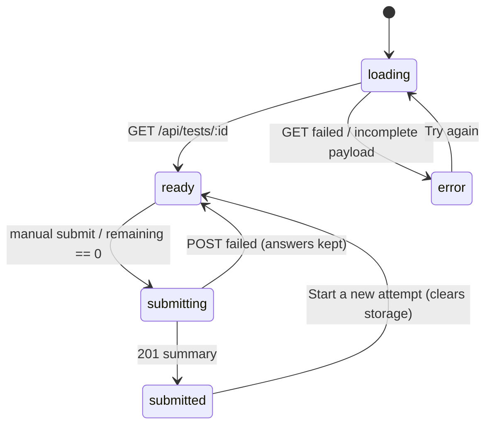

# #0023 — Screen 4: timed mock exam at `/tests/:id` (AG-304)

- Ticket: `AG-304 [FE] Build Screen 4: Timed Mock Exam (/tests/:id) with countdown timer and auto-submit on timeout`
- Branch: `feature/AG-304`
- Date: 2026-11-23

## 1. Background

AG-302 delivers one published test through `GET /api/tests/:id` with every question but no
`correctAnswer`. AG-303 accepts `POST /api/submissions` and marks Core, Reading, and Listening
deterministically, stores Writing/Speaking ungraded, and answers `201` with a score summary.

The student SPA has four screens in the ADS flow: Screen 1 auth portal, Screen 2 diagnostic
placement, Screen 3 today's dashboard, Screen 4 timed mock exam. Screens 1–3 exist. Screen 4 does
not: `client/src/App.jsx` has no `/tests/:id` route, and no client code has ever posted a
submission.

FR04/NFR01 require the attempt to be scored in the same request. TC05 expects an auto-score for
Reading/Listening; TC07 expects Writing/Speaking attempts to land in `pending_review`.

## 2. Problem

1. **No exam screen.** A student cannot open a published test, answer it, or submit it.
2. **No timer.** An Aptis mock is timed. A static duration label does not enforce the exam window,
   and a timer that restarts on refresh lets a student buy unlimited time.
3. **No auto-submit.** If the window closes while the student is still working, the attempt must
   still be graded instead of silently lost.
4. **No client-side attempt Contract.** AG-303 defines answer shapes per `questionType`. The client
   must produce exactly those shapes, or the server rejects the attempt with `400`.
5. **No honest display of ungraded work.** The screen must not show `0` for Writing/Speaking, and
   must not invent an audio upload before FR05.

## 3. Questions and Answers

**Q1. What is the route and its guard?**

A: `/tests/:id` inside `App.jsx`, wrapped in `ProtectedRoute allowedRoles={['student']}`. Lecturers
and admins get the existing access-denied page; unauthenticated visitors go to `/login`. The client
guard is a navigation aid only — the API still enforces the role.

**Q2. Do we render one question at a time or the whole exam?**

A: The whole exam, grouped in stored order, because a mock exam is a full paper rather than an
adaptive diagnostic and a student must be able to revisit answers. Each question is a card; a
sticky summary panel carries the countdown, progress, and submit action. No question-by-question
navigation state is needed, which keeps the `ViewState` smaller and removes a class of
lost-progress bugs.

**Q3. Where does the duration come from, and what exactly is the deadline?**

A:

```text
startedAt  = first time the test reaches status ready (or the stored value after a refresh)
expiresAt  = startedAt + durationMinutes × 60 000 ms
remaining  = max(0, ceil((expiresAt − now) / 1000))
```

`durationMinutes` is the server value from `GET /api/tests/:id`. When it is missing, zero, or not a
finite number the payload is rejected as incomplete instead of guessing a duration.

**Q4. What survives a page refresh?**

A: The answers **and** the same `expiresAt`, stored in `sessionStorage` under
`aptis-go:exam-progress` (tab-scoped, like the placement runner). A refresh therefore cannot reset
the clock. A saved record is only reused when its `version` and `testId` match the loaded test;
anything else is discarded.

If the stored `expiresAt` is already in the past, the screen hydrates straight into an expired
`ready` state and the timer effect fires the automatic submission on the first tick.

**Q5. How does auto-submit avoid a double submission?**

A: `status` moves `ready → submitting` before the request leaves the page and three guards back it:

- the timeout handler only runs while `status === 'ready'`;
- the manual button is disabled while `status === 'submitting'`;
- a `useRef` in-flight flag drops a second concurrent call from the same render.

The result state is terminal: `submitted` hides the inputs and the submit button, so the graded
attempt cannot be edited or re-posted.

**Q6. Which questions does the client send?**

A: Every stored question, in stored order, with `submittedAnswer: null` when the student did not
answer it:

```json
{
  "testId": "665f...71",
  "answers": [
    { "questionId": "665f...72", "submittedAnswer": 1 },
    { "questionId": "665f...73", "submittedAnswer": { "665f...74": 0 } },
    { "questionId": "665f...75", "submittedAnswer": ["665f...78", "665f...77", "665f...76"] },
    { "questionId": "665f...79", "submittedAnswer": "Dear Sir, ..." },
    { "questionId": "665f...80", "submittedAnswer": null }
  ]
}
```

Sending every question (rather than only answered ones) matches AG-303's denominator rule —
skipped questions stay in the denominator and score `0` — and satisfies the non-empty `answers`
requirement even when a student submits with no answers at all.

**Q7. What is the per-type answer shape in `ViewState`?**

A: The raw AG-303 `submittedAnswer`, keyed by question id, with no extra wrapper:

| `questionType` | stored value | sent when absent |
| --- | --- | --- |
| `mcq_single` | option index (`number`) | `null` |
| `dropdown_match`, `dropdown_cloze` | `{ "<setId>": optionIndex }` | `null` |
| `sentence_order` | array of sentence ids in the student's order | `null` |
| `short_fields` | `{ "<fieldId>": "text" }` | `null` |
| `essay_text` | `string` | `null` |
| `audio_record` | never stored | `null` |

Using the wire shape directly means `buildSubmissionPayload` is a filter, not a translator, so a
client change cannot silently diverge from the API Contract.

**Q8. Why must `sentence_order` not start in the correct order?**

A: The stored `sentences[]` order **is** the answer key. Rendering it as-is would hand every student
full marks. The first render therefore uses a deterministic shuffle seeded by the question id, with
`sentences[].isFixed = true` entries pinned to their stored position. The shuffle is stable across
refreshes, so a student cannot reroll for a better starting order.

An untouched order is **not** counted as answered and is sent as `null`, so a lucky shuffle never
earns credit the student did not choose.

**Q9. Which scores does the result panel show?**

A: Exactly what AG-303 returned, without recomputation:

- `status` — `completed` (auto-marked) or `pending_review` (lecturer needed);
- `autoScore` (0–150) and `skillScores.core / reading / listening` (0–50);
- `totalScore` when non-null, otherwise "pending lecturer review";
- `questionCount` and `answeredCount` from the server.

Writing and Speaking are shown as "awaiting review", never as `0`, and no `correctAnswer` can be
displayed because the API never returned one.

**Q10. What about audio questions (FR05)?**

A: The card states that recording arrives with FR05 and submits `submittedAnswer: null`. No
`mediaUrl` is invented, so an unrecorded speaking task truthfully forces `pending_review` instead of
pretending an upload exists.

**Q11. What does the screen do on errors?**

A: Three distinct states:

| Source | Behaviour |
| --- | --- |
| `GET` fails | `status: error` with the API message (`Test not found`, `Invalid identifier`, network text) and a retry button plus a dashboard link |
| `POST` fails | returns to `status: ready` with answers and the deadline intact, shows `role="alert"` and keeps the submit button available for a retry |
| payload incomplete | `status: error` with "The test response was incomplete." rather than rendering a broken exam |

**Q12. Can a student retake the same test?**

A: Yes, explicitly. `submitted` shows "Start a new attempt", which clears the stored attempt and
reloads the test with a fresh `startedAt`/`expiresAt`. AG-303 treats each POST as a new attempt, so
history stays intact.

**Q13. How is the countdown tested without waiting?**

A: The timer is derived from `expiresAt` and a one-second tick (`EXAM_TICK_MS = 1000`), so the
screen test installs Vitest fake timers, advances past `durationMinutes`, and asserts the automatic
`POST`. Pure helpers (`remainingSeconds`, `formatCountdown`, `countdownTone`, `isExpired`) cover the
edge cases — zero, negative, hour-length — without timers at all.

**Q14. Does this ticket change the API?**

A: No. It consumes `GET /api/tests/:id` and `POST /api/submissions` as shipped. No server file is
touched, and no new endpoint is invented.

## 4. Design

### 4.1 Files

| Path | Purpose |
| --- | --- |
| `client/src/exam/examViewState.js` | `ExamViewState`, answer setters, timer helpers, payload builder, shuffle, hydration |
| `client/src/exam/examProgressStorage.js` | tab-scoped attempt persistence (answers + deadline + result) |
| `client/src/exam/api.js` | `fetchExamTest`, `postSubmission` |
| `client/src/exam/ExamQuestionCard.jsx` | one question, all supported types |
| `client/src/exam/MockExamPage.jsx` | Screen 4 shell, timer, auto-submit, result panel |
| `client/src/App.jsx` | `/tests/:id` route |
| `tests/exam-view-state.test.jsx` | pure state, timer, payload, shuffle, hydration |
| `tests/exam-screen.test.jsx` | load, answer, submit, auto-submit, restore, errors, role guard |
| `tests/screen-fixtures.jsx` | shared `EXAM_TEST` fixture |

### 4.2 `ExamViewState`

```js
export const EXAM_VIEW_STATE_VERSION = 1;
export const EXAM_TICK_MS = 1000;
export const EXAM_WARNING_SECONDS = 300;
export const EXAM_CRITICAL_SECONDS = 60;

export const EXAM_STATUS = Object.freeze({
  LOADING: 'loading',
  READY: 'ready',
  SUBMITTING: 'submitting',
  SUBMITTED: 'submitted',
  ERROR: 'error',
});

/**
 * @typedef {object} ExamViewState
 * @property {1} version
 * @property {'loading'|'ready'|'submitting'|'submitted'|'error'} status
 * @property {object|null} test
 * @property {Record<string, unknown>} answers
 * @property {string|null} startedAt
 * @property {string|null} expiresAt
 * @property {boolean} autoSubmitted
 * @property {object|null} result
 * @property {string|null} submittedAt
 * @property {{ message: string, details: string[] }|null} error
 */
```

Transitions (invalid transitions return the same object):

```text
loading --withExamTest--> ready --withExamSubmitting--> submitting --withExamSubmitted--> submitted
loading --withExamError--> error --withExamTest--> ready
submitting --withSubmissionError--> ready (answers and deadline preserved)
ready --withExamTest--> ready (fresh attempt)
```

Exports:

```js
export function createExamViewState();
export function withExamTest(viewState, test, now = new Date());
export function withExamError(viewState, error = {});
export function withOptionAnswer(viewState, questionId, optionIndex);
export function withDropdownAnswer(viewState, questionId, setId, optionIndex);
export function withTextField(viewState, questionId, fieldId, value);
export function withEssayText(viewState, questionId, value);
export function moveSentence(viewState, questionId, index, direction);
export function withExamSubmitting(viewState);
export function withExamSubmitted(viewState, result, { autoSubmitted = false, now = new Date() } = {});
export function withSubmissionError(viewState, error = {});
export function initialSentenceOrder(question);
export function remainingSeconds(expiresAt, now = new Date());
export function formatCountdown(seconds);
export function countdownTone(seconds);
export function isExpired(expiresAt, now = new Date());
export function countAnsweredQuestions(viewState);
export function buildSubmissionPayload(viewState);
export function hydrateExamViewState(saved, test, now = new Date());
```

Validation rules:

- `durationMinutes` must be a finite number `> 0`; otherwise `withExamTest` returns
  `status: 'error'` with message `The test response was incomplete.`
- `test.questions` must be an array; each question needs a non-empty string `id` and a known
  `questionType` (`mcq_single`, `dropdown_match`, `dropdown_cloze`, `sentence_order`,
  `short_fields`, `essay_text`, `audio_record`).
- An MCQ index outside `options` is ignored by `buildSubmissionPayload` (sent as `null`).
- Dropdown maps are reduced to known `dropdownSets[].id` entries with in-range indexes.
- A sentence order is only sent when it is a permutation of that question's sentence ids.
- Short-field values are trimmed; empty values are dropped.
- `essay_text` is trimmed; an empty text is `null`.
- `remainingSeconds` never returns a negative number.

### 4.3 Timer model



`expiresAt` is never rewritten by a tick. A single `setInterval(EXAM_TICK_MS)` only refreshes a
`now` value; `remaining` and the expiry decision are derived from `expiresAt` on every render. A
backgrounded tab therefore catches up as soon as it ticks again.

### 4.4 Submission payload

```js
{
  testId: String(test.id),
  answers: test.questions.map((question) => ({
    questionId: String(question.id),
    submittedAnswer: answerFor(question, viewState.answers[question.id]),
  })),
}
```

No `mediaUrl` key is sent until FR05 owns recording, and no score, status, student, or word-count
field is sent — AG-303 derives all of them.

### 4.5 Route

```jsx
<Route
  path="/tests/:id"
  element={
    <ProtectedRoute allowedRoles={['student']}>
      <MockExamPage />
    </ProtectedRoute>
  }
/>
```

## 5. Implementation Plan

1. Branch `feature/AG-304` from `develop`.
2. Write the failing tests first:
   - `tests/exam-view-state.test.jsx` — defaults, payload validation, answer setters, sentence
     shuffle properties and fixed pinning, timer helpers, payload builder, transitions, hydration.
   - `tests/exam-screen.test.jsx` — load + timer, answer + submit + result, no editing after
     submit, auto-submit at zero with a single POST, restored deadline, 404 retry, POST retry,
     lecturer/non-student guard.
   - add `EXAM_TEST` to `tests/screen-fixtures.jsx`.
3. Run `npm run test:ui` and confirm the new files fail (missing modules and missing route).
4. Implement `examViewState.js`, `examProgressStorage.js`, `api.js`, `ExamQuestionCard.jsx`,
   `MockExamPage.jsx`, and the `App.jsx` route.
5. Re-run `npm run test:ui` until green (new tests **and** the existing 116).
6. Run every gate: `npm test` with and without `MONGODB_TEST_URI`, `npm run test:ui`,
   `npm run test:jest`, `npm run lint`, `npm run format` then `format:check`,
   `npm --prefix client run build`.
7. Exercise the screen against the local demo API and seeded test, then update `README.md` and
   append `## 8. Implementation Results`.
8. Commit, merge into `develop`, push.

## 6. Examples

**Starting order of a sentence-order task**

✅ The client renders `["t2", "t1", "t3"]` from a deterministic shuffle and sends `null` until the
student moves a sentence. The key stays hidden and no unearned credit is possible.

❌ Rendering the stored order `["t1", "t2", "t3"]` (which is `sentences[].order`) and treating it
as answered. Every student starts with the correct answer.

**Unanswered questions on the wire**

✅ `{ "questionId": "q5", "submittedAnswer": null }` — AG-303 keeps the question in the
denominator and marks it wrong.

❌ Omitting `q5` from `answers` because it was skipped. The server still counts it, so the payload
is needlessly inconsistent, and an entirely skipped exam has an empty `answers` array that the API
rejects with `400`.

**Auto-submit timing**

✅ `remaining === 0` flips `ready → submitting` exactly once, then posts whatever is captured.

❌ Posting on every tick at zero, creating duplicate attempts in the student's history.

**Refresh during the exam**

✅ The saved record restores both the answers and the original `expiresAt`, so 40 minutes used
stays used.

❌ Recomputing `startedAt = now` on mount, which turns a refresh into a free time extension.

**Writing/Speaking scores**

✅ `writing: "awaiting review"`, `status: "pending_review"`, `totalScore: "pending lecturer review"`.

❌ Rendering `0` for an ungraded essay, which claims the lecturer scored it zero.

**Answer keys**

✅ The screen only ever shows the server summary: scores, counts, and status.

❌ Echoing the correct option after submit so a retake becomes trivial.

**Failed submission**

✅ The page returns to `ready`, keeps every answer and the deadline, and shows the API message with
a retry.

❌ Dropping to a blank error page, losing the attempt minutes before the timer expires.

## 7. Trade-offs

- **Whole-paper layout, not per-section navigation.** Simpler state and no navigation loss, at the
  cost of a longer page for a 100-question mock. Section gating can be added later without changing
  the payload Contract.
- **Tab-scoped persistence.** Matches the placement runner and survives refresh, but closing the tab
  loses the attempt and the server never sees a partial one. Durable drafts would need an
  `in_progress` submission endpoint, which is not in this ticket.
- **Client-side deadline.** A determined student can edit `sessionStorage` to extend the clock. The
  server does not store a start time for an attempt, so the deadline cannot be enforced
  authoritatively without a new API. This is a demo-grade control, documented rather than hidden.
- **Deterministic shuffle, not a per-attempt record.** The starting order is reproducible from the
  question id, which is enough to hide the key but means two students see the same shuffle.
- **Audio placeholder.** FR05 owns recording and multipart upload; this screen deliberately sends
  `null` instead of a fake `mediaUrl`.
- **No client-side word-limit enforcement.** `minWords`/`maxWords` are displayed and counted; the
  server only caps raw length, and rubric enforcement belongs to FR06.
- **Result panel only.** Per-question correctness stays server-side (AG-303), so the screen cannot
  leak answer keys during a retake.

## 8. Implementation Results

Implemented on `feature/AG-304` from `develop` (`6809758`), no server change.

### Files delivered

| Path | Result |
| --- | --- |
| `client/src/exam/examViewState.js` | `ExamViewState` + all planned helpers; also exports `isExamTest`, `sentenceOrderFor`, `answerForQuestion` |
| `client/src/exam/examProgressStorage.js` | `examProgressKey`, `saveExamProgress`, `readExamProgress`, `clearExamProgress` |
| `client/src/exam/api.js` | `fetchExamTest`, `submitAttempt` |
| `client/src/exam/ExamQuestionCard.jsx` | MCQ, dropdown, sentence order, short fields, essay, audio notice |
| `client/src/exam/MockExamPage.jsx` | Load, countdown, auto-submit, result panel, retry, new attempt |
| `client/src/App.jsx` | `/tests/:id` behind `ProtectedRoute allowedRoles={['student']}` |
| `tests/exam-view-state.test.jsx` | 27 tests |
| `tests/exam-screen.test.jsx` | 9 tests |
| `tests/screen-fixtures.jsx` | `EXAM_TEST`, `SUBMISSION_RESULT` |

### Test evidence

| Gate | Command | Result |
| --- | --- | --- |
| Red step | `npm run test:ui` | 2 new suites failed on missing `examViewState.js` / `examProgressStorage.js`; 116 existing passed |
| New suites | `npx vitest run tests/exam-view-state.test.jsx tests/exam-screen.test.jsx` | 36/36 passed |
| UI suite | `npm run test:ui` | 152/152 passed (14 files) |
| Node suite (no DB) | `npm test` | 252 tests, 240 pass, 12 skipped |
| Node suite (local DB) | `$env:MONGODB_TEST_URI="mongodb://127.0.0.1:27017/aptis-go-test"; npm test` | 252/252 passed |
| Jest | `npm run test:jest` | 7/7 passed |
| Lint | `npm run lint` | Clean (root, client, server) |
| Format | `npm run format` then `format:check` | All matched files use Prettier style |
| Build | `npm --prefix client run build` | 123 modules, `dist/assets/index-CEfo_AYZ.js` 405.78 kB (123.89 kB gzip) |

### Live smoke check (local `aptis-go-demo`, API on `:5000`)

- `GET /api/tests/6af2ba7e4d51845a81047e51` returned the 25-minute diagnostic with
  `durationMinutes: 25` and six questions, each with `id`, `skill`, `part`,
  `questionType`, `prompt`, and array fields — exactly what `isExamTest` requires.
- A client-shaped `POST /api/submissions` (one entry per question, `null` for the
  unanswered MCQ, essay, and speaking item) returned `201`, `status:
  "pending_review"`, `autoScore: 75`, `skillScores.core: 25`, `reading: 50`,
  `listening: 0`, `answeredCount: 4`, `totalScore: null`.
- The verification submission was deleted afterwards so the demo database is
  unchanged.

### Deviations from the plan

1. **`submitAttempt` instead of `postSubmission`.** The wrapper posts to
   `POST /api/submissions`; the name matches the domain verb used by the screen.
2. **Two extra helpers.** `sentenceOrderFor` centralises "valid stored order or
   the initial shuffle" for both the card and the hydrator, and
   `answerForQuestion` exposes one normalised answer for the counter.
3. **`INCOMPLETE_TEST_MESSAGE` is exported** so the tests assert the exact copy
   instead of a duplicated literal.
4. **Test corrections during the red→green loop.** Three queries matched two
   nodes because the accessible name legitimately appears on both the prompt and
   the input (`aria-labelledby`); they were narrowed to
   `getByRole('textbox', …)`, `getByRole('status')`, and `within(summary)`.
   Two expectations in my own tests were arithmetically wrong (a 59-minute-59.5s
   timestamp used where 1 second was intended, and an answered count that
   included the audio question). Inputs and expectations were corrected to the
   intended behaviour; no assertion was weakened or deleted, and the
   implementation was not changed to satisfy them.
5. **No `mediaUrl` is ever sent**, as planned; audio questions stay `null` and
   force `pending_review`.
6. **Deadline remains client-side**, as documented in the trade-offs: there is
   no server-side attempt start time in this ticket.
7. **One-shot auto-submit.** Reviewing the first green run exposed a retry storm:
   a failed automatic submission returned the screen to `ready` while still
   expired, so every failed POST produced a new `ViewState` and re-fired the
   timeout effect. A 10-second fake-timer test reproduces it (the run timed out
   while retrying). `autoSubmitFired` is now a `useRef` set before the request
   and cleared on load, retry, and "Start a new attempt", so the automatic
   attempt happens once. After a failed automatic attempt the error is shown and
   the manual submit button remains enabled for an explicit retry.
