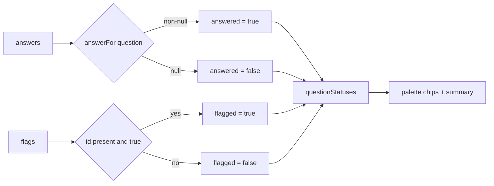

# #0024 — Interactive question palette for the timed mock exam (AG-305)

- Ticket: `AG-305 [FE] Build interactive Question Palette tracking answered, unanswered, and flagged items (Heuristic H3)`
- Branch: `feature/AG-305`
- Date: 2026-11-23

## 1. Background

AG-304 ships Screen 4 at `/tests/:id`: the whole paper renders in stored order with a sticky
countdown, an answered counter, and auto-submit. Answers live in `ExamViewState.answers` and are
mirrored to `sessionStorage`; flags do not exist.

The repository has no heuristic catalogue, so this ticket reads **H3** as Nielsen's third
heuristic, *user control and freedom*, applied to the exam: a student must be able to see where
they are, jump to any item, and mark items to revisit without hunting through a long page.

## 2. Problem

1. **No overview.** With 6–100 items on one page, the only feedback is `N of 6 answered`. A
   student cannot tell *which* items are still empty.
2. **No navigation.** Reaching item 40 means manual scrolling, and the countdown card is sticky
   while the paper is not.
3. **No marking.** Students cannot flag an item for review, so "come back to this" lives only in
   their head.
4. **No persistence for either.** Without storage, a refresh loses the student's position and any
   marking, even though answers survive.

## 3. Questions and Answers

**Q1. Is this an API change?**

A: No. Flags are local study aids, not submitted data. `POST /api/submissions` keeps its AG-303
body, and the palette reads only `GET /api/tests/:id`. No server file changes.

**Q2. Where do flags live in `ExamViewState`?**

A: A new `flags` field on the existing `ViewState`, keyed by question id:

```js
flags: { "e1": true, "e5": true }
```

An object map rather than an array or `Set`: it serialises to JSON as-is, toggling is O(1), and
the ids are filtered against the loaded test on every read, so a stale flag from another test can
never appear. There is no separate `FlagViewState`.

**Q3. What are the three tracked states?**

A: Two independent booleans per question, derived, never stored:

| Concept | Source | Rule |
| --- | --- | --- |
| answered | `answers[questionId]` | exactly the AG-304 rule used by `countAnsweredQuestions`: an untouched `sentence_order` is **not** answered |
| unanswered | derived | `!answered` |
| flagged | `flags[questionId]` | `true` only for a known question id |

A question can be answered **and** flagged. Flagging is never a substitute for answering, and
answering never clears a flag. Both are needed: "I answered it but I'm unsure" is the main reason
students flag.

**Q4. Why derive instead of storing a status per question?**

A: Storing `status: 'answered' | 'unanswered' | 'flagged'` would lose the answered+flagged
combination and would drift from `answers` the moment an answer changes. Derivation keeps one
source of truth and mirrors the server's `answeredCount` semantics.

**Q5. What does the palette show and how does it behave?**

A: A `<nav aria-labelledby>` between the countdown and the paper, containing:

- the summary `"{answered} answered · {unanswered} unanswered · {flagged} flagged"`;
- one button per question, numbered 1…N in stored order, with `aria-current="true"` on the item
  the student last jumped to;
- a per-button accessible name that states the state, e.g.
  `Question 3, reading part 2, unanswered, flagged`;
- a three-item legend so the colours are not the only signal.

Clicking a button scrolls that card into view and moves focus to it, so keyboard and screen-reader
users land on the question rather than the top of the page. Movement is `scrollIntoView` when the
environment provides it (jsdom does not) and focus always happens.

**Q6. Where does the flag toggle live?**

A: On the question card itself, beside the item meta, so it is reachable while reading the
question. It is a `<button type="button" aria-pressed>` with the accessible name
`Flag question 3` and the visible text `Flag` / `Flagged`. The palette is a status display plus
navigation; making its chips also toggle flags would give one control two meanings.

**Q7. What happens after submit or while submitting?**

A: The palette is rendered only while the attempt is editable, next to the paper. `submitting`
disables every palette button and flag control (the same `isReady` gate the inputs already use);
`submitted` replaces both the paper and the palette with the result panel. Flags stay in the
`ViewState` but have no effect on the request or the result.

**Q8. Does a flag survive a refresh?**

A: Yes, through the existing tab-scoped record. `flags` is added as an **optional** field of
`aptis-go:exam-progress:<testId>`, and `hydrateExamViewState` treats a missing or invalid value as
`{}`. The stored `version` stays `1`: the change is additive and old records must keep hydrating
answers rather than being discarded mid-exam.

**Q9. What is the accessibility contract?**

A:

- the palette is a landmark `<nav>` with a heading, not a `div` soup;
- every state is in text (`aria-label` and the summary), never colour alone;
- `aria-pressed` on the flag toggle and `aria-current` on the active palette item;
- buttons are native `<button>`s with visible `:focus-visible` rings;
- the active question receives focus after a jump and its section has `tabIndex={-1}`.

**Q10. What about a two-column sticky rail?**

A: Deferred. The current page is a single column capped at `max-w-5xl`; a sticky rail needs a
layout change and a responsive collapse rule, which is cosmetic and would enlarge this ticket.
The palette is placed directly under the already-sticky countdown card, so it is visible at the
top of the paper on every breakpoint.

## 4. Design

### 4.1 Files

| Path | Change |
| --- | --- |
| `client/src/exam/examViewState.js` | `flags` field, `toggleQuestionFlag`, `isQuestionFlagged`, `countFlaggedQuestions`, `questionStatuses`, hydration |
| `client/src/exam/examProgressStorage.js` | persist and accept `flags` (optional, backward compatible) |
| `client/src/exam/QuestionPalette.jsx` | palette nav, summary, legend, jump buttons |
| `client/src/exam/ExamQuestionCard.jsx` | flag toggle and anchored focusable section |
| `client/src/exam/MockExamPage.jsx` | active question state, jump handler, palette wiring, flag wiring |
| `tests/exam-view-state.test.jsx` | flag/status/hydration/storage tests |
| `tests/exam-screen.test.jsx` | palette rendering, counts, jump + focus, flag toggle, persistence, submit safety |

### 4.2 `ExamViewState`

```js
/**
 * @typedef {object} ExamViewState
 * @property {1} version
 * @property {'loading'|'ready'|'submitting'|'submitted'|'error'} status
 * @property {object|null} test
 * @property {Record<string, unknown>} answers
 * @property {Record<string, true>} flags          // new, default {}
 * @property {string|null} startedAt
 * @property {string|null} expiresAt
 * @property {boolean} autoSubmitted
 * @property {object|null} result
 * @property {string|null} submittedAt
 * @property {{ message: string, details: string[] }|null} error
 */
```

Exports:

```js
export function toggleQuestionFlag(viewState, questionId);
export function isQuestionFlagged(viewState, questionId);
export function countFlaggedQuestions(viewState);
export function questionStatuses(viewState);
```

```js
/**
 * @typedef {object} ExamQuestionStatus
 * @property {string} questionId
 * @property {number} number        // 1-based, stored order
 * @property {string} skill
 * @property {number} part
 * @property {boolean} answered
 * @property {boolean} flagged
 */
```

Validation rules:

- `toggleQuestionFlag` is a no-op returning the same object when `status !== 'ready'`, when the id
  is not a non-empty string, or when the test does not contain that id.
- `isQuestionFlagged` returns `false` for unknown ids and non-ready states.
- `countFlaggedQuestions` counts only ids that exist in the loaded test.
- `questionStatuses` returns `[]` when there is no test, and one entry per stored question in
  stored order; `answered` reuses `answerFor`, so a default `sentence_order` is `false`.
- `withExamTest`, `withExamError` reset `flags` to `{}`; `withExamSubmitted` and
  `withSubmissionError` preserve them.
- Hydration keeps only `flags` entries whose ids exist in the test and whose value is `true`.

### 4.3 Derivation



The palette never stores a status, so it cannot disagree with the submit payload.

### 4.4 Component contract

```jsx
<QuestionPalette
  statuses={questionStatuses(viewState)}
  activeQuestionId={activeQuestionId}
  onJump={(questionId) => void}
  disabled={!isReady}
/>
```

```jsx
<ExamQuestionCard
  ...
  anchorId="exam-question-<id>"
  flagged={isQuestionFlagged(viewState, question.id)}
  onToggleFlag={() => void}
/>
```

Copy that tests pin:

- heading `Question palette`;
- summary `"{n} answered · {m} unanswered · {k} flagged"`;
- chip name `"Question {n}, {skill} part {part}, {answered|unanswered}"`, suffixed `", flagged"`;
- card toggle name `"Flag question {n}"`, text `Flag` / `Flagged`.

## 5. Implementation Plan

1. Branch `feature/AG-305` from `develop`.
2. Write the failing tests first:
   - `tests/exam-view-state.test.jsx`: default `flags: {}`; toggle on/off; no-op for unknown id,
     foreign id, and non-ready status; `isQuestionFlagged`; `countFlaggedQuestions` ignoring
     ghosts; `questionStatuses` numbering and answered/flagged combinations including an
     untouched `sentence_order`; hydration keeps known flags and drops ghosts; a legacy record
     without `flags` still hydrates answers; storage writes and reads `flags`; a legacy stored
     record without `flags` is accepted.
   - `tests/exam-screen.test.jsx`: palette renders six chips with the summary; answering flips a
     chip to answered and updates the summary; flagging from a card updates the chip, summary, and
     `aria-pressed`; jumping focuses the target section and marks `aria-current`; a stored flag is
     restored after reload; the palette is gone after submit; a flagged exam posts the unchanged
     AG-303 body.
3. Run `npm run test:ui` and confirm the new assertions fail.
4. Implement `examViewState.js`, `examProgressStorage.js`, `QuestionPalette.jsx`,
   `ExamQuestionCard.jsx`, `MockExamPage.jsx`.
5. Re-run until green, including all 152 existing UI tests.
6. Run every gate: `npm test` with and without `MONGODB_TEST_URI`, `npm run test:ui`,
   `npm run test:jest`, `npm run lint`, `npm run format` then `format:check`,
   `npm --prefix client run build`.
7. Check the screen against the local demo API and seeded test, update `README.md`, and append
   `## 8. Implementation Results`.
8. Commit, merge into `develop`, push.

## 6. Examples

**Answered versus flagged**

✅ Item 3 has a selected MCQ option and a flag: the palette chip reads
`Question 3, core part 1, answered, flagged`, and the summary moves both counters.

❌ Treating a flag as an answer. The summary would claim 6 answered while one item is empty, and
the student would submit an incomplete paper believing it is complete.

**Untouched sentence order**

✅ `questionStatuses` reports `answered: false` until the student moves a sentence, matching the
server's denominator.

❌ Reporting it as answered because the shuffled ids are present in the rendered order. The
student would skip it, and the API would score it as unanswered anyway.

**Toggling while submitting**

✅ The toggle is disabled and `toggleQuestionFlag` is a no-op once `status` is `submitting`.

❌ Allowing a flag change while the POST is in flight, so the palette disagrees with the attempt
that was actually sent.

**Storage**

✅ A record written by AG-304 (no `flags` key) still restores answers and the deadline, with no
flags.

❌ Bumping `version` and discarding old records, which would reset every in-progress attempt at
deployment time.

## 7. Trade-offs

- **Flags are client-only.** They never reach the server, so a student cannot flag an item from
  another device and a lecturer cannot see the flags. Persisting them would need a submission
  draft endpoint, which is not in scope.
- **No filter or "jump to next unanswered".** The palette shows state and jumps on click; a
  filter adds state and edge cases, and the summary already exposes the count. Deferred.
- **Single-column placement.** No sticky rail, so on a very long paper the palette scrolls away.
  The sticky countdown stays, and a rail is a cosmetic follow-up.
- **Derivation cost.** `questionStatuses` runs on every render (O(n) over questions, and dropdown
  answers are validated per item). For a 100-question paper this is trivial compared with DOM
  work; memoisation can be added if profiling ever shows it.
- **Flag precedence is presentation only.** The view state keeps two booleans; only the chip
  styling chooses which one dominates visually, so the accessibility text can state both.

## 8. Implementation Results

Implemented on `feature/AG-305` from `develop` (`539c8a6`); client-only, no server change.

### Files delivered

| Path | Result |
| --- | --- |
| `client/src/exam/examViewState.js` | `flags` on `ExamViewState`, `toggleQuestionFlag`, `isQuestionFlagged`, `countFlaggedQuestions`, `questionStatuses`, flag sanitising in hydration |
| `client/src/exam/examProgressStorage.js` | persists `flags`; accepts records written before the field existed |
| `client/src/exam/QuestionPalette.jsx` | `<nav>` with summary, numbered chips, `aria-current`, legend |
| `client/src/exam/ExamQuestionCard.jsx` | `anchorId`, `tabIndex={-1}` focus target, `Flag question N` toggle with `aria-pressed` |
| `client/src/exam/MockExamPage.jsx` | `activeQuestionId`, scroll + focus jump, palette and flag wiring |
| `tests/exam-view-state.test.jsx` | 35 tests (was 27) |
| `tests/exam-screen.test.jsx` | 13 tests (was 9) |

### Test evidence

| Gate | Command | Result |
| --- | --- | --- |
| Red step | `npx vitest run tests/exam-view-state.test.jsx tests/exam-screen.test.jsx` | 17 failed / 33 passed (`toggleQuestionFlag is not a function`, missing palette) |
| Targeted | same command after implementation | 50/50 passed |
| UI suite | `npm run test:ui` | 166/166 passed (14 files) |
| Node suite (no DB) | `npm test` | 252 tests, 240 pass, 12 skipped |
| Node suite (local DB) | `$env:MONGODB_TEST_URI="mongodb://127.0.0.1:27017/aptis-go-test"; npm test` | 252/252 passed |
| Jest | `npm run test:jest` | 7/7 passed |
| Lint | `npm run lint` | Clean (root, client, server) |
| Format | `npm run format` then `format:check` | All matched files use Prettier style |
| Build | `npm --prefix client run build` | 123 modules, JS 410.35 kB (125.05 kB gzip), CSS 38.60 kB (6.97 kB gzip) |
| Dev-server transform | `GET http://localhost:5173/src/exam/QuestionPalette.jsx` | `200`, 14,163 bytes |

### Behaviour verified by the tests

- The palette shows six chips and `0 answered · 6 unanswered · 0 flagged` on load.
- Selecting an MCQ flips chip 1 to answered and updates the summary to
  `1 answered · 5 unanswered · 0 flagged`.
- Flagging item 6 sets `aria-pressed="true"`, reads `Flagged`, and produces
  `Question 6, speaking part 1, unanswered, flagged` plus `… · 1 flagged`; clicking again clears it.
- Jumping to item 4 focuses `#exam-question-e4` and sets `aria-current` on its chip.
- A stored `flags: { e1: true }` is restored after a reload.
- The palette and flag toggles are disabled while a submission is in flight, and the palette is
  gone once the result panel renders.
- The exact AG-303 POST body is unchanged by flagging.

### Deviations from the plan

1. **`aria-current="true"`** on the active chip rather than `"location"`; both are valid and
   `"true"` keeps the assertion simple.
2. **Legend copy** reads "Flagged for review" rather than "Flagged", so it does not collide with
   the card's `Flagged` button text for readers and tests.
3. **No new test file** — the two existing exam suites were extended, matching the plan.
4. **The `createExamViewState` shape assertion was extended** with `flags: {}`. This is a shape
   change required by the feature, not a relaxed assertion.
5. **`questionStatuses` reuses the private `answerFor`** inside the module rather than exporting a
   new public helper, so the answered rule cannot drift from the payload builder.
6. **Browser check is visual only.** The screen logic is covered by jsdom tests and the Vite dev
   server compiles the new modules, but no automated browser run was performed in this session.
