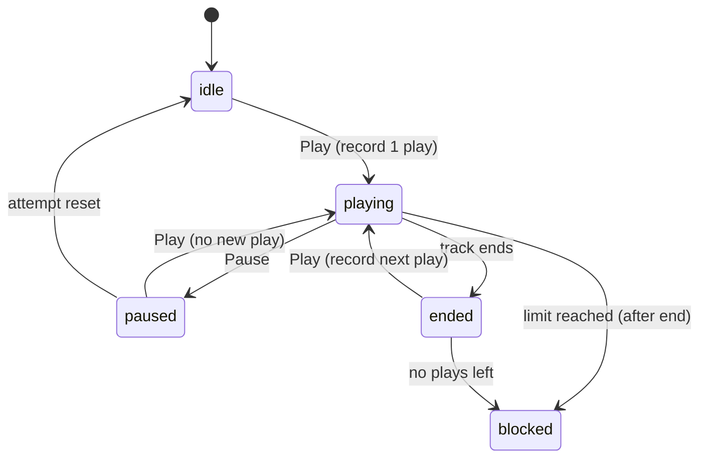
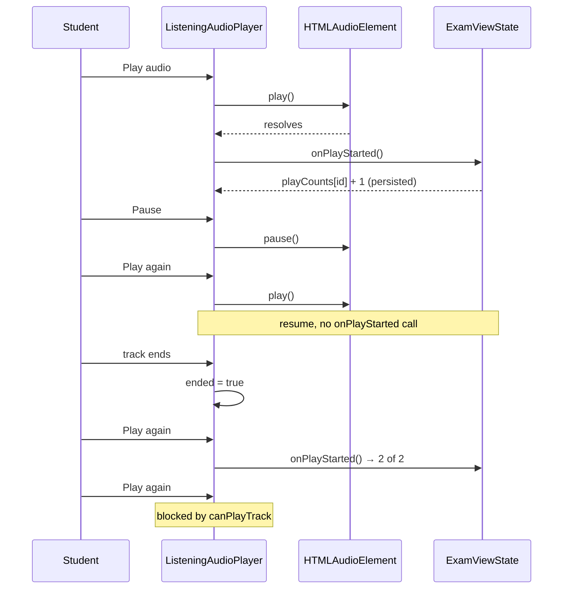

# #0025 — Listening audio player with the official two-play limit (AG-306)

- Ticket: `AG-306 [FE] Build custom Listening Audio Player enforcing official Aptis maximum 2-play limit per track`
- Branch: `feature/AG-306`
- Date: 2026-11-27

## 1. Background

The exam runner at `/tests/:id` renders `GET /api/tests/:id` output. Listening questions already
carry `mediaUrl` (the local demo test has
`https://example.com/audio/placement-listening-1.mp3`), but `ExamQuestionCard` renders only the
prompt and options — there is no way to hear the track.

The rule is already defined once in the shared Contract:

```js
// contracts/JayContract.js
function validateListeningPlaysLimit(currentPlaysCount) {
  return currentPlaysCount < 2 || currentPlaysCount === 2;
}
```

`tests/aptis-contract.test.js` pins `0 → true`, `1 → true`, `2 → true`, `3 → false`, and
`03_DDS_Database_Schema.md` states: *"Strict maximum 2 audio plays per track enforced client &
server side."*

## 2. Problem

1. **No playback.** A listening item cannot be answered honestly without audio.
2. **No limit.** The browser's native `controls` allow unlimited replays, which breaks the Aptis
   equivalence of the mock exam.
3. **No durability.** A limit held only in component memory is reset by a refresh, so the rule is
   trivially bypassed.
4. **No feedback.** Students need to know how many plays remain *before* they answer, and the
   control must not silently stop working.
5. **No handling for a missing track.** A listening item without `mediaUrl` must say so instead of
   rendering a dead player.

## 3. Questions and Answers

**Q1. Where does the limit constant come from?**

A: `contracts/JayContract.js` owns the rule. It is CommonJS (`module.exports`) and the client is an
ESM Vite app, and no client code has ever imported `contracts/`; importing it into the browser
bundle would need a CJS-to-ESM shim or a dual-format conversion of a file the server `require`s.
This ticket therefore declares one client constant and pins it to the Contract with a parity test:

```js
// client/src/exam/examViewState.js
export const LISTENING_PLAY_LIMIT = 2;
```

```js
// tests/exam-audio-player.test.jsx
const { validateListeningPlaysLimit } = require('../contracts/JayContract.js');

expect(LISTENING_PLAY_LIMIT).toBe(2);
expect(validateListeningPlaysLimit(LISTENING_PLAY_LIMIT)).toBe(true);
expect(validateListeningPlaysLimit(LISTENING_PLAY_LIMIT + 1)).toBe(false);
```

If the Contract ever allows three plays, the client test fails instead of drifting. No second
contract module is introduced.

**Q2. What exactly counts as a play?**

A: A **new** play starts when audio begins from the beginning or after the track has ended.
Pausing and resuming continues the current play and does not consume another one; a student who
pauses to think is not punished. Concretely:

| Action | Consumes a play |
| --- | --- |
| First `Play audio` | yes (1 of 2) |
| `Pause`, then `Play again` before the end | no |
| Track ends, then `Play again` | yes (2 of 2) |
| Any further attempt | blocked |

Recording happens only *after* `HTMLMediaElement.play()` resolves. If the browser rejects playback
(autoplay policy, offline), the count is not consumed and an error is shown.

**Q3. Can a student scrub or seek?**

A: No. The player draws a display-only progress bar (`role="progressbar"`, `aria-valuenow`) with no
seek input, matching the official paper where the track plays straight through. Pause/resume is the
only transport control.

**Q4. Where do play counts live?**

A: A new field on the existing `ViewState`, keyed by question id:

```js
playCounts: { "665f…56": 2 };
```

Values are integers `0…LISTENING_PLAY_LIMIT`; `0`/absent means untouched. It is written by the same
tab-scoped record as answers and flags (`aptis-go:exam-progress:<testId>`), so refreshing cannot
grant a third play. Like flags, it never reaches the API.

**Q5. Which questions get a player?**

A: Only questions where `skill === 'listening'` **and** `mediaUrl` is a non-empty string. Other
skills keep their current rendering. A listening question without `mediaUrl` shows
`Audio is not available for this question.` and has no player and no counter.

**Q6. What does the student see?**

A: Inside the listening card, between the prompt and the answer inputs:

- primary control `Play audio` → `Play again` after the first play, `Pause` while playing, and
  `No plays remaining` (disabled) at the limit;
- counter `1 of 2 plays used`;
- status `2 plays remaining` / `1 play remaining` / `No plays remaining`;
- a progress bar and `0:00 / 1:23` clock;
- `role="alert"` text when playback fails.

All states are text, not colour alone.

**Q7. What happens while submitting or after submit?**

A: `submitting` disables every control through the same `isReady` gate the answer inputs use; a
pending play still in flight cannot change the attempt. `submitted` replaces the paper with the
result panel, so the player disappears. Existing plays stay in the state and record.

**Q8. Does this change the API?**

A: No. `GET /api/tests/:id` already returns `mediaUrl`, and `POST /api/submissions` is untouched.
Flags and play counts are local study aids.

**Q9. The DDS says "client & server side". Is the server enforcing it?**

A: Not yet, and this FE ticket cannot add it. Server enforcement needs a stored play counter per
attempt plus an endpoint that authorises each play — none exists in the ADS. This is recorded as a
gap: the client limit is demo-grade and editable via DevTools, exactly like the exam deadline in
AG-304.

**Q10. Why not extend the placement runner too?**

A: The placement screen (`/placement`) renders its own card and deliberately excludes audio-bearing
items with a notice; it is a diagnostic capture, not the mock exam. Reusing the player there is a
follow-up once that runner owns listening items.

## 4. Design

### 4.1 Files

| Path | Change |
| --- | --- |
| `client/src/exam/examViewState.js` | `playCounts`, `LISTENING_PLAY_LIMIT`, `isListeningTrack`, `playsUsedFor`, `playsRemainingFor`, `canPlayTrack`, `recordTrackPlay`, `formatPlayClock`, hydration |
| `client/src/exam/examProgressStorage.js` | persist and accept `playCounts` (optional, backward compatible) |
| `client/src/exam/ListeningAudioPlayer.jsx` | custom transport, counter, progress, errors |
| `client/src/exam/ExamQuestionCard.jsx` | render the player for listening tracks, notice when audio is missing |
| `client/src/exam/MockExamPage.jsx` | pass `playsUsed` and `onPlayStarted` |
| `tests/screen-fixtures.jsx` | `LISTENING_TEST` with one track and one missing-track item |
| `tests/exam-view-state.test.jsx` | play-count transitions, clamping, hydration, storage |
| `tests/exam-audio-player.test.jsx` | player states, two-play enforcement, resume, failure, restore, Contract parity |

### 4.2 `ExamViewState`

```js
/**
 * @typedef {object} ExamViewState
 * …
 * @property {Record<string, number>} playCounts   // new, default {}
 * …
 */
```

```js
export const LISTENING_PLAY_LIMIT = 2;

export function isListeningTrack(question);
export function playsUsedFor(viewState, questionId);
export function playsRemainingFor(viewState, questionId);
export function canPlayTrack(viewState, questionId);
export function recordTrackPlay(viewState, questionId);
export function formatPlayClock(seconds);
```

Validation rules:

- `isListeningTrack` requires a plain question with `skill === 'listening'` and a non-empty string
  `mediaUrl`.
- `playsUsedFor` returns the stored integer clamped to `0…LISTENING_PLAY_LIMIT`, and `0` for any
  question that is not a listening track or does not exist.
- `playsRemainingFor` returns `LISTENING_PLAY_LIMIT − playsUsedFor`, never negative.
- `canPlayTrack` is `playsUsedFor < LISTENING_PLAY_LIMIT`; it does not look at `status`.
- `recordTrackPlay` returns the same object unless `status === 'ready'`, the question is a
  listening track, and `playsUsedFor < LISTENING_PLAY_LIMIT`; otherwise it increments by exactly
  one.
- Hydration keeps only counts for listening tracks in the loaded test whose value is a positive
  integer, clamped to the limit; anything else is dropped.
- `withExamTest` and `withExamError` reset `playCounts` to `{}`; `withExamSubmitted` and
  `withSubmissionError` preserve it.

### 4.3 Player component

```jsx
<ListeningAudioPlayer
  questionId={question.id}
  src={question.mediaUrl}
  playsUsed={playsUsedFor(viewState, question.id)}
  limit={LISTENING_PLAY_LIMIT}
  disabled={!isReady}
  onPlayStarted={() => setViewState((current) => recordTrackPlay(current, question.id))}
/>
```



Copy pinned by tests:

| Element | Text |
| --- | --- |
| primary button | `Play audio`, `Play again`, `Pause`, `No plays remaining` |
| counter | `0 of 2 plays used` … `2 of 2 plays used` |
| status | `2 plays remaining` / `1 play remaining` / `No plays remaining` |
| failure | `Audio could not start. Check your connection and try again.` |
| no source | `Audio is not available for this question.` |

### 4.4 Playback sequence



## 5. Implementation Plan

1. Branch `feature/AG-306` from `develop`.
2. Write the failing tests first:
   - `tests/exam-view-state.test.jsx`: default `playCounts: {}`; `isListeningTrack` truth table;
     `recordTrackPlay` off/on/clamped and non-ready no-op; `playsUsedFor` /
     `playsRemainingFor` / `canPlayTrack`; `formatPlayClock`; hydration keeps known counts and
     clamps/drops bad ones; legacy record without `playCounts`; storage round-trip.
   - `tests/exam-audio-player.test.jsx`: Contract parity; player renders for a listening track and
     the notice for a missing track; first play records 1; pause + resume records nothing;
     end + replay records 2 and disables the control; a third click never calls `play()`;
     rejected playback shows the alert and records nothing; a stored `playCounts` restores the
     blocked state.
   - `tests/screen-fixtures.jsx`: `LISTENING_TEST`.
3. Run `npm run test:ui`, confirm the new assertions fail.
4. Implement `examViewState.js`, `examProgressStorage.js`, `ListeningAudioPlayer.jsx`,
   `ExamQuestionCard.jsx`, `MockExamPage.jsx`.
5. Re-run until green, including all 166 existing UI tests.
6. Run every gate: `npm test` with and without `MONGODB_TEST_URI`, `npm run test:ui`,
   `npm run test:jest`, `npm run lint`, `npm run format` then `format:check`,
   `npm --prefix client run build`.
7. Check the screen against the local demo API, update `README.md`, append
   `## 8. Implementation Results`.
8. Commit, merge into `develop`, push.

## 6. Examples

**Counting a play**

✅ `Play audio` → `play()` resolves → `recordTrackPlay` → `1 of 2 plays used`, status
`1 play remaining`.

❌ Incrementing on the click before `play()` resolves: a blocked autoplay would consume a play the
student never heard.

**Pause and resume**

✅ `Pause` at 0:20, `Play again` at 0:21 → still `1 of 2 plays used`.

❌ Treating every `play` event as a new play, which would consume both plays for one listening and
make the second half unrepeatable.

**Limit enforcement**

✅ After the track ends on the second play the button reads `No plays remaining`, is disabled, and
`recordTrackPlay` is a no-op even if called directly.

❌ Hiding the button after two plays but still accepting `onPlayStarted` from a stale handler, which
would let a third play through.

**Refresh**

✅ A stored `playCounts: { "665f…56": 2 }` restores the blocked state, so a reload cannot buy
another listen.

❌ Keeping the count in component state only; a refresh resets the limit to zero.

**Missing track**

✅ A listening item without `mediaUrl` shows `Audio is not available for this question.` and no
control.

❌ Rendering a player with an empty `src`, which fails silently and looks like a broken exam.

## 7. Trade-offs

- **Client-only enforcement.** DDS asks for client *and* server enforcement, but no server-side
  play counter exists in the ADS. DevTools or a sessionStorage edit can reset the limit; the same
  demo-grade caveat as the AG-304 deadline. A server-side counter needs a new field and endpoint.
- **No scrubbing.** Simpler and closer to the official paper, but a student cannot replay a
  misheard phrase inside the same play. For a 2-play limit this is the intended constraint.
- **One constant outside `contracts/`.** Forced by the CJS/ESM boundary; mitigated by a parity test
  against `validateListeningPlaysLimit`. Converting `JayContract.js` to a dual-format module is a
  separate, riskier change.
- **No waveform or buffering indicator.** The progress bar and time readout are enough for a
  listening stimulus; richer media UI is cosmetic.
- **Per-question id, not per-URL.** Two questions sharing one track would each get two plays. The
  demo and schema attach one track per question, so this is theoretical; keying by URL would leak
  counts across tests with the same CDN asset.
- **No server audit trail.** A lecturer cannot see how many times a student played a track. That
  belongs with FR06 review analytics, not this ticket.

## 8. Implementation Results

Implemented on `feature/AG-306` from `develop` (`3349f5c`); client-only, no server or API change.

### Files delivered

| Path | Result |
| --- | --- |
| `client/src/exam/examViewState.js` | `playCounts`, `LISTENING_PLAY_LIMIT`, `isListeningTrack`, `playsUsedFor`, `playsRemainingFor`, `canPlayTrack`, `recordTrackPlay`, `formatPlayClock`, hydration clamp |
| `client/src/exam/examProgressStorage.js` | persists `playCounts`; accepts records written before the field existed |
| `client/src/exam/ListeningAudioPlayer.jsx` | custom transport, counter, status, progress bar, clock, error alert |
| `client/src/exam/ExamQuestionCard.jsx` | renders the player for listening tracks, notice when `mediaUrl` is missing |
| `client/src/exam/MockExamPage.jsx` | passes `playsUsed` and records a play through `recordTrackPlay` |
| `client/public/audio/demo-listening.wav` | 128,044-byte local listening track for the demo seed |
| `tests/screen-fixtures.jsx` | `LISTENING_TEST` (one track, one missing-track item) |
| `tests/exam-view-state.test.jsx` | 46 tests (was 35) |
| `tests/exam-audio-player.test.jsx` | 7 tests |

### Test evidence

| Gate | Command | Result |
| --- | --- | --- |
| Red step | `npx vitest run tests/exam-view-state.test.jsx tests/exam-audio-player.test.jsx` | 19 failed / 35 passed (`recordTrackPlay is not a function`, missing player, no `playCounts`) |
| Targeted | same command after implementation | 54/54 passed |
| UI suite | `npm run test:ui` | 183/183 passed (15 files) |
| Node suite (no DB) | `npm test` | 252 tests, 240 pass, 12 skipped |
| Node suite (local DB) | `$env:MONGODB_TEST_URI="mongodb://127.0.0.1:27017/aptis-go-test"; npm test` | 252/252 passed |
| Jest | `npm run test:jest` | 7/7 passed |
| Lint | `npm run lint` | Clean (root, client, server) |
| Format | `npm run format` then `format:check` | All matched files use Prettier style |
| Build | `npm --prefix client run build` | 124 modules, JS 414.31 kB (126.19 kB gzip), CSS 38.60 kB (6.97 kB gzip) |

### Demo check (local `aptis-go-demo`, API on `:5000`)

- Generated `client/public/audio/demo-listening.wav` (8 s, 8 kHz mono) because the seeded
  `https://example.com/audio/placement-listening-1.mp3` does not exist.
- Updated the seeded listening question (`6af2ba7e4d51845a81047e56`) to
  `mediaUrl: "/audio/demo-listening.wav"`; `GET /api/tests/6af2ba7e4d51845a81047e51` now returns
  that value, and Vite serves the asset with `200 audio/wav`.
- Playback itself is not exercised by an automated browser run; the player behaviour is covered by
  jsdom tests with a stubbed `HTMLMediaElement`.

### Deviations from the plan

1. **Contract parity, not a runtime import.** `JayContract.js` is CommonJS and would need a bundler
   shim or a dual-format rewrite; the client constant is pinned by
   `validateListeningPlaysLimit(LISTENING_PLAY_LIMIT) === true` and
   `validateListeningPlaysLimit(LISTENING_PLAY_LIMIT + 1) === false` instead.
2. **Demo asset added.** Not in the original file list; without a real track the feature cannot be
   demonstrated. It is static client content, not an API change.
3. **`questionId` is exposed as `data-question-id`**, giving the component an attributable DOM node
   without leaking an ObjectId into an accessible name.
4. **`formatPlayClock` floors negative and non-finite input to `0:00`**, so a metadata-less track
   (`NaN` duration in jsdom) cannot render `NaN:NaN`.
5. **The fixture is a separate `LISTENING_TEST`** rather than a seventh question on `EXAM_TEST`, so
   the AG-304/AG-305 assertions about six items, counts, and the exact POST body stay untouched.
6. **Server enforcement remains absent.** DDS asks for client *and* server limits; the ADS has no
   play-counter field or endpoint, so this stays a documented gap rather than an invented API.
