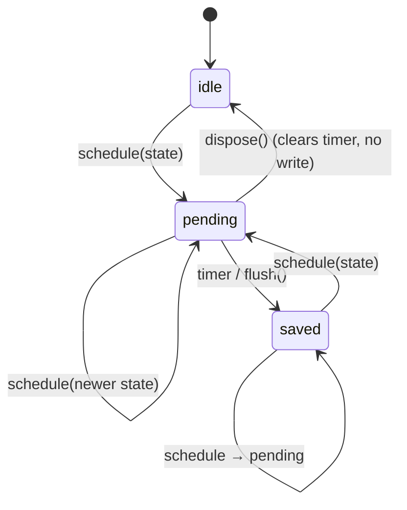
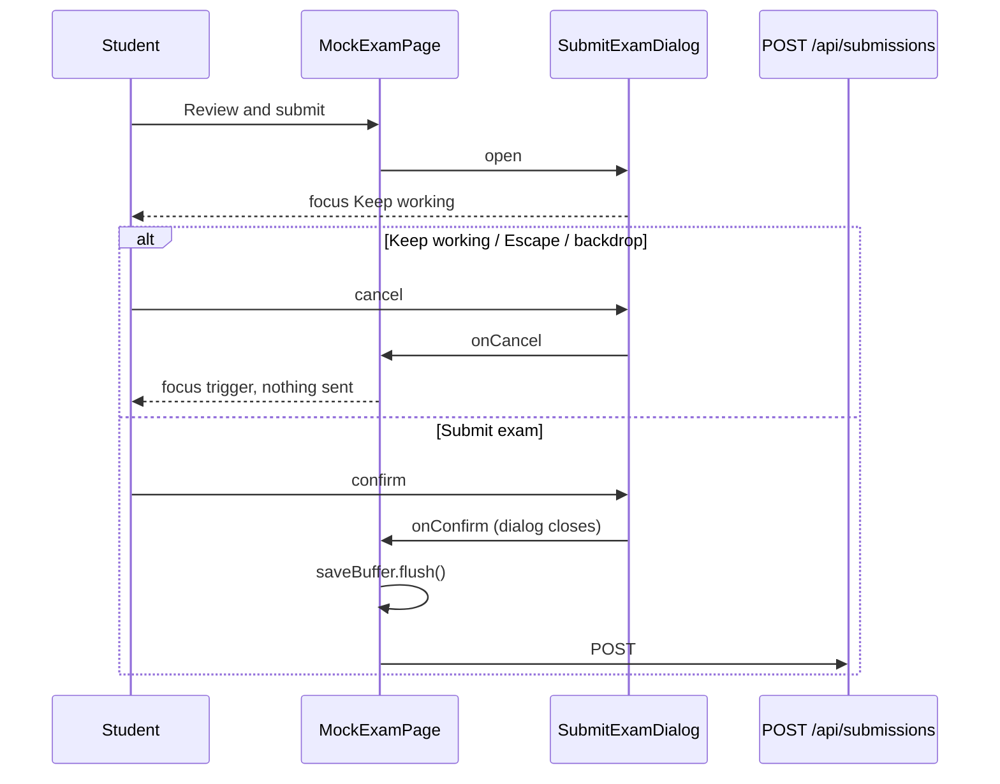

# #0026 — Autosave buffer and pre-submission confirmation (AG-307)

- Ticket: `AG-307 [FE] Implement sessionStorage auto-save buffer and pre-submission confirmation modal (Heuristic H5)`
- Branch: `feature/AG-307`
- Date: 2026-11-27

## 1. Background

AG-304 persists the attempt (answers, deadline, flags, play counts) to `sessionStorage` on every
`ViewState` change. AG-305 and AG-306 added flags and listening play counts to the same record.

The repository has no heuristic catalogue, so **H5** is read as Nielsen's fifth heuristic, *error
prevention*: stop an irreversible action before it happens, and keep the student's work safe while
they are deciding.

## 2. Problem

1. **Every keystroke writes the whole attempt.** Typing an essay serialises the full `ViewState`
   on each character. It works, but it is wasteful and gives no feedback.
2. **No save signal.** A student cannot tell whether the draft is stored, so they may re-answer or
   refresh out of doubt.
3. **No recovery acknowledgement.** After a refresh the exam silently restores state, which looks
   indistinguishable from losing it.
4. **Submit is one click from an irreversible action.** Nothing confirms the attempt, and nothing
   points out that unanswered items will score zero.
5. **Auto-submit must stay instant.** A confirmation step at the timeout would block the graded
   attempt, so the two paths need different behaviour.

## 3. Questions and Answers

**Q1. Does the storage format change?**

A: No. The record keeps `version`, `testId`, `startedAt`, `expiresAt`, `answers`, `flags`,
`playCounts`, `submittedAt`, `autoSubmitted`, `result`, `updatedAt`. Only *when* it is written
changes, so a record written by AG-306 keeps hydrating.

**Q2. What exactly is the buffer?**

A: A small non-React module that holds the latest `ViewState` in memory and writes it after a quiet
period:

```js
// client/src/exam/examSaveBuffer.js
export const EXAM_SAVE_DEBOUNCE_MS = 400;

export function createExamSaveBuffer({ save, delay = EXAM_SAVE_DEBOUNCE_MS, now = () => new Date() } = {});
// → { schedule(state), flush(), getSnapshot(), subscribe(listener), dispose() }
```

Snapshot:

```js
{ status: 'idle' | 'pending' | 'saved', savedAt: string | null }
```

Rules:

- `schedule(state)` replaces any pending state and restarts the timer; it never writes immediately.
- several schedules inside `delay` collapse into **one** write of the newest state;
- `flush()` writes immediately, cancels the timer, and returns the ISO save time (or the previous
  time when nothing is pending); a later timer cannot write twice;
- `flush()` with nothing pending does **not** call `save`;
- `subscribe(listener)` receives the current snapshot immediately and then only when the snapshot
  changes (`status` or `savedAt`), so a keystroke does not re-render the indicator;
- `dispose()` clears the timer without writing; the page flushes first;
- `save` must be a function and `delay` a finite number `>= 0`, otherwise the factory throws
  (`TypeError` / `RangeError`).

**Q3. Where is the buffer flushed besides the timer?**

A: Before `POST /api/submissions`, on `pagehide`, on `beforeunload`, when the tab becomes hidden,
and on unmount. The submit flush guarantees the stored record matches what was sent.

**Q4. What does the student see?**

A: Next to the submit button: `Saving…` while a write is pending, then
`Draft saved at 14:32:07`. Before the first edit it reads
`Draft will be saved automatically.` The line is a `role="status"`.

After a refresh that restores a record, a banner reads
`Restored your saved attempt from 14:32. Answers, flags, and listening plays are kept.` with a
`Dismiss` button. It uses `aria-live="polite"` without a role, so it does not collide with the
result banner's `role="status"`.

**Q5. Which action opens the confirmation?**

A: Only the manual button, now labelled `Review and submit`. Automatic submission at zero keeps
calling the submit path directly — there is no time to confirm, and blocking it would leave the
attempt ungraded.

**Q6. What does the dialog say?**

A: A modal with `role="dialog"`, `aria-modal="true"`, labelled by its heading:

- heading `Submit exam?`;
- summary `{answered} of {total} answered · {unanswered} unanswered · {flagged} flagged`;
- when `unanswered > 0`: `1 question is still unanswered. It will score zero.` (plural: `N questions
  are still unanswered. They will score zero.`);
- `You cannot change your answers after submitting.`;
- buttons `Keep working` and `Submit exam`.

**Q7. What is the keyboard and focus contract?**

A:

- opening moves focus to `Keep working`, the non-destructive default;
- `Escape` and a backdrop click cancel without posting;
- `Tab` / `Shift+Tab` cycle inside the dialog;
- closing returns focus to the trigger when it is still in the document;
- the dialog unmounts as soon as `status` leaves `ready`, so a submission (manual or automatic)
  cannot leave a stale overlay.

**Q8. Is the submit action protected twice?**

A: Yes. The confirm handler closes the dialog and calls the existing `submit`, which keeps the
`inFlight` ref and the `ready`-only guard; the trigger is disabled while `submitting`. A double
click therefore produces one POST.

**Q9. Does this change the API or the server?**

A: No.

## 4. Design

### 4.1 Files

| Path | Change |
| --- | --- |
| `client/src/exam/examSaveBuffer.js` | debounced save buffer, snapshots, subscriptions |
| `client/src/exam/examProgressStorage.js` | export `EXAM_SAVABLE_STATUSES` |
| `client/src/exam/SubmitExamDialog.jsx` | accessible confirmation modal |
| `client/src/exam/MockExamPage.jsx` | buffer wiring, save label, recovery banner, dialog trigger, flush before POST |
| `tests/exam-save-buffer.test.jsx` | debounce, collapse, flush, dispose, subscription, validation |
| `tests/exam-screen.test.jsx` | autosave status, recovery banner, dialog open/cancel/escape/confirm, retry |

### 4.2 Buffer lifecycle



### 4.3 Dialog flow



### 4.4 Signatures

```js
// client/src/exam/examSaveBuffer.js
export const EXAM_SAVE_DEBOUNCE_MS = 400;
export function createExamSaveBuffer({ save, delay, now } = {});
```

```jsx
// client/src/exam/SubmitExamDialog.jsx
<SubmitExamDialog
  open={confirmOpen}
  answered={answered}
  total={totalQuestions}
  flagged={flaggedCount}
  onCancel={() => setConfirmOpen(false)}
  onConfirm={handleConfirmSubmit}
/>
```

```js
// client/src/exam/examProgressStorage.js
export const EXAM_SAVABLE_STATUSES = Object.freeze(['ready', 'submitting', 'submitted']);
```

Page wiring:

```js
const saveBuffer = useRef(null);
if (saveBuffer.current === null) {
  saveBuffer.current = createExamSaveBuffer({
    save: (viewState, at) => saveExamProgress(viewState, at),
  });
}

useEffect(() => {
  if (EXAM_SAVABLE_STATUSES.includes(viewState.status)) {
    saveBuffer.current.schedule(viewState);
  }
}, [viewState]);
```

## 5. Implementation Plan

1. Branch `feature/AG-307` from `develop`.
2. Write the failing tests first:
   - `tests/exam-save-buffer.test.jsx` — debounce collapse, flush, no double write, dispose,
     subscription snapshots, injected clock, factory validation.
   - `tests/exam-screen.test.jsx` — save label transitions, recovery banner + dismiss,
     dialog open without posting, counts and warning, default focus, Tab cycle, Escape,
     backdrop cancel, confirm posts once, retry after failure, auto-submit skips the dialog,
     no warning when everything is answered (`LISTENING_TEST`).
   - update the three existing submit flows to go through the dialog and rename the trigger to
     `Review and submit`.
3. Run `npm run test:ui`, confirm the new assertions fail.
4. Implement the buffer, storage export, dialog, page wiring, and save label.
5. Re-run until green, including all 183 existing UI tests.
6. Run every gate: `npm test` with and without `MONGODB_TEST_URI`, `npm run test:ui`,
   `npm run test:jest`, `npm run lint`, `npm run format` then `format:check`,
   `npm --prefix client run build`.
7. Check the screen against the local demo API, update `README.md`, append
   `## 8. Implementation Results`.
8. Commit, merge into `develop`, push.

## 6. Examples

**Coalescing writes**

✅ Typing 30 characters inside 400 ms produces one `sessionStorage` write containing the final
text.

❌ Writing on every character, which serialises the whole attempt 30 times for one sentence.

**Submit flush**

✅ `Review and submit` → `Submit exam` → buffer flush → POST body and stored draft agree.

❌ Posting while the newest keystrokes are still only in the pending buffer, so a refresh after a
failed POST loses them.

**Confirmation**

✅ Clicking `Review and submit` opens the dialog, shows `1 unanswered`, and waits.

❌ Posting on the first click with no summary; the student cannot see that an item is blank until
the result appears.

**Cancel**

✅ `Keep working`, `Escape`, or a backdrop click closes the dialog, posts nothing, and returns
focus to the trigger.

❌ Closing on any click including the dialog body, which makes an accidental Cancel while reading
the summary.

**Automatic submission**

✅ The countdown reaches zero and the attempt posts immediately, without a dialog.

❌ Opening a dialog at zero, which leaves the attempt ungraded when the student walks away.

**Recovery**

✅ After a refresh the banner says the saved attempt was restored, so the student knows the work
survived.

❌ Silently restoring state, which looks identical to losing it.

## 7. Trade-offs

- **400 ms of exposure.** A hard browser crash can lose the last few keystrokes; `pagehide`,
  visibility, and unmount flushes narrow that to a genuine process kill. A shorter delay writes
  more often; a longer one loses more.
- **One extra click to submit.** That is the point of H5, but it costs a step on every attempt.
  Auto-submit stays unconfirmed so the timed path is unaffected.
- **Client-only guarantees.** `sessionStorage` is editable and tab-scoped; there is still no
  server-side draft, so closing the tab loses the attempt. Documented in AG-304 and unchanged.
- **Dialog is hand-rolled, not `<dialog>`.** jsdom's `HTMLDialogElement` support is partial, and a
  hand-rolled overlay keeps focus handling explicit and testable. The cost is owning the focus
  trap.
- **Save label lives with the submit action.** It is visible where the student needs confidence
  (before submitting) rather than in the sticky timer, which keeps the countdown compact.

## 8. Implementation Results

Implemented on `feature/AG-307` from `develop` (`40f446e`); client-only, no server or API change.

### Files delivered

| Path | Result |
| --- | --- |
| `client/src/exam/examSaveBuffer.js` | `EXAM_SAVE_DEBOUNCE_MS = 400`, `createExamSaveBuffer` with `schedule/flush/getSnapshot/subscribe/dispose` |
| `client/src/exam/examProgressStorage.js` | exports `EXAM_SAVABLE_STATUSES`; record format unchanged |
| `client/src/exam/SubmitExamDialog.jsx` | modal with summary, warning, focus trap, Escape/backdrop cancel, focus return |
| `client/src/exam/MockExamPage.jsx` | buffer wiring, save label, recovery banner, `Review and submit` trigger, flush before POST |
| `tests/exam-save-buffer.test.jsx` | 9 tests |
| `tests/exam-screen.test.jsx` | 18 tests (was 13) |

### Test evidence

| Gate | Command | Result |
| --- | --- | --- |
| Red step | `npx vitest run tests/exam-save-buffer.test.jsx tests/exam-screen.test.jsx` | Both suites failed to resolve `examSaveBuffer.js`, so no tests were collected |
| Targeted | same command after implementation | 27/27 passed |
| UI suite | `npm run test:ui` | 197/197 passed (16 files) |
| Node suite (no DB) | `npm test` | 252 tests, 240 pass, 12 skipped |
| Node suite (local DB) | `$env:MONGODB_TEST_URI="mongodb://127.0.0.1:27017/aptis-go-test"; npm test` | 252/252 passed |
| Jest | `npm run test:jest` | 7/7 passed |
| Lint | `npm run lint` | Clean (root, client, server) |
| Format | `npm run format` then `format:check` | All matched files use Prettier style |
| Build | `npm --prefix client run build` | 125 modules, JS 419.90 kB (127.76 kB gzip), CSS 40.09 kB (7.12 kB gzip) |
| Dev-server transform | `GET /src/exam/MockExamPage.jsx`, `GET /src/exam/SubmitExamDialog.jsx` | `200` for both; API health `ok` |

### Behaviour verified by the tests

- typing inside 400 ms collapses into one write of the newest state, and `Saving…` becomes
  `Draft saved at …`;
- `flush()` writes immediately, cancels the timer, and a later tick cannot write twice;
- subscribers see `idle → pending → saved` once per change and stop after unsubscribe;
- the initial hydrated state is not rewritten, so the panel starts at
  `Draft will be saved automatically.`;
- a restored record shows the recovery banner and `Dismiss` removes it;
- `Review and submit` opens the dialog, posts nothing, shows
  `0 of 6 answered · 6 unanswered · 0 flagged`, the plural unanswered warning, focuses
  `Keep working`, and traps `Tab` / `Shift+Tab`;
- `Keep working`, `Escape`, and a backdrop click all cancel without posting and return focus;
- confirming posts exactly once and renders the result; a failed POST keeps answers and can be
  retried through the dialog;
- a complete paper (`LISTENING_TEST`) shows `2 of 2 answered · 0 unanswered · 0 flagged` and no
  warning;
- automatic submission at zero posts without opening a dialog.

### Deviations from the plan

1. **Trigger renamed to `Review and submit`.** Keeping `Submit exam` on both the trigger and the
   dialog confirm would give two controls the same accessible name. The confirm keeps the final
   label.
2. **`skipNextSave` ref added.** The first green run showed the label jumping straight to
   `Saving…` on mount because hydration scheduled a redundant write. The freshly hydrated record
   is now treated as already saved; only later changes schedule a write.
3. **The autosave test uses `fireEvent` under fake timers.** `userEvent` with `advanceTimers`
   stalled the test past its 5 s timeout; the interaction and assertions are otherwise unchanged.
4. **The recovery banner uses `aria-live="polite"` without `role="status"`**, so it does not
   collide with the result banner's `role="status"` used by automatic submission.
5. **No server-side draft.** The buffer is still tab-scoped and client-owned, consistent with
   AG-304's documented limitation.
