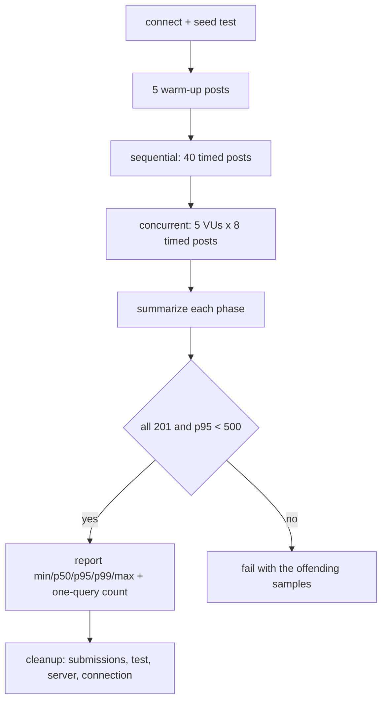

# #0027 — Latency profile for `POST /api/submissions` (AG-308, NFR01)

- Ticket: `AG-308 [QA] Profile POST /api/submissions execution latency to verify <500ms benchmark (NFR01)`
- Branch: `feature/AG-308`
- Date: 2026-11-27

## 1. Background

NFR01 requires a submission to be marked and stored in under 500 ms. AG-303 already asserts a
**single** request under 500 ms in `tests/submission-marking.integration.test.js`, together with
one `Test.findOne` per attempt. One sample proves the endpoint *can* be fast; it does not profile a
benchmark, and it cannot show a tail.

The request path is: `verifyToken` → body validation → one indexed `Test.findOne` with the answer
keys → in-memory marking (`autoMarkingService`) → one `Submission.create` → JSON summary.

## 2. Problem

1. **No distribution.** A single measurement hides p95/p99 and any occasional slow write.
2. **No repeatable profiling artifact.** The number quoted in AG-303's log cannot be reproduced
   without reading test output from one run.
3. **No evidence under concurrency.** Real requests are not perfectly serialised; the latency must
   hold when several students submit at once.
4. **No gate.** A future change (extra query, heavier marking, an index dropped) could regress the
   benchmark silently, because the existing assertion still passes at 499 ms.

## 3. Questions and Answers

**Q1. Why not run this with the Postman performance runner?**

A: The runner is the right tool for sustained load with virtual users and it is what the
`performance-testing` guidance recommends. Here the goal is an in-repo, repeatable NFR gate for one
endpoint with seeded data; the repository's QA harness is `node:test` against the real Express app
and MongoDB, already used for AG-303's NFR01 check and the one-query assertion. The Postman CLI is
not part of the repo's gates, so a test that depends on it would be unenforceable. The harness used
here still exercises the full request path (JWT verification, validation, Mongoose, marking,
persistence) and adds the profile the Postman run would give: N requests, percentiles, error rate,
and a p95 threshold.

Limits are reported rather than hidden: the load generator and the target share this machine, so
CPU contention under the concurrent phase is a generator limit, not proof of production capacity.

**Q2. What exactly is the workload?**

A: One published `mock` test with six questions (2 `mcq_single` core, one `dropdown_cloze` reading
with two sets, one listening `mcq_single`, one `essay_text`, one `audio_record`) and one student.
Every request is a **write** — it creates a new `Submission` — so the measured path includes the
insert, not just a read. The payload mirrors AG-303's mixed-answer test (partial credit, an essay,
and a null audio answer, which forces `pending_review`).

**Q3. Which profiles are measured?**

A:

| Profile | Virtual users | Requests | Purpose |
| --- | --- | --- | --- |
| `sequential` | 1 | 40 (after 5 warm-ups) | Baseline NFR01 latency without contention |
| `concurrent` | 5 | 8 iterations each (40 total) | Confirms the benchmark survives simultaneous writes |

Both are configurable through `PROFILE_REQUESTS` and `PROFILE_VUS` for a heavier local run.

**Q4. Which statistic is the gate?**

A: `p95 < 500 ms` in both profiles, with zero non-201 responses. p95 is the standard benchmark gate
because a single noisy sample on a shared laptop is not evidence of a broken endpoint; the maximum
is still reported, so a real tail cannot be hidden. If every measured request is under 500 ms, the
results state that stronger fact explicitly.

**Q5. How is percentiles computed?**

A: Nearest-rank on the sorted samples:

```text
index = clamp(ceil(p / 100 × n) − 1, 0, n − 1)
```

A pure helper (`tests/support/latencyStats.js`) computes `count`, `min`, `p50`, `p90`, `p95`,
`p99`, `max`, and `mean`; it rejects empty input (`RangeError`) and non-finite or negative samples
(`TypeError`). It is unit-tested first, so the aggregation cannot be quietly wrong.

**Q6. What is measured end to end?**

A: `performance.now()` before `fetch`, then the response body is read, then the stopwatch stops.
The measurement therefore includes JWT verification, JSON parsing/serialisation, the Mongoose read,
marking, the insert, and loopback transfer. It excludes the browser, TLS, a reverse proxy, and any
real network, which are stated as limitations.

**Q7. Is the one-query claim re-checked?**

A: Yes. `Test.findOne` is wrapped with a counter for the whole run, and the test asserts exactly one
call per profiled request (80/80). That ties the latency to the single-read design rather than to an
unnoticed extra query.

**Q8. What happens to the data?**

A: All documents created by the run are deleted in `t.after` (submissions for the seeded student id
and the generated test), the HTTP server is closed, and the Mongoose connection is disconnected.
The suite is skipped unless `MONGODB_TEST_URI` is set, so `npm test` without a database stays green.

**Q9. Does this change production code?**

A: No. The profiler wraps `Test.findOne` inside the test only. No server file is modified, so the
measured latency is the shipped path and the gate cannot alter behaviour.

## 4. Design

### 4.1 Files

| Path | Change |
| --- | --- |
| `tests/support/latencyStats.js` | pure percentile summary helper |
| `tests/latency-stats.test.js` | unit tests for the helper |
| `tests/submission-latency-profile.integration.test.js` | seeded profile: warm-up, sequential and concurrent phases, assertions, diagnostics |
| `README.md` | QA table, layout, roadmap |

### 4.2 Helper

```js
// tests/support/latencyStats.js
function percentile(sortedSamples, percentile);
function summarizeLatencies(samples);
// → { count, min, p50, p90, p95, p99, max, mean }
```

Rules: samples must be a non-empty array of finite non-negative numbers; `percentile` is in
`(0, 100]`; results are unrounded numbers.

### 4.3 Profile flow



### 4.4 Gate

```js
assert.ok(sequential.p95 < 500, 'sequential p95 must stay under the NFR01 500 ms benchmark');
assert.ok(concurrent.p95 < 500, 'concurrent p95 must stay under the NFR01 500 ms benchmark');
assert.equal(errorCount, 0);
assert.equal(findOneCalls, measuredRequests * 2);
```

## 5. Implementation Plan

1. Branch `feature/AG-308` from `develop`.
2. Write `tests/latency-stats.test.js` first and confirm it fails (helper module missing).
3. Implement `tests/support/latencyStats.js`; re-run until green.
4. Write the profiling integration test.
5. Run `$env:MONGODB_TEST_URI="mongodb://127.0.0.1:27017/aptis-go-test"; node --test tests/submission-latency-profile.integration.test.js`
   and capture the diagnostics.
6. Run every gate: `npm test` with and without `MONGODB_TEST_URI`, `npm run test:ui`,
   `npm run test:jest`, `npm run lint`, `npm run format` then `format:check`,
   `npm --prefix client run build`.
7. Record the measured numbers in this log, update `README.md`, append
   `## 8. Implementation Results`.
8. Commit, merge into `develop`, push.

## 6. Examples

**Percentile gate with a reported tail**

✅ `p50 18 ms · p95 25 ms · p99 31 ms · max 34 ms` → the gate passes and the reader sees the
whole distribution.

❌ Reporting only `mean 19 ms`, which hides a slow tail and says nothing about the benchmark.

**Warm-up**

✅ Five untimed requests absorb connection setup and Mongoose model warm-up before the 40 measured
ones.

❌ Timing the very first request after `connectDatabase`, where driver and index setup dominate and
the number says nothing about steady state.

**Attribution**

✅ `Test.findOne` is counted across the run and asserted at one call per request.

❌ Quoting a fast total without checking that an extra query slipped into the controller.

**Data safety**

✅ The suite uses `aptis-go-test`, seeds a unique title per run, and deletes the submissions and
test afterwards.

❌ Running the profile against `aptis-go-demo` or Atlas, leaving generated attempts in the demo
history.

**Concurrency**

✅ 5 virtual users each send 8 sequential requests, and both phases are asserted separately.

❌ Reusing the sequential numbers as if they proved concurrent behaviour.

## 7. Trade-offs

- **Loopback, not production.** No TLS, proxy, or real network; the result bounds the application
  and database work, not the user-perceived latency on a deployed host.
- **Shared CPU.** The generator, the API, and MongoDB run on the same laptop, so the concurrent
  phase measures contention as well as the endpoint. That is reported as a generator limit rather
  than claimed as capacity.
- **Write-heavy by design.** Every sample inserts a document. That is the real workload, but it
  also means the profiling run grows the test collection until cleanup.
- **p95 as the gate.** A single noisy outlier does not fail the build even though NFR01 says
  `<500 ms`. The maximum is printed, and the Result section states whether every sample met the
  literal bound.
- **No production instrumentation.** Phase-level timing inside the controller would need timers in
  shipped code. The single-query count plus end-to-end percentiles give the actionable signal
  without that cost.
- **No saved artifact.** Numbers are printed as diagnostics and copied into this log. Committing
  per-run JSON would add noise to review with no schema behind it.

## 8. Implementation Results

Implemented on `feature/AG-308` from `develop` (`0324f67`); test-only, no server change.

### Files delivered

| Path | Result |
| --- | --- |
| `tests/support/latencyStats.js` | `summarizeLatencies` with nearest-rank `p50/p90/p95/p99` |
| `tests/latency-stats.test.js` | 7 unit tests (red first) |
| `tests/submission-latency-profile.integration.test.js` | opt-in seeded profile with sequential and concurrent phases, one-query attribution, NFR01 gate |
| `README.md` | QA table, layout, roadmap, refreshed expected gate counts |

### Measured profile (local MongoDB, 2026-11-27)

Environment: `node v24.10.0`, `win32 x64`, AMD Ryzen 7 4800H (16 cores), 7 GB RAM, MongoDB on
`127.0.0.1:27017/aptis-go-test`. Workload: six-question mixed paper, every request writes one
`Submission`.

| Phase | n | min | p50 | p90 | p95 | p99 | max | mean |
| --- | --- | --- | --- | --- | --- | --- | --- | --- |
| Sequential (1 VU) | 40 | 5.0 ms | 6.9 ms | 9.8 ms | **9.9 ms** | 10.4 ms | 10.4 ms | 7.1 ms |
| Concurrent (5 VUs × 8) | 40 | 20.1 ms | 25.3 ms | 31.9 ms | **34.9 ms** | 43.8 ms | 43.8 ms | 27.1 ms |

- NFR01 gate: p95 < 500 ms in both phases → **passed**, with 20× headroom at the tail.
- Every measured request was under 500 ms; the slowest single sample was 43.8 ms under
  five concurrent writers.
- Errors: 0. Attribution: exactly one `Test.findOne` per request (40/40 sequential, 40/40
  concurrent).
- The concurrent phase is ~3.5× slower at p50 because the generator, the API, and MongoDB share
  this laptop; it is reported as a contention limit, not as production capacity.

### Test evidence

| Gate | Command | Result |
| --- | --- | --- |
| Red step | `node --test tests/latency-stats.test.js` | Failed: `tests/support/latencyStats` missing |
| Stats helper | same command after implementation | 7/7 passed |
| Profile | `$env:MONGODB_TEST_URI="mongodb://127.0.0.1:27017/aptis-go-test"; node --test tests/submission-latency-profile.integration.test.js` | 1/1 passed in 733 ms (diagnostics above) |
| Node suite (no DB) | `npm test` | 260 tests, 247 pass, 13 skipped |
| Node suite (local DB) | `$env:MONGODB_TEST_URI=...; npm test` | 260/260 passed |
| UI suite | `npm run test:ui` | 197/197 passed |
| Jest | `npm run test:jest` | 7/7 passed |
| Lint / Format | `npm run lint`, `npm run format:check` | Clean |
| Build | `npm --prefix client run build` | Unchanged: JS 419.90 kB (127.76 kB gzip) |

### Deviations from the plan

1. **No Postman performance run.** The runner is the right tool for sustained load, but it is not a
   repository gate and the repo's QA harness already exercises the real app and database. The
   node profile supplies the numbers the runner would report (percentiles, error rate, VUs) and the
   methodology states the generator/target limit explicitly.
2. **`positiveInt` guard added** so `PROFILE_REQUESTS`/`PROFILE_VUS`/`PROFILE_ITERATIONS` fall back
   to defaults instead of producing a zero-request or `NaN` run.
3. **No controller instrumentation.** Phase-level timers would touch shipped code; the one-query
   count plus end-to-end percentiles give the actionable signal without it.
4. **Duplicate six-question fixture.** The profile builds its own mixed paper rather than
   refactoring the AG-303 integration test into a shared fixture. This keeps a passing suite
   untouched; the duplication is six question objects.
5. **README expected counts refreshed.** The Quality gates block still reported the AG-302-era
   `181/173/8` and `94` UI tests; it now matches the current `260/247/13` and `197`.
